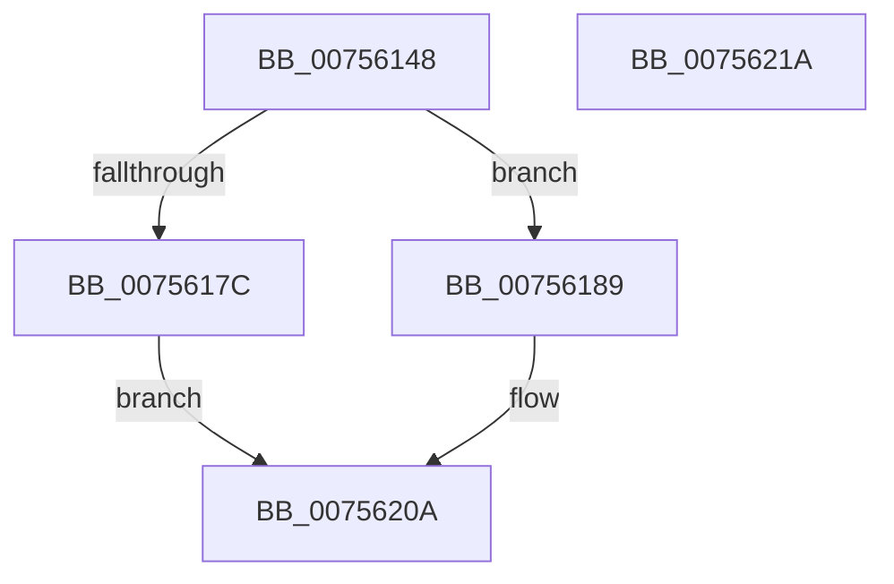

# PopDisablePowerLimitExtension

- RVA: `0x00756148`–`0x0075621B` (길이 `211` bytes)
- VA: `0x0000000140756148`
- 실행 섹션: `PAGE`
- PDB 이름 있음: `예`; PDB Function 태그: `아니요`
- unwind 정보 RVA: `0x0008A4C8`
- 디코드: `54`개 명령, `211/211` bytes 표시
- 미해석 바이트: `0` (있으면 어셈블리에 `.byte`로 보존)

> 이 문서는 커널 이미지의 기계어와 PDB 기호를 분석해 생성했습니다. 4번과 5번은 함수 원형과 자료형을 바이너리 사용 방식에서 추정한 C 해석이며 원본 소스 복구 결과는 아닙니다.

## 1. Dependencies

- 직접 호출 지점: **10**; 고유 호출 대상: **7**
- 직접 호출자로 확인된 함수: **1**
- RIP 상대 이미지 참조: **1**

### Outgoing calls
- `0x00756170` → [PopAcquireRwLockExclusive](../../text/43/PopAcquireRwLockExclusive_function_00430B44.md) (function, `0x00430B44`)
- `0x0075617F` → [PopReleaseRwLock](../../text/2D/PopReleaseRwLock_function_002DFBBC.md) (function, `0x002DFBBC`)
- `0x00756196` → [PopDiagTracePowerLimitExtension](../76/PopDiagTracePowerLimitExtension_function_0076233C.md) (function, `0x0076233C`)
- `0x007561A5` → [KeInitializeEvent](../../text/40/KeInitializeEvent_function_0040DD10.md) (function, `0x0040DD10`)
- `0x007561B9` → [PopEvaluatePowerLimitChange](PopEvaluatePowerLimitChange_function_00756224.md) (function, `0x00756224`)
- `0x007561C1` → [PopReleaseRwLock](../../text/2D/PopReleaseRwLock_function_002DFBBC.md) (function, `0x002DFBBC`)
- `0x007561D8` → [KeWaitForSingleObject](../../text/20/KeWaitForSingleObject_function_0020E6B0.md) (function, `0x0020E6B0`)
- `0x007561E0` → [PopAcquireRwLockExclusive](../../text/43/PopAcquireRwLockExclusive_function_00430B44.md) (function, `0x00430B44`)
- `0x007561FA` → [PopReleaseRwLock](../../text/2D/PopReleaseRwLock_function_002DFBBC.md) (function, `0x002DFBBC`)
- `0x00756205` → [guard_dispatch_icall](../../text/6B/guard_dispatch_icall_function_006BAAD0.md) (function, `0x006BAAD0`)

### Direct callers
- [PopPowerLimitPnpNotification](PopPowerLimitPnpNotification_function_007567C0.md) at `0x007567F7`
- [PopPowerLimitPnpNotification](PopPowerLimitPnpNotification_function_007567C0.md) at `0x0075681E`

### Static image references
- `0x00756189` → RVA `0x000210B8` (`.rdata`; read)

## 2. Other-region calls and transfers

- 다른 실행 섹션으로 향하는 call: **8**
  - `0x00756170` → [PopAcquireRwLockExclusive](../../text/43/PopAcquireRwLockExclusive_function_00430B44.md) (`PAGE` → `.text`)
  - `0x0075617F` → [PopReleaseRwLock](../../text/2D/PopReleaseRwLock_function_002DFBBC.md) (`PAGE` → `.text`)
  - `0x007561A5` → [KeInitializeEvent](../../text/40/KeInitializeEvent_function_0040DD10.md) (`PAGE` → `.text`)
  - `0x007561C1` → [PopReleaseRwLock](../../text/2D/PopReleaseRwLock_function_002DFBBC.md) (`PAGE` → `.text`)
  - `0x007561D8` → [KeWaitForSingleObject](../../text/20/KeWaitForSingleObject_function_0020E6B0.md) (`PAGE` → `.text`)
  - `0x007561E0` → [PopAcquireRwLockExclusive](../../text/43/PopAcquireRwLockExclusive_function_00430B44.md) (`PAGE` → `.text`)
  - `0x007561FA` → [PopReleaseRwLock](../../text/2D/PopReleaseRwLock_function_002DFBBC.md) (`PAGE` → `.text`)
  - `0x00756205` → [guard_dispatch_icall](../../text/6B/guard_dispatch_icall_function_006BAAD0.md) (`PAGE` → `.text`)
- 별도 외부 분기/꼬리 이동을 확인하지 못했습니다.

## 3. Assembly (complete function range)

```asm
00756148  48 89 5C 24 08                  mov qword ptr [rsp + 8], rbx
0075614D  48 89 74 24 10                  mov qword ptr [rsp + 0x10], rsi
00756152  57                              push rdi
00756153  48 83 EC 50                     sub rsp, 0x50
00756157  48 8D 71 20                     lea rsi, [rcx + 0x20]
0075615B  48 8B F9                        mov rdi, rcx
0075615E  0F 57 C0                        xorps xmm0, xmm0
00756161  33 C0                           xor eax, eax
00756163  48 8B CE                        mov rcx, rsi
00756166  48 89 44 24 40                  mov qword ptr [rsp + 0x40], rax
0075616B  0F 11 44 24 30                  movups xmmword ptr [rsp + 0x30], xmm0
00756170  E8 CF A9 CD FF                  call 0x140430b44
00756175  33 DB                           xor ebx, ebx
00756177  38 5F 30                        cmp byte ptr [rdi + 0x30], bl
0075617A  75 0D                           jne 0x140756189
0075617C  48 8B CE                        mov rcx, rsi
0075617F  E8 38 9A B8 FF                  call 0x1402dfbbc
00756184  E9 81 00 00 00                  jmp 0x14075620a
00756189  48 8D 15 28 AF 8C FF            lea rdx, [rip - 0x7350d8]
00756190  88 5F 30                        mov byte ptr [rdi + 0x30], bl
00756193  48 8B CF                        mov rcx, rdi
00756196  E8 A1 C1 00 00                  call 0x14076233c
0075619B  45 33 C0                        xor r8d, r8d
0075619E  48 8D 4C 24 30                  lea rcx, [rsp + 0x30]
007561A3  33 D2                           xor edx, edx
007561A5  E8 66 7B CB FF                  call 0x14040dd10
007561AA  48 8D 44 24 30                  lea rax, [rsp + 0x30]
007561AF  48 8B CF                        mov rcx, rdi
007561B2  48 89 87 C0 00 00 00            mov qword ptr [rdi + 0xc0], rax
007561B9  E8 66 00 00 00                  call 0x140756224
007561BE  48 8B CE                        mov rcx, rsi
007561C1  E8 F6 99 B8 FF                  call 0x1402dfbbc
007561C6  45 33 C9                        xor r9d, r9d
007561C9  48 89 5C 24 20                  mov qword ptr [rsp + 0x20], rbx
007561CE  45 33 C0                        xor r8d, r8d
007561D1  48 8D 4C 24 30                  lea rcx, [rsp + 0x30]
007561D6  33 D2                           xor edx, edx
007561D8  E8 D3 84 AB FF                  call 0x14020e6b0
007561DD  48 8B CE                        mov rcx, rsi
007561E0  E8 5F A9 CD FF                  call 0x140430b44
007561E5  48 89 9F C0 00 00 00            mov qword ptr [rdi + 0xc0], rbx
007561EC  48 8B CE                        mov rcx, rsi
007561EF  48 8B 5F 78                     mov rbx, qword ptr [rdi + 0x78]
007561F3  48 8B BF 88 00 00 00            mov rdi, qword ptr [rdi + 0x88]
007561FA  E8 BD 99 B8 FF                  call 0x1402dfbbc
007561FF  48 8B CB                        mov rcx, rbx
00756202  48 8B C7                        mov rax, rdi
00756205  E8 C6 48 F6 FF                  call 0x1406baad0
0075620A  48 8B 5C 24 60                  mov rbx, qword ptr [rsp + 0x60]
0075620F  48 8B 74 24 68                  mov rsi, qword ptr [rsp + 0x68]
00756214  48 83 C4 50                     add rsp, 0x50
00756218  5F                              pop rdi
00756219  C3                              ret
0075621A  CC                              int3
```

## 4. C-style interpretation (structured pseudocode)

```c
__int64 __fastcall PopDisablePowerLimitExtension(__int64 a1, __int64 a2, int a3, int a4)
{
    __int64 result;
    __int64 v_rbx;
    __int64 v_rsp;
    unsigned __int64 v_stack_m18;
    unsigned __int64 v_stack_m28;
    unsigned __int64 v_stack_m38;
    unsigned __int64 v_stack_p10;
    unsigned __int64 v_stack_p8;

    v_stack_p8 = v_rbx;
    v_stack_p10 = v_rsi;
    v_rsp = (v_rsp) - (80);
    result = 0;
    v_stack_m18 = 0;
    v_stack_m28 = v_xmm0;
    result = PopAcquireRwLockExclusive(a1 + 32, a2, a3, a4);
    v_rbx = 0;
    if ((*(unsigned __int8 *)(a1 + 48)) != 0) goto loc_00756189;
    result = PopReleaseRwLock(a1 + 32, a2, a3, a4);
    goto loc_0075620A;
loc_00756189:
    *(unsigned __int8 *)(a1 + 48) = 0;
    result = PopDiagTracePowerLimitExtension(a1, v_rip - 7557336, a3, a4);
    a3 = 0;
    a2 = 0;
    result = KeInitializeEvent(v_stack_m28, a2, a3, a4);
    *(unsigned __int64 *)(a1 + 192) = v_stack_m28;
    result = PopEvaluatePowerLimitChange(a1, a2, a3, a4);
    result = PopReleaseRwLock(a1 + 32, a2, a3, a4);
    a4 = 0;
    v_stack_m38 = 0;
    a3 = 0;
    a2 = 0;
    result = KeWaitForSingleObject(v_stack_m28, a2, a3, a4);
    result = PopAcquireRwLockExclusive(a1 + 32, a2, a3, a4);
    *(unsigned __int64 *)(a1 + 192) = 0;
    result = PopReleaseRwLock(a1 + 32, a2, a3, a4);
    result = guard_dispatch_icall(*(unsigned __int64 *)(a1 + 120), a2, a3, a4);
loc_0075620A:
    v_rsp = (v_rsp) + (80);
    return result;
}
```

## 5. (Beta) C Style

```c
int64_t PopDisablePowerLimitExtension(void *Arg1, int64_t Arg2, int32_t Arg3, int32_t Arg4)
{
    uint8_t *arg1 = (uint8_t *)Arg1;

    int64_t result;
    int64_t local_rbx;
    int64_t local_rsp;
    uint64_t v_stack_m18;
    uint64_t v_stack_m28;
    uint64_t v_stack_m38;
    uint64_t v_stack_p10;
    uint64_t v_stack_p8;

    v_stack_p8 = local_rbx;
    v_stack_p10 = local_rsi;
    local_rsp = (local_rsp) - (80);
    result = 0;
    v_stack_m18 = 0;
    v_stack_m28 = v_xmm0;
    result = PopAcquireRwLockExclusive(Arg1 + 32, Arg2, Arg3, Arg4);
    local_rbx = 0;
    if ((*(uint8_t *)(arg1 + 0x30)) != 0) goto loc_00756189;
    result = PopReleaseRwLock(Arg1 + 32, Arg2, Arg3, Arg4);
    goto loc_0075620A;
loc_00756189:
    *(uint8_t *)(arg1 + 0x30) = 0;
    result = PopDiagTracePowerLimitExtension(Arg1, v_rip - 7557336, Arg3, Arg4);
    Arg3 = 0;
    Arg2 = 0;
    result = KeInitializeEvent(v_stack_m28, Arg2, Arg3, Arg4);
    *(uint64_t *)(arg1 + 0xC0) = v_stack_m28;
    result = PopEvaluatePowerLimitChange(Arg1, Arg2, Arg3, Arg4);
    result = PopReleaseRwLock(Arg1 + 32, Arg2, Arg3, Arg4);
    Arg4 = 0;
    v_stack_m38 = 0;
    Arg3 = 0;
    Arg2 = 0;
    result = KeWaitForSingleObject(v_stack_m28, Arg2, Arg3, Arg4);
    result = PopAcquireRwLockExclusive(Arg1 + 32, Arg2, Arg3, Arg4);
    *(uint64_t *)(arg1 + 0xC0) = 0;
    result = PopReleaseRwLock(Arg1 + 32, Arg2, Arg3, Arg4);
    result = guard_dispatch_icall(*(uint64_t *)(arg1 + 0x78), Arg2, Arg3, Arg4);
loc_0075620A:
    local_rsp = (local_rsp) + (80);
    return result;
}
```

### 관측된 메모리 오프셋

구조체 형식이 확인되지 않은 접근은 인자 기준의 오프셋으로만 기록했습니다.

| 기준 인자 | 오프셋 표현 | 폭 (bit) | 접근 |
|---|---:|---:|---|
| `Arg1` | `+ 0x20` | `64` | `R` |
| `Arg1` | `+ 0x30` | `8` | `R` |
| `Arg1` | `+ 0x30` | `8` | `W` |
| `Arg1` | `+ 0x78` | `64` | `R` |
| `Arg1` | `+ 0x88` | `64` | `R` |
| `Arg1` | `+ 0xC0` | `64` | `W` |

## 6. Execution-region graph

[열기: 2D/3D 그래프와 함수 탐색 컨트롤 패널](../../../control-panel.html?section=page&rva=0x00756148&view=graph)

- 2D 그래프는 위에서 아래로 흐르고, 3D 그래프는 빈 공간을 드래그해 회전합니다. Shift+드래그는 이동, 휠은 확대·축소, 함수 노드 선택은 대상 보고서 이동입니다.

### Static fallback


