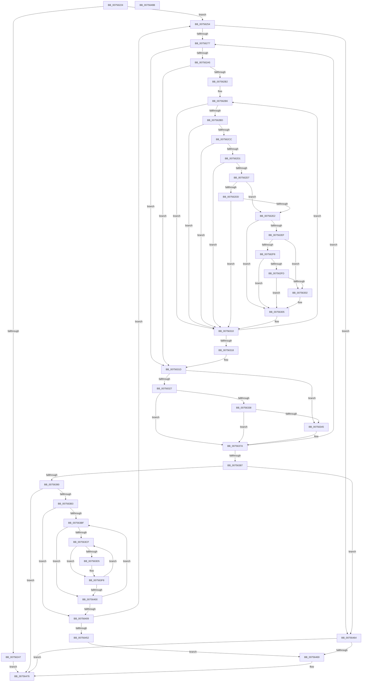

# PopEvaluatePowerLimitChange

- RVA: `0x00756224`–`0x0075648C` (길이 `616` bytes)
- VA: `0x0000000140756224`
- 실행 섹션: `PAGE`
- PDB 이름 있음: `예`; PDB Function 태그: `아니요`
- unwind 정보 RVA: `0x0008CF18`
- 디코드: `179`개 명령, `616/616` bytes 표시
- 미해석 바이트: `0` (있으면 어셈블리에 `.byte`로 보존)

> 이 문서는 커널 이미지의 기계어와 PDB 기호를 분석해 생성했습니다. 4번과 5번은 함수 원형과 자료형을 바이너리 사용 방식에서 추정한 C 해석이며 원본 소스 복구 결과는 아닙니다.

## 1. Dependencies

- 직접 호출 지점: **8**; 고유 호출 대상: **8**
- 직접 호출자로 확인된 함수: **4**
- RIP 상대 이미지 참조: **0**

### Outgoing calls
- `0x00756265` → [memset](../../text/6C/memset_function_006C6C40.md) (function, `0x006C6C40`)
- `0x007563A2` → [ExAllocatePool2](../../poolcode/B8/ExAllocatePool2_function_00B820F0.md) (function, `0x00B820F0`)
- `0x0075641C` → [PopReleaseRwLock](../../text/2D/PopReleaseRwLock_function_002DFBBC.md) (function, `0x002DFBBC`)
- `0x00756432` → [guard_dispatch_icall](../../text/6B/guard_dispatch_icall_function_006BAAD0.md) (function, `0x006BAAD0`)
- `0x0075643B` → [PopAcquireRwLockExclusive](../../text/43/PopAcquireRwLockExclusive_function_00430B44.md) (function, `0x00430B44`)
- `0x00756455` → [PopDiagTracePowerLimitExtensionValueUpdate](../76/PopDiagTracePowerLimitExtensionValueUpdate_function_00762580.md) (function, `0x00762580`)
- `0x0075645D` → [PopPowerLimitUpdatePendingEvents](PopPowerLimitUpdatePendingEvents_function_007568D4.md) (function, `0x007568D4`)
- `0x00756471` → [ExFreePoolWithTag](../../poolcode/B8/ExFreePoolWithTag_function_00B82870.md) (function, `0x00B82870`)

### Direct callers
- [PoSetPowerLimitValue](PoSetPowerLimitValue_function_00755C30.md) at `0x00755DCD`
- [PopDisablePowerLimitExtension](PopDisablePowerLimitExtension_function_00756148.md) at `0x007561B9`
- [PopFreePowerLimitRequest](PopFreePowerLimitRequest_function_00756494.md) at `0x0075653F`
- [PopPowerLimitPnpNotification](PopPowerLimitPnpNotification_function_007567C0.md) at `0x007568BA`

### Static image references
- 디코드된 RIP-relative 메모리 참조가 없습니다.

## 2. Other-region calls and transfers

- 다른 실행 섹션으로 향하는 call: **6**
  - `0x00756265` → [memset](../../text/6C/memset_function_006C6C40.md) (`PAGE` → `.text`)
  - `0x007563A2` → [ExAllocatePool2](../../poolcode/B8/ExAllocatePool2_function_00B820F0.md) (`PAGE` → `POOLCODE`)
  - `0x0075641C` → [PopReleaseRwLock](../../text/2D/PopReleaseRwLock_function_002DFBBC.md) (`PAGE` → `.text`)
  - `0x00756432` → [guard_dispatch_icall](../../text/6B/guard_dispatch_icall_function_006BAAD0.md) (`PAGE` → `.text`)
  - `0x0075643B` → [PopAcquireRwLockExclusive](../../text/43/PopAcquireRwLockExclusive_function_00430B44.md) (`PAGE` → `.text`)
  - `0x00756471` → [ExFreePoolWithTag](../../poolcode/B8/ExFreePoolWithTag_function_00B82870.md) (`PAGE` → `POOLCODE`)
- 별도 외부 분기/꼬리 이동을 확인하지 못했습니다.

## 3. Assembly (complete function range)

```asm
00756224  48 89 5C 24 20                  mov qword ptr [rsp + 0x20], rbx
00756229  55                              push rbp
0075622A  56                              push rsi
0075622B  57                              push rdi
0075622C  41 54                           push r12
0075622E  41 55                           push r13
00756230  41 56                           push r14
00756232  41 57                           push r15
00756234  48 83 EC 20                     sub rsp, 0x20
00756238  8B 81 B0 00 00 00               mov eax, dword ptr [rcx + 0xb0]
0075623E  33 ED                           xor ebp, ebp
00756240  48 8B F1                        mov rsi, rcx
00756243  85 C0                           test eax, eax
00756245  74 0D                           je 0x140756254
00756247  FF C0                           inc eax
00756249  89 81 B0 00 00 00               mov dword ptr [rcx + 0xb0], eax
0075624F  E9 22 02 00 00                  jmp 0x140756476
00756254  44 8B 46 60                     mov r8d, dword ptr [rsi + 0x60]
00756258  33 D2                           xor edx, edx
0075625A  48 8B 4E 68                     mov rcx, qword ptr [rsi + 0x68]
0075625E  45 33 ED                        xor r13d, r13d
00756261  49 C1 E0 03                     shl r8, 3
00756265  E8 D6 09 F7 FF                  call 0x1406c6c40
0075626A  45 33 C9                        xor r9d, r9d
0075626D  44 39 4E 48                     cmp dword ptr [rsi + 0x48], r9d
00756271  0F 86 ED 01 00 00               jbe 0x140756464
00756277  48 8B 7E 58                     mov rdi, qword ptr [rsi + 0x58]
0075627B  41 83 CA FF                     or r10d, 0xffffffff
0075627F  41 8B D1                        mov edx, r9d
00756282  45 0B FA                        or r15d, r10d
00756285  48 03 D2                        add rdx, rdx
00756288  45 8B D9                        mov r11d, r9d
0075628B  80 7E 30 00                     cmp byte ptr [rsi + 0x30], 0
0075628F  48 89 7C 24 70                  mov qword ptr [rsp + 0x70], rdi
00756294  8B 04 D7                        mov eax, dword ptr [rdi + rdx*8]
00756297  8B 4C D7 04                     mov ecx, dword ptr [rdi + rdx*8 + 4]
0075629B  89 44 24 60                     mov dword ptr [rsp + 0x60], eax
0075629F  89 4C 24 68                     mov dword ptr [rsp + 0x68], ecx
007562A3  74 78                           je 0x14075631d
007562A5  4C 8D 66 10                     lea r12, [rsi + 0x10]
007562A9  4D 8B 04 24                     mov r8, qword ptr [r12]
007562AD  4D 3B C4                        cmp r8, r12
007562B0  74 6B                           je 0x14075631d
007562B2  4B 8D 3C C9                     lea rdi, [r9 + r9*8]
007562B6  41 80 78 10 00                  cmp byte ptr [r8 + 0x10], 0
007562BB  74 53                           je 0x140756310
007562BD  49 8B 58 28                     mov rbx, qword ptr [r8 + 0x28]
007562C1  44 8B 74 D3 08                  mov r14d, dword ptr [rbx + rdx*8 + 8]
007562C6  41 83 FE FF                     cmp r14d, -1
007562CA  74 44                           je 0x140756310
007562CC  39 04 D3                        cmp dword ptr [rbx + rdx*8], eax
007562CF  75 3F                           jne 0x140756310
007562D1  39 4C D3 04                     cmp dword ptr [rbx + rdx*8 + 4], ecx
007562D5  75 39                           jne 0x140756310
007562D7  41 83 FA FF                     cmp r10d, -1
007562DB  74 05                           je 0x1407562e2
007562DD  45 3B F2                        cmp r14d, r10d
007562E0  77 2E                           ja 0x140756310
007562E2  48 8B 46 50                     mov rax, qword ptr [rsi + 0x50]
007562E6  8B 4C B8 20                     mov ecx, dword ptr [rax + rdi*4 + 0x20]
007562EA  F6 C1 01                        test cl, 1
007562ED  74 16                           je 0x140756305
007562EF  8B 44 D3 0C                     mov eax, dword ptr [rbx + rdx*8 + 0xc]
007562F3  45 3B F2                        cmp r14d, r10d
007562F6  75 0A                           jne 0x140756302
007562F8  83 F8 FF                        cmp eax, -1
007562FB  74 08                           je 0x140756305
007562FD  44 3B F8                        cmp r15d, eax
00756300  72 03                           jb 0x140756305
00756302  44 8B F8                        mov r15d, eax
00756305  8B 44 24 60                     mov eax, dword ptr [rsp + 0x60]
00756309  45 8B D6                        mov r10d, r14d
0075630C  8B 4C 24 68                     mov ecx, dword ptr [rsp + 0x68]
00756310  4D 8B 00                        mov r8, qword ptr [r8]
00756313  4D 3B C4                        cmp r8, r12
00756316  75 9E                           jne 0x1407562b6
00756318  48 8B 7C 24 70                  mov rdi, qword ptr [rsp + 0x70]
0075631D  4D 03 DB                        add r11, r11
00756320  46 39 54 DF 08                  cmp dword ptr [rdi + r11*8 + 8], r10d
00756325  75 1E                           jne 0x140756345
00756327  48 8B 46 50                     mov rax, qword ptr [rsi + 0x50]
0075632B  4B 8D 0C C9                     lea rcx, [r9 + r9*8]
0075632F  8B 4C 88 20                     mov ecx, dword ptr [rax + rcx*4 + 0x20]
00756333  F6 C1 01                        test cl, 1
00756336  74 42                           je 0x14075637a
00756338  41 8B C1                        mov eax, r9d
0075633B  48 03 C0                        add rax, rax
0075633E  44 39 7C C7 0C                  cmp dword ptr [rdi + rax*8 + 0xc], r15d
00756343  74 35                           je 0x14075637a
00756345  46 89 54 DF 08                  mov dword ptr [rdi + r11*8 + 8], r10d
0075634A  41 FF C5                        inc r13d
0075634D  48 8B 46 58                     mov rax, qword ptr [rsi + 0x58]
00756351  45 8B C1                        mov r8d, r9d
00756354  41 8B C9                        mov ecx, r9d
00756357  41 83 E0 3F                     and r8d, 0x3f
0075635B  48 03 C9                        add rcx, rcx
0075635E  41 8B D1                        mov edx, r9d
00756361  48 C1 EA 06                     shr rdx, 6
00756365  44 89 7C C8 0C                  mov dword ptr [rax + rcx*8 + 0xc], r15d
0075636A  48 8B 4E 68                     mov rcx, qword ptr [rsi + 0x68]
0075636E  48 8B 04 D1                     mov rax, qword ptr [rcx + rdx*8]
00756372  4C 0F AB C0                     bts rax, r8
00756376  48 89 04 D1                     mov qword ptr [rcx + rdx*8], rax
0075637A  41 FF C1                        inc r9d
0075637D  44 3B 4E 48                     cmp r9d, dword ptr [rsi + 0x48]
00756381  0F 82 F0 FE FF FF               jb 0x140756277
00756387  45 85 ED                        test r13d, r13d
0075638A  0F 84 D4 00 00 00               je 0x140756464
00756390  41 8B D5                        mov edx, r13d
00756393  B9 00 01 00 00                  mov ecx, 0x100
00756398  48 C1 E2 04                     shl rdx, 4
0075639C  41 B8 50 50 6C 6D               mov r8d, 0x6d6c5050
007563A2  E8 49 BD 42 00                  call 0x140b820f0
007563A7  48 8B E8                        mov rbp, rax
007563AA  48 85 C0                        test rax, rax
007563AD  0F 84 C3 00 00 00               je 0x140756476
007563B3  45 33 DB                        xor r11d, r11d
007563B6  45 33 C9                        xor r9d, r9d
007563B9  44 39 4E 60                     cmp dword ptr [rsi + 0x60], r9d
007563BD  76 4A                           jbe 0x140756409
007563BF  48 8B 4E 68                     mov rcx, qword ptr [rsi + 0x68]
007563C3  45 33 D2                        xor r10d, r10d
007563C6  4E 8B 04 C9                     mov r8, qword ptr [rcx + r9*8]
007563CA  4D 85 C0                        test r8, r8
007563CD  74 31                           je 0x140756400
007563CF  41 F6 C0 01                     test r8b, 1
007563D3  74 23                           je 0x1407563f8
007563D5  48 8B 46 58                     mov rax, qword ptr [rsi + 0x58]
007563D9  41 8B D1                        mov edx, r9d
007563DC  C1 E2 06                        shl edx, 6
007563DF  41 03 D2                        add edx, r10d
007563E2  41 8B CB                        mov ecx, r11d
007563E5  48 03 D2                        add rdx, rdx
007563E8  48 03 C9                        add rcx, rcx
007563EB  41 FF C3                        inc r11d
007563EE  0F 10 04 D0                     movups xmm0, xmmword ptr [rax + rdx*8]
007563F2  F3 0F 7F 44 CD 00               movdqu xmmword ptr [rbp + rcx*8], xmm0
007563F8  41 FF C2                        inc r10d
007563FB  49 D1 E8                        shr r8, 1
007563FE  75 CF                           jne 0x1407563cf
00756400  41 FF C1                        inc r9d
00756403  44 3B 4E 60                     cmp r9d, dword ptr [rsi + 0x60]
00756407  72 B6                           jb 0x1407563bf
00756409  8B BE B0 00 00 00               mov edi, dword ptr [rsi + 0xb0]
0075640F  48 8D 4E 20                     lea rcx, [rsi + 0x20]
00756413  8D 47 01                        lea eax, [rdi + 1]
00756416  89 86 B0 00 00 00               mov dword ptr [rsi + 0xb0], eax
0075641C  E8 9B 97 B8 FF                  call 0x1402dfbbc
00756421  48 8B 86 A0 00 00 00            mov rax, qword ptr [rsi + 0xa0]
00756428  4C 8B C5                        mov r8, rbp
0075642B  48 8B 4E 78                     mov rcx, qword ptr [rsi + 0x78]
0075642F  41 8B D5                        mov edx, r13d
00756432  E8 99 46 F6 FF                  call 0x1406baad0
00756437  48 8D 4E 20                     lea rcx, [rsi + 0x20]
0075643B  E8 04 A7 CD FF                  call 0x140430b44
00756440  FF 8E B0 00 00 00               dec dword ptr [rsi + 0xb0]
00756446  39 BE B0 00 00 00               cmp dword ptr [rsi + 0xb0], edi
0075644C  0F 85 02 FE FF FF               jne 0x140756254
00756452  48 8B CE                        mov rcx, rsi
00756455  E8 26 C1 00 00                  call 0x140762580
0075645A  48 8B CE                        mov rcx, rsi
0075645D  E8 72 04 00 00                  call 0x1407568d4
00756462  EB 05                           jmp 0x140756469
00756464  48 85 ED                        test rbp, rbp
00756467  74 0D                           je 0x140756476
00756469  BA 50 50 6C 6D                  mov edx, 0x6d6c5050
0075646E  48 8B CD                        mov rcx, rbp
00756471  E8 FA C3 42 00                  call 0x140b82870
00756476  48 8B 5C 24 78                  mov rbx, qword ptr [rsp + 0x78]
0075647B  48 83 C4 20                     add rsp, 0x20
0075647F  41 5F                           pop r15
00756481  41 5E                           pop r14
00756483  41 5D                           pop r13
00756485  41 5C                           pop r12
00756487  5F                              pop rdi
00756488  5E                              pop rsi
00756489  5D                              pop rbp
0075648A  C3                              ret
0075648B  CC                              int3
```

## 4. C-style interpretation (structured pseudocode)

```c
__int64 __fastcall PopEvaluatePowerLimitChange(__int64 a1, int a2, __int64 a3, int a4)
{
    __int64 result;
    __int64 v_r10;
    __int64 v_r11;
    __int64 v_r13;
    __int64 v_r15;
    __int64 v_rbp;
    __int64 v_rsp;
    unsigned int v_stack_p10;
    unsigned __int64 v_stack_p18;
    unsigned __int64 v_stack_p20;
    unsigned int v_stack_p8;

    v_stack_p20 = v_rbx;
    v_rsp = (v_rsp) - (32);
    v_rbp = 0;
    if ((unsigned int)((unsigned int)(*(unsigned int *)(a1 + 176))) == 0) goto loc_00756254;
    result = (unsigned int)(((unsigned int)(*(unsigned int *)(a1 + 176))) + 1);
    *(unsigned int *)(a1 + 176) = (unsigned int)(result);
    goto loc_00756476;
loc_00756254:
    a2 = 0;
    v_r13 = 0;
    a3 = ((unsigned int)(*(unsigned int *)(a1 + 96))) << (3);
    result = memset(*(unsigned __int64 *)(a1 + 104), a2, a3, a4);
    a4 = 0;
    if ((*(unsigned int *)(a1 + 72)) <= 0) goto loc_00756464;
loc_00756277:
    v_r10 = (unsigned int)((v_r10) | (0xFFFFFFFFULL));
    v_r15 = (unsigned int)((v_r15) | ((unsigned int)(v_r10)));
    a2 = (0) + (0);
    v_stack_p18 = *(unsigned __int64 *)(a1 + 88);
    v_stack_p8 = (unsigned int)((unsigned int)(*(unsigned int *)(*(unsigned __int64 *)(a1 + 88) + a2 * 8)));
    v_stack_p10 = (unsigned int)((unsigned int)(*(unsigned int *)(*(unsigned __int64 *)(a1 + 88) + a2 * 8 + 4)));
    if ((*(unsigned __int8 *)(a1 + 48)) == 0) goto loc_0075631D;
    if ((*(unsigned __int64 *)(a1 + 16)) == (a1 + 16)) goto loc_0075631D;
loc_007562B6:
    if ((*(unsigned __int8 *)(*(unsigned __int64 *)(a1 + 16) + 16)) == 0) goto loc_00756310;
    if (((unsigned int)((unsigned int)(*(unsigned int *)(*(unsigned __int64 *)(*(unsigned __int64 *)(a1 + 16) + 40) + a2 * 8 + 8)))) == -1) goto loc_00756310;
    if ((*(unsigned int *)(*(unsigned __int64 *)(*(unsigned __int64 *)(a1 + 16) + 40) + a2 * 8)) != ((unsigned int)((unsigned int)(*(unsigned int *)(*(unsigned __int64 *)(a1 + 88) + a2 * 8))))) goto loc_00756310;
    if ((*(unsigned int *)(*(unsigned __int64 *)(*(unsigned __int64 *)(a1 + 16) + 40) + a2 * 8 + 4)) != ((unsigned int)((unsigned int)(*(unsigned int *)(*(unsigned __int64 *)(a1 + 88) + a2 * 8 + 4))))) goto loc_00756310;
    if (((unsigned int)(v_r10)) == -1) goto loc_007562E2;
    if (((unsigned int)((unsigned int)(*(unsigned int *)(*(unsigned __int64 *)(*(unsigned __int64 *)(a1 + 16) + 40) + a2 * 8 + 8)))) > ((unsigned int)(v_r10))) goto loc_00756310;
loc_007562E2:
    if ((((unsigned __int8)((unsigned int)(*(unsigned int *)(*(unsigned __int64 *)(a1 + 80) + a4 + a4 * 8 * 4 + 32)))) & (1)) == 0) goto loc_00756305;
    if (((unsigned int)((unsigned int)(*(unsigned int *)(*(unsigned __int64 *)(*(unsigned __int64 *)(a1 + 16) + 40) + a2 * 8 + 8)))) != ((unsigned int)(v_r10))) goto loc_00756302;
    if (((unsigned int)((unsigned int)(*(unsigned int *)(*(unsigned __int64 *)(*(unsigned __int64 *)(a1 + 16) + 40) + a2 * 8 + 12)))) == -1) goto loc_00756305;
    if (((unsigned int)(v_r15)) >= ((unsigned int)((unsigned int)(*(unsigned int *)(*(unsigned __int64 *)(*(unsigned __int64 *)(a1 + 16) + 40) + a2 * 8 + 12))))) {
        v_r15 = (unsigned int)((unsigned int)(*(unsigned int *)(*(unsigned __int64 *)(*(unsigned __int64 *)(a1 + 16) + 40) + a2 * 8 + 12)));
    }
loc_00756310:
    if ((*(unsigned __int64 *)(*(unsigned __int64 *)(a1 + 16))) != (a1 + 16)) goto loc_007562B6;
loc_0075631D:
    v_r11 = (0) + (0);
    if ((*(unsigned int *)(v_stack_p18 + v_r11 * 8 + 8)) != ((unsigned int)((unsigned int)((unsigned int)((unsigned int)(*(unsigned int *)(*(unsigned __int64 *)(*(unsigned __int64 *)(a1 + 16) + 40) + a2 * 8 + 8))))))) goto loc_00756345;
    if ((((unsigned __int8)((unsigned int)(*(unsigned int *)(*(unsigned __int64 *)(a1 + 80) + a4 + a4 * 8 * 4 + 32)))) & (1)) == 0) goto loc_0075637A;
    result = (0) + (0);
    if ((*(unsigned int *)(v_stack_p18 + result * 8 + 12)) != ((unsigned int)(v_r15))) {
        *(unsigned int *)(v_stack_p18 + v_r11 * 8 + 8) = (unsigned int)((unsigned int)((unsigned int)((unsigned int)(*(unsigned int *)(*(unsigned __int64 *)(*(unsigned __int64 *)(a1 + 16) + 40) + a2 * 8 + 8)))));
        v_r13 = (unsigned int)((v_r13) + 1);
        result = *(unsigned __int64 *)(a1 + 88);
        a3 = 0;
        a1 = 0;
        a3 = (unsigned int)((a3) & (63));
        a1 = (a1) + (a1);
        a2 = 0;
        a2 = (a2) >> (6);
        *(unsigned int *)(result + a1 * 8 + 12) = (unsigned int)(v_r15);
        a1 = *(unsigned __int64 *)(a1 + 104);
        result = *(unsigned __int64 *)(a1 + a2 * 8);
        *(unsigned __int64 *)(a1 + a2 * 8) = result;
    }
    a4 = (unsigned int)((a4) + 1);
    if (a4 < (*(unsigned int *)(a1 + 72))) goto loc_00756277;
    if ((unsigned int)(v_r13) == 0) goto loc_00756464;
    a2 = ((unsigned int)((unsigned int)(v_r13))) << (4);
    result = ExAllocatePool2(256, a2, (unsigned int)(0x6D6C5050ULL), a4);
    if (result == 0) goto loc_00756476;
    v_r11 = 0;
    a4 = 0;
    if ((*(unsigned int *)(a1 + 96)) <= 0) goto loc_00756409;
loc_007563BF:
    v_r10 = 0;
    if (*(unsigned __int64 *)(*(unsigned __int64 *)(a1 + 104) + a4 * 8) == 0) goto loc_00756400;
loc_007563CF:
    if ((((unsigned __int8)(*(unsigned __int64 *)(*(unsigned __int64 *)(a1 + 104) + a4 * 8))) & (1)) != 0) {
        result = *(unsigned __int64 *)(a1 + 88);
        a2 = 0;
        a2 = (unsigned int)((a2) << (6));
        a2 = (unsigned int)((a2) + (0));
        a1 = 0;
        a2 = (a2) + (a2);
        a1 = (a1) + (a1);
        v_r11 = (unsigned int)((v_r11) + 1);
        *(unsigned __int64 *)(result + a1 * 8) = v_xmm0;
    }
    v_r10 = (unsigned int)((v_r10) + 1);
    a3 = (*(unsigned __int64 *)(*(unsigned __int64 *)(a1 + 104) + a4 * 8)) >> (1);
    if (condition_is_not_equal) goto loc_007563CF;
loc_00756400:
    a4 = (unsigned int)((a4) + 1);
    if (a4 < (*(unsigned int *)(a1 + 96))) goto loc_007563BF;
loc_00756409:
    *(unsigned int *)(a1 + 176) = (unsigned int)((unsigned int)(*(unsigned int *)(a1 + 176)) + 1);
    result = PopReleaseRwLock(a1 + 32, a2, a3, a4);
    result = guard_dispatch_icall(*(unsigned __int64 *)(a1 + 120), (unsigned int)((unsigned int)(v_r13)), result, a4);
    result = PopAcquireRwLockExclusive(a1 + 32, (unsigned int)((unsigned int)(v_r13)), result, a4);
    if ((*(unsigned int *)(a1 + 176)) != ((unsigned int)((unsigned int)(*(unsigned int *)(a1 + 176))))) goto loc_00756254;
    result = PopDiagTracePowerLimitExtensionValueUpdate(a1, (unsigned int)((unsigned int)(v_r13)), result, a4);
    result = PopPowerLimitUpdatePendingEvents(a1, (unsigned int)((unsigned int)(v_r13)), result, a4);
    goto loc_00756469;
loc_00756464:
    if (result != 0) {
        a2 = 0x6D6C5050ULL;
        a1 = result;
        result = ExFreePoolWithTag(a1, a2, result, a4);
    }
    v_rsp = (v_rsp) + (32);
    return result;
}
```

## 5. (Beta) C Style

```c
int64_t PopEvaluatePowerLimitChange(void *Arg1, int32_t Arg2, int64_t Arg3, int32_t Arg4)
{
    uint8_t *arg1 = (uint8_t *)Arg1;

    int64_t result;
    int64_t local_r10;
    int64_t local_r11;
    int64_t local_r13;
    int64_t local_r15;
    int64_t local_rbp;
    int64_t local_rsp;
    uint32_t v_stack_p10;
    uint64_t v_stack_p18;
    uint64_t v_stack_p20;
    uint32_t v_stack_p8;

    v_stack_p20 = local_rbx;
    local_rsp = (local_rsp) - (32);
    local_rbp = 0;
    if ((uint32_t)((uint32_t)(*(uint32_t *)(arg1 + 0xB0))) == 0) goto loc_00756254;
    result = (uint32_t)(((uint32_t)(*(uint32_t *)(arg1 + 0xB0))) + 1);
    *(uint32_t *)(arg1 + 0xB0) = (uint32_t)(result);
    goto loc_00756476;
loc_00756254:
    Arg2 = 0;
    local_r13 = 0;
    Arg3 = ((uint32_t)(*(uint32_t *)(arg1 + 0x60))) << (3);
    result = memset(*(uint64_t *)(arg1 + 0x68), Arg2, Arg3, Arg4);
    Arg4 = 0;
    if ((*(uint32_t *)(arg1 + 0x48)) <= 0) goto loc_00756464;
loc_00756277:
    local_r10 = (uint32_t)((local_r10) | (0xFFFFFFFFULL));
    local_r15 = (uint32_t)((local_r15) | ((uint32_t)(local_r10)));
    Arg2 = (0) + (0);
    v_stack_p18 = *(uint64_t *)(arg1 + 0x58);
    v_stack_p8 = (uint32_t)((uint32_t)(*(uint32_t *)(*(uint64_t *)(arg1 + 0x58) + Arg2 * 8)));
    v_stack_p10 = (uint32_t)((uint32_t)(*(uint32_t *)(*(uint64_t *)(arg1 + 0x58) + Arg2 * 8 + 0x4)));
    if ((*(uint8_t *)(arg1 + 0x30)) == 0) goto loc_0075631D;
    if ((*(uint64_t *)(arg1 + 0x10)) == (Arg1 + 16)) goto loc_0075631D;
loc_007562B6:
    if ((*(uint8_t *)(*(uint64_t *)(arg1 + 0x10) + 0x10)) == 0) goto loc_00756310;
    if (((uint32_t)((uint32_t)(*(uint32_t *)(*(uint64_t *)(*(uint64_t *)(arg1 + 0x10) + 0x28) + Arg2 * 8 + 0x8)))) == -1) goto loc_00756310;
    if ((*(uint32_t *)(*(uint64_t *)(*(uint64_t *)(arg1 + 0x10) + 0x28) + Arg2 * 8)) != ((uint32_t)((uint32_t)(*(uint32_t *)(*(uint64_t *)(arg1 + 0x58) + Arg2 * 8))))) goto loc_00756310;
    if ((*(uint32_t *)(*(uint64_t *)(*(uint64_t *)(arg1 + 0x10) + 0x28) + Arg2 * 8 + 0x4)) != ((uint32_t)((uint32_t)(*(uint32_t *)(*(uint64_t *)(arg1 + 0x58) + Arg2 * 8 + 0x4))))) goto loc_00756310;
    if (((uint32_t)(local_r10)) == -1) goto loc_007562E2;
    if (((uint32_t)((uint32_t)(*(uint32_t *)(*(uint64_t *)(*(uint64_t *)(arg1 + 0x10) + 0x28) + Arg2 * 8 + 0x8)))) > ((uint32_t)(local_r10))) goto loc_00756310;
loc_007562E2:
    if ((((uint8_t)((uint32_t)(*(uint32_t *)(*(uint64_t *)(arg1 + 0x50) + Arg4 + Arg4 * 8 * 4 + 0x20)))) & (1)) == 0) goto loc_00756305;
    if (((uint32_t)((uint32_t)(*(uint32_t *)(*(uint64_t *)(*(uint64_t *)(arg1 + 0x10) + 0x28) + Arg2 * 8 + 0x8)))) != ((uint32_t)(local_r10))) goto loc_00756302;
    if (((uint32_t)((uint32_t)(*(uint32_t *)(*(uint64_t *)(*(uint64_t *)(arg1 + 0x10) + 0x28) + Arg2 * 8 + 0xC)))) == -1) goto loc_00756305;
    if (((uint32_t)(local_r15)) >= ((uint32_t)((uint32_t)(*(uint32_t *)(*(uint64_t *)(*(uint64_t *)(arg1 + 0x10) + 0x28) + Arg2 * 8 + 0xC))))) {
        local_r15 = (uint32_t)((uint32_t)(*(uint32_t *)(*(uint64_t *)(*(uint64_t *)(arg1 + 0x10) + 0x28) + Arg2 * 8 + 0xC)));
    }
loc_00756310:
    if ((*(uint64_t *)(*(uint64_t *)(arg1 + 0x10))) != (Arg1 + 16)) goto loc_007562B6;
loc_0075631D:
    local_r11 = (0) + (0);
    if ((*(uint32_t *)(v_stack_p18 + local_r11 * 8 + 0x8)) != ((uint32_t)((uint32_t)((uint32_t)((uint32_t)(*(uint32_t *)(*(uint64_t *)(*(uint64_t *)(arg1 + 0x10) + 0x28) + Arg2 * 8 + 0x8))))))) goto loc_00756345;
    if ((((uint8_t)((uint32_t)(*(uint32_t *)(*(uint64_t *)(arg1 + 0x50) + Arg4 + Arg4 * 8 * 4 + 0x20)))) & (1)) == 0) goto loc_0075637A;
    result = (0) + (0);
    if ((*(uint32_t *)(v_stack_p18 + result * 8 + 0xC)) != ((uint32_t)(local_r15))) {
        *(uint32_t *)(v_stack_p18 + local_r11 * 8 + 0x8) = (uint32_t)((uint32_t)((uint32_t)((uint32_t)(*(uint32_t *)(*(uint64_t *)(*(uint64_t *)(arg1 + 0x10) + 0x28) + Arg2 * 8 + 0x8)))));
        local_r13 = (uint32_t)((local_r13) + 1);
        result = *(uint64_t *)(arg1 + 0x58);
        Arg3 = 0;
        Arg1 = 0;
        Arg3 = (uint32_t)((Arg3) & (63));
        Arg1 = (Arg1) + (Arg1);
        Arg2 = 0;
        Arg2 = (Arg2) >> (6);
        *(uint32_t *)(result + arg1 * 8 + 0xC) = (uint32_t)(local_r15);
        Arg1 = *(uint64_t *)(arg1 + 0x68);
        result = *(uint64_t *)(arg1 + Arg2 * 8);
        *(uint64_t *)(arg1 + Arg2 * 8) = result;
    }
    Arg4 = (uint32_t)((Arg4) + 1);
    if (Arg4 < (*(uint32_t *)(arg1 + 0x48))) goto loc_00756277;
    if ((uint32_t)(local_r13) == 0) goto loc_00756464;
    Arg2 = ((uint32_t)((uint32_t)(local_r13))) << (4);
    result = ExAllocatePool2(256, Arg2, (uint32_t)(0x6D6C5050ULL), Arg4);
    if (result == 0) goto loc_00756476;
    local_r11 = 0;
    Arg4 = 0;
    if ((*(uint32_t *)(arg1 + 0x60)) <= 0) goto loc_00756409;
loc_007563BF:
    local_r10 = 0;
    if (*(uint64_t *)(*(uint64_t *)(arg1 + 0x68) + Arg4 * 8) == 0) goto loc_00756400;
loc_007563CF:
    if ((((uint8_t)(*(uint64_t *)(*(uint64_t *)(arg1 + 0x68) + Arg4 * 8))) & (1)) != 0) {
        result = *(uint64_t *)(arg1 + 0x58);
        Arg2 = 0;
        Arg2 = (uint32_t)((Arg2) << (6));
        Arg2 = (uint32_t)((Arg2) + (0));
        Arg1 = 0;
        Arg2 = (Arg2) + (Arg2);
        Arg1 = (Arg1) + (Arg1);
        local_r11 = (uint32_t)((local_r11) + 1);
        *(uint64_t *)(result + arg1 * 8) = v_xmm0;
    }
    local_r10 = (uint32_t)((local_r10) + 1);
    Arg3 = (*(uint64_t *)(*(uint64_t *)(arg1 + 0x68) + Arg4 * 8)) >> (1);
    if (condition_is_not_equal) goto loc_007563CF;
loc_00756400:
    Arg4 = (uint32_t)((Arg4) + 1);
    if (Arg4 < (*(uint32_t *)(arg1 + 0x60))) goto loc_007563BF;
loc_00756409:
    *(uint32_t *)(arg1 + 0xB0) = (uint32_t)((uint32_t)(*(uint32_t *)(arg1 + 0xB0)) + 1);
    result = PopReleaseRwLock(Arg1 + 32, Arg2, Arg3, Arg4);
    result = guard_dispatch_icall(*(uint64_t *)(arg1 + 0x78), (uint32_t)((uint32_t)(local_r13)), result, Arg4);
    result = PopAcquireRwLockExclusive(Arg1 + 32, (uint32_t)((uint32_t)(local_r13)), result, Arg4);
    if ((*(uint32_t *)(arg1 + 0xB0)) != ((uint32_t)((uint32_t)(*(uint32_t *)(arg1 + 0xB0))))) goto loc_00756254;
    result = PopDiagTracePowerLimitExtensionValueUpdate(Arg1, (uint32_t)((uint32_t)(local_r13)), result, Arg4);
    result = PopPowerLimitUpdatePendingEvents(Arg1, (uint32_t)((uint32_t)(local_r13)), result, Arg4);
    goto loc_00756469;
loc_00756464:
    if (result != 0) {
        Arg2 = 0x6D6C5050ULL;
        Arg1 = result;
        result = ExFreePoolWithTag(Arg1, Arg2, result, Arg4);
    }
    local_rsp = (local_rsp) + (32);
    return result;
}
```

### 관측된 메모리 오프셋

구조체 형식이 확인되지 않은 접근은 인자 기준의 오프셋으로만 기록했습니다.

| 기준 인자 | 오프셋 표현 | 폭 (bit) | 접근 |
|---|---:|---:|---|
| `Arg1` | `+ 0x0` | `64` | `R` |
| `Arg1` | `+ 0x10` | `64` | `R` |
| `Arg1` | `+ 0x20` | `64` | `R` |
| `Arg1` | `+ 0x30` | `8` | `R` |
| `Arg1` | `+ 0x48` | `32` | `R` |
| `Arg1` | `+ 0x50` | `64` | `R` |
| `Arg1` | `+ 0x58` | `64` | `R` |
| `Arg1` | `+ 0x60` | `32` | `R` |
| `Arg1` | `+ 0x68` | `64` | `R` |
| `Arg1` | `+ 0x78` | `64` | `R` |
| `Arg1` | `+ 0xA0` | `64` | `R` |
| `Arg1` | `+ 0xB0` | `32` | `R` |
| `Arg1` | `+ 0xB0` | `32` | `R/W` |
| `Arg1` | `+ 0xB0` | `32` | `W` |

## 6. Execution-region graph

[열기: 2D/3D 그래프와 함수 탐색 컨트롤 패널](../../../control-panel.html?section=page&rva=0x00756224&view=graph)

- 2D 그래프는 위에서 아래로 흐르고, 3D 그래프는 빈 공간을 드래그해 회전합니다. Shift+드래그는 이동, 휠은 확대·축소, 함수 노드 선택은 대상 보고서 이동입니다.

### Static fallback


