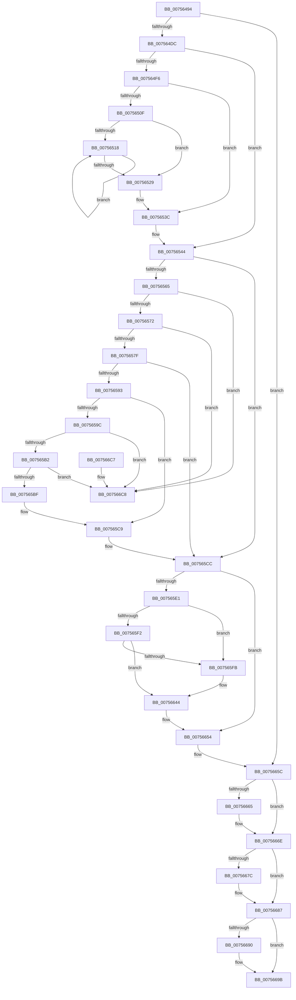

# PopFreePowerLimitRequest

- RVA: `0x00756494`–`0x007566CF` (길이 `571` bytes)
- VA: `0x0000000140756494`
- 실행 섹션: `PAGE`
- PDB 이름 있음: `예`; PDB Function 태그: `아니요`
- unwind 정보 RVA: `0x000C588C`
- 디코드: `155`개 명령, `571/571` bytes 표시
- 미해석 바이트: `0` (있으면 어셈블리에 `.byte`로 보존)

> 이 문서는 커널 이미지의 기계어와 PDB 기호를 분석해 생성했습니다. 4번과 5번은 함수 원형과 자료형을 바이너리 사용 방식에서 추정한 C 해석이며 원본 소스 복구 결과는 아닙니다.

## 1. Dependencies

- 직접 호출 지점: **27**; 고유 호출 대상: **13**
- 직접 호출자로 확인된 함수: **2**
- RIP 상대 이미지 참조: **2**

### Outgoing calls
- `0x007564C7` → [PopAcquireRwLockExclusive](../../text/43/PopAcquireRwLockExclusive_function_00430B44.md) (function, `0x00430B44`)
- `0x007564DF` → [PopReleaseRwLock](../../text/2D/PopReleaseRwLock_function_002DFBBC.md) (function, `0x002DFBBC`)
- `0x007564EB` → [PopAcquireRwLockExclusive](../../text/43/PopAcquireRwLockExclusive_function_00430B44.md) (function, `0x00430B44`)
- `0x00756504` → [PopDiagTracePowerLimitRequest](../76/PopDiagTracePowerLimitRequest_function_007626D0.md) (function, `0x007626D0`)
- `0x0075651D` → [PopUpdatePowerLimitTimeTracking](../../text/5D/PopUpdatePowerLimitTimeTracking_function_005D0F6C.md) (function, `0x005D0F6C`)
- `0x0075652C` → [PopTracePowerLimitHistogram](../../text/5D/PopTracePowerLimitHistogram_function_005D7B10.md) (function, `0x005D7B10`)
- `0x00756533` → [PopThermalUpdateTelemetryClientCount](../../text/5D/PopThermalUpdateTelemetryClientCount_function_005D58C4.md) (function, `0x005D58C4`)
- `0x0075653F` → [PopEvaluatePowerLimitChange](PopEvaluatePowerLimitChange_function_00756224.md) (function, `0x00756224`)
- `0x00756547` → [PopReleaseRwLock](../../text/2D/PopReleaseRwLock_function_002DFBBC.md) (function, `0x002DFBBC`)
- `0x00756552` → [PopAcquireRwLockExclusive](../../text/43/PopAcquireRwLockExclusive_function_00430B44.md) (function, `0x00430B44`)
- `0x0075655A` → [PopAcquireRwLockExclusive](../../text/43/PopAcquireRwLockExclusive_function_00430B44.md) (function, `0x00430B44`)
- `0x0075659C` → [PopGetDope](../../text/4C/PopGetDope_function_004CB77C.md) (function, `0x004CB77C`)
- `0x007565CF` → [PopReleaseRwLock](../../text/2D/PopReleaseRwLock_function_002DFBBC.md) (function, `0x002DFBBC`)
- `0x007565D7` → [PopReleaseRwLock](../../text/2D/PopReleaseRwLock_function_002DFBBC.md) (function, `0x002DFBBC`)
- `0x007565E4` → [PopAcquireRwLockExclusive](../../text/43/PopAcquireRwLockExclusive_function_00430B44.md) (function, `0x00430B44`)
- `0x00756605` → [KeInitializeEvent](../../text/40/KeInitializeEvent_function_0040DD10.md) (function, `0x0040DD10`)
- `0x00756619` → [PopReleaseRwLock](../../text/2D/PopReleaseRwLock_function_002DFBBC.md) (function, `0x002DFBBC`)
- `0x00756630` → [KeWaitForSingleObject](../../text/20/KeWaitForSingleObject_function_0020E6B0.md) (function, `0x0020E6B0`)
- `0x00756638` → [PopAcquireRwLockExclusive](../../text/43/PopAcquireRwLockExclusive_function_00430B44.md) (function, `0x00430B44`)
- `0x00756647` → [PopReleaseRwLock](../../text/2D/PopReleaseRwLock_function_002DFBBC.md) (function, `0x002DFBBC`)
- `0x0075664F` → [PopCleanPowerLimitExtension](../../text/5D/PopCleanPowerLimitExtension_function_005D0DD4.md) (function, `0x005D0DD4`)
- `0x00756657` → [PopAcquireRwLockExclusive](../../text/43/PopAcquireRwLockExclusive_function_00430B44.md) (function, `0x00430B44`)
- `0x00756665` → [PoDestroyReasonContext](../../text/23/PoDestroyReasonContext_function_00230944.md) (function, `0x00230944`)
- `0x0075667E` → [ExFreePoolWithTag](../../poolcode/B8/ExFreePoolWithTag_function_00B82870.md) (function, `0x00B82870`)
- `0x00756692` → [ExFreePoolWithTag](../../poolcode/B8/ExFreePoolWithTag_function_00B82870.md) (function, `0x00B82870`)
- `0x007566A0` → [ExFreePoolWithTag](../../poolcode/B8/ExFreePoolWithTag_function_00B82870.md) (function, `0x00B82870`)
- `0x007566A8` → [PopReleaseRwLock](../../text/2D/PopReleaseRwLock_function_002DFBBC.md) (function, `0x002DFBBC`)

### Direct callers
- [PoCreatePowerLimitRequest](PoCreatePowerLimitRequest_function_00755960.md) at `0x00755A18`
- [PoDeletePowerLimitRequest](PoDeletePowerLimitRequest_function_00755A40.md) at `0x00755A50`

### Static image references
- `0x007564AF` → RVA `0x00F0BB50` (`.data`; read)
- `0x007564F6` → RVA `0x000230F8` (`.rdata`; read)

## 2. Other-region calls and transfers

- 다른 실행 섹션으로 향하는 call: **25**
  - `0x007564C7` → [PopAcquireRwLockExclusive](../../text/43/PopAcquireRwLockExclusive_function_00430B44.md) (`PAGE` → `.text`)
  - `0x007564DF` → [PopReleaseRwLock](../../text/2D/PopReleaseRwLock_function_002DFBBC.md) (`PAGE` → `.text`)
  - `0x007564EB` → [PopAcquireRwLockExclusive](../../text/43/PopAcquireRwLockExclusive_function_00430B44.md) (`PAGE` → `.text`)
  - `0x0075651D` → [PopUpdatePowerLimitTimeTracking](../../text/5D/PopUpdatePowerLimitTimeTracking_function_005D0F6C.md) (`PAGE` → `.text`)
  - `0x0075652C` → [PopTracePowerLimitHistogram](../../text/5D/PopTracePowerLimitHistogram_function_005D7B10.md) (`PAGE` → `.text`)
  - `0x00756533` → [PopThermalUpdateTelemetryClientCount](../../text/5D/PopThermalUpdateTelemetryClientCount_function_005D58C4.md) (`PAGE` → `.text`)
  - `0x00756547` → [PopReleaseRwLock](../../text/2D/PopReleaseRwLock_function_002DFBBC.md) (`PAGE` → `.text`)
  - `0x00756552` → [PopAcquireRwLockExclusive](../../text/43/PopAcquireRwLockExclusive_function_00430B44.md) (`PAGE` → `.text`)
  - `0x0075655A` → [PopAcquireRwLockExclusive](../../text/43/PopAcquireRwLockExclusive_function_00430B44.md) (`PAGE` → `.text`)
  - `0x0075659C` → [PopGetDope](../../text/4C/PopGetDope_function_004CB77C.md) (`PAGE` → `.text`)
  - `0x007565CF` → [PopReleaseRwLock](../../text/2D/PopReleaseRwLock_function_002DFBBC.md) (`PAGE` → `.text`)
  - `0x007565D7` → [PopReleaseRwLock](../../text/2D/PopReleaseRwLock_function_002DFBBC.md) (`PAGE` → `.text`)
  - `0x007565E4` → [PopAcquireRwLockExclusive](../../text/43/PopAcquireRwLockExclusive_function_00430B44.md) (`PAGE` → `.text`)
  - `0x00756605` → [KeInitializeEvent](../../text/40/KeInitializeEvent_function_0040DD10.md) (`PAGE` → `.text`)
  - `0x00756619` → [PopReleaseRwLock](../../text/2D/PopReleaseRwLock_function_002DFBBC.md) (`PAGE` → `.text`)
  - `0x00756630` → [KeWaitForSingleObject](../../text/20/KeWaitForSingleObject_function_0020E6B0.md) (`PAGE` → `.text`)
  - `0x00756638` → [PopAcquireRwLockExclusive](../../text/43/PopAcquireRwLockExclusive_function_00430B44.md) (`PAGE` → `.text`)
  - `0x00756647` → [PopReleaseRwLock](../../text/2D/PopReleaseRwLock_function_002DFBBC.md) (`PAGE` → `.text`)
  - `0x0075664F` → [PopCleanPowerLimitExtension](../../text/5D/PopCleanPowerLimitExtension_function_005D0DD4.md) (`PAGE` → `.text`)
  - `0x00756657` → [PopAcquireRwLockExclusive](../../text/43/PopAcquireRwLockExclusive_function_00430B44.md) (`PAGE` → `.text`)
  - `0x00756665` → [PoDestroyReasonContext](../../text/23/PoDestroyReasonContext_function_00230944.md) (`PAGE` → `.text`)
  - `0x0075667E` → [ExFreePoolWithTag](../../poolcode/B8/ExFreePoolWithTag_function_00B82870.md) (`PAGE` → `POOLCODE`)
  - `0x00756692` → [ExFreePoolWithTag](../../poolcode/B8/ExFreePoolWithTag_function_00B82870.md) (`PAGE` → `POOLCODE`)
  - `0x007566A0` → [ExFreePoolWithTag](../../poolcode/B8/ExFreePoolWithTag_function_00B82870.md) (`PAGE` → `POOLCODE`)
  - `0x007566A8` → [PopReleaseRwLock](../../text/2D/PopReleaseRwLock_function_002DFBBC.md) (`PAGE` → `.text`)
- 별도 외부 분기/꼬리 이동을 확인하지 못했습니다.

## 3. Assembly (complete function range)

```asm
00756494  4C 8B DC                        mov r11, rsp
00756497  49 89 5B 08                     mov qword ptr [r11 + 8], rbx
0075649B  49 89 6B 10                     mov qword ptr [r11 + 0x10], rbp
0075649F  49 89 73 18                     mov qword ptr [r11 + 0x18], rsi
007564A3  57                              push rdi
007564A4  41 56                           push r14
007564A6  41 57                           push r15
007564A8  48 83 EC 50                     sub rsp, 0x50
007564AC  0F 57 C0                        xorps xmm0, xmm0
007564AF  4C 8D 3D 9A 56 7B 00            lea r15, [rip + 0x7b569a]
007564B6  48 8B D9                        mov rbx, rcx
007564B9  33 C0                           xor eax, eax
007564BB  0F 11 44 24 30                  movups xmmword ptr [rsp + 0x30], xmm0
007564C0  49 8B CF                        mov rcx, r15
007564C3  49 89 43 D8                     mov qword ptr [r11 - 0x28], rax
007564C7  E8 78 A6 CD FF                  call 0x140430b44
007564CC  48 8B 7B 40                     mov rdi, qword ptr [rbx + 0x40]
007564D0  45 33 F6                        xor r14d, r14d
007564D3  48 85 FF                        test rdi, rdi
007564D6  0F 84 80 01 00 00               je 0x14075665c
007564DC  49 8B CF                        mov rcx, r15
007564DF  E8 D8 96 B8 FF                  call 0x1402dfbbc
007564E4  48 8D 77 20                     lea rsi, [rdi + 0x20]
007564E8  48 8B CE                        mov rcx, rsi
007564EB  E8 54 A6 CD FF                  call 0x140430b44
007564F0  44 38 73 10                     cmp byte ptr [rbx + 0x10], r14b
007564F4  74 4E                           je 0x140756544
007564F6  48 8D 15 FB CB 8C FF            lea rdx, [rip - 0x733405]
007564FD  44 88 73 10                     mov byte ptr [rbx + 0x10], r14b
00756501  48 8B CB                        mov rcx, rbx
00756504  E8 C7 C1 00 00                  call 0x1407626d0
00756509  44 38 73 30                     cmp byte ptr [rbx + 0x30], r14b
0075650D  74 2D                           je 0x14075653c
0075650F  41 8B EE                        mov ebp, r14d
00756512  44 39 73 20                     cmp dword ptr [rbx + 0x20], r14d
00756516  76 11                           jbe 0x140756529
00756518  8B D5                           mov edx, ebp
0075651A  48 8B CB                        mov rcx, rbx
0075651D  E8 4A AA E7 FF                  call 0x1405d0f6c
00756522  FF C5                           inc ebp
00756524  3B 6B 20                        cmp ebp, dword ptr [rbx + 0x20]
00756527  72 EF                           jb 0x140756518
00756529  48 8B CB                        mov rcx, rbx
0075652C  E8 DF 15 E8 FF                  call 0x1405d7b10
00756531  33 C9                           xor ecx, ecx
00756533  E8 8C F3 E7 FF                  call 0x1405d58c4
00756538  44 88 73 30                     mov byte ptr [rbx + 0x30], r14b
0075653C  48 8B CF                        mov rcx, rdi
0075653F  E8 E0 FC FF FF                  call 0x140756224
00756544  48 8B CE                        mov rcx, rsi
00756547  E8 70 96 B8 FF                  call 0x1402dfbbc
0075654C  49 8B CF                        mov rcx, r15
0075654F  41 8A EE                        mov bpl, r14b
00756552  E8 ED A5 CD FF                  call 0x140430b44
00756557  48 8B CE                        mov rcx, rsi
0075655A  E8 E5 A5 CD FF                  call 0x140430b44
0075655F  4C 39 73 40                     cmp qword ptr [rbx + 0x40], r14
00756563  74 67                           je 0x1407565cc
00756565  48 8B 0B                        mov rcx, qword ptr [rbx]
00756568  48 39 59 08                     cmp qword ptr [rcx + 8], rbx
0075656C  0F 85 56 01 00 00               jne 0x1407566c8
00756572  48 8B 43 08                     mov rax, qword ptr [rbx + 8]
00756576  48 39 18                        cmp qword ptr [rax], rbx
00756579  0F 85 49 01 00 00               jne 0x1407566c8
0075657F  48 89 08                        mov qword ptr [rax], rcx
00756582  48 89 41 08                     mov qword ptr [rcx + 8], rax
00756586  48 8D 47 10                     lea rax, [rdi + 0x10]
0075658A  4C 89 73 40                     mov qword ptr [rbx + 0x40], r14
0075658E  48 39 00                        cmp qword ptr [rax], rax
00756591  75 39                           jne 0x1407565cc
00756593  48 8B 4F 38                     mov rcx, qword ptr [rdi + 0x38]
00756597  48 85 C9                        test rcx, rcx
0075659A  74 2D                           je 0x1407565c9
0075659C  E8 DB 51 D7 FF                  call 0x1404cb77c
007565A1  4C 89 70 48                     mov qword ptr [rax + 0x48], r14
007565A5  48 8B 0F                        mov rcx, qword ptr [rdi]
007565A8  48 39 79 08                     cmp qword ptr [rcx + 8], rdi
007565AC  0F 85 16 01 00 00               jne 0x1407566c8
007565B2  48 8B 47 08                     mov rax, qword ptr [rdi + 8]
007565B6  48 39 38                        cmp qword ptr [rax], rdi
007565B9  0F 85 09 01 00 00               jne 0x1407566c8
007565BF  48 89 08                        mov qword ptr [rax], rcx
007565C2  48 89 41 08                     mov qword ptr [rcx + 8], rax
007565C6  4C 89 37                        mov qword ptr [rdi], r14
007565C9  40 B5 01                        mov bpl, 1
007565CC  48 8B CE                        mov rcx, rsi
007565CF  E8 E8 95 B8 FF                  call 0x1402dfbbc
007565D4  49 8B CF                        mov rcx, r15
007565D7  E8 E0 95 B8 FF                  call 0x1402dfbbc
007565DC  40 84 ED                        test bpl, bpl
007565DF  74 73                           je 0x140756654
007565E1  48 8B CE                        mov rcx, rsi
007565E4  E8 5B A5 CD FF                  call 0x140430b44
007565E9  44 39 B7 B0 00 00 00            cmp dword ptr [rdi + 0xb0], r14d
007565F0  75 09                           jne 0x1407565fb
007565F2  44 39 B7 B4 00 00 00            cmp dword ptr [rdi + 0xb4], r14d
007565F9  74 49                           je 0x140756644
007565FB  45 33 C0                        xor r8d, r8d
007565FE  48 8D 4C 24 30                  lea rcx, [rsp + 0x30]
00756603  33 D2                           xor edx, edx
00756605  E8 06 77 CB FF                  call 0x14040dd10
0075660A  48 8D 44 24 30                  lea rax, [rsp + 0x30]
0075660F  48 8B CE                        mov rcx, rsi
00756612  48 89 87 B8 00 00 00            mov qword ptr [rdi + 0xb8], rax
00756619  E8 9E 95 B8 FF                  call 0x1402dfbbc
0075661E  45 33 C9                        xor r9d, r9d
00756621  4C 89 74 24 20                  mov qword ptr [rsp + 0x20], r14
00756626  45 33 C0                        xor r8d, r8d
00756629  48 8D 4C 24 30                  lea rcx, [rsp + 0x30]
0075662E  33 D2                           xor edx, edx
00756630  E8 7B 80 AB FF                  call 0x14020e6b0
00756635  48 8B CE                        mov rcx, rsi
00756638  E8 07 A5 CD FF                  call 0x140430b44
0075663D  4C 89 B7 B8 00 00 00            mov qword ptr [rdi + 0xb8], r14
00756644  48 8B CE                        mov rcx, rsi
00756647  E8 70 95 B8 FF                  call 0x1402dfbbc
0075664C  48 8B CF                        mov rcx, rdi
0075664F  E8 80 A7 E7 FF                  call 0x1405d0dd4
00756654  49 8B CF                        mov rcx, r15
00756657  E8 E8 A4 CD FF                  call 0x140430b44
0075665C  48 8B 4B 18                     mov rcx, qword ptr [rbx + 0x18]
00756660  48 85 C9                        test rcx, rcx
00756663  74 09                           je 0x14075666e
00756665  E8 DA A2 AD FF                  call 0x140230944
0075666A  4C 89 73 18                     mov qword ptr [rbx + 0x18], r14
0075666E  48 8B 4B 38                     mov rcx, qword ptr [rbx + 0x38]
00756672  BF 50 50 6C 6D                  mov edi, 0x6d6c5050
00756677  48 85 C9                        test rcx, rcx
0075667A  74 0B                           je 0x140756687
0075667C  8B D7                           mov edx, edi
0075667E  E8 ED C1 42 00                  call 0x140b82870
00756683  4C 89 73 38                     mov qword ptr [rbx + 0x38], r14
00756687  48 8B 4B 28                     mov rcx, qword ptr [rbx + 0x28]
0075668B  48 85 C9                        test rcx, rcx
0075668E  74 0B                           je 0x14075669b
00756690  8B D7                           mov edx, edi
00756692  E8 D9 C1 42 00                  call 0x140b82870
00756697  4C 89 73 28                     mov qword ptr [rbx + 0x28], r14
0075669B  8B D7                           mov edx, edi
0075669D  48 8B CB                        mov rcx, rbx
007566A0  E8 CB C1 42 00                  call 0x140b82870
007566A5  49 8B CF                        mov rcx, r15
007566A8  E8 0F 95 B8 FF                  call 0x1402dfbbc
007566AD  4C 8D 5C 24 50                  lea r11, [rsp + 0x50]
007566B2  49 8B 5B 20                     mov rbx, qword ptr [r11 + 0x20]
007566B6  49 8B 6B 28                     mov rbp, qword ptr [r11 + 0x28]
007566BA  49 8B 73 30                     mov rsi, qword ptr [r11 + 0x30]
007566BE  49 8B E3                        mov rsp, r11
007566C1  41 5F                           pop r15
007566C3  41 5E                           pop r14
007566C5  5F                              pop rdi
007566C6  C3                              ret
007566C7  CC                              int3
007566C8  B9 03 00 00 00                  mov ecx, 3
007566CD  CD 29                           int 0x29
```

## 4. C-style interpretation (structured pseudocode)

```c
__int64 __fastcall PopFreePowerLimitRequest(__int64 a1, __int64 a2, int a3, int a4)
{
    __int64 result;
    __int64 v_r14;
    __int64 v_rbp;
    __int64 v_rsp;
    unsigned __int64 v_stack_m18;
    unsigned __int64 v_stack_m38;
    unsigned __int64 v_stack_m48;

    *(unsigned __int64 *)(v_rsp + 8) = v_rbx;
    *(unsigned __int64 *)(v_rsp + 16) = v_rbp;
    *(unsigned __int64 *)(v_rsp + 24) = v_rsi;
    v_rsp = (v_rsp) - (80);
    result = 0;
    v_stack_m38 = v_xmm0;
    *(unsigned __int64 *)(v_rsp - 40) = 0;
    result = PopAcquireRwLockExclusive(v_rip + 8083098, a2, a3, a4);
    v_r14 = 0;
    if (*(unsigned __int64 *)(a1 + 64) == 0) goto loc_0075665C;
    result = PopReleaseRwLock(v_rip + 8083098, a2, a3, a4);
    result = PopAcquireRwLockExclusive(*(unsigned __int64 *)(a1 + 64) + 32, a2, a3, a4);
    if ((*(unsigned __int8 *)(a1 + 16)) == 0) goto loc_00756544;
    *(unsigned __int8 *)(a1 + 16) = 0;
    result = PopDiagTracePowerLimitRequest(a1, v_rip - 7549957, a3, a4);
    if ((*(unsigned __int8 *)(a1 + 48)) == 0) goto loc_0075653C;
    if ((*(unsigned int *)(a1 + 32)) <= 0) goto loc_00756529;
loc_00756518:
    result = PopUpdatePowerLimitTimeTracking(a1, 0, a3, a4);
    v_rbp = (unsigned int)((0) + 1);
    if (((unsigned int)(v_rbp)) < (*(unsigned int *)(a1 + 32))) goto loc_00756518;
loc_00756529:
    result = PopTracePowerLimitHistogram(a1, 0, a3, a4);
    a1 = 0;
    result = PopThermalUpdateTelemetryClientCount(a1, 0, a3, a4);
    *(unsigned __int8 *)(a1 + 48) = 0;
loc_0075653C:
    result = PopEvaluatePowerLimitChange(*(unsigned __int64 *)(a1 + 64), 0, a3, a4);
loc_00756544:
    result = PopReleaseRwLock(*(unsigned __int64 *)(a1 + 64) + 32, 0, a3, a4);
    result = PopAcquireRwLockExclusive(v_rip + 8083098, 0, a3, a4);
    result = PopAcquireRwLockExclusive(*(unsigned __int64 *)(a1 + 64) + 32, 0, a3, a4);
    if ((*(unsigned __int64 *)(a1 + 64)) == 0) goto loc_007565CC;
    if ((*(unsigned __int64 *)(*(unsigned __int64 *)(a1) + 8)) != 0) goto loc_007566C8;
    if ((*(unsigned __int64 *)(*(unsigned __int64 *)(a1 + 8))) != 0) goto loc_007566C8;
    *(unsigned __int64 *)(*(unsigned __int64 *)(a1 + 8)) = *(unsigned __int64 *)(a1);
    *(unsigned __int64 *)(*(unsigned __int64 *)(a1) + 8) = *(unsigned __int64 *)(a1 + 8);
    *(unsigned __int64 *)(a1 + 64) = 0;
    if ((*(unsigned __int64 *)(*(unsigned __int64 *)(a1 + 64) + 16)) != (*(unsigned __int64 *)(a1 + 64) + 16)) goto loc_007565CC;
    if (*(unsigned __int64 *)(*(unsigned __int64 *)(a1 + 64) + 56) == 0) goto loc_007565C9;
    result = PopGetDope(*(unsigned __int64 *)(*(unsigned __int64 *)(a1 + 64) + 56), 0, a3, a4);
    *(unsigned __int64 *)(result + 72) = 0;
    if ((*(unsigned __int64 *)(*(unsigned __int64 *)(*(unsigned __int64 *)(a1 + 64)) + 8)) != (*(unsigned __int64 *)(a1 + 64))) goto loc_007566C8;
    if ((*(unsigned __int64 *)(*(unsigned __int64 *)(*(unsigned __int64 *)(a1 + 64) + 8))) != (*(unsigned __int64 *)(a1 + 64))) goto loc_007566C8;
    *(unsigned __int64 *)(*(unsigned __int64 *)(*(unsigned __int64 *)(a1 + 64) + 8)) = *(unsigned __int64 *)(*(unsigned __int64 *)(a1 + 64));
    *(unsigned __int64 *)(*(unsigned __int64 *)(*(unsigned __int64 *)(a1 + 64)) + 8) = *(unsigned __int64 *)(*(unsigned __int64 *)(a1 + 64) + 8);
    *(unsigned __int64 *)(*(unsigned __int64 *)(a1 + 64)) = 0;
loc_007565C9:
loc_007565CC:
    result = PopReleaseRwLock(*(unsigned __int64 *)(a1 + 64) + 32, 0, a3, a4);
    result = PopReleaseRwLock(v_rip + 8083098, 0, a3, a4);
    if (1 == 0) goto loc_00756654;
    result = PopAcquireRwLockExclusive(*(unsigned __int64 *)(a1 + 64) + 32, 0, a3, a4);
    if ((*(unsigned int *)(*(unsigned __int64 *)(a1 + 64) + 176)) != 0) goto loc_007565FB;
    if ((*(unsigned int *)(*(unsigned __int64 *)(a1 + 64) + 180)) != 0) {
        a3 = 0;
        a1 = v_stack_m38;
        a2 = 0;
        result = KeInitializeEvent(a1, a2, a3, a4);
        result = v_stack_m38;
        a1 = *(unsigned __int64 *)(a1 + 64) + 32;
        *(unsigned __int64 *)(*(unsigned __int64 *)(a1 + 64) + 184) = result;
        result = PopReleaseRwLock(a1, a2, a3, a4);
        a4 = 0;
        v_stack_m48 = 0;
        a3 = 0;
        a1 = v_stack_m38;
        a2 = 0;
        result = KeWaitForSingleObject(a1, a2, a3, a4);
        a1 = *(unsigned __int64 *)(a1 + 64) + 32;
        result = PopAcquireRwLockExclusive(a1, a2, a3, a4);
        *(unsigned __int64 *)(*(unsigned __int64 *)(a1 + 64) + 184) = 0;
    }
    result = PopReleaseRwLock(*(unsigned __int64 *)(a1 + 64) + 32, a2, a3, a4);
    result = PopCleanPowerLimitExtension(*(unsigned __int64 *)(a1 + 64), a2, a3, a4);
loc_00756654:
    result = PopAcquireRwLockExclusive(v_rip + 8083098, a2, a3, a4);
loc_0075665C:
    if (*(unsigned __int64 *)(a1 + 24) != 0) {
        result = PoDestroyReasonContext(*(unsigned __int64 *)(a1 + 24), a2, a3, a4);
        *(unsigned __int64 *)(a1 + 24) = 0;
    }
    if (*(unsigned __int64 *)(a1 + 56) != 0) {
        a2 = (unsigned int)((unsigned int)(0x6D6C5050ULL));
        result = ExFreePoolWithTag(*(unsigned __int64 *)(a1 + 56), a2, a3, a4);
        *(unsigned __int64 *)(a1 + 56) = 0;
    }
    if (*(unsigned __int64 *)(a1 + 40) != 0) {
        a2 = (unsigned int)((unsigned int)(0x6D6C5050ULL));
        result = ExFreePoolWithTag(*(unsigned __int64 *)(a1 + 40), a2, a3, a4);
        *(unsigned __int64 *)(a1 + 40) = 0;
    }
    result = ExFreePoolWithTag(a1, (unsigned int)((unsigned int)((unsigned int)(0x6D6C5050ULL))), a3, a4);
    result = PopReleaseRwLock(v_rip + 8083098, (unsigned int)((unsigned int)((unsigned int)(0x6D6C5050ULL))), a3, a4);
    return result;
loc_007566C8:
    return result;
}
```

## 5. (Beta) C Style

```c
int64_t PopFreePowerLimitRequest(void *Arg1, int64_t Arg2, int32_t Arg3, int32_t Arg4)
{
    uint8_t *arg1 = (uint8_t *)Arg1;

    int64_t result;
    int64_t local_r14;
    int64_t local_rbp;
    int64_t local_rsp;
    uint64_t v_stack_m18;
    uint64_t v_stack_m38;
    uint64_t v_stack_m48;

    *(uint64_t *)(local_rsp + 0x8) = local_rbx;
    *(uint64_t *)(local_rsp + 0x10) = local_rbp;
    *(uint64_t *)(local_rsp + 0x18) = local_rsi;
    local_rsp = (local_rsp) - (80);
    result = 0;
    v_stack_m38 = v_xmm0;
    *(uint64_t *)(local_rsp - 0x28) = 0;
    result = PopAcquireRwLockExclusive(v_rip + 8083098, Arg2, Arg3, Arg4);
    local_r14 = 0;
    if (*(uint64_t *)(arg1 + 0x40) == 0) goto loc_0075665C;
    result = PopReleaseRwLock(v_rip + 8083098, Arg2, Arg3, Arg4);
    result = PopAcquireRwLockExclusive(*(uint64_t *)(arg1 + 0x40) + 32, Arg2, Arg3, Arg4);
    if ((*(uint8_t *)(arg1 + 0x10)) == 0) goto loc_00756544;
    *(uint8_t *)(arg1 + 0x10) = 0;
    result = PopDiagTracePowerLimitRequest(Arg1, v_rip - 7549957, Arg3, Arg4);
    if ((*(uint8_t *)(arg1 + 0x30)) == 0) goto loc_0075653C;
    if ((*(uint32_t *)(arg1 + 0x20)) <= 0) goto loc_00756529;
loc_00756518:
    result = PopUpdatePowerLimitTimeTracking(Arg1, 0, Arg3, Arg4);
    local_rbp = (uint32_t)((0) + 1);
    if (((uint32_t)(local_rbp)) < (*(uint32_t *)(arg1 + 0x20))) goto loc_00756518;
loc_00756529:
    result = PopTracePowerLimitHistogram(Arg1, 0, Arg3, Arg4);
    Arg1 = 0;
    result = PopThermalUpdateTelemetryClientCount(Arg1, 0, Arg3, Arg4);
    *(uint8_t *)(arg1 + 0x30) = 0;
loc_0075653C:
    result = PopEvaluatePowerLimitChange(*(uint64_t *)(arg1 + 0x40), 0, Arg3, Arg4);
loc_00756544:
    result = PopReleaseRwLock(*(uint64_t *)(arg1 + 0x40) + 32, 0, Arg3, Arg4);
    result = PopAcquireRwLockExclusive(v_rip + 8083098, 0, Arg3, Arg4);
    result = PopAcquireRwLockExclusive(*(uint64_t *)(arg1 + 0x40) + 32, 0, Arg3, Arg4);
    if ((*(uint64_t *)(arg1 + 0x40)) == 0) goto loc_007565CC;
    if ((*(uint64_t *)(*(uint64_t *)(arg1) + 0x8)) != 0) goto loc_007566C8;
    if ((*(uint64_t *)(*(uint64_t *)(arg1 + 0x8))) != 0) goto loc_007566C8;
    *(uint64_t *)(*(uint64_t *)(arg1 + 0x8)) = *(uint64_t *)(arg1);
    *(uint64_t *)(*(uint64_t *)(arg1) + 0x8) = *(uint64_t *)(arg1 + 0x8);
    *(uint64_t *)(arg1 + 0x40) = 0;
    if ((*(uint64_t *)(*(uint64_t *)(arg1 + 0x40) + 0x10)) != (*(uint64_t *)(arg1 + 0x40) + 16)) goto loc_007565CC;
    if (*(uint64_t *)(*(uint64_t *)(arg1 + 0x40) + 0x38) == 0) goto loc_007565C9;
    result = PopGetDope(*(uint64_t *)(*(uint64_t *)(arg1 + 0x40) + 0x38), 0, Arg3, Arg4);
    *(uint64_t *)(result + 0x48) = 0;
    if ((*(uint64_t *)(*(uint64_t *)(*(uint64_t *)(arg1 + 0x40)) + 0x8)) != (*(uint64_t *)(arg1 + 0x40))) goto loc_007566C8;
    if ((*(uint64_t *)(*(uint64_t *)(*(uint64_t *)(arg1 + 0x40) + 0x8))) != (*(uint64_t *)(arg1 + 0x40))) goto loc_007566C8;
    *(uint64_t *)(*(uint64_t *)(*(uint64_t *)(arg1 + 0x40) + 0x8)) = *(uint64_t *)(*(uint64_t *)(arg1 + 0x40));
    *(uint64_t *)(*(uint64_t *)(*(uint64_t *)(arg1 + 0x40)) + 0x8) = *(uint64_t *)(*(uint64_t *)(arg1 + 0x40) + 0x8);
    *(uint64_t *)(*(uint64_t *)(arg1 + 0x40)) = 0;
loc_007565C9:
loc_007565CC:
    result = PopReleaseRwLock(*(uint64_t *)(arg1 + 0x40) + 32, 0, Arg3, Arg4);
    result = PopReleaseRwLock(v_rip + 8083098, 0, Arg3, Arg4);
    if (1 == 0) goto loc_00756654;
    result = PopAcquireRwLockExclusive(*(uint64_t *)(arg1 + 0x40) + 32, 0, Arg3, Arg4);
    if ((*(uint32_t *)(*(uint64_t *)(arg1 + 0x40) + 0xB0)) != 0) goto loc_007565FB;
    if ((*(uint32_t *)(*(uint64_t *)(arg1 + 0x40) + 0xB4)) != 0) {
        Arg3 = 0;
        Arg1 = v_stack_m38;
        Arg2 = 0;
        result = KeInitializeEvent(Arg1, Arg2, Arg3, Arg4);
        result = v_stack_m38;
        Arg1 = *(uint64_t *)(arg1 + 0x40) + 32;
        *(uint64_t *)(*(uint64_t *)(arg1 + 0x40) + 0xB8) = result;
        result = PopReleaseRwLock(Arg1, Arg2, Arg3, Arg4);
        Arg4 = 0;
        v_stack_m48 = 0;
        Arg3 = 0;
        Arg1 = v_stack_m38;
        Arg2 = 0;
        result = KeWaitForSingleObject(Arg1, Arg2, Arg3, Arg4);
        Arg1 = *(uint64_t *)(arg1 + 0x40) + 32;
        result = PopAcquireRwLockExclusive(Arg1, Arg2, Arg3, Arg4);
        *(uint64_t *)(*(uint64_t *)(arg1 + 0x40) + 0xB8) = 0;
    }
    result = PopReleaseRwLock(*(uint64_t *)(arg1 + 0x40) + 32, Arg2, Arg3, Arg4);
    result = PopCleanPowerLimitExtension(*(uint64_t *)(arg1 + 0x40), Arg2, Arg3, Arg4);
loc_00756654:
    result = PopAcquireRwLockExclusive(v_rip + 8083098, Arg2, Arg3, Arg4);
loc_0075665C:
    if (*(uint64_t *)(arg1 + 0x18) != 0) {
        result = PoDestroyReasonContext(*(uint64_t *)(arg1 + 0x18), Arg2, Arg3, Arg4);
        *(uint64_t *)(arg1 + 0x18) = 0;
    }
    if (*(uint64_t *)(arg1 + 0x38) != 0) {
        Arg2 = (uint32_t)((uint32_t)(0x6D6C5050ULL));
        result = ExFreePoolWithTag(*(uint64_t *)(arg1 + 0x38), Arg2, Arg3, Arg4);
        *(uint64_t *)(arg1 + 0x38) = 0;
    }
    if (*(uint64_t *)(arg1 + 0x28) != 0) {
        Arg2 = (uint32_t)((uint32_t)(0x6D6C5050ULL));
        result = ExFreePoolWithTag(*(uint64_t *)(arg1 + 0x28), Arg2, Arg3, Arg4);
        *(uint64_t *)(arg1 + 0x28) = 0;
    }
    result = ExFreePoolWithTag(Arg1, (uint32_t)((uint32_t)((uint32_t)(0x6D6C5050ULL))), Arg3, Arg4);
    result = PopReleaseRwLock(v_rip + 8083098, (uint32_t)((uint32_t)((uint32_t)(0x6D6C5050ULL))), Arg3, Arg4);
    return result;
loc_007566C8:
    return result;
}
```

### 관측된 메모리 오프셋

구조체 형식이 확인되지 않은 접근은 인자 기준의 오프셋으로만 기록했습니다.

| 기준 인자 | 오프셋 표현 | 폭 (bit) | 접근 |
|---|---:|---:|---|
| `Arg1` | `+ 0x0` | `64` | `R` |
| `Arg1` | `+ 0x8` | `64` | `R` |
| `Arg1` | `+ 0x10` | `8` | `R` |
| `Arg1` | `+ 0x10` | `8` | `W` |
| `Arg1` | `+ 0x18` | `64` | `R` |
| `Arg1` | `+ 0x18` | `64` | `W` |
| `Arg1` | `+ 0x20` | `32` | `R` |
| `Arg1` | `+ 0x28` | `64` | `R` |
| `Arg1` | `+ 0x28` | `64` | `W` |
| `Arg1` | `+ 0x30` | `8` | `R` |
| `Arg1` | `+ 0x30` | `8` | `W` |
| `Arg1` | `+ 0x38` | `64` | `R` |
| `Arg1` | `+ 0x38` | `64` | `W` |
| `Arg1` | `+ 0x40` | `64` | `R` |
| `Arg1` | `+ 0x40` | `64` | `W` |

## 6. Execution-region graph

[열기: 2D/3D 그래프와 함수 탐색 컨트롤 패널](../../../control-panel.html?section=page&rva=0x00756494&view=graph)

- 2D 그래프는 위에서 아래로 흐르고, 3D 그래프는 빈 공간을 드래그해 회전합니다. Shift+드래그는 이동, 휠은 확대·축소, 함수 노드 선택은 대상 보고서 이동입니다.

### Static fallback


