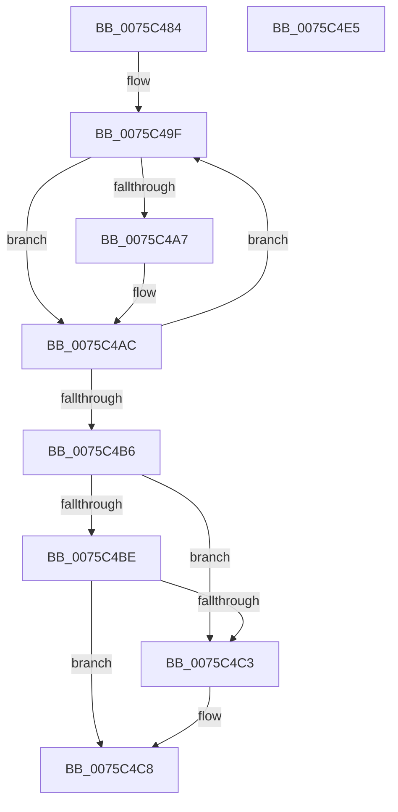

# PopFreeRegistration

- RVA: `0x0075C484`–`0x0075C4E6` (길이 `98` bytes)
- VA: `0x000000014075C484`
- 실행 섹션: `PAGE`
- PDB 이름 있음: `예`; PDB Function 태그: `아니요`
- unwind 정보 RVA: `0x00060BC4`
- 디코드: `29`개 명령, `98/98` bytes 표시
- 미해석 바이트: `0` (있으면 어셈블리에 `.byte`로 보존)

> 이 문서는 커널 이미지의 기계어와 PDB 기호를 분석해 생성했습니다. 4번과 5번은 함수 원형과 자료형을 바이너리 사용 방식에서 추정한 C 해석이며 원본 소스 복구 결과는 아닙니다.

## 1. Dependencies

- 직접 호출 지점: **3**; 고유 호출 대상: **3**
- 직접 호출자로 확인된 함수: **2**
- RIP 상대 이미지 참조: **0**

### Outgoing calls
- `0x0075C4A7` → [PopUnreferencePowerSetting](../91/PopUnreferencePowerSetting_function_009164A4.md) (function, `0x009164A4`)
- `0x0075C4C3` → [ZwDeleteWnfStateName](../../text/6A/ZwDeleteWnfStateName_function_006AECF0.md) (function, `0x006AECF0`)
- `0x0075C4D0` → [ExFreePoolWithTag](../../poolcode/B8/ExFreePoolWithTag_function_00B82870.md) (function, `0x00B82870`)

### Direct callers
- [PopFreeSessionState](../91/PopFreeSessionState_function_00912D00.md) at `0x00912D70`
- [PopDispatchNotificationsToList](../A3/PopDispatchNotificationsToList_function_00A3ADA8.md) at `0x00A3AE28`

### Static image references
- 디코드된 RIP-relative 메모리 참조가 없습니다.

## 2. Other-region calls and transfers

- 다른 실행 섹션으로 향하는 call: **2**
  - `0x0075C4C3` → [ZwDeleteWnfStateName](../../text/6A/ZwDeleteWnfStateName_function_006AECF0.md) (`PAGE` → `.text`)
  - `0x0075C4D0` → [ExFreePoolWithTag](../../poolcode/B8/ExFreePoolWithTag_function_00B82870.md) (`PAGE` → `POOLCODE`)
- 별도 외부 분기/꼬리 이동을 확인하지 못했습니다.

## 3. Assembly (complete function range)

```asm
0075C484  48 89 5C 24 08                  mov qword ptr [rsp + 8], rbx
0075C489  48 89 74 24 10                  mov qword ptr [rsp + 0x10], rsi
0075C48E  57                              push rdi
0075C48F  48 83 EC 20                     sub rsp, 0x20
0075C493  48 8B F9                        mov rdi, rcx
0075C496  48 8D 59 40                     lea rbx, [rcx + 0x40]
0075C49A  BE 03 00 00 00                  mov esi, 3
0075C49F  48 8B 0B                        mov rcx, qword ptr [rbx]
0075C4A2  48 85 C9                        test rcx, rcx
0075C4A5  74 05                           je 0x14075c4ac
0075C4A7  E8 F8 9F 1B 00                  call 0x1409164a4
0075C4AC  48 83 C3 08                     add rbx, 8
0075C4B0  48 83 EE 01                     sub rsi, 1
0075C4B4  75 E9                           jne 0x14075c49f
0075C4B6  48 8D 4F 38                     lea rcx, [rdi + 0x38]
0075C4BA  39 31                           cmp dword ptr [rcx], esi
0075C4BC  75 05                           jne 0x14075c4c3
0075C4BE  39 71 04                        cmp dword ptr [rcx + 4], esi
0075C4C1  74 05                           je 0x14075c4c8
0075C4C3  E8 28 28 F5 FF                  call 0x1406aecf0
0075C4C8  BA 50 53 65 74                  mov edx, 0x74655350
0075C4CD  48 8B CF                        mov rcx, rdi
0075C4D0  E8 9B 63 42 00                  call 0x140b82870
0075C4D5  48 8B 5C 24 30                  mov rbx, qword ptr [rsp + 0x30]
0075C4DA  48 8B 74 24 38                  mov rsi, qword ptr [rsp + 0x38]
0075C4DF  48 83 C4 20                     add rsp, 0x20
0075C4E3  5F                              pop rdi
0075C4E4  C3                              ret
0075C4E5  CC                              int3
```

## 4. C-style interpretation (structured pseudocode)

```c
__int64 __fastcall PopFreeRegistration(__int64 a1)
{
    __int64 result;
    __int64 v_rbx;
    __int64 v_rsi;
    __int64 v_rsp;
    unsigned __int64 v_stack_p10;
    unsigned __int64 v_stack_p8;

    v_stack_p8 = v_rbx;
    v_stack_p10 = v_rsi;
    v_rsp = (v_rsp) - (32);
loc_0075C49F:
    if (*(unsigned __int64 *)(a1 + 64) != 0) {
        result = PopUnreferencePowerSetting(*(unsigned __int64 *)(a1 + 64), a2, a3, a4);
    }
    v_rbx = (a1 + 64) + (8);
    v_rsi = (3) - (1);
    if (condition_is_not_equal) goto loc_0075C49F;
    if ((*(unsigned int *)(a1 + 56)) != ((unsigned int)(v_rsi))) goto loc_0075C4C3;
    if ((*(unsigned int *)(a1 + 56 + 4)) != ((unsigned int)(v_rsi))) {
        result = ZwDeleteWnfStateName(a1 + 56, a2, a3, a4);
    }
    result = ExFreePoolWithTag(a1, (unsigned int)(0x74655350ULL), a3, a4);
    v_rsp = (v_rsp) + (32);
    return result;
}
```

## 5. (Beta) C Style

```c
int64_t PopFreeRegistration(void *Arg1)
{
    uint8_t *arg1 = (uint8_t *)Arg1;

    int64_t result;
    int64_t local_rbx;
    int64_t local_rsi;
    int64_t local_rsp;
    uint64_t v_stack_p10;
    uint64_t v_stack_p8;

    v_stack_p8 = local_rbx;
    v_stack_p10 = local_rsi;
    local_rsp = (local_rsp) - (32);
loc_0075C49F:
    if (*(uint64_t *)(arg1 + 0x40) != 0) {
        result = PopUnreferencePowerSetting(*(uint64_t *)(arg1 + 0x40), a2, a3, a4);
    }
    local_rbx = (Arg1 + 64) + (8);
    local_rsi = (3) - (1);
    if (condition_is_not_equal) goto loc_0075C49F;
    if ((*(uint32_t *)(arg1 + 0x38)) != ((uint32_t)(local_rsi))) goto loc_0075C4C3;
    if ((*(uint32_t *)(arg1 + 0x38 + 0x4)) != ((uint32_t)(local_rsi))) {
        result = ZwDeleteWnfStateName(Arg1 + 56, a2, a3, a4);
    }
    result = ExFreePoolWithTag(Arg1, (uint32_t)(0x74655350ULL), a3, a4);
    local_rsp = (local_rsp) + (32);
    return result;
}
```

### 관측된 메모리 오프셋

구조체 형식이 확인되지 않은 접근은 인자 기준의 오프셋으로만 기록했습니다.

| 기준 인자 | 오프셋 표현 | 폭 (bit) | 접근 |
|---|---:|---:|---|
| `Arg1` | `+ 0x0` | `32` | `R` |
| `Arg1` | `+ 0x0` | `64` | `R` |
| `Arg1` | `+ 0x4` | `32` | `R` |
| `Arg1` | `+ 0x38` | `64` | `R` |
| `Arg1` | `+ 0x40` | `64` | `R` |

## 6. Execution-region graph

[열기: 2D/3D 그래프와 함수 탐색 컨트롤 패널](../../../control-panel.html?section=page&rva=0x0075C484&view=graph)

- 2D 그래프는 위에서 아래로 흐르고, 3D 그래프는 빈 공간을 드래그해 회전합니다. Shift+드래그는 이동, 휠은 확대·축소, 함수 노드 선택은 대상 보고서 이동입니다.

### Static fallback


