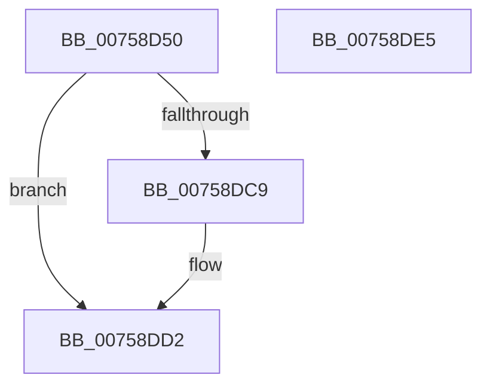

# PopFxCreateStaticWorkPoolThread

- RVA: `0x00758D50`–`0x00758DE6` (길이 `150` bytes)
- VA: `0x0000000140758D50`
- 실행 섹션: `PAGE`
- PDB 이름 있음: `예`; PDB Function 태그: `아니요`
- unwind 정보 RVA: `0x000CC11C`
- 디코드: `36`개 명령, `150/150` bytes 표시
- 미해석 바이트: `0` (있으면 어셈블리에 `.byte`로 보존)

> 이 문서는 커널 이미지의 기계어와 PDB 기호를 분석해 생성했습니다. 4번과 5번은 함수 원형과 자료형을 바이너리 사용 방식에서 추정한 C 해석이며 원본 소스 복구 결과는 아닙니다.

## 1. Dependencies

- 직접 호출 지점: **2**; 고유 호출 대상: **2**
- 직접 호출자로 확인된 함수: **1**
- RIP 상대 이미지 참조: **1**

### Outgoing calls
- `0x00758DBE` → [PsCreateSystemThreadEx](../9E/PsCreateSystemThreadEx_function_009ED120.md) (function, `0x009ED120`)
- `0x00758DCD` → [ZwClose](../../text/6A/ZwClose_function_006AD2B0.md) (function, `0x006AD2B0`)

### Direct callers
- [PopFxInitializeWorkPool](PopFxInitializeWorkPool_function_00759290.md) at `0x0075931F`

### Static image references
- `0x00758D67` → RVA `0x005D3690` (`PopFxStaticWorkPoolThread`; read)

## 2. Other-region calls and transfers

- 다른 실행 섹션으로 향하는 call: **1**
  - `0x00758DCD` → [ZwClose](../../text/6A/ZwClose_function_006AD2B0.md) (`PAGE` → `.text`)
- 별도 외부 분기/꼬리 이동을 확인하지 못했습니다.

## 3. Assembly (complete function range)

```asm
00758D50  4C 8B DC                        mov r11, rsp
00758D53  49 89 5B 08                     mov qword ptr [r11 + 8], rbx
00758D57  55                              push rbp
00758D58  48 8B EC                        mov rbp, rsp
00758D5B  48 81 EC 80 00 00 00            sub rsp, 0x80
00758D62  49 83 63 B8 00                  and qword ptr [r11 - 0x48], 0
00758D67  48 8D 05 22 A9 E7 FF            lea rax, [rip - 0x1856de]
00758D6E  49 83 63 B0 00                  and qword ptr [r11 - 0x50], 0
00758D73  4C 8D 45 D0                     lea r8, [rbp - 0x30]
00758D77  83 65 EC 00                     and dword ptr [rbp - 0x14], 0
00758D7B  0F 57 C0                        xorps xmm0, xmm0
00758D7E  48 83 65 18 00                  and qword ptr [rbp + 0x18], 0
00758D83  45 33 C9                        xor r9d, r9d
00758D86  48 83 65 D8 00                  and qword ptr [rbp - 0x28], 0
00758D8B  BA FF FF 1F 00                  mov edx, 0x1fffff
00758D90  48 83 65 E0 00                  and qword ptr [rbp - 0x20], 0
00758D95  49 89 4B A8                     mov qword ptr [r11 - 0x58], rcx
00758D99  48 8D 4D 18                     lea rcx, [rbp + 0x18]
00758D9D  49 89 43 A0                     mov qword ptr [r11 - 0x60], rax
00758DA1  49 83 63 98 00                  and qword ptr [r11 - 0x68], 0
00758DA6  48 C7 45 D0 30 00 00 00         mov qword ptr [rbp - 0x30], 0x30
00758DAE  83 65 D4 00                     and dword ptr [rbp - 0x2c], 0
00758DB2  C7 45 E8 00 02 00 00            mov dword ptr [rbp - 0x18], 0x200
00758DB9  F3 0F 7F 45 F0                  movdqu xmmword ptr [rbp - 0x10], xmm0
00758DBE  E8 5D 43 29 00                  call 0x1409ed120
00758DC3  8B D8                           mov ebx, eax
00758DC5  85 C0                           test eax, eax
00758DC7  78 09                           js 0x140758dd2
00758DC9  48 8B 4D 18                     mov rcx, qword ptr [rbp + 0x18]
00758DCD  E8 DE 44 F5 FF                  call 0x1406ad2b0
00758DD2  8B C3                           mov eax, ebx
00758DD4  48 8B 9C 24 90 00 00 00         mov rbx, qword ptr [rsp + 0x90]
00758DDC  48 81 C4 80 00 00 00            add rsp, 0x80
00758DE3  5D                              pop rbp
00758DE4  C3                              ret
00758DE5  CC                              int3
```

## 4. C-style interpretation (structured pseudocode)

```c
__int64 __fastcall PopFxCreateStaticWorkPoolThread(__int64 a1, __int64 a2, __int64 a3, int a4)
{
    __int64 result;
    __int64 v_rsp;
    unsigned __int64 v_stack_m18;
    unsigned int v_stack_m1C;
    unsigned int v_stack_m20;
    unsigned __int64 v_stack_m28;
    unsigned __int64 v_stack_m30;
    unsigned int v_stack_m34;
    unsigned __int64 v_stack_m38;
    unsigned __int64 v_stack_p10;
    unsigned __int64 v_stack_p8;

    *(unsigned __int64 *)(v_rsp + 8) = v_rbx;
    v_rsp = (v_rsp) - (128);
    a4 = 0;
    *(unsigned __int64 *)(v_rsp - 88) = a1;
    *(unsigned __int64 *)(v_rsp - 96) = v_rip - 1595102;
    v_stack_m38 = 48;
    v_stack_m20 = 512;
    v_stack_m18 = v_xmm0;
    result = PsCreateSystemThreadEx(v_stack_p10, (unsigned int)(0x1FFFFFULL), v_stack_m38, a4);
    if (!(sign_flag)) {
        a1 = v_stack_p10;
        result = ZwClose(a1, (unsigned int)(0x1FFFFFULL), v_stack_m38, a4);
    }
    v_rsp = (v_rsp) + (128);
    return (unsigned int)((unsigned int)((unsigned int)((unsigned int)(result))));
}
```

## 5. (Beta) C Style

```c
int64_t PopFxCreateStaticWorkPoolThread(int64_t Arg1, int64_t Arg2, int64_t Arg3, int32_t Arg4)
{
    int64_t result;
    int64_t local_rsp;
    uint64_t v_stack_m18;
    uint32_t v_stack_m1C;
    uint32_t v_stack_m20;
    uint64_t v_stack_m28;
    uint64_t v_stack_m30;
    uint32_t v_stack_m34;
    uint64_t v_stack_m38;
    uint64_t v_stack_p10;
    uint64_t v_stack_p8;

    *(uint64_t *)(local_rsp + 0x8) = local_rbx;
    local_rsp = (local_rsp) - (128);
    Arg4 = 0;
    *(uint64_t *)(local_rsp - 0x58) = Arg1;
    *(uint64_t *)(local_rsp - 0x60) = v_rip - 1595102;
    v_stack_m38 = 48;
    v_stack_m20 = 512;
    v_stack_m18 = v_xmm0;
    result = PsCreateSystemThreadEx(v_stack_p10, (uint32_t)(0x1FFFFFULL), v_stack_m38, Arg4);
    if (!(sign_flag)) {
        Arg1 = v_stack_p10;
        result = ZwClose(Arg1, (uint32_t)(0x1FFFFFULL), v_stack_m38, Arg4);
    }
    local_rsp = (local_rsp) + (128);
    return (uint32_t)((uint32_t)((uint32_t)((uint32_t)(result))));
}
```

## 6. Execution-region graph

[열기: 2D/3D 그래프와 함수 탐색 컨트롤 패널](../../../control-panel.html?section=page&rva=0x00758D50&view=graph)

- 2D 그래프는 위에서 아래로 흐르고, 3D 그래프는 빈 공간을 드래그해 회전합니다. Shift+드래그는 이동, 휠은 확대·축소, 함수 노드 선택은 대상 보고서 이동입니다.

### Static fallback


