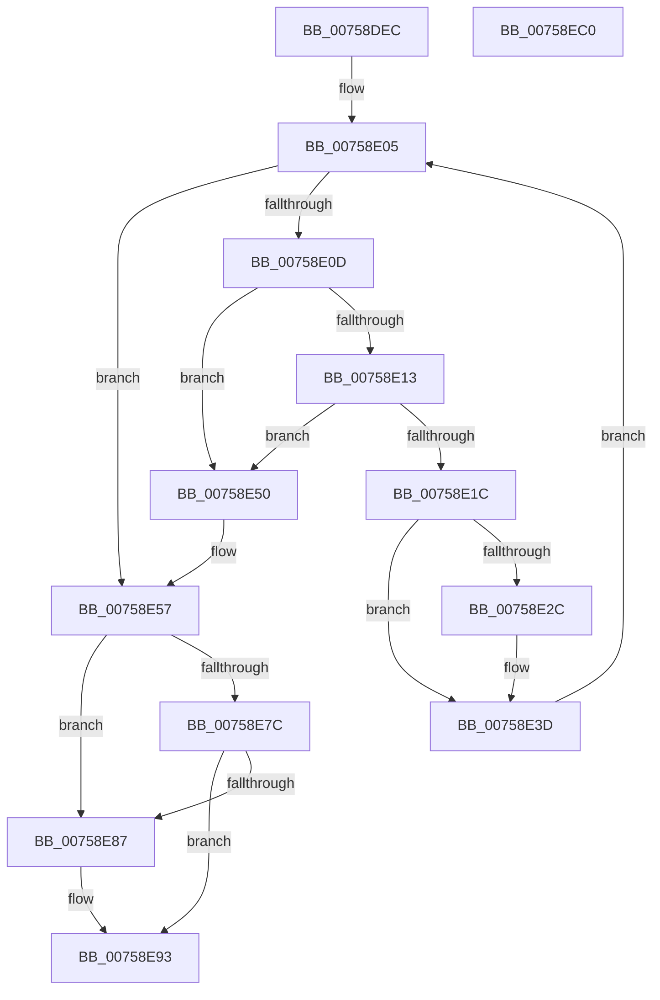

# PopFxDestroyDripsBlockingDeviceList

- RVA: `0x00758DEC`–`0x00758EC1` (길이 `213` bytes)
- VA: `0x0000000140758DEC`
- 실행 섹션: `PAGE`
- PDB 이름 있음: `예`; PDB Function 태그: `아니요`
- unwind 정보 RVA: `0x0005C954`
- 디코드: `55`개 명령, `213/213` bytes 표시
- 미해석 바이트: `0` (있으면 어셈블리에 `.byte`로 보존)

> 이 문서는 커널 이미지의 기계어와 PDB 기호를 분석해 생성했습니다. 4번과 5번은 함수 원형과 자료형을 바이너리 사용 방식에서 추정한 C 해석이며 원본 소스 복구 결과는 아닙니다.

## 1. Dependencies

- 직접 호출 지점: **6**; 고유 호출 대상: **6**
- 직접 호출자로 확인된 함수: **3**
- RIP 상대 이미지 참조: **1**

### Outgoing calls
- `0x00758E31` → [ExFreePoolWithTag](../../poolcode/B8/ExFreePoolWithTag_function_00B82870.md) (function, `0x00B82870`)
- `0x00758E49` → [PopFxDereferenceDevice](../../text/27/PopFxDereferenceDevice_function_0027038C.md) (function, `0x0027038C`)
- `0x00758E8E` → [ExfReleasePushLock](../../text/26/ExfReleasePushLock_function_002638D0.md) (function, `0x002638D0`)
- `0x00758E9A` → [KeAbPostRelease](../../text/2E/KeAbPostRelease_function_002E1600.md) (function, `0x002E1600`)
- `0x00758E9F` → [KeLeaveCriticalRegion](../../text/25/KeLeaveCriticalRegion_function_0025D8B0.md) (function, `0x0025D8B0`)
- `0x00758EA6` → [IoLockUnlockPnpDeviceTree](../AB/IoLockUnlockPnpDeviceTree_function_00AB953C.md) (function, `0x00AB953C`)

### Direct callers
- [PopFxBuildDripsBlockingDeviceList](../../text/49/PopFxBuildDripsBlockingDeviceList_function_0049B5B0.md) at `0x0049B9A1`
- [PopDripsWatchdogCallbackHandler](../76/PopDripsWatchdogCallbackHandler_function_0076C1C0.md) at `0x0076C334`
- [PopDripsWatchdogTakeAction](../77/PopDripsWatchdogTakeAction_function_007732D0.md) at `0x007735EF`

### Static image references
- `0x00758E57` → RVA `0x00F0E4C0` (`.data`; read)

## 2. Other-region calls and transfers

- 다른 실행 섹션으로 향하는 call: **5**
  - `0x00758E31` → [ExFreePoolWithTag](../../poolcode/B8/ExFreePoolWithTag_function_00B82870.md) (`PAGE` → `POOLCODE`)
  - `0x00758E49` → [PopFxDereferenceDevice](../../text/27/PopFxDereferenceDevice_function_0027038C.md) (`PAGE` → `.text`)
  - `0x00758E8E` → [ExfReleasePushLock](../../text/26/ExfReleasePushLock_function_002638D0.md) (`PAGE` → `.text`)
  - `0x00758E9A` → [KeAbPostRelease](../../text/2E/KeAbPostRelease_function_002E1600.md) (`PAGE` → `.text`)
  - `0x00758E9F` → [KeLeaveCriticalRegion](../../text/25/KeLeaveCriticalRegion_function_0025D8B0.md) (`PAGE` → `.text`)
- 별도 외부 분기/꼬리 이동을 확인하지 못했습니다.

## 3. Assembly (complete function range)

```asm
00758DEC  48 89 5C 24 08                  mov qword ptr [rsp + 8], rbx
00758DF1  48 89 6C 24 10                  mov qword ptr [rsp + 0x10], rbp
00758DF6  48 89 74 24 18                  mov qword ptr [rsp + 0x18], rsi
00758DFB  57                              push rdi
00758DFC  48 83 EC 20                     sub rsp, 0x20
00758E00  48 8B F9                        mov rdi, rcx
00758E03  33 ED                           xor ebp, ebp
00758E05  48 8B 1F                        mov rbx, qword ptr [rdi]
00758E08  48 3B DF                        cmp rbx, rdi
00758E0B  74 4A                           je 0x140758e57
00758E0D  48 39 7B 08                     cmp qword ptr [rbx + 8], rdi
00758E11  75 3D                           jne 0x140758e50
00758E13  48 8B 03                        mov rax, qword ptr [rbx]
00758E16  48 39 58 08                     cmp qword ptr [rax + 8], rbx
00758E1A  75 34                           jne 0x140758e50
00758E1C  48 89 07                        mov qword ptr [rdi], rax
00758E1F  48 89 78 08                     mov qword ptr [rax + 8], rdi
00758E23  48 8B 4B 18                     mov rcx, qword ptr [rbx + 0x18]
00758E27  48 85 C9                        test rcx, rcx
00758E2A  74 11                           je 0x140758e3d
00758E2C  BA 50 46 58 4D                  mov edx, 0x4d584650
00758E31  E8 3A 9A 42 00                  call 0x140b82870
00758E36  48 89 6B 18                     mov qword ptr [rbx + 0x18], rbp
00758E3A  89 6B 20                        mov dword ptr [rbx + 0x20], ebp
00758E3D  BA 03 00 00 00                  mov edx, 3
00758E42  48 8D 8B 70 FC FF FF            lea rcx, [rbx - 0x390]
00758E49  E8 3E 75 B1 FF                  call 0x14027038c
00758E4E  EB B5                           jmp 0x140758e05
00758E50  B9 03 00 00 00                  mov ecx, 3
00758E55  CD 29                           int 0x29
00758E57  0F 0D 0D 62 56 7B 00            prefetchw byte ptr [rip + 0x7b5662]
00758E5E  48 8B 05 5B 56 7B 00            mov rax, qword ptr [rip + 0x7b565b]
00758E65  48 8B C8                        mov rcx, rax
00758E68  48 83 E1 F0                     and rcx, 0xfffffffffffffff0
00758E6C  48 83 F9 10                     cmp rcx, 0x10
00758E70  48 8D 50 F0                     lea rdx, [rax - 0x10]
00758E74  48 0F 46 D5                     cmovbe rdx, rbp
00758E78  A8 02                           test al, 2
00758E7A  75 0B                           jne 0x140758e87
00758E7C  F0 48 0F B1 15 3B 56 7B 00      lock cmpxchg qword ptr [rip + 0x7b563b], rdx
00758E85  74 0C                           je 0x140758e93
00758E87  48 8D 0D 32 56 7B 00            lea rcx, [rip + 0x7b5632]
00758E8E  E8 3D AA B0 FF                  call 0x1402638d0
00758E93  48 8D 0D 26 56 7B 00            lea rcx, [rip + 0x7b5626]
00758E9A  E8 61 87 B8 FF                  call 0x1402e1600
00758E9F  E8 0C 4A B0 FF                  call 0x14025d8b0
00758EA4  33 C9                           xor ecx, ecx
00758EA6  E8 91 06 36 00                  call 0x140ab953c
00758EAB  48 8B 5C 24 30                  mov rbx, qword ptr [rsp + 0x30]
00758EB0  48 8B 6C 24 38                  mov rbp, qword ptr [rsp + 0x38]
00758EB5  48 8B 74 24 40                  mov rsi, qword ptr [rsp + 0x40]
00758EBA  48 83 C4 20                     add rsp, 0x20
00758EBE  5F                              pop rdi
00758EBF  C3                              ret
00758EC0  CC                              int3
```

## 4. C-style interpretation (structured pseudocode)

```c
__int64 __fastcall PopFxDestroyDripsBlockingDeviceList(__int64 a1)
{
    __int64 result;
    __int64 v_rbp;
    __int64 v_rsp;
    unsigned __int64 v_stack_p10;
    unsigned __int64 v_stack_p18;
    unsigned __int64 v_stack_p8;

    v_stack_p8 = v_rbx;
    v_stack_p10 = v_rbp;
    v_stack_p18 = v_rsi;
    v_rsp = (v_rsp) - (32);
    v_rbp = 0;
loc_00758E05:
    if ((*(unsigned __int64 *)(a1)) == a1) goto loc_00758E57;
    if ((*(unsigned __int64 *)(*(unsigned __int64 *)(a1) + 8)) != a1) goto loc_00758E50;
    if ((*(unsigned __int64 *)(*(unsigned __int64 *)(*(unsigned __int64 *)(a1)) + 8)) != (*(unsigned __int64 *)(a1))) goto loc_00758E50;
    *(unsigned __int64 *)(a1) = *(unsigned __int64 *)(*(unsigned __int64 *)(a1));
    *(unsigned __int64 *)(*(unsigned __int64 *)(*(unsigned __int64 *)(a1)) + 8) = a1;
    result = *(unsigned __int64 *)(*(unsigned __int64 *)(a1));
    if (*(unsigned __int64 *)(*(unsigned __int64 *)(a1) + 24) != 0) {
        a2 = 0x4D584650ULL;
        result = ExFreePoolWithTag(*(unsigned __int64 *)(*(unsigned __int64 *)(a1) + 24), a2, a3, a4);
        *(unsigned __int64 *)(*(unsigned __int64 *)(a1) + 24) = 0;
        *(unsigned int *)(*(unsigned __int64 *)(a1) + 32) = 0;
    }
    result = PopFxDereferenceDevice(*(unsigned __int64 *)(a1) - 912, 3, a3, a4);
    goto loc_00758E05;
loc_00758E50:
loc_00758E57:
    a1 = (*(unsigned __int64 *)(v_rip + 8083035)) & (-16);
    a2 = *(unsigned __int64 *)(v_rip + 8083035) - 16;
    if (a1 <= 16) { a2 = 0; }
    if ((((unsigned __int8)(*(unsigned __int64 *)(v_rip + 8083035))) & (2)) != 0) goto loc_00758E87;
    result = *(unsigned __int64 *)(v_rip + 8083035);
    if ((((unsigned __int8)(*(unsigned __int64 *)(v_rip + 8083035))) & (2)) != 0) {
        a1 = v_rip + 8082994;
        result = ExfReleasePushLock(a1, a2, a3, a4);
    }
    result = KeAbPostRelease(v_rip + 8082982, a2, a3, a4);
    result = KeLeaveCriticalRegion(v_rip + 8082982, a2, a3, a4);
    a1 = 0;
    result = IoLockUnlockPnpDeviceTree(a1, a2, a3, a4);
    v_rsp = (v_rsp) + (32);
    return result;
}
```

## 5. (Beta) C Style

```c
int64_t PopFxDestroyDripsBlockingDeviceList(void *Arg1)
{
    uint8_t *arg1 = (uint8_t *)Arg1;

    int64_t result;
    int64_t local_rbp;
    int64_t local_rsp;
    uint64_t v_stack_p10;
    uint64_t v_stack_p18;
    uint64_t v_stack_p8;

    v_stack_p8 = local_rbx;
    v_stack_p10 = local_rbp;
    v_stack_p18 = local_rsi;
    local_rsp = (local_rsp) - (32);
    local_rbp = 0;
loc_00758E05:
    if ((*(uint64_t *)(arg1)) == Arg1) goto loc_00758E57;
    if ((*(uint64_t *)(*(uint64_t *)(arg1) + 0x8)) != Arg1) goto loc_00758E50;
    if ((*(uint64_t *)(*(uint64_t *)(*(uint64_t *)(arg1)) + 0x8)) != (*(uint64_t *)(arg1))) goto loc_00758E50;
    *(uint64_t *)(arg1) = *(uint64_t *)(*(uint64_t *)(arg1));
    *(void **)(*(uint64_t *)(*(uint64_t *)(arg1)) + 0x8) = Arg1;
    result = *(uint64_t *)(*(uint64_t *)(arg1));
    if (*(uint64_t *)(*(uint64_t *)(arg1) + 0x18) != 0) {
        a2 = 0x4D584650ULL;
        result = ExFreePoolWithTag(*(uint64_t *)(*(uint64_t *)(arg1) + 0x18), a2, a3, a4);
        *(uint64_t *)(*(uint64_t *)(arg1) + 0x18) = 0;
        *(uint32_t *)(*(uint64_t *)(arg1) + 0x20) = 0;
    }
    result = PopFxDereferenceDevice(*(uint64_t *)(arg1) - 912, 3, a3, a4);
    goto loc_00758E05;
loc_00758E50:
loc_00758E57:
    Arg1 = (*(uint64_t *)(v_rip + 0x7B565B)) & (-16);
    a2 = *(uint64_t *)(v_rip + 0x7B565B) - 16;
    if (Arg1 <= 16) { a2 = 0; }
    if ((((uint8_t)(*(uint64_t *)(v_rip + 0x7B565B))) & (2)) != 0) goto loc_00758E87;
    result = *(uint64_t *)(v_rip + 0x7B565B);
    if ((((uint8_t)(*(uint64_t *)(v_rip + 0x7B565B))) & (2)) != 0) {
        Arg1 = v_rip + 8082994;
        result = ExfReleasePushLock(Arg1, a2, a3, a4);
    }
    result = KeAbPostRelease(v_rip + 8082982, a2, a3, a4);
    result = KeLeaveCriticalRegion(v_rip + 8082982, a2, a3, a4);
    Arg1 = 0;
    result = IoLockUnlockPnpDeviceTree(Arg1, a2, a3, a4);
    local_rsp = (local_rsp) + (32);
    return result;
}
```

### 관측된 메모리 오프셋

구조체 형식이 확인되지 않은 접근은 인자 기준의 오프셋으로만 기록했습니다.

| 기준 인자 | 오프셋 표현 | 폭 (bit) | 접근 |
|---|---:|---:|---|
| `Arg1` | `+ 0x0` | `64` | `R` |
| `Arg1` | `+ 0x0` | `64` | `W` |

## 6. Execution-region graph

[열기: 2D/3D 그래프와 함수 탐색 컨트롤 패널](../../../control-panel.html?section=page&rva=0x00758DEC&view=graph)

- 2D 그래프는 위에서 아래로 흐르고, 3D 그래프는 빈 공간을 드래그해 회전합니다. Shift+드래그는 이동, 휠은 확대·축소, 함수 노드 선택은 대상 보고서 이동입니다.

### Static fallback


