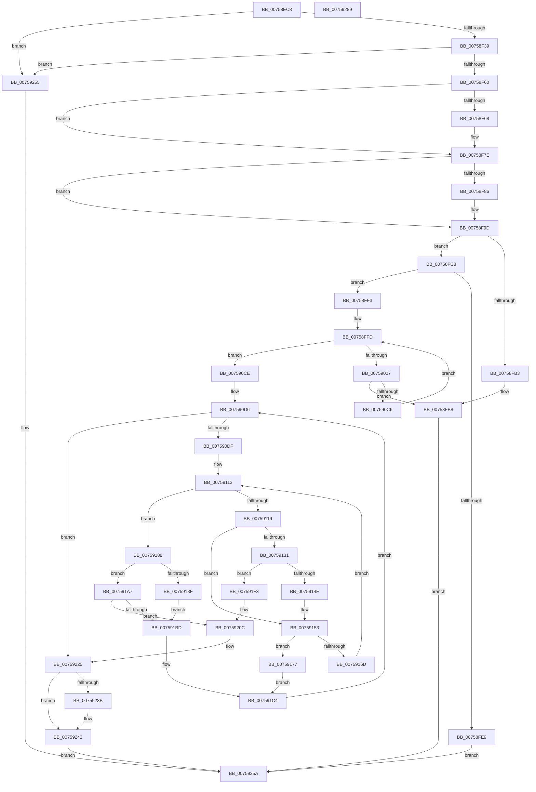

# PopFxInitializeSocSubsystemStaticInfo

- RVA: `0x00758EC8`–`0x0075928A` (길이 `962` bytes)
- VA: `0x0000000140758EC8`
- 실행 섹션: `PAGE`
- PDB 이름 있음: `예`; PDB Function 태그: `아니요`
- unwind 정보 RVA: `0x000C6434`
- 디코드: `239`개 명령, `962/962` bytes 표시
- 미해석 바이트: `0` (있으면 어셈블리에 `.byte`로 보존)

> 이 문서는 커널 이미지의 기계어와 PDB 기호를 분석해 생성했습니다. 4번과 5번은 함수 원형과 자료형을 바이너리 사용 방식에서 추정한 C 해석이며 원본 소스 복구 결과는 아닙니다.

## 1. Dependencies

- 직접 호출 지점: **16**; 고유 호출 대상: **11**
- 직접 호출자로 확인된 함수: **1**
- RIP 상대 이미지 참조: **6**

### Outgoing calls
- `0x00758F21` → [memset](../../text/6C/memset_function_006C6C40.md) (function, `0x006C6C40`)
- `0x00758F53` → [guard_dispatch_icall](../../text/6B/guard_dispatch_icall_function_006BAAD0.md) (function, `0x006BAAD0`)
- `0x00758F78` → [PopFxBugCheck](../../text/2B/PopFxBugCheck_function_002BFC6C.md) (function, `0x002BFC6C`)
- `0x00758F97` → [PopFxBugCheck](../../text/2B/PopFxBugCheck_function_002BFC6C.md) (function, `0x002BFC6C`)
- `0x00758FA0` → [PopFxLookupSocSubsystemsByPlatformIdleState](../97/PopFxLookupSocSubsystemsByPlatformIdleState_function_0097ABEC.md) (function, `0x0097ABEC`)
- `0x00758FBE` → [ExFreePoolWithTag](../../poolcode/B8/ExFreePoolWithTag_function_00B82870.md) (function, `0x00B82870`)
- `0x00758FDC` → [ExAllocatePool2](../../poolcode/B8/ExAllocatePool2_function_00B820F0.md) (function, `0x00B820F0`)
- `0x0075907D` → [PopPluginInitializeSocSubsystemStaticInfo](PopPluginInitializeSocSubsystemStaticInfo_function_0075A98C.md) (function, `0x0075A98C`)
- `0x007590B7` → [RtlHashUnicodeString](../97/RtlHashUnicodeString_function_0097A780.md) (function, `0x0097A780`)
- `0x00759141` → [wcsncmp](../../text/50/wcsncmp_function_00501CA0.md) (function, `0x00501CA0`)
- `0x00759161` → [wcsncmp](../../text/50/wcsncmp_function_00501CA0.md) (function, `0x00501CA0`)
- `0x0075919B` → [RtlStringCchCopyW](../../text/26/RtlStringCchCopyW_function_0026E9A4.md) (function, `0x0026E9A4`)
- `0x007591B4` → [wcsncmp](../../text/50/wcsncmp_function_00501CA0.md) (function, `0x00501CA0`)
- `0x00759206` → [PopFxBugCheck](../../text/2B/PopFxBugCheck_function_002BFC6C.md) (function, `0x002BFC6C`)
- `0x0075921F` → [PopFxBugCheck](../../text/2B/PopFxBugCheck_function_002BFC6C.md) (function, `0x002BFC6C`)
- `0x00759263` → [_security_check_cookie](../../text/6A/_security_check_cookie_function_006AC640.md) (function, `0x006AC640`)

### Direct callers
- [PopFxEnablePlatformStates](../../text/5D/PopFxEnablePlatformStates_function_005D2A98.md) at `0x005D2AB9`

### Static image references
- `0x00758EEB` → RVA `0x00E0A740` (`.data`; read)
- `0x00758F26` → RVA `0x00E676B8` (`.data`; read)
- `0x007590DF` → RVA `0x00026A48` (`.rdata`; read)
- `0x00759225` → RVA `0x00F0E548` (`.data`; read)
- `0x0075922C` → RVA `0x00F0E540` (`.data`; read)
- `0x0075924C` → RVA `0x00F0E548` (`.data`; write)

## 2. Other-region calls and transfers

- 다른 실행 섹션으로 향하는 call: **13**
  - `0x00758F21` → [memset](../../text/6C/memset_function_006C6C40.md) (`PAGE` → `.text`)
  - `0x00758F53` → [guard_dispatch_icall](../../text/6B/guard_dispatch_icall_function_006BAAD0.md) (`PAGE` → `.text`)
  - `0x00758F78` → [PopFxBugCheck](../../text/2B/PopFxBugCheck_function_002BFC6C.md) (`PAGE` → `.text`)
  - `0x00758F97` → [PopFxBugCheck](../../text/2B/PopFxBugCheck_function_002BFC6C.md) (`PAGE` → `.text`)
  - `0x00758FBE` → [ExFreePoolWithTag](../../poolcode/B8/ExFreePoolWithTag_function_00B82870.md) (`PAGE` → `POOLCODE`)
  - `0x00758FDC` → [ExAllocatePool2](../../poolcode/B8/ExAllocatePool2_function_00B820F0.md) (`PAGE` → `POOLCODE`)
  - `0x00759141` → [wcsncmp](../../text/50/wcsncmp_function_00501CA0.md) (`PAGE` → `.text`)
  - `0x00759161` → [wcsncmp](../../text/50/wcsncmp_function_00501CA0.md) (`PAGE` → `.text`)
  - `0x0075919B` → [RtlStringCchCopyW](../../text/26/RtlStringCchCopyW_function_0026E9A4.md) (`PAGE` → `.text`)
  - `0x007591B4` → [wcsncmp](../../text/50/wcsncmp_function_00501CA0.md) (`PAGE` → `.text`)
  - `0x00759206` → [PopFxBugCheck](../../text/2B/PopFxBugCheck_function_002BFC6C.md) (`PAGE` → `.text`)
  - `0x0075921F` → [PopFxBugCheck](../../text/2B/PopFxBugCheck_function_002BFC6C.md) (`PAGE` → `.text`)
  - `0x00759263` → [_security_check_cookie](../../text/6A/_security_check_cookie_function_006AC640.md) (`PAGE` → `.text`)
- 별도 외부 분기/꼬리 이동을 확인하지 못했습니다.

## 3. Assembly (complete function range)

```asm
00758EC8  48 8B C4                        mov rax, rsp
00758ECB  48 89 58 10                     mov qword ptr [rax + 0x10], rbx
00758ECF  48 89 70 18                     mov qword ptr [rax + 0x18], rsi
00758ED3  48 89 78 20                     mov qword ptr [rax + 0x20], rdi
00758ED7  55                              push rbp
00758ED8  41 54                           push r12
00758EDA  41 55                           push r13
00758EDC  41 56                           push r14
00758EDE  41 57                           push r15
00758EE0  48 8D 68 C8                     lea rbp, [rax - 0x38]
00758EE4  48 81 EC 10 01 00 00            sub rsp, 0x110
00758EEB  48 8B 05 4E 18 6B 00            mov rax, qword ptr [rip + 0x6b184e]
00758EF2  48 33 C4                        xor rax, rsp
00758EF5  48 89 45 00                     mov qword ptr [rbp], rax
00758EF9  0F 57 C0                        xorps xmm0, xmm0
00758EFC  44 8B F9                        mov r15d, ecx
00758EFF  33 C0                           xor eax, eax
00758F01  48 8D 4D 80                     lea rcx, [rbp - 0x80]
00758F05  33 D2                           xor edx, edx
00758F07  48 89 44 24 60                  mov qword ptr [rsp + 0x60], rax
00758F0C  41 B8 80 00 00 00               mov r8d, 0x80
00758F12  0F 11 44 24 30                  movups xmmword ptr [rsp + 0x30], xmm0
00758F17  0F 11 44 24 40                  movups xmmword ptr [rsp + 0x40], xmm0
00758F1C  0F 11 44 24 50                  movups xmmword ptr [rsp + 0x50], xmm0
00758F21  E8 1A DD F6 FF                  call 0x1406c6c40
00758F26  48 8B 05 8B E7 70 00            mov rax, qword ptr [rip + 0x70e78b]
00758F2D  45 33 E4                        xor r12d, r12d
00758F30  48 85 C0                        test rax, rax
00758F33  0F 84 1C 03 00 00               je 0x140759255
00758F39  48 8B 40 60                     mov rax, qword ptr [rax + 0x60]
00758F3D  41 8D 7C 24 24                  lea edi, [r12 + 0x24]
00758F42  8B CF                           mov ecx, edi
00758F44  44 89 7C 24 70                  mov dword ptr [rsp + 0x70], r15d
00758F49  48 8D 54 24 70                  lea rdx, [rsp + 0x70]
00758F4E  4C 89 64 24 74                  mov qword ptr [rsp + 0x74], r12
00758F53  E8 78 1B F6 FF                  call 0x1406baad0
00758F58  84 C0                           test al, al
00758F5A  0F 84 F5 02 00 00               je 0x140759255
00758F60  8B 5C 24 74                     mov ebx, dword ptr [rsp + 0x74]
00758F64  85 DB                           test ebx, ebx
00758F66  75 16                           jne 0x140758f7e
00758F68  45 33 C9                        xor r9d, r9d
00758F6B  41 B8 75 6F 43 53               mov r8d, 0x53436f75
00758F71  8B D7                           mov edx, edi
00758F73  B9 06 07 00 00                  mov ecx, 0x706
00758F78  E8 EF 6C B6 FF                  call 0x1402bfc6c
00758F7D  CC                              int3
00758F7E  81 FB E8 03 00 00               cmp ebx, 0x3e8
00758F84  76 17                           jbe 0x140758f9d
00758F86  4C 8B CB                        mov r9, rbx
00758F89  41 B8 75 6F 43 53               mov r8d, 0x53436f75
00758F8F  48 8B D7                        mov rdx, rdi
00758F92  B9 06 07 00 00                  mov ecx, 0x706
00758F97  E8 D0 6C B6 FF                  call 0x1402bfc6c
00758F9C  CC                              int3
00758F9D  41 8B CF                        mov ecx, r15d
00758FA0  E8 47 1C 22 00                  call 0x14097abec
00758FA5  48 8B F0                        mov rsi, rax
00758FA8  41 BD 50 46 58 4D               mov r13d, 0x4d584650
00758FAE  48 85 C0                        test rax, rax
00758FB1  74 15                           je 0x140758fc8
00758FB3  BB EF 00 00 C0                  mov ebx, 0xc00000ef
00758FB8  41 8B D5                        mov edx, r13d
00758FBB  48 8B CE                        mov rcx, rsi
00758FBE  E8 AD 98 42 00                  call 0x140b82870
00758FC3  E9 92 02 00 00                  jmp 0x14075925a
00758FC8  69 C3 58 01 00 00               imul eax, ebx, 0x158
00758FCE  45 8B C5                        mov r8d, r13d
00758FD1  B9 00 01 00 00                  mov ecx, 0x100
00758FD6  83 C0 18                        add eax, 0x18
00758FD9  48 63 D0                        movsxd rdx, eax
00758FDC  E8 0F 91 42 00                  call 0x140b820f0
00758FE1  48 8B F0                        mov rsi, rax
00758FE4  48 85 C0                        test rax, rax
00758FE7  75 0A                           jne 0x140758ff3
00758FE9  BB 9A 00 00 C0                  mov ebx, 0xc000009a
00758FEE  E9 67 02 00 00                  jmp 0x14075925a
00758FF3  44 89 78 10                     mov dword ptr [rax + 0x10], r15d
00758FF7  45 8B F4                        mov r14d, r12d
00758FFA  89 58 14                        mov dword ptr [rax + 0x14], ebx
00758FFD  44 3B 76 14                     cmp r14d, dword ptr [rsi + 0x14]
00759001  0F 83 C7 00 00 00               jae 0x1407590ce
00759007  41 8B C6                        mov eax, r14d
0075900A  48 8D 54 24 30                  lea rdx, [rsp + 0x30]
0075900F  48 69 F8 58 01 00 00            imul rdi, rax, 0x158
00759016  B9 80 00 00 00                  mov ecx, 0x80
0075901B  48 8D 46 6C                     lea rax, [rsi + 0x6c]
0075901F  48 03 C7                        add rax, rdi
00759022  48 89 44 37 20                  mov qword ptr [rdi + rsi + 0x20], rax
00759027  48 8D 1C 37                     lea rbx, [rdi + rsi]
0075902B  C7 44 37 18 00 00 80 00         mov dword ptr [rdi + rsi + 0x18], 0x800000
00759033  48 8D 86 EC 00 00 00            lea rax, [rsi + 0xec]
0075903A  66 44 89 63 28                  mov word ptr [rbx + 0x28], r12w
0075903F  48 03 C7                        add rax, rdi
00759042  48 89 44 37 30                  mov qword ptr [rdi + rsi + 0x30], rax
00759047  66 89 4C 37 2A                  mov word ptr [rdi + rsi + 0x2a], cx
0075904C  44 89 74 37 38                  mov dword ptr [rdi + rsi + 0x38], r14d
00759051  44 89 7C 24 30                  mov dword ptr [rsp + 0x30], r15d
00759056  4C 89 64 24 38                  mov qword ptr [rsp + 0x38], r12
0075905B  8B 44 37 38                     mov eax, dword ptr [rdi + rsi + 0x38]
0075905F  89 44 24 34                     mov dword ptr [rsp + 0x34], eax
00759063  0F 10 44 37 18                  movups xmm0, xmmword ptr [rdi + rsi + 0x18]
00759068  F3 0F 7F 44 24 40               movdqu xmmword ptr [rsp + 0x40], xmm0
0075906E  0F 10 4B 28                     movups xmm1, xmmword ptr [rbx + 0x28]
00759072  4C 89 64 24 60                  mov qword ptr [rsp + 0x60], r12
00759077  F3 0F 7F 4C 24 50               movdqu xmmword ptr [rsp + 0x50], xmm1
0075907D  E8 0A 19 00 00                  call 0x14075a98c
00759082  0F B7 44 24 50                  movzx eax, word ptr [rsp + 0x50]
00759087  4C 8D 4E 3C                     lea r9, [rsi + 0x3c]
0075908B  66 89 43 28                     mov word ptr [rbx + 0x28], ax
0075908F  48 8D 4B 28                     lea rcx, [rbx + 0x28]
00759093  0F B7 44 24 40                  movzx eax, word ptr [rsp + 0x40]
00759098  4C 03 CF                        add r9, rdi
0075909B  66 89 44 37 18                  mov word ptr [rdi + rsi + 0x18], ax
007590A0  45 33 C0                        xor r8d, r8d
007590A3  48 8B 44 24 38                  mov rax, qword ptr [rsp + 0x38]
007590A8  33 D2                           xor edx, edx
007590AA  48 89 44 37 40                  mov qword ptr [rdi + rsi + 0x40], rax
007590AF  8B 44 24 60                     mov eax, dword ptr [rsp + 0x60]
007590B3  89 44 37 68                     mov dword ptr [rdi + rsi + 0x68], eax
007590B7  E8 C4 16 22 00                  call 0x14097a780
007590BC  8B D8                           mov ebx, eax
007590BE  85 C0                           test eax, eax
007590C0  0F 88 F2 FE FF FF               js 0x140758fb8
007590C6  41 FF C6                        inc r14d
007590C9  E9 2F FF FF FF                  jmp 0x140758ffd
007590CE  44 88 64 24 20                  mov byte ptr [rsp + 0x20], r12b
007590D3  41 8B DC                        mov ebx, r12d
007590D6  3B 5E 14                        cmp ebx, dword ptr [rsi + 0x14]
007590D9  0F 83 46 01 00 00               jae 0x140759225
007590DF  0F 10 05 62 D9 8C FF            movups xmm0, xmmword ptr [rip - 0x73269e]
007590E6  8B C3                           mov eax, ebx
007590E8  45 8B F4                        mov r14d, r12d
007590EB  48 69 F8 58 01 00 00            imul rdi, rax, 0x158
007590F2  8B 44 37 38                     mov eax, dword ptr [rdi + rsi + 0x38]
007590F6  F3 0F 7F 44 37 48               movdqu xmmword ptr [rdi + rsi + 0x48], xmm0
007590FC  FF C0                           inc eax
007590FE  66 44 89 7C 37 4C               mov word ptr [rdi + rsi + 0x4c], r15w
00759104  66 89 44 37 4E                  mov word ptr [rdi + rsi + 0x4e], ax
00759109  48 8B 44 37 20                  mov rax, qword ptr [rdi + rsi + 0x20]
0075910E  48 89 44 24 28                  mov qword ptr [rsp + 0x28], rax
00759113  44 3B 76 14                     cmp r14d, dword ptr [rsi + 0x14]
00759117  73 6F                           jae 0x140759188
00759119  45 8B EE                        mov r13d, r14d
0075911C  49 69 CD 58 01 00 00            imul rcx, r13, 0x158
00759123  48 89 4C 24 68                  mov qword ptr [rsp + 0x68], rcx
00759128  4C 8D 24 31                     lea r12, [rcx + rsi]
0075912C  44 3B F3                        cmp r14d, ebx
0075912F  74 22                           je 0x140759153
00759131  49 8B 54 24 30                  mov rdx, qword ptr [r12 + 0x30]
00759136  41 B8 40 00 00 00               mov r8d, 0x40
0075913C  48 8B 4C 37 30                  mov rcx, qword ptr [rdi + rsi + 0x30]
00759141  E8 5A 8B DA FF                  call 0x140501ca0
00759146  85 C0                           test eax, eax
00759148  0F 84 A5 00 00 00               je 0x1407591f3
0075914E  48 8B 44 24 28                  mov rax, qword ptr [rsp + 0x28]
00759153  49 8B 54 24 30                  mov rdx, qword ptr [r12 + 0x30]
00759158  41 B8 40 00 00 00               mov r8d, 0x40
0075915E  48 8B C8                        mov rcx, rax
00759161  E8 3A 8B DA FF                  call 0x140501ca0
00759166  45 33 E4                        xor r12d, r12d
00759169  85 C0                           test eax, eax
0075916B  74 0A                           je 0x140759177
0075916D  48 8B 44 24 28                  mov rax, qword ptr [rsp + 0x28]
00759172  41 FF C6                        inc r14d
00759175  EB 9C                           jmp 0x140759113
00759177  48 8B 4C 24 68                  mov rcx, qword ptr [rsp + 0x68]
0075917C  45 0F B7 D7                     movzx r10d, r15w
00759180  8B 4C 31 38                     mov ecx, dword ptr [rcx + rsi + 0x38]
00759184  FF C1                           inc ecx
00759186  EB 3C                           jmp 0x1407591c4
00759188  44 38 64 24 20                  cmp byte ptr [rsp + 0x20], r12b
0075918D  75 18                           jne 0x1407591a7
0075918F  4C 8B C0                        mov r8, rax
00759192  48 8D 4D 80                     lea rcx, [rbp - 0x80]
00759196  BA 40 00 00 00                  mov edx, 0x40
0075919B  E8 04 58 B1 FF                  call 0x14026e9a4
007591A0  C6 44 24 20 01                  mov byte ptr [rsp + 0x20], 1
007591A5  EB 16                           jmp 0x1407591bd
007591A7  41 B8 40 00 00 00               mov r8d, 0x40
007591AD  48 8D 55 80                     lea rdx, [rbp - 0x80]
007591B1  48 8B C8                        mov rcx, rax
007591B4  E8 E7 8A DA FF                  call 0x140501ca0
007591B9  85 C0                           test eax, eax
007591BB  75 4F                           jne 0x14075920c
007591BD  41 0F B7 CC                     movzx ecx, r12w
007591C1  45 8B D4                        mov r10d, r12d
007591C4  0F 10 05 7D D8 8C FF            movups xmm0, xmmword ptr [rip - 0x732783]
007591CB  41 B9 04 00 00 00               mov r9d, 4
007591D1  48 8D 46 58                     lea rax, [rsi + 0x58]
007591D5  48 03 C7                        add rax, rdi
007591D8  4C 8B C0                        mov r8, rax
007591DB  FF C3                           inc ebx
007591DD  41 8D 51 02                     lea edx, [r9 + 2]
007591E1  F3 0F 7F 00                     movdqu xmmword ptr [rax], xmm0
007591E5  66 46 89 14 08                  mov word ptr [rax + r9], r10w
007591EA  66 89 0C 10                     mov word ptr [rax + rdx], cx
007591EE  E9 E3 FE FF FF                  jmp 0x1407590d6
007591F3  4D 8B CD                        mov r9, r13
007591F6  BA 25 00 00 00                  mov edx, 0x25
007591FB  B9 06 07 00 00                  mov ecx, 0x706
00759200  41 B8 65 6D 61 4E               mov r8d, 0x4e616d65
00759206  E8 61 6A B6 FF                  call 0x1402bfc6c
0075920B  CC                              int3
0075920C  44 8B CB                        mov r9d, ebx
0075920F  BA 25 00 00 00                  mov edx, 0x25
00759214  B9 06 07 00 00                  mov ecx, 0x706
00759219  41 B8 65 72 61 50               mov r8d, 0x50617265
0075921F  E8 48 6A B6 FF                  call 0x1402bfc6c
00759224  CC                              int3
00759225  48 8B 05 1C 53 7B 00            mov rax, qword ptr [rip + 0x7b531c]
0075922C  48 8D 0D 0D 53 7B 00            lea rcx, [rip + 0x7b530d]
00759233  41 8B DC                        mov ebx, r12d
00759236  48 39 08                        cmp qword ptr [rax], rcx
00759239  74 07                           je 0x140759242
0075923B  B9 03 00 00 00                  mov ecx, 3
00759240  CD 29                           int 0x29
00759242  48 89 0E                        mov qword ptr [rsi], rcx
00759245  48 89 46 08                     mov qword ptr [rsi + 8], rax
00759249  48 89 30                        mov qword ptr [rax], rsi
0075924C  48 89 35 F5 52 7B 00            mov qword ptr [rip + 0x7b52f5], rsi
00759253  EB 05                           jmp 0x14075925a
00759255  BB 02 00 00 C0                  mov ebx, 0xc0000002
0075925A  8B C3                           mov eax, ebx
0075925C  48 8B 4D 00                     mov rcx, qword ptr [rbp]
00759260  48 33 CC                        xor rcx, rsp
00759263  E8 D8 33 F5 FF                  call 0x1406ac640
00759268  4C 8D 9C 24 10 01 00 00         lea r11, [rsp + 0x110]
00759270  49 8B 5B 38                     mov rbx, qword ptr [r11 + 0x38]
00759274  49 8B 73 40                     mov rsi, qword ptr [r11 + 0x40]
00759278  49 8B 7B 48                     mov rdi, qword ptr [r11 + 0x48]
0075927C  49 8B E3                        mov rsp, r11
0075927F  41 5F                           pop r15
00759281  41 5E                           pop r14
00759283  41 5D                           pop r13
00759285  41 5C                           pop r12
00759287  5D                              pop rbp
00759288  C3                              ret
00759289  CC                              int3
```

## 4. C-style interpretation (structured pseudocode)

```c
__int64 __fastcall PopFxInitializeSocSubsystemStaticInfo(int a1, int a2, __int64 a3, int a4)
{
    __int64 result;
    __int64 v_r12;
    __int64 v_r14;
    __int64 v_rbx;
    __int64 v_rdi;
    __int64 v_rsp;
    unsigned __int64 v_stack_m100;
    unsigned int v_stack_m104;
    unsigned __int64 v_stack_m108;
    unsigned __int64 v_stack_m110;
    unsigned __int8 v_stack_m118;
    unsigned __int64 v_stack_m28;
    unsigned __int64 v_stack_mC4;
    unsigned int v_stack_mC8;
    unsigned __int64 v_stack_mD0;
    unsigned __int64 v_stack_mD8;
    unsigned __int64 v_stack_mE8;
    unsigned __int64 v_stack_mF8;

    *(unsigned __int64 *)(v_rsp + 16) = v_rbx;
    *(unsigned __int64 *)(v_rsp + 24) = v_rsi;
    *(unsigned __int64 *)(v_rsp + 32) = v_rdi;
    v_rsp = (v_rsp) - (272);
    result = (*(unsigned __int64 *)(v_rip + 7018574)) ^ (v_rsp);
    *(unsigned __int64 *)(v_rsp - 56) = result;
    result = 0;
    a2 = 0;
    v_stack_mD8 = 0;
    v_stack_m108 = v_xmm0;
    v_stack_mF8 = v_xmm0;
    v_stack_mE8 = v_xmm0;
    result = memset(v_rsp - 56 - 128, a2, 128, a4);
    v_r12 = 0;
    if (*(unsigned __int64 *)(v_rip + 7399307) == 0) goto loc_00759255;
    v_stack_mC8 = (unsigned int)((unsigned int)(a1));
    v_stack_mC4 = 0;
    result = guard_dispatch_icall((unsigned int)((unsigned int)(v_r12 + 36)), v_stack_mC8, 128, a4);
    if ((unsigned __int8)(result) == 0) goto loc_00759255;
    if ((unsigned int)((unsigned int)(v_stack_mC4)) == 0) {
        a4 = 0;
        a3 = 0x53436F75ULL;
        a2 = (unsigned int)(v_r12 + 36);
        a1 = 0x706ULL;
        result = PopFxBugCheck(a1, a2, a3, a4);
    }
    if (((unsigned int)((unsigned int)(v_stack_mC4))) >= = 1000) {
        a4 = (unsigned int)(v_stack_mC4);
        a3 = 0x53436F75ULL;
        a2 = v_r12 + 36;
        a1 = 0x706ULL;
        result = PopFxBugCheck(a1, a2, a3, a4);
    }
    result = PopFxLookupSocSubsystemsByPlatformIdleState((unsigned int)((unsigned int)((unsigned int)(a1))), a2, a3, a4);
    if (result == 0) goto loc_00758FC8;
loc_00758FB8:
    result = ExFreePoolWithTag(result, (unsigned int)((unsigned int)((unsigned int)(0x4D584650ULL))), a3, a4);
    goto loc_0075925A;
loc_00758FC8:
    result = (unsigned int)((result) * ((unsigned int)((unsigned int)(0xC00000EFULL))));
    result = (unsigned int)((result) + (24));
    result = ExAllocatePool2(256, (int)((unsigned int)(result)), (unsigned int)((unsigned int)((unsigned int)(0x4D584650ULL))), a4);
    if (result != 0) goto loc_00758FF3;
    goto loc_0075925A;
loc_00758FF3:
    *(unsigned int *)(result + 16) = (unsigned int)((unsigned int)(a1));
    *(unsigned int *)(result + 20) = (unsigned int)((unsigned int)(0xC000009AULL));
loc_00758FFD:
    if (0 >= (*(unsigned int *)(result + 20))) goto loc_007590CE;
    v_rdi = (v_r12 + 36) * (0);
    result = (result + 108) + (v_rdi);
    *(unsigned __int64 *)(v_rdi + result * 1 + 32) = result;
    *(unsigned int *)(v_rdi + result * 1 + 24) = 0x800000ULL;
    *(unsigned __int16 *)(v_rdi + result * 1 + 40) = 0;
    result = (result + 236) + (v_rdi);
    *(unsigned __int64 *)(v_rdi + result * 1 + 48) = result;
    *(unsigned __int16 *)(v_rdi + result * 1 + 42) = 128;
    *(unsigned int *)(v_rdi + result * 1 + 56) = 0;
    v_stack_m108 = (unsigned int)((unsigned int)(a1));
    v_stack_m100 = 0;
    v_stack_m104 = (unsigned int)((unsigned int)(*(unsigned int *)(v_rdi + result * 1 + 56)));
    v_stack_mF8 = v_xmm0;
    v_stack_mD8 = 0;
    v_stack_mE8 = v_xmm1;
    result = PopPluginInitializeSocSubsystemStaticInfo(128, v_stack_m108, (unsigned int)((unsigned int)((unsigned int)(0x4D584650ULL))), a4);
    *(unsigned __int16 *)(v_rdi + result * 1 + 40) = (unsigned __int16)(v_stack_mE8);
    a4 = (result + 60) + (v_rdi);
    *(unsigned __int16 *)(v_rdi + result * 1 + 24) = (unsigned __int16)(v_stack_mF8);
    a3 = 0;
    a2 = 0;
    *(unsigned __int64 *)(v_rdi + result * 1 + 64) = v_stack_m100;
    *(unsigned int *)(v_rdi + result * 1 + 104) = (unsigned int)((unsigned int)(v_stack_mD8));
    result = RtlHashUnicodeString(v_rdi + result * 1 + 40, a2, a3, a4);
    if (sign_flag) goto loc_00758FB8;
    v_r14 = (unsigned int)((0) + 1);
    goto loc_00758FFD;
loc_007590CE:
    v_stack_m118 = 0;
loc_007590D6:
    if (0 >= (*(unsigned int *)(result + 20))) goto loc_00759225;
    v_rdi = (v_rdi) * (0);
    *(unsigned __int64 *)(v_rdi + result * 1 + 72) = v_xmm0;
    result = (unsigned int)(((unsigned int)(*(unsigned int *)(v_rdi + result * 1 + 56))) + 1);
    *(unsigned __int16 *)(v_rdi + result * 1 + 76) = (unsigned __int16)((unsigned int)(a1));
    *(unsigned __int16 *)(v_rdi + result * 1 + 78) = (unsigned __int16)(result);
    v_stack_m110 = *(unsigned __int64 *)(v_rdi + result * 1 + 32);
loc_00759113:
    if (0 >= (*(unsigned int *)(result + 20))) goto loc_00759188;
    a1 = (v_rdi + result * 1 + 40) * (0);
    v_stack_mD0 = a1;
    if (0 == 0) goto loc_00759153;
    result = wcsncmp(*(unsigned __int64 *)(v_rdi + result * 1 + 48), *(unsigned __int64 *)(a1 + result * 1 + 48), 64, a4);
    if ((unsigned int)(result) == 0) goto loc_007591F3;
loc_00759153:
    result = wcsncmp(v_stack_m110, *(unsigned __int64 *)(a1 + result * 1 + 48), 64, a4);
    v_r12 = 0;
    if ((unsigned int)(result) == 0) goto loc_00759177;
    v_r14 = (unsigned int)((0) + 1);
    goto loc_00759113;
loc_00759177:
    a1 = (unsigned int)(((unsigned int)(*(unsigned int *)(v_stack_mD0 + result * 1 + 56))) + 1);
    goto loc_007591C4;
loc_00759188:
    if (v_stack_m118 != 0) goto loc_007591A7;
    result = RtlStringCchCopyW(v_rsp - 56 - 128, 64, v_stack_m110, a4);
    v_stack_m118 = 1;
    goto loc_007591BD;
loc_007591A7:
    result = wcsncmp(result, v_rsp - 56 - 128, 64, a4);
    if ((unsigned int)(result) != 0) goto loc_0075920C;
loc_007591BD:
loc_007591C4:
    result = (result + 88) + (v_rdi);
    v_rbx = (unsigned int)((0) + 1);
    *(unsigned __int64 *)(result) = v_xmm0;
    *(unsigned __int16 *)(result + 4 * 1) = 0;
    *(unsigned __int16 *)(result + 4 + 2 * 1) = 0;
    goto loc_007590D6;
loc_007591F3:
    result = PopFxBugCheck((unsigned int)(0x706ULL), 37, (unsigned int)(0x4E616D65ULL), 0);
loc_0075920C:
    result = PopFxBugCheck((unsigned int)(0x706ULL), 37, (unsigned int)(0x50617265ULL), (unsigned int)((unsigned int)(v_rbx)));
loc_00759225:
    if ((*(unsigned __int64 *)(*(unsigned __int64 *)(v_rip + 8082204))) != (v_rip + 8082189)) {
        a1 = 3;
    }
    *(unsigned __int64 *)(result) = a1;
    *(unsigned __int64 *)(result + 8) = *(unsigned __int64 *)(v_rip + 8082204);
    *(unsigned __int64 *)(*(unsigned __int64 *)(v_rip + 8082204)) = result;
    *(unsigned __int64 *)(v_rip + 8082165) = result;
    goto loc_0075925A;
loc_00759255:
loc_0075925A:
    a1 = (*(unsigned __int64 *)(v_rsp - 56)) ^ (v_rsp);
    result = _security_check_cookie(a1, 37, (unsigned int)(0x50617265ULL), (unsigned int)((unsigned int)(v_rbx)));
    return result;
}
```

## 5. (Beta) C Style

```c
int64_t PopFxInitializeSocSubsystemStaticInfo(int32_t Arg1, int32_t Arg2, int64_t Arg3, int32_t Arg4)
{
    int64_t result;
    int64_t local_r12;
    int64_t local_r14;
    int64_t local_rbx;
    int64_t local_rdi;
    int64_t local_rsp;
    uint64_t v_stack_m100;
    uint32_t v_stack_m104;
    uint64_t v_stack_m108;
    uint64_t v_stack_m110;
    uint8_t v_stack_m118;
    uint64_t v_stack_m28;
    uint64_t v_stack_mC4;
    uint32_t v_stack_mC8;
    uint64_t v_stack_mD0;
    uint64_t v_stack_mD8;
    uint64_t v_stack_mE8;
    uint64_t v_stack_mF8;

    *(uint64_t *)(local_rsp + 0x10) = local_rbx;
    *(uint64_t *)(local_rsp + 0x18) = local_rsi;
    *(uint64_t *)(local_rsp + 0x20) = local_rdi;
    local_rsp = (local_rsp) - (272);
    result = (*(uint64_t *)(v_rip + 0x6B184E)) ^ (local_rsp);
    *(uint64_t *)(local_rsp - 0x38) = result;
    result = 0;
    Arg2 = 0;
    v_stack_mD8 = 0;
    v_stack_m108 = v_xmm0;
    v_stack_mF8 = v_xmm0;
    v_stack_mE8 = v_xmm0;
    result = memset(local_rsp - 56 - 128, Arg2, 128, Arg4);
    local_r12 = 0;
    if (*(uint64_t *)(v_rip + 0x70E78B) == 0) goto loc_00759255;
    v_stack_mC8 = (uint32_t)((uint32_t)(Arg1));
    v_stack_mC4 = 0;
    result = guard_dispatch_icall((uint32_t)((uint32_t)(local_r12 + 36)), v_stack_mC8, 128, Arg4);
    if ((uint8_t)(result) == 0) goto loc_00759255;
    if ((uint32_t)((uint32_t)(v_stack_mC4)) == 0) {
        Arg4 = 0;
        Arg3 = 0x53436F75ULL;
        Arg2 = (uint32_t)(local_r12 + 36);
        Arg1 = 0x706ULL;
        result = PopFxBugCheck(Arg1, Arg2, Arg3, Arg4);
    }
    if (((uint32_t)((uint32_t)(v_stack_mC4))) >= = 1000) {
        Arg4 = (uint32_t)(v_stack_mC4);
        Arg3 = 0x53436F75ULL;
        Arg2 = local_r12 + 36;
        Arg1 = 0x706ULL;
        result = PopFxBugCheck(Arg1, Arg2, Arg3, Arg4);
    }
    result = PopFxLookupSocSubsystemsByPlatformIdleState((uint32_t)((uint32_t)((uint32_t)(Arg1))), Arg2, Arg3, Arg4);
    if (result == 0) goto loc_00758FC8;
loc_00758FB8:
    result = ExFreePoolWithTag(result, (uint32_t)((uint32_t)((uint32_t)(0x4D584650ULL))), Arg3, Arg4);
    goto loc_0075925A;
loc_00758FC8:
    result = (uint32_t)((result) * ((uint32_t)((uint32_t)(0xC00000EFULL))));
    result = (uint32_t)((result) + (24));
    result = ExAllocatePool2(256, (int32_t)((uint32_t)(result)), (uint32_t)((uint32_t)((uint32_t)(0x4D584650ULL))), Arg4);
    if (result != 0) goto loc_00758FF3;
    goto loc_0075925A;
loc_00758FF3:
    *(uint32_t *)(result + 0x10) = (uint32_t)((uint32_t)(Arg1));
    *(uint32_t *)(result + 0x14) = (uint32_t)((uint32_t)(0xC000009AULL));
loc_00758FFD:
    if (0 >= (*(uint32_t *)(result + 0x14))) goto loc_007590CE;
    local_rdi = (local_r12 + 36) * (0);
    result = (result + 108) + (local_rdi);
    *(uint64_t *)(local_rdi + result * 1 + 0x20) = result;
    *(uint32_t *)(local_rdi + result * 1 + 0x18) = 0x800000ULL;
    *(uint16_t *)(local_rdi + result * 1 + 0x28) = 0;
    result = (result + 236) + (local_rdi);
    *(uint64_t *)(local_rdi + result * 1 + 0x30) = result;
    *(uint16_t *)(local_rdi + result * 1 + 0x2A) = 128;
    *(uint32_t *)(local_rdi + result * 1 + 0x38) = 0;
    v_stack_m108 = (uint32_t)((uint32_t)(Arg1));
    v_stack_m100 = 0;
    v_stack_m104 = (uint32_t)((uint32_t)(*(uint32_t *)(local_rdi + result * 1 + 0x38)));
    v_stack_mF8 = v_xmm0;
    v_stack_mD8 = 0;
    v_stack_mE8 = v_xmm1;
    result = PopPluginInitializeSocSubsystemStaticInfo(128, v_stack_m108, (uint32_t)((uint32_t)((uint32_t)(0x4D584650ULL))), Arg4);
    *(uint16_t *)(local_rdi + result * 1 + 0x28) = (uint16_t)(v_stack_mE8);
    Arg4 = (result + 60) + (local_rdi);
    *(uint16_t *)(local_rdi + result * 1 + 0x18) = (uint16_t)(v_stack_mF8);
    Arg3 = 0;
    Arg2 = 0;
    *(uint64_t *)(local_rdi + result * 1 + 0x40) = v_stack_m100;
    *(uint32_t *)(local_rdi + result * 1 + 0x68) = (uint32_t)((uint32_t)(v_stack_mD8));
    result = RtlHashUnicodeString(local_rdi + result * 1 + 40, Arg2, Arg3, Arg4);
    if (sign_flag) goto loc_00758FB8;
    local_r14 = (uint32_t)((0) + 1);
    goto loc_00758FFD;
loc_007590CE:
    v_stack_m118 = 0;
loc_007590D6:
    if (0 >= (*(uint32_t *)(result + 0x14))) goto loc_00759225;
    local_rdi = (local_rdi) * (0);
    *(uint64_t *)(local_rdi + result * 1 + 0x48) = v_xmm0;
    result = (uint32_t)(((uint32_t)(*(uint32_t *)(local_rdi + result * 1 + 0x38))) + 1);
    *(uint16_t *)(local_rdi + result * 1 + 0x4C) = (uint16_t)((uint32_t)(Arg1));
    *(uint16_t *)(local_rdi + result * 1 + 0x4E) = (uint16_t)(result);
    v_stack_m110 = *(uint64_t *)(local_rdi + result * 1 + 0x20);
loc_00759113:
    if (0 >= (*(uint32_t *)(result + 0x14))) goto loc_00759188;
    Arg1 = (local_rdi + result * 1 + 40) * (0);
    v_stack_mD0 = Arg1;
    if (0 == 0) goto loc_00759153;
    result = wcsncmp(*(uint64_t *)(local_rdi + result * 1 + 0x30), *(uint64_t *)(Arg1 + result * 1 + 0x30), 64, Arg4);
    if ((uint32_t)(result) == 0) goto loc_007591F3;
loc_00759153:
    result = wcsncmp(v_stack_m110, *(uint64_t *)(Arg1 + result * 1 + 0x30), 64, Arg4);
    local_r12 = 0;
    if ((uint32_t)(result) == 0) goto loc_00759177;
    local_r14 = (uint32_t)((0) + 1);
    goto loc_00759113;
loc_00759177:
    Arg1 = (uint32_t)(((uint32_t)(*(uint32_t *)(v_stack_mD0 + result * 1 + 0x38))) + 1);
    goto loc_007591C4;
loc_00759188:
    if (v_stack_m118 != 0) goto loc_007591A7;
    result = RtlStringCchCopyW(local_rsp - 56 - 128, 64, v_stack_m110, Arg4);
    v_stack_m118 = 1;
    goto loc_007591BD;
loc_007591A7:
    result = wcsncmp(result, local_rsp - 56 - 128, 64, Arg4);
    if ((uint32_t)(result) != 0) goto loc_0075920C;
loc_007591BD:
loc_007591C4:
    result = (result + 88) + (local_rdi);
    local_rbx = (uint32_t)((0) + 1);
    *(uint64_t *)(result) = v_xmm0;
    *(uint16_t *)(result + 0x4 * 1) = 0;
    *(uint16_t *)(result + 0x4 + 0x2 * 1) = 0;
    goto loc_007590D6;
loc_007591F3:
    result = PopFxBugCheck((uint32_t)(0x706ULL), 37, (uint32_t)(0x4E616D65ULL), 0);
loc_0075920C:
    result = PopFxBugCheck((uint32_t)(0x706ULL), 37, (uint32_t)(0x50617265ULL), (uint32_t)((uint32_t)(local_rbx)));
loc_00759225:
    if ((*(uint64_t *)(*(uint64_t *)(v_rip + 0x7B531C))) != (v_rip + 8082189)) {
        Arg1 = 3;
    }
    *(uint64_t *)(result) = Arg1;
    *(uint64_t *)(result + 0x8) = *(uint64_t *)(v_rip + 0x7B531C);
    *(uint64_t *)(*(uint64_t *)(v_rip + 0x7B531C)) = result;
    *(uint64_t *)(v_rip + 0x7B52F5) = result;
    goto loc_0075925A;
loc_00759255:
loc_0075925A:
    Arg1 = (*(uint64_t *)(local_rsp - 0x38)) ^ (local_rsp);
    result = _security_check_cookie(Arg1, 37, (uint32_t)(0x50617265ULL), (uint32_t)((uint32_t)(local_rbx)));
    return result;
}
```

## 6. Execution-region graph

[열기: 2D/3D 그래프와 함수 탐색 컨트롤 패널](../../../control-panel.html?section=page&rva=0x00758EC8&view=graph)

- 2D 그래프는 위에서 아래로 흐르고, 3D 그래프는 빈 공간을 드래그해 회전합니다. Shift+드래그는 이동, 휠은 확대·축소, 함수 노드 선택은 대상 보고서 이동입니다.

### Static fallback


