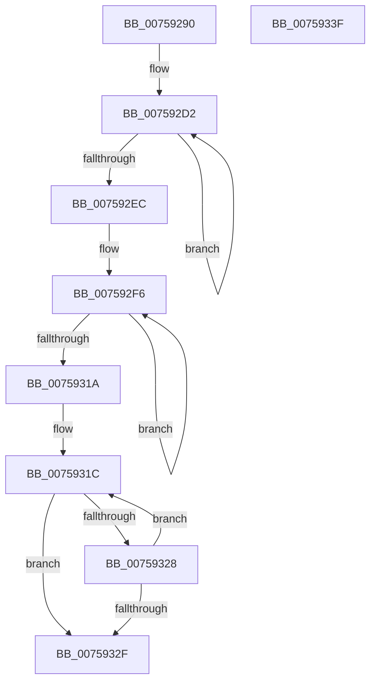

# PopFxInitializeWorkPool

- RVA: `0x00759290`–`0x00759340` (길이 `176` bytes)
- VA: `0x0000000140759290`
- 실행 섹션: `PAGE`
- PDB 이름 있음: `예`; PDB Function 태그: `아니요`
- unwind 정보 RVA: `0x00060BC4`
- 디코드: `49`개 명령, `176/176` bytes 표시
- 미해석 바이트: `0` (있으면 어셈블리에 `.byte`로 보존)

> 이 문서는 커널 이미지의 기계어와 PDB 기호를 분석해 생성했습니다. 4번과 5번은 함수 원형과 자료형을 바이너리 사용 방식에서 추정한 C 해석이며 원본 소스 복구 결과는 아닙니다.

## 1. Dependencies

- 직접 호출 지점: **3**; 고유 호출 대상: **3**
- 직접 호출자로 확인된 함수: **2**
- RIP 상대 이미지 참조: **1**

### Outgoing calls
- `0x007592B1` → [memset](../../text/6C/memset_function_006C6C40.md) (function, `0x006C6C40`)
- `0x007592DD` → [KeInitializeSemaphore](../../text/46/KeInitializeSemaphore_function_004660D0.md) (function, `0x004660D0`)
- `0x0075931F` → [PopFxCreateStaticWorkPoolThread](PopFxCreateStaticWorkPoolThread_function_00758D50.md) (function, `0x00758D50`)

### Direct callers
- [PopFxRegisterPluginEx](../../text/5D/PopFxRegisterPluginEx_function_005D31B8.md) at `0x005D32AE`
- [PoFxInitPowerManagement](../../init/C3/PoFxInitPowerManagement_function_00C3E83C.md) at `0x00C3EA26`
- [PoFxInitPowerManagement](../../init/C3/PoFxInitPowerManagement_function_00C3E83C.md) at `0x00C3EA34`

### Static image references
- `0x007592FD` → RVA `0x00A17050` (`PopFxPluginWork`; read)

## 2. Other-region calls and transfers

- 다른 실행 섹션으로 향하는 call: **2**
  - `0x007592B1` → [memset](../../text/6C/memset_function_006C6C40.md) (`PAGE` → `.text`)
  - `0x007592DD` → [KeInitializeSemaphore](../../text/46/KeInitializeSemaphore_function_004660D0.md) (`PAGE` → `.text`)
- 별도 외부 분기/꼬리 이동을 확인하지 못했습니다.

## 3. Assembly (complete function range)

```asm
00759290  48 89 5C 24 08                  mov qword ptr [rsp + 8], rbx
00759295  48 89 74 24 10                  mov qword ptr [rsp + 0x10], rsi
0075929A  57                              push rdi
0075929B  48 83 EC 20                     sub rsp, 0x20
0075929F  48 8B DA                        mov rbx, rdx
007592A2  48 8B F9                        mov rdi, rcx
007592A5  48 83 C1 18                     add rcx, 0x18
007592A9  33 D2                           xor edx, edx
007592AB  41 B8 18 01 00 00               mov r8d, 0x118
007592B1  E8 8A D9 F6 FF                  call 0x1406c6c40
007592B6  48 83 67 08 00                  and qword ptr [rdi + 8], 0
007592BB  48 8D 47 10                     lea rax, [rdi + 0x10]
007592BF  48 89 1F                        mov qword ptr [rdi], rbx
007592C2  BE 02 00 00 00                  mov esi, 2
007592C7  48 89 40 08                     mov qword ptr [rax + 8], rax
007592CB  48 8D 5F 20                     lea rbx, [rdi + 0x20]
007592CF  48 89 00                        mov qword ptr [rax], rax
007592D2  33 D2                           xor edx, edx
007592D4  41 B8 FF FF FF 7F               mov r8d, 0x7fffffff
007592DA  48 8B CB                        mov rcx, rbx
007592DD  E8 EE CD D0 FF                  call 0x1404660d0
007592E2  48 83 C3 20                     add rbx, 0x20
007592E6  48 83 EE 01                     sub rsi, 1
007592EA  75 E6                           jne 0x1407592d2
007592EC  48 8D 8F 88 00 00 00            lea rcx, [rdi + 0x88]
007592F3  8D 56 04                        lea edx, [rsi + 4]
007592F6  48 8D 41 E0                     lea rax, [rcx - 0x20]
007592FA  48 89 38                        mov qword ptr [rax], rdi
007592FD  4C 8D 05 4C DD 2B 00            lea r8, [rip + 0x2bdd4c]
00759304  48 83 61 E8 00                  and qword ptr [rcx - 0x18], 0
00759309  4C 89 41 F8                     mov qword ptr [rcx - 8], r8
0075930D  48 89 01                        mov qword ptr [rcx], rax
00759310  48 8D 49 28                     lea rcx, [rcx + 0x28]
00759314  48 83 EA 01                     sub rdx, 1
00759318  75 DC                           jne 0x1407592f6
0075931A  33 DB                           xor ebx, ebx
0075931C  48 8B CF                        mov rcx, rdi
0075931F  E8 2C FA FF FF                  call 0x140758d50
00759324  85 C0                           test eax, eax
00759326  78 07                           js 0x14075932f
00759328  FF C3                           inc ebx
0075932A  83 FB 01                        cmp ebx, 1
0075932D  72 ED                           jb 0x14075931c
0075932F  48 8B 5C 24 30                  mov rbx, qword ptr [rsp + 0x30]
00759334  48 8B 74 24 38                  mov rsi, qword ptr [rsp + 0x38]
00759339  48 83 C4 20                     add rsp, 0x20
0075933D  5F                              pop rdi
0075933E  C3                              ret
0075933F  CC                              int3
```

## 4. C-style interpretation (structured pseudocode)

```c
__int64 __fastcall PopFxInitializeWorkPool(__int64 a1, __int64 a2)
{
    __int64 result;
    __int64 v_rbx;
    __int64 v_rsi;
    __int64 v_rsp;
    unsigned __int64 v_stack_p10;
    unsigned __int64 v_stack_p8;

    v_stack_p8 = v_rbx;
    v_stack_p10 = v_rsi;
    v_rsp = (v_rsp) - (32);
    a1 = (a1) + (24);
    a2 = 0;
    result = memset(a1, a2, 280, a4);
    *(unsigned __int64 *)(a1) = 0;
    *(unsigned __int64 *)(a1 + 16 + 8) = a1 + 16;
    *(unsigned __int64 *)(a1 + 16) = a1 + 16;
loc_007592D2:
    a2 = 0;
    result = KeInitializeSemaphore(a1 + 32, a2, (unsigned int)(0x7FFFFFFFULL), a4);
    v_rbx = (a1 + 32) + (32);
    v_rsi = (2) - (1);
    if (condition_is_not_equal) goto loc_007592D2;
loc_007592F6:
    *(unsigned __int64 *)(a1 + 136 - 32) = a1;
    *(unsigned __int64 *)(a1 + 136 - 8) = v_rip + 2874700;
    *(unsigned __int64 *)(a1 + 136) = a1 + 136 - 32;
    a2 = (v_rsi + 4) - (1);
    if (condition_is_not_equal) goto loc_007592F6;
    v_rbx = 0;
loc_0075931C:
    result = PopFxCreateStaticWorkPoolThread(a1, a2, v_rip + 2874700, a4);
    if (sign_flag) goto loc_0075932F;
    v_rbx = (unsigned int)((v_rbx) + 1);
    if (((unsigned int)(v_rbx)) < 1) goto loc_0075931C;
loc_0075932F:
    v_rsp = (v_rsp) + (32);
    return result;
}
```

## 5. (Beta) C Style

```c
int64_t PopFxInitializeWorkPool(void *Arg1, int64_t Arg2)
{
    uint8_t *arg1 = (uint8_t *)Arg1;

    int64_t result;
    int64_t local_rbx;
    int64_t local_rsi;
    int64_t local_rsp;
    uint64_t v_stack_p10;
    uint64_t v_stack_p8;

    v_stack_p8 = local_rbx;
    v_stack_p10 = local_rsi;
    local_rsp = (local_rsp) - (32);
    Arg1 = (Arg1) + (24);
    Arg2 = 0;
    result = memset(Arg1, Arg2, 280, a4);
    *(uint64_t *)(arg1) = 0;
    *(void **)(arg1 + 0x10 + 0x8) = Arg1 + 16;
    *(void **)(arg1 + 0x10) = Arg1 + 16;
loc_007592D2:
    Arg2 = 0;
    result = KeInitializeSemaphore(Arg1 + 32, Arg2, (uint32_t)(0x7FFFFFFFULL), a4);
    local_rbx = (Arg1 + 32) + (32);
    local_rsi = (2) - (1);
    if (condition_is_not_equal) goto loc_007592D2;
loc_007592F6:
    *(void **)(arg1 + 0x88 - 0x20) = Arg1;
    *(uint64_t *)(arg1 + 0x88 - 0x8) = v_rip + 2874700;
    *(void **)(arg1 + 0x88) = Arg1 + 136 - 32;
    Arg2 = (local_rsi + 4) - (1);
    if (condition_is_not_equal) goto loc_007592F6;
    local_rbx = 0;
loc_0075931C:
    result = PopFxCreateStaticWorkPoolThread(Arg1, Arg2, v_rip + 2874700, a4);
    if (sign_flag) goto loc_0075932F;
    local_rbx = (uint32_t)((local_rbx) + 1);
    if (((uint32_t)(local_rbx)) < 1) goto loc_0075931C;
loc_0075932F:
    local_rsp = (local_rsp) + (32);
    return result;
}
```

### 관측된 메모리 오프셋

구조체 형식이 확인되지 않은 접근은 인자 기준의 오프셋으로만 기록했습니다.

| 기준 인자 | 오프셋 표현 | 폭 (bit) | 접근 |
|---|---:|---:|---|
| `Arg1` | `- 0x20` | `64` | `R` |
| `Arg1` | `- 0x18` | `64` | `R/W` |
| `Arg1` | `- 0x8` | `64` | `W` |
| `Arg1` | `+ 0x0` | `64` | `W` |
| `Arg1` | `+ 0x8` | `64` | `R/W` |
| `Arg1` | `+ 0x8` | `64` | `W` |
| `Arg1` | `+ 0x10` | `64` | `R` |
| `Arg1` | `+ 0x20` | `64` | `R` |
| `Arg1` | `+ 0x28` | `64` | `R` |
| `Arg1` | `+ 0x88` | `64` | `R` |

## 6. Execution-region graph

[열기: 2D/3D 그래프와 함수 탐색 컨트롤 패널](../../../control-panel.html?section=page&rva=0x00759290&view=graph)

- 2D 그래프는 위에서 아래로 흐르고, 3D 그래프는 빈 공간을 드래그해 회전합니다. Shift+드래그는 이동, 휠은 확대·축소, 함수 노드 선택은 대상 보고서 이동입니다.

### Static fallback


