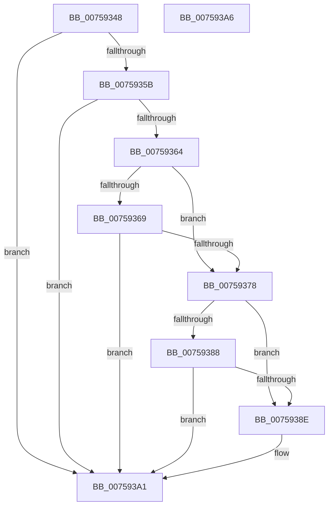

# PopFxInvokeDripsWatchdogCallback

- RVA: `0x00759348`–`0x007593A7` (길이 `95` bytes)
- VA: `0x0000000140759348`
- 실행 섹션: `PAGE`
- PDB 이름 있음: `예`; PDB Function 태그: `아니요`
- unwind 정보 RVA: `0x0005C788`
- 디코드: `26`개 명령, `95/95` bytes 표시
- 미해석 바이트: `0` (있으면 어셈블리에 `.byte`로 보존)

> 이 문서는 커널 이미지의 기계어와 PDB 기호를 분석해 생성했습니다. 4번과 5번은 함수 원형과 자료형을 바이너리 사용 방식에서 추정한 C 해석이며 원본 소스 복구 결과는 아닙니다.

## 1. Dependencies

- 직접 호출 지점: **1**; 고유 호출 대상: **1**
- 직접 호출자로 확인된 함수: **1**
- RIP 상대 이미지 참조: **0**

### Outgoing calls
- `0x0075939C` → [guard_dispatch_icall](../../text/6B/guard_dispatch_icall_function_006BAAD0.md) (function, `0x006BAAD0`)

### Direct callers
- [PopDripsWatchdogInvokeDeviceCallbacks](../AA/PopDripsWatchdogInvokeDeviceCallbacks_function_00AA34A0.md) at `0x00AA3539`
- [PopDripsWatchdogInvokeDeviceCallbacks](../AA/PopDripsWatchdogInvokeDeviceCallbacks_function_00AA34A0.md) at `0x00AA3549`

### Static image references
- 디코드된 RIP-relative 메모리 참조가 없습니다.

## 2. Other-region calls and transfers

- 다른 실행 섹션으로 향하는 call: **1**
  - `0x0075939C` → [guard_dispatch_icall](../../text/6B/guard_dispatch_icall_function_006BAAD0.md) (`PAGE` → `.text`)
- 별도 외부 분기/꼬리 이동을 확인하지 못했습니다.

## 3. Assembly (complete function range)

```asm
00759348  48 83 EC 28                     sub rsp, 0x28
0075934C  48 8B C1                        mov rax, rcx
0075934F  45 33 C9                        xor r9d, r9d
00759352  48 8B 49 50                     mov rcx, qword ptr [rcx + 0x50]
00759356  48 85 C9                        test rcx, rcx
00759359  74 46                           je 0x1407593a1
0075935B  4C 39 89 A8 00 00 00            cmp qword ptr [rcx + 0xa8], r9
00759362  74 3D                           je 0x1407593a1
00759364  48 3B C2                        cmp rax, rdx
00759367  74 0F                           je 0x140759378
00759369  33 C0                           xor eax, eax
0075936B  F0 44 0F B1 89 60 03 00 00      lock cmpxchg dword ptr [rcx + 0x360], r9d
00759374  A8 08                           test al, 8
00759376  74 29                           je 0x1407593a1
00759378  48 8B 81 88 03 00 00            mov rax, qword ptr [rcx + 0x388]
0075937F  48 8B 52 20                     mov rdx, qword ptr [rdx + 0x20]
00759383  48 85 C0                        test rax, rax
00759386  74 06                           je 0x14075938e
00759388  48 3B 42 08                     cmp rax, qword ptr [rdx + 8]
0075938C  75 13                           jne 0x1407593a1
0075938E  48 8B 81 A8 00 00 00            mov rax, qword ptr [rcx + 0xa8]
00759395  48 8B 89 C0 00 00 00            mov rcx, qword ptr [rcx + 0xc0]
0075939C  E8 2F 17 F6 FF                  call 0x1406baad0
007593A1  48 83 C4 28                     add rsp, 0x28
007593A5  C3                              ret
007593A6  CC                              int3
```

## 4. C-style interpretation (structured pseudocode)

```c
__int64 __fastcall PopFxInvokeDripsWatchdogCallback(__int64 a1, __int64 a2, __int64 a3, int a4)
{
    __int64 result;
    __int64 v_rsp;

    v_rsp = (v_rsp) - (40);
    a4 = 0;
    if (*(unsigned __int64 *)(a1 + 80) == 0) goto loc_007593A1;
    if ((*(unsigned __int64 *)(*(unsigned __int64 *)(a1 + 80) + 168)) == 0) goto loc_007593A1;
    if (a1 == a2) goto loc_00759378;
    result = 0;
    if (((0) & (8)) == 0) goto loc_007593A1;
loc_00759378:
    if (*(unsigned __int64 *)(*(unsigned __int64 *)(a1 + 80) + 904) == 0) goto loc_0075938E;
    result = *(unsigned __int64 *)(*(unsigned __int64 *)(a1 + 80) + 904);
    if ((*(unsigned __int64 *)(*(unsigned __int64 *)(a1 + 80) + 904)) == (*(unsigned __int64 *)(*(unsigned __int64 *)(a2 + 32) + 8))) {
        result = *(unsigned __int64 *)(*(unsigned __int64 *)(a1 + 80) + 168);
        a1 = *(unsigned __int64 *)(*(unsigned __int64 *)(a1 + 80) + 192);
        result = guard_dispatch_icall(a1, *(unsigned __int64 *)(a2 + 32), a3, a4);
    }
    v_rsp = (v_rsp) + (40);
    return result;
}
```

## 5. (Beta) C Style

```c
int64_t PopFxInvokeDripsWatchdogCallback(void *Arg1, void *Arg2, int64_t Arg3, int32_t Arg4)
{
    uint8_t *arg1 = (uint8_t *)Arg1;
    uint8_t *arg2 = (uint8_t *)Arg2;

    int64_t result;
    int64_t local_rsp;

    local_rsp = (local_rsp) - (40);
    Arg4 = 0;
    if (*(uint64_t *)(arg1 + 0x50) == 0) goto loc_007593A1;
    if ((*(uint64_t *)(*(uint64_t *)(arg1 + 0x50) + 0xA8)) == 0) goto loc_007593A1;
    if (Arg1 == Arg2) goto loc_00759378;
    result = 0;
    if (((0) & (8)) == 0) goto loc_007593A1;
loc_00759378:
    if (*(uint64_t *)(*(uint64_t *)(arg1 + 0x50) + 0x388) == 0) goto loc_0075938E;
    result = *(uint64_t *)(*(uint64_t *)(arg1 + 0x50) + 0x388);
    if ((*(uint64_t *)(*(uint64_t *)(arg1 + 0x50) + 0x388)) == (*(uint64_t *)(*(uint64_t *)(arg2 + 0x20) + 0x8))) {
        result = *(uint64_t *)(*(uint64_t *)(arg1 + 0x50) + 0xA8);
        Arg1 = *(uint64_t *)(*(uint64_t *)(arg1 + 0x50) + 0xC0);
        result = guard_dispatch_icall(Arg1, *(uint64_t *)(arg2 + 0x20), Arg3, Arg4);
    }
    local_rsp = (local_rsp) + (40);
    return result;
}
```

### 관측된 메모리 오프셋

구조체 형식이 확인되지 않은 접근은 인자 기준의 오프셋으로만 기록했습니다.

| 기준 인자 | 오프셋 표현 | 폭 (bit) | 접근 |
|---|---:|---:|---|
| `Arg1` | `+ 0x50` | `64` | `R` |
| `Arg2` | `+ 0x20` | `64` | `R` |

## 6. Execution-region graph

[열기: 2D/3D 그래프와 함수 탐색 컨트롤 패널](../../../control-panel.html?section=page&rva=0x00759348&view=graph)

- 2D 그래프는 위에서 아래로 흐르고, 3D 그래프는 빈 공간을 드래그해 회전합니다. Shift+드래그는 이동, 휠은 확대·축소, 함수 노드 선택은 대상 보고서 이동입니다.

### Static fallback


