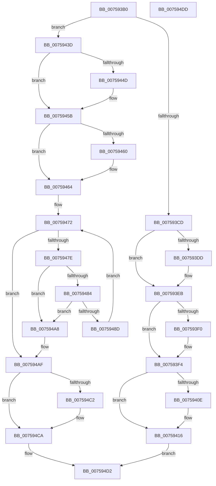

# PopFxNotifySxTransitionState

- RVA: `0x007593B0`–`0x007594DE` (길이 `302` bytes)
- VA: `0x00000001407593B0`
- 실행 섹션: `PAGE`
- PDB 이름 있음: `예`; PDB Function 태그: `아니요`
- unwind 정보 RVA: `0x0006E5F8`
- 디코드: `80`개 명령, `302/302` bytes 표시
- 미해석 바이트: `0` (있으면 어셈블리에 `.byte`로 보존)

> 이 문서는 커널 이미지의 기계어와 PDB 기호를 분석해 생성했습니다. 4번과 5번은 함수 원형과 자료형을 바이너리 사용 방식에서 추정한 C 해석이며 원본 소스 복구 결과는 아닙니다.

## 1. Dependencies

- 직접 호출 지점: **10**; 고유 호출 대상: **6**
- 직접 호출자로 확인된 함수: **1**
- RIP 상대 이미지 참조: **6**

### Outgoing calls
- `0x007593CD` → [KeAbPreAcquire](../../text/21/KeAbPreAcquire_function_00210230.md) (function, `0x00210230`)
- `0x007593E6` → [ExfAcquirePushLockExclusiveEx](../../text/20/ExfAcquirePushLockExclusiveEx_function_0020FC90.md) (function, `0x0020FC90`)
- `0x00759411` → [ExfTryToWakePushLock](../../text/26/ExfTryToWakePushLock_function_00265DD0.md) (function, `0x00265DD0`)
- `0x00759419` → [KeAbPostRelease](../../text/2E/KeAbPostRelease_function_002E1600.md) (function, `0x002E1600`)
- `0x00759433` → [KeWaitForSingleObject](../../text/20/KeWaitForSingleObject_function_0020E6B0.md) (function, `0x0020E6B0`)
- `0x0075943D` → [KeAbPreAcquire](../../text/21/KeAbPreAcquire_function_00210230.md) (function, `0x00210230`)
- `0x00759456` → [ExfAcquirePushLockExclusiveEx](../../text/20/ExfAcquirePushLockExclusiveEx_function_0020FC90.md) (function, `0x0020FC90`)
- `0x007594A1` → [ExQueueWorkItem](../../text/2F/ExQueueWorkItem_function_002F9520.md) (function, `0x002F9520`)
- `0x007594C5` → [ExfTryToWakePushLock](../../text/26/ExfTryToWakePushLock_function_00265DD0.md) (function, `0x00265DD0`)
- `0x007594CD` → [KeAbPostRelease](../../text/2E/KeAbPostRelease_function_002E1600.md) (function, `0x002E1600`)

### Direct callers
- [PoBroadcastSystemState](../../pagelk/B7/PoBroadcastSystemState_function_00B761B0.md) at `0x00B766D9`
- [PoBroadcastSystemState](../../pagelk/B7/PoBroadcastSystemState_function_00B761B0.md) at `0x00B76768`

### Static image references
- `0x007593BD` → RVA `0x00F0E500` (`.data`; read)
- `0x007593F4` → RVA `0x00F0E518` (`.data`; write)
- `0x007593FF` → RVA `0x00F0E500` (`.data`; read/write)
- `0x00759424` → RVA `0x00F0E520` (`.data`; read)
- `0x0075946B` → RVA `0x00F0E508` (`.data`; read)
- `0x0075948D` → RVA `0x00F0E508` (`.data`; write)

## 2. Other-region calls and transfers

- 다른 실행 섹션으로 향하는 call: **10**
  - `0x007593CD` → [KeAbPreAcquire](../../text/21/KeAbPreAcquire_function_00210230.md) (`PAGE` → `.text`)
  - `0x007593E6` → [ExfAcquirePushLockExclusiveEx](../../text/20/ExfAcquirePushLockExclusiveEx_function_0020FC90.md) (`PAGE` → `.text`)
  - `0x00759411` → [ExfTryToWakePushLock](../../text/26/ExfTryToWakePushLock_function_00265DD0.md) (`PAGE` → `.text`)
  - `0x00759419` → [KeAbPostRelease](../../text/2E/KeAbPostRelease_function_002E1600.md) (`PAGE` → `.text`)
  - `0x00759433` → [KeWaitForSingleObject](../../text/20/KeWaitForSingleObject_function_0020E6B0.md) (`PAGE` → `.text`)
  - `0x0075943D` → [KeAbPreAcquire](../../text/21/KeAbPreAcquire_function_00210230.md) (`PAGE` → `.text`)
  - `0x00759456` → [ExfAcquirePushLockExclusiveEx](../../text/20/ExfAcquirePushLockExclusiveEx_function_0020FC90.md) (`PAGE` → `.text`)
  - `0x007594A1` → [ExQueueWorkItem](../../text/2F/ExQueueWorkItem_function_002F9520.md) (`PAGE` → `.text`)
  - `0x007594C5` → [ExfTryToWakePushLock](../../text/26/ExfTryToWakePushLock_function_00265DD0.md) (`PAGE` → `.text`)
  - `0x007594CD` → [KeAbPostRelease](../../text/2E/KeAbPostRelease_function_002E1600.md) (`PAGE` → `.text`)
- 별도 외부 분기/꼬리 이동을 확인하지 못했습니다.

## 3. Assembly (complete function range)

```asm
007593B0  48 89 5C 24 08                  mov qword ptr [rsp + 8], rbx
007593B5  57                              push rdi
007593B6  48 83 EC 30                     sub rsp, 0x30
007593BA  45 33 C0                        xor r8d, r8d
007593BD  48 8D 1D 3C 51 7B 00            lea rbx, [rip + 0x7b513c]
007593C4  33 D2                           xor edx, edx
007593C6  84 C9                           test cl, cl
007593C8  48 8B CB                        mov rcx, rbx
007593CB  74 70                           je 0x14075943d
007593CD  E8 5E 6E AB FF                  call 0x140210230
007593D2  F0 48 0F BA 2B 00               lock bts qword ptr [rbx], 0
007593D8  48 8B F8                        mov rdi, rax
007593DB  73 0E                           jae 0x1407593eb
007593DD  4C 8B C3                        mov r8, rbx
007593E0  48 8B D0                        mov rdx, rax
007593E3  48 8B CB                        mov rcx, rbx
007593E6  E8 A5 68 AB FF                  call 0x14020fc90
007593EB  48 85 FF                        test rdi, rdi
007593EE  74 04                           je 0x1407593f4
007593F0  C6 47 0A 01                     mov byte ptr [rdi + 0xa], 1
007593F4  C6 05 1D 51 7B 00 01            mov byte ptr [rip + 0x7b511d], 1
007593FB  48 83 C8 FF                     or rax, 0xffffffffffffffff
007593FF  F0 48 0F C1 05 F8 50 7B 00      lock xadd qword ptr [rip + 0x7b50f8], rax
00759408  24 06                           and al, 6
0075940A  3C 02                           cmp al, 2
0075940C  75 08                           jne 0x140759416
0075940E  48 8B CB                        mov rcx, rbx
00759411  E8 BA C9 B0 FF                  call 0x140265dd0
00759416  48 8B CB                        mov rcx, rbx
00759419  E8 E2 81 B8 FF                  call 0x1402e1600
0075941E  48 83 64 24 20 00               and qword ptr [rsp + 0x20], 0
00759424  48 8D 0D F5 50 7B 00            lea rcx, [rip + 0x7b50f5]
0075942B  45 33 C9                        xor r9d, r9d
0075942E  45 33 C0                        xor r8d, r8d
00759431  33 D2                           xor edx, edx
00759433  E8 78 52 AB FF                  call 0x14020e6b0
00759438  E9 95 00 00 00                  jmp 0x1407594d2
0075943D  E8 EE 6D AB FF                  call 0x140210230
00759442  F0 48 0F BA 2B 00               lock bts qword ptr [rbx], 0
00759448  48 8B F8                        mov rdi, rax
0075944B  73 0E                           jae 0x14075945b
0075944D  4C 8B C3                        mov r8, rbx
00759450  48 8B D0                        mov rdx, rax
00759453  48 8B CB                        mov rcx, rbx
00759456  E8 35 68 AB FF                  call 0x14020fc90
0075945B  48 85 FF                        test rdi, rdi
0075945E  74 04                           je 0x140759464
00759460  C6 47 0A 01                     mov byte ptr [rdi + 0xa], 1
00759464  C6 05 AD 50 7B 00 00            mov byte ptr [rip + 0x7b50ad], 0
0075946B  48 8D 3D 96 50 7B 00            lea rdi, [rip + 0x7b5096]
00759472  48 8B 0D 8F 50 7B 00            mov rcx, qword ptr [rip + 0x7b508f]
00759479  48 3B CF                        cmp rcx, rdi
0075947C  74 31                           je 0x1407594af
0075947E  48 39 79 08                     cmp qword ptr [rcx + 8], rdi
00759482  75 24                           jne 0x1407594a8
00759484  48 8B 01                        mov rax, qword ptr [rcx]
00759487  48 39 48 08                     cmp qword ptr [rax + 8], rcx
0075948B  75 1B                           jne 0x1407594a8
0075948D  48 89 05 74 50 7B 00            mov qword ptr [rip + 0x7b5074], rax
00759494  48 83 C1 20                     add rcx, 0x20
00759498  BA 01 00 00 00                  mov edx, 1
0075949D  48 89 78 08                     mov qword ptr [rax + 8], rdi
007594A1  E8 7A 00 BA FF                  call 0x1402f9520
007594A6  EB CA                           jmp 0x140759472
007594A8  B9 03 00 00 00                  mov ecx, 3
007594AD  CD 29                           int 0x29
007594AF  48 83 C8 FF                     or rax, 0xffffffffffffffff
007594B3  F0 48 0F C1 05 44 50 7B 00      lock xadd qword ptr [rip + 0x7b5044], rax
007594BC  24 06                           and al, 6
007594BE  3C 02                           cmp al, 2
007594C0  75 08                           jne 0x1407594ca
007594C2  48 8B CB                        mov rcx, rbx
007594C5  E8 06 C9 B0 FF                  call 0x140265dd0
007594CA  48 8B CB                        mov rcx, rbx
007594CD  E8 2E 81 B8 FF                  call 0x1402e1600
007594D2  48 8B 5C 24 40                  mov rbx, qword ptr [rsp + 0x40]
007594D7  48 83 C4 30                     add rsp, 0x30
007594DB  5F                              pop rdi
007594DC  C3                              ret
007594DD  CC                              int3
```

## 4. C-style interpretation (structured pseudocode)

```c
__int64 __fastcall PopFxNotifySxTransitionState(unsigned __int8 a1, int a2, int a3, int a4)
{
    __int64 result;
    __int64 v_rsp;
    unsigned __int64 v_stack_m18;
    unsigned __int64 v_stack_p8;

    v_stack_p8 = v_rbx;
    v_rsp = (v_rsp) - (48);
    a3 = 0;
    a2 = 0;
    if (a1 == 0) goto loc_0075943D;
    result = KeAbPreAcquire(v_rip + 8081724, a2, a3, a4);
    if (!(condition_is_above_or_equal)) {
        a3 = v_rip + 8081724;
        a2 = result;
        a1 = v_rip + 8081724;
        result = ExfAcquirePushLockExclusiveEx(a1, a2, a3, a4);
    }
    if (result != 0) {
        *(unsigned __int8 *)(result + 10) = 1;
    }
    *(unsigned __int8 *)(v_rip + 8081693) = 1;
    result = (result) | (-1);
    result = (unsigned __int8)((result) & (6));
    if (((unsigned __int8)(result)) == 2) {
        a1 = v_rip + 8081724;
        result = ExfTryToWakePushLock(a1, a2, a3, a4);
    }
    result = KeAbPostRelease(v_rip + 8081724, a2, a3, a4);
    a4 = 0;
    a3 = 0;
    a2 = 0;
    result = KeWaitForSingleObject(v_rip + 8081653, a2, a3, a4);
    goto loc_007594D2;
loc_0075943D:
    result = KeAbPreAcquire(v_rip + 8081653, a2, a3, a4);
    if (!(condition_is_above_or_equal)) {
        a3 = v_rip + 8081724;
        a2 = result;
        a1 = v_rip + 8081724;
        result = ExfAcquirePushLockExclusiveEx(a1, a2, a3, a4);
    }
    if (result != 0) {
        *(unsigned __int8 *)(result + 10) = 1;
    }
    *(unsigned __int8 *)(v_rip + 8081581) = 0;
loc_00759472:
    if ((*(unsigned __int64 *)(v_rip + 8081551)) == (v_rip + 8081558)) goto loc_007594AF;
    if ((*(unsigned __int64 *)(*(unsigned __int64 *)(v_rip + 8081551) + 8)) != (v_rip + 8081558)) goto loc_007594A8;
    if ((*(unsigned __int64 *)(*(unsigned __int64 *)(*(unsigned __int64 *)(v_rip + 8081551)) + 8)) != (*(unsigned __int64 *)(v_rip + 8081551))) goto loc_007594A8;
    *(unsigned __int64 *)(v_rip + 8081524) = *(unsigned __int64 *)(*(unsigned __int64 *)(v_rip + 8081551));
    a1 = (*(unsigned __int64 *)(v_rip + 8081551)) + (32);
    *(unsigned __int64 *)(*(unsigned __int64 *)(*(unsigned __int64 *)(v_rip + 8081551)) + 8) = v_rip + 8081558;
    result = ExQueueWorkItem(a1, 1, a3, a4);
    goto loc_00759472;
loc_007594A8:
loc_007594AF:
    result = (result) | (-1);
    result = (unsigned __int8)((result) & (6));
    if (((unsigned __int8)(result)) == 2) {
        a1 = v_rip + 8081724;
        result = ExfTryToWakePushLock(a1, 1, a3, a4);
    }
    result = KeAbPostRelease(v_rip + 8081724, 1, a3, a4);
loc_007594D2:
    v_rsp = (v_rsp) + (48);
    return result;
}
```

## 5. (Beta) C Style

```c
int64_t PopFxNotifySxTransitionState(uint8_t Arg1, int32_t Arg2, int32_t Arg3, int32_t Arg4)
{
    int64_t result;
    int64_t local_rsp;
    uint64_t v_stack_m18;
    uint64_t v_stack_p8;

    v_stack_p8 = local_rbx;
    local_rsp = (local_rsp) - (48);
    Arg3 = 0;
    Arg2 = 0;
    if (Arg1 == 0) goto loc_0075943D;
    result = KeAbPreAcquire(v_rip + 8081724, Arg2, Arg3, Arg4);
    if (!(condition_is_above_or_equal)) {
        Arg3 = v_rip + 8081724;
        Arg2 = result;
        Arg1 = v_rip + 8081724;
        result = ExfAcquirePushLockExclusiveEx(Arg1, Arg2, Arg3, Arg4);
    }
    if (result != 0) {
        *(uint8_t *)(result + 0xA) = 1;
    }
    *(uint8_t *)(v_rip + 0x7B511D) = 1;
    result = (result) | (-1);
    result = (uint8_t)((result) & (6));
    if (((uint8_t)(result)) == 2) {
        Arg1 = v_rip + 8081724;
        result = ExfTryToWakePushLock(Arg1, Arg2, Arg3, Arg4);
    }
    result = KeAbPostRelease(v_rip + 8081724, Arg2, Arg3, Arg4);
    Arg4 = 0;
    Arg3 = 0;
    Arg2 = 0;
    result = KeWaitForSingleObject(v_rip + 8081653, Arg2, Arg3, Arg4);
    goto loc_007594D2;
loc_0075943D:
    result = KeAbPreAcquire(v_rip + 8081653, Arg2, Arg3, Arg4);
    if (!(condition_is_above_or_equal)) {
        Arg3 = v_rip + 8081724;
        Arg2 = result;
        Arg1 = v_rip + 8081724;
        result = ExfAcquirePushLockExclusiveEx(Arg1, Arg2, Arg3, Arg4);
    }
    if (result != 0) {
        *(uint8_t *)(result + 0xA) = 1;
    }
    *(uint8_t *)(v_rip + 0x7B50AD) = 0;
loc_00759472:
    if ((*(uint64_t *)(v_rip + 0x7B508F)) == (v_rip + 8081558)) goto loc_007594AF;
    if ((*(uint64_t *)(*(uint64_t *)(v_rip + 0x7B508F) + 0x8)) != (v_rip + 8081558)) goto loc_007594A8;
    if ((*(uint64_t *)(*(uint64_t *)(*(uint64_t *)(v_rip + 0x7B508F)) + 0x8)) != (*(uint64_t *)(v_rip + 0x7B508F))) goto loc_007594A8;
    *(uint64_t *)(v_rip + 0x7B5074) = *(uint64_t *)(*(uint64_t *)(v_rip + 0x7B508F));
    Arg1 = (*(uint64_t *)(v_rip + 0x7B508F)) + (32);
    *(uint64_t *)(*(uint64_t *)(*(uint64_t *)(v_rip + 0x7B508F)) + 0x8) = v_rip + 8081558;
    result = ExQueueWorkItem(Arg1, 1, Arg3, Arg4);
    goto loc_00759472;
loc_007594A8:
loc_007594AF:
    result = (result) | (-1);
    result = (uint8_t)((result) & (6));
    if (((uint8_t)(result)) == 2) {
        Arg1 = v_rip + 8081724;
        result = ExfTryToWakePushLock(Arg1, 1, Arg3, Arg4);
    }
    result = KeAbPostRelease(v_rip + 8081724, 1, Arg3, Arg4);
loc_007594D2:
    local_rsp = (local_rsp) + (48);
    return result;
}
```

## 6. Execution-region graph

[열기: 2D/3D 그래프와 함수 탐색 컨트롤 패널](../../../control-panel.html?section=page&rva=0x007593B0&view=graph)

- 2D 그래프는 위에서 아래로 흐르고, 3D 그래프는 빈 공간을 드래그해 회전합니다. Shift+드래그는 이동, 휠은 확대·축소, 함수 노드 선택은 대상 보고서 이동입니다.

### Static fallback


