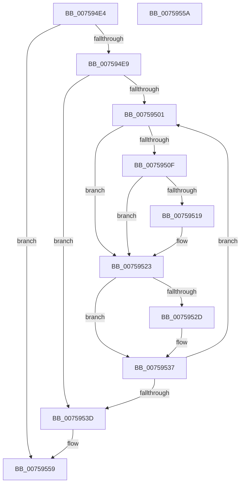

# PopFxPepPerfInfoFree

- RVA: `0x007594E4`–`0x0075955B` (길이 `119` bytes)
- VA: `0x00000001407594E4`
- 실행 섹션: `PAGE`
- PDB 이름 있음: `예`; PDB Function 태그: `아니요`
- unwind 정보 RVA: `0x000ADC24`
- 디코드: `36`개 명령, `119/119` bytes 표시
- 미해석 바이트: `0` (있으면 어셈블리에 `.byte`로 보존)

> 이 문서는 커널 이미지의 기계어와 PDB 기호를 분석해 생성했습니다. 4번과 5번은 함수 원형과 자료형을 바이너리 사용 방식에서 추정한 C 해석이며 원본 소스 복구 결과는 아닙니다.

## 1. Dependencies

- 직접 호출 지점: **3**; 고유 호출 대상: **1**
- 직접 호출자로 확인된 함수: **2**
- RIP 상대 이미지 참조: **0**

### Outgoing calls
- `0x0075951E` → [ExFreePoolWithTag](../../poolcode/B8/ExFreePoolWithTag_function_00B82870.md) (function, `0x00B82870`)
- `0x00759532` → [ExFreePoolWithTag](../../poolcode/B8/ExFreePoolWithTag_function_00B82870.md) (function, `0x00B82870`)
- `0x00759545` → [ExFreePoolWithTag](../../poolcode/B8/ExFreePoolWithTag_function_00B82870.md) (function, `0x00B82870`)

### Direct callers
- [PopFxPepPerfInfoQuery](PopFxPepPerfInfoQuery_function_00759564.md) at `0x007595A6`
- [PopFxRegisterComponentPerfStates](PopFxRegisterComponentPerfStates_function_00759764.md) at `0x00759B57`

### Static image references
- 디코드된 RIP-relative 메모리 참조가 없습니다.

## 2. Other-region calls and transfers

- 다른 실행 섹션으로 향하는 call: **3**
  - `0x0075951E` → [ExFreePoolWithTag](../../poolcode/B8/ExFreePoolWithTag_function_00B82870.md) (`PAGE` → `POOLCODE`)
  - `0x00759532` → [ExFreePoolWithTag](../../poolcode/B8/ExFreePoolWithTag_function_00B82870.md) (`PAGE` → `POOLCODE`)
  - `0x00759545` → [ExFreePoolWithTag](../../poolcode/B8/ExFreePoolWithTag_function_00B82870.md) (`PAGE` → `POOLCODE`)
- 별도 외부 분기/꼬리 이동을 확인하지 못했습니다.

## 3. Assembly (complete function range)

```asm
007594E4  48 85 C9                        test rcx, rcx
007594E7  74 70                           je 0x140759559
007594E9  48 89 5C 24 08                  mov qword ptr [rsp + 8], rbx
007594EE  48 89 74 24 10                  mov qword ptr [rsp + 0x10], rsi
007594F3  57                              push rdi
007594F4  48 83 EC 20                     sub rsp, 0x20
007594F8  33 FF                           xor edi, edi
007594FA  48 8B D9                        mov rbx, rcx
007594FD  39 39                           cmp dword ptr [rcx], edi
007594FF  76 3C                           jbe 0x14075953d
00759501  48 8D 34 7F                     lea rsi, [rdi + rdi*2]
00759505  48 03 F6                        add rsi, rsi
00759508  83 7C F3 24 00                  cmp dword ptr [rbx + rsi*8 + 0x24], 0
0075950D  75 14                           jne 0x140759523
0075950F  48 8B 4C F3 30                  mov rcx, qword ptr [rbx + rsi*8 + 0x30]
00759514  48 85 C9                        test rcx, rcx
00759517  74 0A                           je 0x140759523
00759519  BA 50 46 58 4D                  mov edx, 0x4d584650
0075951E  E8 4D 93 42 00                  call 0x140b82870
00759523  48 8B 4C F3 10                  mov rcx, qword ptr [rbx + rsi*8 + 0x10]
00759528  48 85 C9                        test rcx, rcx
0075952B  74 0A                           je 0x140759537
0075952D  BA 50 46 58 4D                  mov edx, 0x4d584650
00759532  E8 39 93 42 00                  call 0x140b82870
00759537  FF C7                           inc edi
00759539  3B 3B                           cmp edi, dword ptr [rbx]
0075953B  72 C4                           jb 0x140759501
0075953D  BA 50 46 58 4D                  mov edx, 0x4d584650
00759542  48 8B CB                        mov rcx, rbx
00759545  E8 26 93 42 00                  call 0x140b82870
0075954A  48 8B 5C 24 30                  mov rbx, qword ptr [rsp + 0x30]
0075954F  48 8B 74 24 38                  mov rsi, qword ptr [rsp + 0x38]
00759554  48 83 C4 20                     add rsp, 0x20
00759558  5F                              pop rdi
00759559  C3                              ret
0075955A  CC                              int3
```

## 4. C-style interpretation (structured pseudocode)

```c
__int64 __fastcall PopFxPepPerfInfoFree(__int64 a1)
{
    __int64 result;
    __int64 v_rdi;
    __int64 v_rsi;
    __int64 v_rsp;
    unsigned __int64 v_stack_p10;
    unsigned __int64 v_stack_p8;

    if (a1 == 0) goto loc_00759559;
    v_stack_p8 = v_rbx;
    v_stack_p10 = v_rsi;
    v_rsp = (v_rsp) - (32);
    v_rdi = 0;
    if ((*(unsigned int *)(a1)) <= 0) goto loc_0075953D;
loc_00759501:
    v_rsi = (v_rdi + v_rdi * 2) + (v_rdi + v_rdi * 2);
    if ((*(unsigned int *)(a1 + v_rsi * 8 + 36)) != 0) goto loc_00759523;
    if (*(unsigned __int64 *)(a1 + v_rsi * 8 + 48) != 0) {
        a2 = 0x4D584650ULL;
        result = ExFreePoolWithTag(*(unsigned __int64 *)(a1 + v_rsi * 8 + 48), a2, a3, a4);
    }
    if (*(unsigned __int64 *)(a1 + v_rsi * 8 + 16) != 0) {
        a2 = 0x4D584650ULL;
        result = ExFreePoolWithTag(*(unsigned __int64 *)(a1 + v_rsi * 8 + 16), a2, a3, a4);
    }
    v_rdi = (unsigned int)((v_rdi) + 1);
    if (((unsigned int)(v_rdi)) < (*(unsigned int *)(a1))) goto loc_00759501;
loc_0075953D:
    result = ExFreePoolWithTag(a1, (unsigned int)(0x4D584650ULL), a3, a4);
    v_rsp = (v_rsp) + (32);
loc_00759559:
    return result;
}
```

## 5. (Beta) C Style

```c
int64_t PopFxPepPerfInfoFree(int64_t Arg1)
{
    int64_t result;
    int64_t local_rdi;
    int64_t local_rsi;
    int64_t local_rsp;
    uint64_t v_stack_p10;
    uint64_t v_stack_p8;

    if (Arg1 == 0) goto loc_00759559;
    v_stack_p8 = local_rbx;
    v_stack_p10 = local_rsi;
    local_rsp = (local_rsp) - (32);
    local_rdi = 0;
    if ((*(uint32_t *)(Arg1)) <= 0) goto loc_0075953D;
loc_00759501:
    local_rsi = (local_rdi + local_rdi * 2) + (local_rdi + local_rdi * 2);
    if ((*(uint32_t *)(Arg1 + local_rsi * 8 + 0x24)) != 0) goto loc_00759523;
    if (*(uint64_t *)(Arg1 + local_rsi * 8 + 0x30) != 0) {
        a2 = 0x4D584650ULL;
        result = ExFreePoolWithTag(*(uint64_t *)(Arg1 + local_rsi * 8 + 0x30), a2, a3, a4);
    }
    if (*(uint64_t *)(Arg1 + local_rsi * 8 + 0x10) != 0) {
        a2 = 0x4D584650ULL;
        result = ExFreePoolWithTag(*(uint64_t *)(Arg1 + local_rsi * 8 + 0x10), a2, a3, a4);
    }
    local_rdi = (uint32_t)((local_rdi) + 1);
    if (((uint32_t)(local_rdi)) < (*(uint32_t *)(Arg1))) goto loc_00759501;
loc_0075953D:
    result = ExFreePoolWithTag(Arg1, (uint32_t)(0x4D584650ULL), a3, a4);
    local_rsp = (local_rsp) + (32);
loc_00759559:
    return result;
}
```

## 6. Execution-region graph

[열기: 2D/3D 그래프와 함수 탐색 컨트롤 패널](../../../control-panel.html?section=page&rva=0x007594E4&view=graph)

- 2D 그래프는 위에서 아래로 흐르고, 3D 그래프는 빈 공간을 드래그해 회전합니다. Shift+드래그는 이동, 휠은 확대·축소, 함수 노드 선택은 대상 보고서 이동입니다.

### Static fallback


