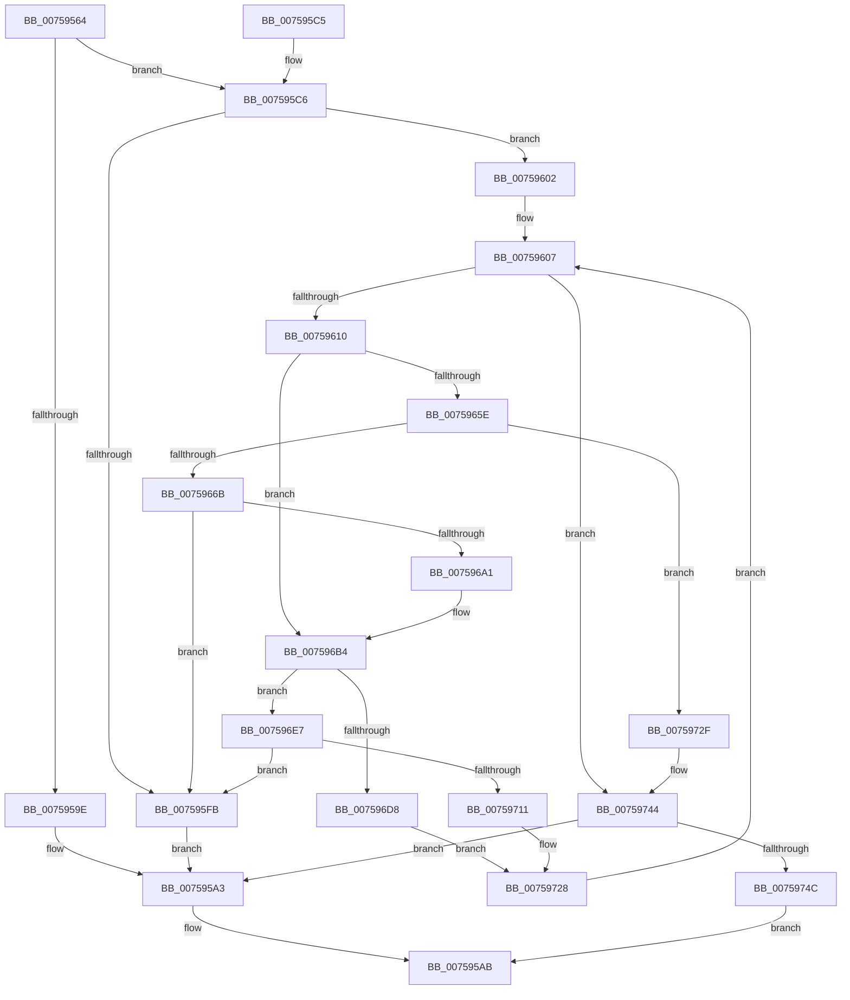

# PopFxPepPerfInfoQuery

- RVA: `0x00759564`–`0x0075975C` (길이 `504` bytes)
- VA: `0x0000000140759564`
- 실행 섹션: `PAGE`
- PDB 이름 있음: `예`; PDB Function 태그: `아니요`
- unwind 정보 RVA: `0x000CC150`
- 디코드: `140`개 명령, `504/504` bytes 표시
- 미해석 바이트: `0` (있으면 어셈블리에 `.byte`로 보존)

> 이 문서는 커널 이미지의 기계어와 PDB 기호를 분석해 생성했습니다. 4번과 5번은 함수 원형과 자료형을 바이너리 사용 방식에서 추정한 C 해석이며 원본 소스 복구 결과는 아닙니다.

## 1. Dependencies

- 직접 호출 지점: **11**; 고유 호출 대상: **8**
- 직접 호출자로 확인된 함수: **1**
- RIP 상대 이미지 참조: **0**

### Outgoing calls
- `0x00759595` → [PopPluginQueryComponentPerfCapabilities](../../text/5D/PopPluginQueryComponentPerfCapabilities_function_005D3A68.md) (function, `0x005D3A68`)
- `0x007595A6` → [PopFxPepPerfInfoFree](PopFxPepPerfInfoFree_function_007594E4.md) (function, `0x007594E4`)
- `0x007595EE` → [ExAllocatePool2](../../poolcode/B8/ExAllocatePool2_function_00B820F0.md) (function, `0x00B820F0`)
- `0x00759653` → [PopPluginQueryComponentPerfSet](../../text/5D/PopPluginQueryComponentPerfSet_function_005D3AB8.md) (function, `0x005D3AB8`)
- `0x00759677` → [RtlULongLongMult](../../text/43/RtlULongLongMult_function_0043E530.md) (function, `0x0043E530`)
- `0x0075968E` → [ExAllocatePool2](../../poolcode/B8/ExAllocatePool2_function_00B820F0.md) (function, `0x00B820F0`)
- `0x007596AD` → [PopPluginQueryComponentPerfStates](../../text/5D/PopPluginQueryComponentPerfStates_function_005D3BF0.md) (function, `0x005D3BF0`)
- `0x007596CA` → [PopPluginQueryComponentPerfSetName](../../text/5D/PopPluginQueryComponentPerfSetName_function_005D3B64.md) (function, `0x005D3B64`)
- `0x007596FE` → [ExAllocatePool2](../../poolcode/B8/ExAllocatePool2_function_00B820F0.md) (function, `0x00B820F0`)
- `0x00759723` → [PopPluginQueryComponentPerfSetName](../../text/5D/PopPluginQueryComponentPerfSetName_function_005D3B64.md) (function, `0x005D3B64`)
- `0x0075973E` → [PopFxBugCheck](../../text/2B/PopFxBugCheck_function_002BFC6C.md) (function, `0x002BFC6C`)

### Direct callers
- [PopFxRegisterComponentPerfStates](PopFxRegisterComponentPerfStates_function_00759764.md) at `0x007597B8`

### Static image references
- 디코드된 RIP-relative 메모리 참조가 없습니다.

## 2. Other-region calls and transfers

- 다른 실행 섹션으로 향하는 call: **10**
  - `0x00759595` → [PopPluginQueryComponentPerfCapabilities](../../text/5D/PopPluginQueryComponentPerfCapabilities_function_005D3A68.md) (`PAGE` → `.text`)
  - `0x007595EE` → [ExAllocatePool2](../../poolcode/B8/ExAllocatePool2_function_00B820F0.md) (`PAGE` → `POOLCODE`)
  - `0x00759653` → [PopPluginQueryComponentPerfSet](../../text/5D/PopPluginQueryComponentPerfSet_function_005D3AB8.md) (`PAGE` → `.text`)
  - `0x00759677` → [RtlULongLongMult](../../text/43/RtlULongLongMult_function_0043E530.md) (`PAGE` → `.text`)
  - `0x0075968E` → [ExAllocatePool2](../../poolcode/B8/ExAllocatePool2_function_00B820F0.md) (`PAGE` → `POOLCODE`)
  - `0x007596AD` → [PopPluginQueryComponentPerfStates](../../text/5D/PopPluginQueryComponentPerfStates_function_005D3BF0.md) (`PAGE` → `.text`)
  - `0x007596CA` → [PopPluginQueryComponentPerfSetName](../../text/5D/PopPluginQueryComponentPerfSetName_function_005D3B64.md) (`PAGE` → `.text`)
  - `0x007596FE` → [ExAllocatePool2](../../poolcode/B8/ExAllocatePool2_function_00B820F0.md) (`PAGE` → `POOLCODE`)
  - `0x00759723` → [PopPluginQueryComponentPerfSetName](../../text/5D/PopPluginQueryComponentPerfSetName_function_005D3B64.md) (`PAGE` → `.text`)
  - `0x0075973E` → [PopFxBugCheck](../../text/2B/PopFxBugCheck_function_002BFC6C.md) (`PAGE` → `.text`)
- 별도 외부 분기/꼬리 이동을 확인하지 못했습니다.

## 3. Assembly (complete function range)

```asm
00759564  48 8B C4                        mov rax, rsp
00759567  48 89 58 08                     mov qword ptr [rax + 8], rbx
0075956B  4C 89 40 18                     mov qword ptr [rax + 0x18], r8
0075956F  55                              push rbp
00759570  56                              push rsi
00759571  57                              push rdi
00759572  41 54                           push r12
00759574  41 55                           push r13
00759576  41 56                           push r14
00759578  41 57                           push r15
0075957A  48 83 EC 50                     sub rsp, 0x50
0075957E  33 DB                           xor ebx, ebx
00759580  44 8B E2                        mov r12d, edx
00759583  4C 8D 40 20                     lea r8, [rax + 0x20]
00759587  89 58 20                        mov dword ptr [rax + 0x20], ebx
0075958A  48 89 58 B8                     mov qword ptr [rax - 0x48], rbx
0075958E  8B FB                           mov edi, ebx
00759590  8B F3                           mov esi, ebx
00759592  4C 8B F1                        mov r14, rcx
00759595  E8 CE A4 E7 FF                  call 0x1405d3a68
0075959A  84 C0                           test al, al
0075959C  75 28                           jne 0x1407595c6
0075959E  BF 02 00 00 C0                  mov edi, 0xc0000002
007595A3  48 8B CE                        mov rcx, rsi
007595A6  E8 39 FF FF FF                  call 0x1407594e4
007595AB  48 8B 9C 24 90 00 00 00         mov rbx, qword ptr [rsp + 0x90]
007595B3  8B C7                           mov eax, edi
007595B5  48 83 C4 50                     add rsp, 0x50
007595B9  41 5F                           pop r15
007595BB  41 5E                           pop r14
007595BD  41 5D                           pop r13
007595BF  41 5C                           pop r12
007595C1  5F                              pop rdi
007595C2  5E                              pop rsi
007595C3  5D                              pop rbp
007595C4  C3                              ret
007595C5  CC                              int3
007595C6  44 8B AC 24 A8 00 00 00         mov r13d, dword ptr [rsp + 0xa8]
007595CE  B9 00 01 00 00                  mov ecx, 0x100
007595D3  41 B8 50 46 58 4D               mov r8d, 0x4d584650
007595D9  42 8D 04 6D 00 00 00 00         lea eax, [r13*2]
007595E1  41 03 C5                        add eax, r13d
007595E4  C1 E0 04                        shl eax, 4
007595E7  48 63 D0                        movsxd rdx, eax
007595EA  48 83 C2 08                     add rdx, 8
007595EE  E8 FD 8A 42 00                  call 0x140b820f0
007595F3  48 8B F0                        mov rsi, rax
007595F6  48 85 C0                        test rax, rax
007595F9  75 07                           jne 0x140759602
007595FB  BF 9A 00 00 C0                  mov edi, 0xc000009a
00759600  EB A1                           jmp 0x1407595a3
00759602  44 89 28                        mov dword ptr [rax], r13d
00759605  8B EB                           mov ebp, ebx
00759607  41 3B ED                        cmp ebp, r13d
0075960A  0F 83 34 01 00 00               jae 0x140759744
00759610  8B C5                           mov eax, ebp
00759612  48 8D 4E 30                     lea rcx, [rsi + 0x30]
00759616  48 8D 5E 24                     lea rbx, [rsi + 0x24]
0075961A  44 8B C5                        mov r8d, ebp
0075961D  4C 8D 4E 20                     lea r9, [rsi + 0x20]
00759621  41 8B D4                        mov edx, r12d
00759624  4C 8D 3C 40                     lea r15, [rax + rax*2]
00759628  49 C1 E7 04                     shl r15, 4
0075962C  48 8D 46 28                     lea rax, [rsi + 0x28]
00759630  49 03 CF                        add rcx, r15
00759633  49 03 C7                        add rax, r15
00759636  48 89 4C 24 38                  mov qword ptr [rsp + 0x38], rcx
0075963B  49 03 DF                        add rbx, r15
0075963E  48 89 44 24 30                  mov qword ptr [rsp + 0x30], rax
00759643  4D 03 CF                        add r9, r15
00759646  48 89 44 24 28                  mov qword ptr [rsp + 0x28], rax
0075964B  49 8B CE                        mov rcx, r14
0075964E  48 89 5C 24 20                  mov qword ptr [rsp + 0x20], rbx
00759653  E8 60 A4 E7 FF                  call 0x1405d3ab8
00759658  33 C9                           xor ecx, ecx
0075965A  39 0B                           cmp dword ptr [rbx], ecx
0075965C  75 56                           jne 0x1407596b4
0075965E  41 8B 44 37 28                  mov eax, dword ptr [r15 + rsi + 0x28]
00759663  85 C0                           test eax, eax
00759665  0F 84 C4 00 00 00               je 0x14075972f
0075966B  8B C8                           mov ecx, eax
0075966D  4C 8D 44 24 40                  lea r8, [rsp + 0x40]
00759672  BA 10 00 00 00                  mov edx, 0x10
00759677  E8 B4 4E CE FF                  call 0x14043e530
0075967C  48 8B 54 24 40                  mov rdx, qword ptr [rsp + 0x40]
00759681  41 B8 50 46 58 4D               mov r8d, 0x4d584650
00759687  B9 00 01 00 00                  mov ecx, 0x100
0075968C  8B F8                           mov edi, eax
0075968E  E8 5D 8A 42 00                  call 0x140b820f0
00759693  49 89 44 37 30                  mov qword ptr [r15 + rsi + 0x30], rax
00759698  48 85 C0                        test rax, rax
0075969B  0F 84 5A FF FF FF               je 0x1407595fb
007596A1  4C 8B C8                        mov r9, rax
007596A4  44 8B C5                        mov r8d, ebp
007596A7  41 8B D4                        mov edx, r12d
007596AA  49 8B CE                        mov rcx, r14
007596AD  E8 3E A5 E7 FF                  call 0x1405d3bf0
007596B2  33 C9                           xor ecx, ecx
007596B4  48 89 4C 24 20                  mov qword ptr [rsp + 0x20], rcx
007596B9  49 8D 1C 37                     lea rbx, [r15 + rsi]
007596BD  4C 8D 4B 0A                     lea r9, [rbx + 0xa]
007596C1  44 8B C5                        mov r8d, ebp
007596C4  41 8B D4                        mov edx, r12d
007596C7  49 8B CE                        mov rcx, r14
007596CA  E8 95 A4 E7 FF                  call 0x1405d3b64
007596CF  0F B7 4B 0A                     movzx ecx, word ptr [rbx + 0xa]
007596D3  66 85 C9                        test cx, cx
007596D6  75 0F                           jne 0x1407596e7
007596D8  33 DB                           xor ebx, ebx
007596DA  66 41 89 5C 37 08               mov word ptr [r15 + rsi + 8], bx
007596E0  49 89 5C 37 10                  mov qword ptr [r15 + rsi + 0x10], rbx
007596E5  EB 41                           jmp 0x140759728
007596E7  8D 41 FE                        lea eax, [rcx - 2]
007596EA  48 8B D1                        mov rdx, rcx
007596ED  B9 00 01 00 00                  mov ecx, 0x100
007596F2  66 41 89 44 37 08               mov word ptr [r15 + rsi + 8], ax
007596F8  41 B8 50 46 58 4D               mov r8d, 0x4d584650
007596FE  E8 ED 89 42 00                  call 0x140b820f0
00759703  49 89 44 37 10                  mov qword ptr [r15 + rsi + 0x10], rax
00759708  48 85 C0                        test rax, rax
0075970B  0F 84 EA FE FF FF               je 0x1407595fb
00759711  4C 8D 4B 0A                     lea r9, [rbx + 0xa]
00759715  48 89 44 24 20                  mov qword ptr [rsp + 0x20], rax
0075971A  44 8B C5                        mov r8d, ebp
0075971D  41 8B D4                        mov edx, r12d
00759720  49 8B CE                        mov rcx, r14
00759723  E8 3C A4 E7 FF                  call 0x1405d3b64
00759728  FF C5                           inc ebp
0075972A  E9 D8 FE FF FF                  jmp 0x140759607
0075972F  49 8B 56 40                     mov rdx, qword ptr [r14 + 0x40]
00759733  4D 8B CC                        mov r9, r12
00759736  4D 8B C6                        mov r8, r14
00759739  B9 1A 06 00 00                  mov ecx, 0x61a
0075973E  E8 29 65 B6 FF                  call 0x1402bfc6c
00759743  CC                              int3
00759744  85 FF                           test edi, edi
00759746  0F 88 57 FE FF FF               js 0x1407595a3
0075974C  48 8B 84 24 A0 00 00 00         mov rax, qword ptr [rsp + 0xa0]
00759754  48 89 30                        mov qword ptr [rax], rsi
00759757  E9 4F FE FF FF                  jmp 0x1407595ab
```

## 4. C-style interpretation (structured pseudocode)

```c
__int64 __fastcall PopFxPepPerfInfoQuery(__int64 a1, int a2, __int64 a3)
{
    __int64 result;
    __int64 v_r15;
    __int64 v_rbp;
    __int64 v_rbx;
    __int64 v_rsp;
    unsigned __int64 v_stack_p20;
    unsigned __int64 v_stack_p28;
    unsigned __int64 v_stack_p30;
    unsigned __int64 v_stack_p38;
    unsigned __int64 v_stack_p40;
    unsigned __int64 v_stack_p8;
    unsigned __int64 v_stack_pA0;
    unsigned int v_stack_pA8;

    *(unsigned __int64 *)(v_rsp + 8) = v_rbx;
    *(unsigned __int64 *)(v_rsp + 24) = a3;
    v_rsp = (v_rsp) - (80);
    v_rbx = 0;
    *(unsigned int *)(v_rsp + 32) = 0;
    *(unsigned __int64 *)(v_rsp - 72) = 0;
    result = PopPluginQueryComponentPerfCapabilities(a1, a2, v_rsp + 32, a4);
    if ((unsigned __int8)(result) != 0) goto loc_007595C6;
loc_007595A3:
    result = PopFxPepPerfInfoFree(0, a2, v_rsp + 32, a4);
loc_007595AB:
    v_rsp = (v_rsp) + (80);
    return (unsigned int)((unsigned int)((unsigned int)(0xC0000002ULL)));
loc_007595C6:
    result = (unsigned int)(((unsigned int)(v_stack_pA8) * 2) + ((unsigned int)((unsigned int)(v_stack_pA8))));
    result = (unsigned int)((result) << (4));
    a2 = ((int)((unsigned int)(result))) + (8);
    result = ExAllocatePool2(256, a2, (unsigned int)(0x4D584650ULL), a4);
    if (result != 0) goto loc_00759602;
loc_007595FB:
    goto loc_007595A3;
loc_00759602:
    *(unsigned int *)(result) = (unsigned int)((unsigned int)(v_stack_pA8));
loc_00759607:
    if (((unsigned int)((unsigned int)((unsigned int)(v_stack_p8)))) >= ((unsigned int)((unsigned int)(v_stack_pA8)))) goto loc_00759744;
    v_r15 = ((unsigned int)((unsigned int)((unsigned int)((unsigned int)(v_stack_p8)))) + (unsigned int)((unsigned int)((unsigned int)((unsigned int)(v_stack_p8)))) * 2) << (4);
    a1 = (result + 48) + (v_r15);
    result = (result + 40) + (v_r15);
    v_stack_p38 = a1;
    v_rbx = (result + 36) + (v_r15);
    v_stack_p30 = result;
    a4 = (result + 32) + (v_r15);
    v_stack_p28 = result;
    v_stack_p20 = v_rbx;
    result = PopPluginQueryComponentPerfSet(a1, (unsigned int)((unsigned int)((unsigned int)(a2))), (unsigned int)((unsigned int)((unsigned int)((unsigned int)(v_stack_p8)))), a4);
    a1 = 0;
    if ((*(unsigned int *)(v_rbx)) != 0) goto loc_007596B4;
    if ((unsigned int)((unsigned int)(*(unsigned int *)(v_r15 + result * 1 + 40))) == 0) goto loc_0075972F;
    result = RtlULongLongMult((unsigned int)((unsigned int)((unsigned int)(*(unsigned int *)(v_r15 + result * 1 + 40)))), 16, v_stack_p40, a4);
    result = ExAllocatePool2(256, v_stack_p40, (unsigned int)(0x4D584650ULL), a4);
    *(unsigned __int64 *)(v_r15 + result * 1 + 48) = result;
    if (result == 0) goto loc_007595FB;
    result = PopPluginQueryComponentPerfStates(0, (unsigned int)((unsigned int)((unsigned int)(a2))), (unsigned int)((unsigned int)((unsigned int)((unsigned int)(v_stack_p8)))), result);
    a1 = 0;
loc_007596B4:
    v_stack_p20 = 0;
    result = PopPluginQueryComponentPerfSetName(0, (unsigned int)((unsigned int)((unsigned int)(a2))), (unsigned int)((unsigned int)((unsigned int)((unsigned int)(v_stack_p8)))), v_r15 + result * 1 + 10);
    if ((unsigned __int16)(*(unsigned __int16 *)(v_r15 + result * 1 + 10)) != 0) goto loc_007596E7;
    v_rbx = 0;
    *(unsigned __int16 *)(v_r15 + result * 1 + 8) = 0;
    *(unsigned __int64 *)(v_r15 + result * 1 + 16) = 0;
    goto loc_00759728;
loc_007596E7:
    *(unsigned __int16 *)(v_r15 + result * 1 + 8) = (unsigned __int16)(*(unsigned __int16 *)(v_r15 + result * 1 + 10) - 2);
    result = ExAllocatePool2(256, *(unsigned __int16 *)(v_r15 + result * 1 + 10), (unsigned int)(0x4D584650ULL), v_r15 + result * 1 + 10);
    *(unsigned __int64 *)(v_r15 + result * 1 + 16) = result;
    if (result == 0) goto loc_007595FB;
    v_stack_p20 = result;
    result = PopPluginQueryComponentPerfSetName(0, (unsigned int)((unsigned int)((unsigned int)(a2))), (unsigned int)((unsigned int)((unsigned int)((unsigned int)(v_stack_p8)))), v_rbx + 10);
loc_00759728:
    v_rbp = (unsigned int)(((unsigned int)((unsigned int)(v_stack_p8))) + 1);
    goto loc_00759607;
loc_0075972F:
    result = PopFxBugCheck((unsigned int)(0x61AULL), *(unsigned __int64 *)(a1 + 64), 0, (unsigned int)(a2));
loc_00759744:
    if (sign_flag) goto loc_007595A3;
    *(unsigned __int64 *)(v_stack_pA0) = result;
    goto loc_007595AB;
}
```

## 5. (Beta) C Style

```c
int64_t PopFxPepPerfInfoQuery(void *Arg1, int32_t Arg2, int64_t Arg3)
{
    uint8_t *arg1 = (uint8_t *)Arg1;

    int64_t result;
    int64_t local_r15;
    int64_t local_rbp;
    int64_t local_rbx;
    int64_t local_rsp;
    uint64_t v_stack_p20;
    uint64_t v_stack_p28;
    uint64_t v_stack_p30;
    uint64_t v_stack_p38;
    uint64_t v_stack_p40;
    uint64_t v_stack_p8;
    uint64_t v_stack_pA0;
    uint32_t v_stack_pA8;

    *(uint64_t *)(local_rsp + 0x8) = local_rbx;
    *(uint64_t *)(local_rsp + 0x18) = Arg3;
    local_rsp = (local_rsp) - (80);
    local_rbx = 0;
    *(uint32_t *)(local_rsp + 0x20) = 0;
    *(uint64_t *)(local_rsp - 0x48) = 0;
    result = PopPluginQueryComponentPerfCapabilities(Arg1, Arg2, local_rsp + 32, a4);
    if ((uint8_t)(result) != 0) goto loc_007595C6;
loc_007595A3:
    result = PopFxPepPerfInfoFree(0, Arg2, local_rsp + 32, a4);
loc_007595AB:
    local_rsp = (local_rsp) + (80);
    return (uint32_t)((uint32_t)((uint32_t)(0xC0000002ULL)));
loc_007595C6:
    result = (uint32_t)(((uint32_t)(v_stack_pA8) * 2) + ((uint32_t)((uint32_t)(v_stack_pA8))));
    result = (uint32_t)((result) << (4));
    Arg2 = ((int32_t)((uint32_t)(result))) + (8);
    result = ExAllocatePool2(256, Arg2, (uint32_t)(0x4D584650ULL), a4);
    if (result != 0) goto loc_00759602;
loc_007595FB:
    goto loc_007595A3;
loc_00759602:
    *(uint32_t *)(result) = (uint32_t)((uint32_t)(v_stack_pA8));
loc_00759607:
    if (((uint32_t)((uint32_t)((uint32_t)(v_stack_p8)))) >= ((uint32_t)((uint32_t)(v_stack_pA8)))) goto loc_00759744;
    local_r15 = ((uint32_t)((uint32_t)((uint32_t)((uint32_t)(v_stack_p8)))) + (uint32_t)((uint32_t)((uint32_t)((uint32_t)(v_stack_p8)))) * 2) << (4);
    Arg1 = (result + 48) + (local_r15);
    result = (result + 40) + (local_r15);
    v_stack_p38 = Arg1;
    local_rbx = (result + 36) + (local_r15);
    v_stack_p30 = result;
    a4 = (result + 32) + (local_r15);
    v_stack_p28 = result;
    v_stack_p20 = local_rbx;
    result = PopPluginQueryComponentPerfSet(Arg1, (uint32_t)((uint32_t)((uint32_t)(Arg2))), (uint32_t)((uint32_t)((uint32_t)((uint32_t)(v_stack_p8)))), a4);
    Arg1 = 0;
    if ((*(uint32_t *)(local_rbx)) != 0) goto loc_007596B4;
    if ((uint32_t)((uint32_t)(*(uint32_t *)(local_r15 + result * 1 + 0x28))) == 0) goto loc_0075972F;
    result = RtlULongLongMult((uint32_t)((uint32_t)((uint32_t)(*(uint32_t *)(local_r15 + result * 1 + 0x28)))), 16, v_stack_p40, a4);
    result = ExAllocatePool2(256, v_stack_p40, (uint32_t)(0x4D584650ULL), a4);
    *(uint64_t *)(local_r15 + result * 1 + 0x30) = result;
    if (result == 0) goto loc_007595FB;
    result = PopPluginQueryComponentPerfStates(0, (uint32_t)((uint32_t)((uint32_t)(Arg2))), (uint32_t)((uint32_t)((uint32_t)((uint32_t)(v_stack_p8)))), result);
    Arg1 = 0;
loc_007596B4:
    v_stack_p20 = 0;
    result = PopPluginQueryComponentPerfSetName(0, (uint32_t)((uint32_t)((uint32_t)(Arg2))), (uint32_t)((uint32_t)((uint32_t)((uint32_t)(v_stack_p8)))), local_r15 + result * 1 + 10);
    if ((uint16_t)(*(uint16_t *)(local_r15 + result * 1 + 0xA)) != 0) goto loc_007596E7;
    local_rbx = 0;
    *(uint16_t *)(local_r15 + result * 1 + 0x8) = 0;
    *(uint64_t *)(local_r15 + result * 1 + 0x10) = 0;
    goto loc_00759728;
loc_007596E7:
    *(uint16_t *)(local_r15 + result * 1 + 0x8) = (uint16_t)(*(uint16_t *)(local_r15 + result * 1 + 0xA) - 2);
    result = ExAllocatePool2(256, *(uint16_t *)(local_r15 + result * 1 + 0xA), (uint32_t)(0x4D584650ULL), local_r15 + result * 1 + 10);
    *(uint64_t *)(local_r15 + result * 1 + 0x10) = result;
    if (result == 0) goto loc_007595FB;
    v_stack_p20 = result;
    result = PopPluginQueryComponentPerfSetName(0, (uint32_t)((uint32_t)((uint32_t)(Arg2))), (uint32_t)((uint32_t)((uint32_t)((uint32_t)(v_stack_p8)))), local_rbx + 10);
loc_00759728:
    local_rbp = (uint32_t)(((uint32_t)((uint32_t)(v_stack_p8))) + 1);
    goto loc_00759607;
loc_0075972F:
    result = PopFxBugCheck((uint32_t)(0x61AULL), *(uint64_t *)(arg1 + 0x40), 0, (uint32_t)(Arg2));
loc_00759744:
    if (sign_flag) goto loc_007595A3;
    *(uint64_t *)(v_stack_pA0) = result;
    goto loc_007595AB;
}
```

### 관측된 메모리 오프셋

구조체 형식이 확인되지 않은 접근은 인자 기준의 오프셋으로만 기록했습니다.

| 기준 인자 | 오프셋 표현 | 폭 (bit) | 접근 |
|---|---:|---:|---|
| `Arg1` | `+ 0x40` | `64` | `R` |

## 6. Execution-region graph

[열기: 2D/3D 그래프와 함수 탐색 컨트롤 패널](../../../control-panel.html?section=page&rva=0x00759564&view=graph)

- 2D 그래프는 위에서 아래로 흐르고, 3D 그래프는 빈 공간을 드래그해 회전합니다. Shift+드래그는 이동, 휠은 확대·축소, 함수 노드 선택은 대상 보고서 이동입니다.

### Static fallback


