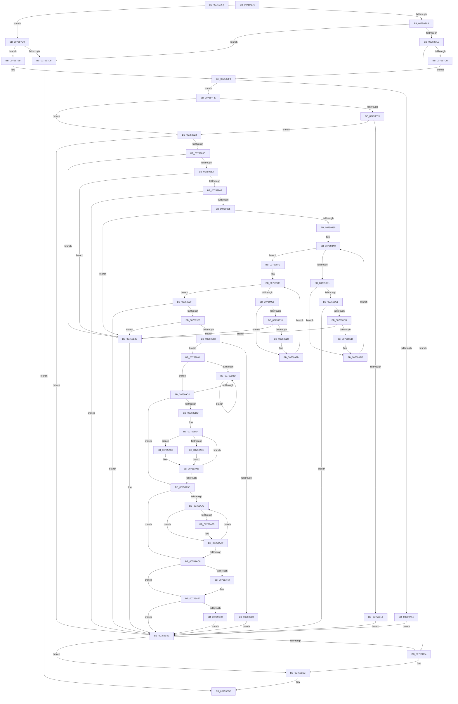

# PopFxRegisterComponentPerfStates

- RVA: `0x00759764`–`0x00759B77` (길이 `1,043` bytes)
- VA: `0x0000000140759764`
- 실행 섹션: `PAGE`
- PDB 이름 있음: `예`; PDB Function 태그: `아니요`
- unwind 정보 RVA: `0x000CC16C`
- 디코드: `300`개 명령, `1,043/1,043` bytes 표시
- 미해석 바이트: `0` (있으면 어셈블리에 `.byte`로 보존)

> 이 문서는 커널 이미지의 기계어와 PDB 기호를 분석해 생성했습니다. 4번과 5번은 함수 원형과 자료형을 바이너리 사용 방식에서 추정한 C 해석이며 원본 소스 복구 결과는 아닙니다.

## 1. Dependencies

- 직접 호출 지점: **13**; 고유 호출 대상: **10**
- 직접 호출자로 확인된 함수: **1**
- RIP 상대 이미지 참조: **1**

### Outgoing calls
- `0x007597B8` → [PopFxPepPerfInfoQuery](PopFxPepPerfInfoQuery_function_00759564.md) (function, `0x00759564`)
- `0x00759807` → [PopPluginRegisterComponentPerfStates](../../text/5D/PopPluginRegisterComponentPerfStates_function_005D3C48.md) (function, `0x005D3C48`)
- `0x0075982D` → [RtlULongLongMult](../../text/43/RtlULongLongMult_function_0043E530.md) (function, `0x0043E530`)
- `0x00759876` → [RtlULongLongMult](../../text/43/RtlULongLongMult_function_0043E530.md) (function, `0x0043E530`)
- `0x007598CC` → [RtlULongLongMult](../../text/43/RtlULongLongMult_function_0043E530.md) (function, `0x0043E530`)
- `0x00759944` → [RtlULongLongMult](../../text/43/RtlULongLongMult_function_0043E530.md) (function, `0x0043E530`)
- `0x00759970` → [ExAllocatePool2](../../poolcode/B8/ExAllocatePool2_function_00B820F0.md) (function, `0x00B820F0`)
- `0x00759A28` → [memcpy](../../text/6C/memcpy_function_006C6840.md) (function, `0x006C6840`)
- `0x00759AA7` → [RtlCopyUnicodeString](../../text/3F/RtlCopyUnicodeString_function_003FEF30.md) (function, `0x003FEF30`)
- `0x00759AE4` → [KeInitializeEvent](../../text/40/KeInitializeEvent_function_0040DD10.md) (function, `0x0040DD10`)
- `0x00759B15` → [PopFxTracePerfRegistration](../AD/PopFxTracePerfRegistration_function_00AD81B0.md) (function, `0x00AD81B0`)
- `0x00759B29` → [PopPepRegisterComponentPerfStates](../../text/5D/PopPepRegisterComponentPerfStates_function_005DD000.md) (function, `0x005DD000`)
- `0x00759B57` → [PopFxPepPerfInfoFree](PopFxPepPerfInfoFree_function_007594E4.md) (function, `0x007594E4`)

### Direct callers
- [PoFxRegisterComponentPerfStates](PoFxRegisterComponentPerfStates_function_00758780.md) at `0x007587E8`

### Static image references
- `0x00759B06` → RVA `0x005D21A0` (`PopFxComponentPerfWork`; read)

## 2. Other-region calls and transfers

- 다른 실행 섹션으로 향하는 call: **10**
  - `0x00759807` → [PopPluginRegisterComponentPerfStates](../../text/5D/PopPluginRegisterComponentPerfStates_function_005D3C48.md) (`PAGE` → `.text`)
  - `0x0075982D` → [RtlULongLongMult](../../text/43/RtlULongLongMult_function_0043E530.md) (`PAGE` → `.text`)
  - `0x00759876` → [RtlULongLongMult](../../text/43/RtlULongLongMult_function_0043E530.md) (`PAGE` → `.text`)
  - `0x007598CC` → [RtlULongLongMult](../../text/43/RtlULongLongMult_function_0043E530.md) (`PAGE` → `.text`)
  - `0x00759944` → [RtlULongLongMult](../../text/43/RtlULongLongMult_function_0043E530.md) (`PAGE` → `.text`)
  - `0x00759970` → [ExAllocatePool2](../../poolcode/B8/ExAllocatePool2_function_00B820F0.md) (`PAGE` → `POOLCODE`)
  - `0x00759A28` → [memcpy](../../text/6C/memcpy_function_006C6840.md) (`PAGE` → `.text`)
  - `0x00759AA7` → [RtlCopyUnicodeString](../../text/3F/RtlCopyUnicodeString_function_003FEF30.md) (`PAGE` → `.text`)
  - `0x00759AE4` → [KeInitializeEvent](../../text/40/KeInitializeEvent_function_0040DD10.md) (`PAGE` → `.text`)
  - `0x00759B29` → [PopPepRegisterComponentPerfStates](../../text/5D/PopPepRegisterComponentPerfStates_function_005DD000.md) (`PAGE` → `.text`)
- 별도 외부 분기/꼬리 이동을 확인하지 못했습니다.

## 3. Assembly (complete function range)

```asm
00759764  48 8B C4                        mov rax, rsp
00759767  48 89 58 20                     mov qword ptr [rax + 0x20], rbx
0075976B  4C 89 40 18                     mov qword ptr [rax + 0x18], r8
0075976F  48 89 50 10                     mov qword ptr [rax + 0x10], rdx
00759773  48 89 48 08                     mov qword ptr [rax + 8], rcx
00759777  55                              push rbp
00759778  56                              push rsi
00759779  57                              push rdi
0075977A  41 54                           push r12
0075977C  41 55                           push r13
0075977E  41 56                           push r14
00759780  41 57                           push r15
00759782  48 8B EC                        mov rbp, rsp
00759785  48 83 EC 60                     sub rsp, 0x60
00759789  33 F6                           xor esi, esi
0075978B  4D 8B E1                        mov r12, r9
0075978E  4C 8B C9                        mov r9, rcx
00759791  48 89 75 C8                     mov qword ptr [rbp - 0x38], rsi
00759795  48 8B 4D 60                     mov rcx, qword ptr [rbp + 0x60]
00759799  49 8B D8                        mov rbx, r8
0075979C  48 89 75 D0                     mov qword ptr [rbp - 0x30], rsi
007597A0  48 8B C2                        mov rax, rdx
007597A3  48 85 C9                        test rcx, rcx
007597A6  75 31                           jne 0x1407597d9
007597A8  48 39 75 68                     cmp qword ptr [rbp + 0x68], rsi
007597AC  74 31                           je 0x1407597df
007597AE  8B 52 10                        mov edx, dword ptr [rdx + 0x10]
007597B1  4C 8D 45 D0                     lea r8, [rbp - 0x30]
007597B5  49 8B C9                        mov rcx, r9
007597B8  E8 A7 FD FF FF                  call 0x140759564
007597BD  48 8B 7D D0                     mov rdi, qword ptr [rbp - 0x30]
007597C1  8B D8                           mov ebx, eax
007597C3  85 C0                           test eax, eax
007597C5  0F 88 89 03 00 00               js 0x140759b54
007597CB  48 8B 45 48                     mov rax, qword ptr [rbp + 0x48]
007597CF  48 8B 5D 50                     mov rbx, qword ptr [rbp + 0x50]
007597D3  4C 8B 4D 40                     mov r9, qword ptr [rbp + 0x40]
007597D7  EB 17                           jmp 0x1407597f0
007597D9  48 39 75 68                     cmp qword ptr [rbp + 0x68], rsi
007597DD  74 0A                           je 0x1407597e9
007597DF  B8 0D 00 00 C0                  mov eax, 0xc000000d
007597E4  E9 75 03 00 00                  jmp 0x140759b5e
007597E9  48 8B F9                        mov rdi, rcx
007597EC  48 89 4D D0                     mov qword ptr [rbp - 0x30], rcx
007597F0  39 37                           cmp dword ptr [rdi], esi
007597F2  75 0A                           jne 0x1407597fe
007597F4  BB 0D 00 00 C0                  mov ebx, 0xc000000d
007597F9  E9 50 03 00 00                  jmp 0x140759b4e
007597FE  8B 50 10                        mov edx, dword ptr [rax + 0x10]
00759801  4C 8B C7                        mov r8, rdi
00759804  49 8B C9                        mov rcx, r9
00759807  E8 3C A4 E7 FF                  call 0x1405d3c48
0075980C  88 45 C0                        mov byte ptr [rbp - 0x40], al
0075980F  84 C0                           test al, al
00759811  75 0F                           jne 0x140759822
00759813  F6 C3 01                        test bl, 1
00759816  75 0A                           jne 0x140759822
00759818  BB 02 00 00 C0                  mov ebx, 0xc0000002
0075981D  E9 2C 03 00 00                  jmp 0x140759b4e
00759822  8B 0F                           mov ecx, dword ptr [rdi]
00759824  4C 8D 45 C8                     lea r8, [rbp - 0x38]
00759828  BA 20 00 00 00                  mov edx, 0x20
0075982D  E8 FE 4C CE FF                  call 0x14043e530
00759832  8B D8                           mov ebx, eax
00759834  85 C0                           test eax, eax
00759836  0F 88 12 03 00 00               js 0x140759b4e
0075983C  48 8B 45 C8                     mov rax, qword ptr [rbp - 0x38]
00759840  48 05 A0 00 00 00               add rax, 0xa0
00759846  48 3D A0 00 00 00               cmp rax, 0xa0
0075984C  0F 82 F7 02 00 00               jb 0x140759b49
00759852  4C 8D 70 07                     lea r14, [rax + 7]
00759856  49 83 E6 F8                     and r14, 0xfffffffffffffff8
0075985A  4D 8D 6E 08                     lea r13, [r14 + 8]
0075985E  4C 89 6D E0                     mov qword ptr [rbp - 0x20], r13
00759862  4D 3B EE                        cmp r13, r14
00759865  0F 82 DE 02 00 00               jb 0x140759b49
0075986B  8B 0F                           mov ecx, dword ptr [rdi]
0075986D  4C 8D 45 C8                     lea r8, [rbp - 0x38]
00759871  BA 30 00 00 00                  mov edx, 0x30
00759876  E8 B5 4C CE FF                  call 0x14043e530
0075987B  8B D8                           mov ebx, eax
0075987D  85 C0                           test eax, eax
0075987F  0F 88 C9 02 00 00               js 0x140759b4e
00759885  4C 8B 4D C8                     mov r9, qword ptr [rbp - 0x38]
00759889  4D 03 CD                        add r9, r13
0075988C  4D 3B CD                        cmp r9, r13
0075988F  0F 82 B4 02 00 00               jb 0x140759b49
00759895  49 83 C1 07                     add r9, 7
00759899  44 8B D6                        mov r10d, esi
0075989C  49 83 E1 F8                     and r9, 0xfffffffffffffff8
007598A0  41 BB 10 00 00 00               mov r11d, 0x10
007598A6  4D 8B F9                        mov r15, r9
007598A9  44 8B 07                        mov r8d, dword ptr [rdi]
007598AC  45 3B D0                        cmp r10d, r8d
007598AF  73 42                           jae 0x1407598f3
007598B1  41 8B C2                        mov eax, r10d
007598B4  48 8D 0C 40                     lea rcx, [rax + rax*2]
007598B8  48 03 C9                        add rcx, rcx
007598BB  39 74 CF 24                     cmp dword ptr [rdi + rcx*8 + 0x24], esi
007598BF  75 2D                           jne 0x1407598ee
007598C1  8B 4C CF 28                     mov ecx, dword ptr [rdi + rcx*8 + 0x28]
007598C5  4C 8D 45 C8                     lea r8, [rbp - 0x38]
007598C9  49 8B D3                        mov rdx, r11
007598CC  E8 5F 4C CE FF                  call 0x14043e530
007598D1  8B D8                           mov ebx, eax
007598D3  85 C0                           test eax, eax
007598D5  0F 88 73 02 00 00               js 0x140759b4e
007598DB  48 8B 4D C8                     mov rcx, qword ptr [rbp - 0x38]
007598DF  49 03 C9                        add rcx, r9
007598E2  49 3B C9                        cmp rcx, r9
007598E5  0F 82 5E 02 00 00               jb 0x140759b49
007598EB  4C 8B C9                        mov r9, rcx
007598EE  41 FF C2                        inc r10d
007598F1  EB B6                           jmp 0x1407598a9
007598F3  49 FF C1                        inc r9
007598F6  8B D6                           mov edx, esi
007598F8  49 83 E1 FE                     and r9, 0xfffffffffffffffe
007598FC  4C 89 4D D8                     mov qword ptr [rbp - 0x28], r9
00759900  41 3B D0                        cmp edx, r8d
00759903  73 2A                           jae 0x14075992f
00759905  8B C2                           mov eax, edx
00759907  48 8D 0C 40                     lea rcx, [rax + rax*2]
0075990B  48 03 C9                        add rcx, rcx
0075990E  0F B7 44 CF 08                  movzx eax, word ptr [rdi + rcx*8 + 8]
00759913  66 85 C0                        test ax, ax
00759916  74 13                           je 0x14075992b
00759918  48 8D 48 02                     lea rcx, [rax + 2]
0075991C  49 03 C9                        add rcx, r9
0075991F  49 3B C9                        cmp rcx, r9
00759922  0F 82 21 02 00 00               jb 0x140759b49
00759928  4C 8B C9                        mov r9, rcx
0075992B  FF C2                           inc edx
0075992D  EB D1                           jmp 0x140759900
0075992F  8B 0F                           mov ecx, dword ptr [rdi]
00759931  4C 8D 45 C8                     lea r8, [rbp - 0x38]
00759935  49 83 C1 07                     add r9, 7
00759939  49 8B D3                        mov rdx, r11
0075993C  49 83 E1 F8                     and r9, 0xfffffffffffffff8
00759940  4C 89 4D E8                     mov qword ptr [rbp - 0x18], r9
00759944  E8 E7 4B CE FF                  call 0x14043e530
00759949  8B D8                           mov ebx, eax
0075994B  85 C0                           test eax, eax
0075994D  0F 88 FB 01 00 00               js 0x140759b4e
00759953  48 8B 55 C8                     mov rdx, qword ptr [rbp - 0x38]
00759957  49 03 D1                        add rdx, r9
0075995A  49 3B D1                        cmp rdx, r9
0075995D  0F 82 E6 01 00 00               jb 0x140759b49
00759963  B9 40 00 00 00                  mov ecx, 0x40
00759968  41 B8 50 46 58 4D               mov r8d, 0x4d584650
0075996E  8B DE                           mov ebx, esi
00759970  E8 7B 87 42 00                  call 0x140b820f0
00759975  45 33 C9                        xor r9d, r9d
00759978  48 8B F0                        mov rsi, rax
0075997B  48 85 C0                        test rax, rax
0075997E  75 0A                           jne 0x14075998a
00759980  BB 9A 00 00 C0                  mov ebx, 0xc000009a
00759985  E9 C4 01 00 00                  jmp 0x140759b4e
0075998A  4C 89 60 20                     mov qword ptr [rax + 0x20], r12
0075998E  49 8D 14 36                     lea rdx, [r14 + rsi]
00759992  8B 07                           mov eax, dword ptr [rdi]
00759994  48 8D 8E A0 00 00 00            lea rcx, [rsi + 0xa0]
0075999B  89 86 90 00 00 00               mov dword ptr [rsi + 0x90], eax
007599A1  45 8B C1                        mov r8d, r9d
007599A4  48 89 8E 98 00 00 00            mov qword ptr [rsi + 0x98], rcx
007599AB  8B 07                           mov eax, dword ptr [rdi]
007599AD  89 02                           mov dword ptr [rdx], eax
007599AF  8B 07                           mov eax, dword ptr [rdi]
007599B1  48 89 55 F0                     mov qword ptr [rbp - 0x10], rdx
007599B5  4A 8D 14 2E                     lea rdx, [rsi + r13]
007599B9  85 C0                           test eax, eax
007599BB  74 15                           je 0x1407599d2
007599BD  48 89 11                        mov qword ptr [rcx], rdx
007599C0  41 FF C0                        inc r8d
007599C3  8B 07                           mov eax, dword ptr [rdi]
007599C5  48 8D 49 20                     lea rcx, [rcx + 0x20]
007599C9  48 83 C2 30                     add rdx, 0x30
007599CD  44 3B C0                        cmp r8d, eax
007599D0  72 EB                           jb 0x1407599bd
007599D2  4D 8D 24 37                     lea r12, [r15 + rsi]
007599D6  45 8B F9                        mov r15d, r9d
007599D9  85 C0                           test eax, eax
007599DB  74 7E                           je 0x140759a5b
007599DD  4D 8D 75 20                     lea r14, [r13 + 0x20]
007599E1  4C 03 F6                        add r14, rsi
007599E4  41 8B C7                        mov eax, r15d
007599E7  48 8D 0C 40                     lea rcx, [rax + rax*2]
007599EB  48 03 C9                        add rcx, rcx
007599EE  48 8B 44 CF 18                  mov rax, qword ptr [rdi + rcx*8 + 0x18]
007599F3  49 89 46 F0                     mov qword ptr [r14 - 0x10], rax
007599F7  8B 44 CF 20                     mov eax, dword ptr [rdi + rcx*8 + 0x20]
007599FB  41 89 46 F8                     mov dword ptr [r14 - 8], eax
007599FF  8B 44 CF 24                     mov eax, dword ptr [rdi + rcx*8 + 0x24]
00759A03  41 89 46 FC                     mov dword ptr [r14 - 4], eax
00759A07  44 39 4C CF 24                  cmp dword ptr [rdi + rcx*8 + 0x24], r9d
00759A0C  75 2E                           jne 0x140759a3c
00759A0E  8B 44 CF 28                     mov eax, dword ptr [rdi + rcx*8 + 0x28]
00759A12  41 89 06                        mov dword ptr [r14], eax
00759A15  44 8B C0                        mov r8d, eax
00759A18  4D 89 66 08                     mov qword ptr [r14 + 8], r12
00759A1C  48 8B 54 CF 30                  mov rdx, qword ptr [rdi + rcx*8 + 0x30]
00759A21  49 8B CC                        mov rcx, r12
00759A24  49 C1 E0 04                     shl r8, 4
00759A28  E8 13 CE F6 FF                  call 0x1406c6840
00759A2D  41 8B 06                        mov eax, dword ptr [r14]
00759A30  48 C1 E0 04                     shl rax, 4
00759A34  4C 03 E0                        add r12, rax
00759A37  45 33 C9                        xor r9d, r9d
00759A3A  EB 11                           jmp 0x140759a4d
00759A3C  48 8B 44 CF 28                  mov rax, qword ptr [rdi + rcx*8 + 0x28]
00759A41  49 89 06                        mov qword ptr [r14], rax
00759A44  48 8B 44 CF 30                  mov rax, qword ptr [rdi + rcx*8 + 0x30]
00759A49  49 89 46 08                     mov qword ptr [r14 + 8], rax
00759A4D  8B 07                           mov eax, dword ptr [rdi]
00759A4F  49 83 C6 30                     add r14, 0x30
00759A53  41 FF C7                        inc r15d
00759A56  44 3B F8                        cmp r15d, eax
00759A59  72 89                           jb 0x1407599e4
00759A5B  4C 8B 6D D8                     mov r13, qword ptr [rbp - 0x28]
00759A5F  45 8B E1                        mov r12d, r9d
00759A62  4C 8B 75 E0                     mov r14, qword ptr [rbp - 0x20]
00759A66  4C 03 EE                        add r13, rsi
00759A69  4C 03 F6                        add r14, rsi
00759A6C  85 C0                           test eax, eax
00759A6E  74 59                           je 0x140759ac9
00759A70  41 8B C4                        mov eax, r12d
00759A73  4C 8D 3C 40                     lea r15, [rax + rax*2]
00759A77  49 C1 E7 04                     shl r15, 4
00759A7B  4C 03 FF                        add r15, rdi
00759A7E  66 45 39 4F 08                  cmp word ptr [r15 + 8], r9w
00759A83  74 2A                           je 0x140759aaf
00759A85  4D 89 6E 08                     mov qword ptr [r14 + 8], r13
00759A89  49 8D 57 08                     lea rdx, [r15 + 8]
00759A8D  41 0F B7 47 08                  movzx eax, word ptr [r15 + 8]
00759A92  49 8B CE                        mov rcx, r14
00759A95  66 41 89 06                     mov word ptr [r14], ax
00759A99  41 0F B7 47 08                  movzx eax, word ptr [r15 + 8]
00759A9E  66 83 C0 02                     add ax, 2
00759AA2  66 41 89 46 02                  mov word ptr [r14 + 2], ax
00759AA7  E8 84 54 CA FF                  call 0x1403fef30
00759AAC  45 33 C9                        xor r9d, r9d
00759AAF  41 0F B7 47 08                  movzx eax, word ptr [r15 + 8]
00759AB4  49 83 C6 30                     add r14, 0x30
00759AB8  D1 E8                           shr eax, 1
00759ABA  41 FF C4                        inc r12d
00759ABD  FF C0                           inc eax
00759ABF  4D 8D 6C 45 00                  lea r13, [r13 + rax*2]
00759AC4  44 3B 27                        cmp r12d, dword ptr [rdi]
00759AC7  72 A7                           jb 0x140759a70
00759AC9  48 8B 45 E8                     mov rax, qword ptr [rbp - 0x18]
00759ACD  48 8D 4E 08                     lea rcx, [rsi + 8]
00759AD1  4C 8B 75 48                     mov r14, qword ptr [rbp + 0x48]
00759AD5  48 03 C6                        add rax, rsi
00759AD8  41 B0 01                        mov r8b, 1
00759ADB  48 89 46 30                     mov qword ptr [rsi + 0x30], rax
00759ADF  33 D2                           xor edx, edx
00759AE1  4C 89 36                        mov qword ptr [rsi], r14
00759AE4  E8 27 42 CB FF                  call 0x14040dd10
00759AE9  4C 8B 7D 50                     mov r15, qword ptr [rbp + 0x50]
00759AED  41 F6 C7 06                     test r15b, 6
00759AF1  74 04                           je 0x140759af7
00759AF3  C6 46 4A 01                     mov byte ptr [rsi + 0x4a], 1
00759AF7  8A 45 C0                        mov al, byte ptr [rbp - 0x40]
00759AFA  33 D2                           xor edx, edx
00759AFC  88 46 49                        mov byte ptr [rsi + 0x49], al
00759AFF  48 8B CE                        mov rcx, rsi
00759B02  48 21 5E 58                     and qword ptr [rsi + 0x58], rbx
00759B06  48 8D 05 93 86 E7 FF            lea rax, [rip - 0x18796d]
00759B0D  48 89 46 68                     mov qword ptr [rsi + 0x68], rax
00759B11  48 89 76 70                     mov qword ptr [rsi + 0x70], rsi
00759B15  E8 96 E6 37 00                  call 0x140ad81b0
00759B1A  48 8B 4D 40                     mov rcx, qword ptr [rbp + 0x40]
00759B1E  4D 8B C7                        mov r8, r15
00759B21  41 8B 56 10                     mov edx, dword ptr [r14 + 0x10]
00759B25  48 8B 49 38                     mov rcx, qword ptr [rcx + 0x38]
00759B29  E8 D2 34 E8 FF                  call 0x1405dd000
00759B2E  48 8B 45 68                     mov rax, qword ptr [rbp + 0x68]
00759B32  49 89 B6 A8 01 00 00            mov qword ptr [r14 + 0x1a8], rsi
00759B39  33 F6                           xor esi, esi
00759B3B  48 85 C0                        test rax, rax
00759B3E  74 0E                           je 0x140759b4e
00759B40  48 8B 4D F0                     mov rcx, qword ptr [rbp - 0x10]
00759B44  48 89 08                        mov qword ptr [rax], rcx
00759B47  EB 05                           jmp 0x140759b4e
00759B49  BB 95 00 00 C0                  mov ebx, 0xc0000095
00759B4E  48 39 75 60                     cmp qword ptr [rbp + 0x60], rsi
00759B52  75 08                           jne 0x140759b5c
00759B54  48 8B CF                        mov rcx, rdi
00759B57  E8 88 F9 FF FF                  call 0x1407594e4
00759B5C  8B C3                           mov eax, ebx
00759B5E  48 8B 9C 24 B8 00 00 00         mov rbx, qword ptr [rsp + 0xb8]
00759B66  48 83 C4 60                     add rsp, 0x60
00759B6A  41 5F                           pop r15
00759B6C  41 5E                           pop r14
00759B6E  41 5D                           pop r13
00759B70  41 5C                           pop r12
00759B72  5F                              pop rdi
00759B73  5E                              pop rsi
00759B74  5D                              pop rbp
00759B75  C3                              ret
00759B76  CC                              int3
```

## 4. C-style interpretation (structured pseudocode)

```c
__int64 __fastcall PopFxRegisterComponentPerfStates(__int64 a1, __int64 a2, __int64 a3, __int64 a4, __int64 a5, __int64 a6)
{
    __int64 result;
    __int64 v_r10;
    __int64 v_r12;
    __int64 v_r13;
    __int64 v_r14;
    __int64 v_r15;
    __int64 v_rsi;
    __int64 v_rsp;
    unsigned __int64 v_stack_m48;
    unsigned __int64 v_stack_m50;
    unsigned __int64 v_stack_m58;
    unsigned __int64 v_stack_m60;
    unsigned __int64 v_stack_m68;
    unsigned __int64 v_stack_m70;
    unsigned __int8 v_stack_m78;
    unsigned __int64 v_stack_p10;
    unsigned __int64 v_stack_p18;
    unsigned __int64 v_stack_p20;
    unsigned __int64 v_stack_p8;

    *(unsigned __int64 *)(v_rsp + 32) = v_rbx;
    *(unsigned __int64 *)(v_rsp + 24) = a3;
    *(unsigned __int64 *)(v_rsp + 16) = a2;
    *(unsigned __int64 *)(v_rsp + 8) = a1;
    v_rsp = (v_rsp) - (96);
    v_rsi = 0;
    v_stack_m70 = 0;
    v_stack_m68 = 0;
    if (a5 != 0) goto loc_007597D9;
    if (a6 == 0) goto loc_007597DF;
    result = PopFxPepPerfInfoQuery(a1, (unsigned int)(*(unsigned int *)(a2 + 16)), v_stack_m68, a1);
    if (sign_flag) goto loc_00759B54;
    goto loc_007597F0;
loc_007597D9:
    if (a6 == 0) goto loc_007597E9;
loc_007597DF:
    goto loc_00759B5E;
loc_007597E9:
    v_stack_m68 = a1;
loc_007597F0:
    if ((*(unsigned int *)(a1)) != 0) goto loc_007597FE;
    goto loc_00759B4E;
loc_007597FE:
    result = PopPluginRegisterComponentPerfStates(v_stack_p8, (unsigned int)(*(unsigned int *)((unsigned int)(0xC000000DULL) + 16)), a1, v_stack_p8);
    v_stack_m78 = (unsigned __int8)(result);
    if ((unsigned __int8)(result) != 0) goto loc_00759822;
    if ((((unsigned __int8)((unsigned int)(0xC000000DULL))) & (1)) != 0) goto loc_00759822;
    goto loc_00759B4E;
loc_00759822:
    result = RtlULongLongMult((unsigned int)(*(unsigned int *)(a1)), 32, v_stack_m70, v_stack_p8);
    if (sign_flag) goto loc_00759B4E;
    result = (v_stack_m70) + (160);
    if (result < 160) goto loc_00759B49;
    v_r14 = (result + 7) & (-8);
    v_stack_m58 = v_r14 + 8;
    if ((v_r14 + 8) < v_r14) goto loc_00759B49;
    result = RtlULongLongMult((unsigned int)(*(unsigned int *)(a1)), 48, v_stack_m70, v_stack_p8);
    if (sign_flag) goto loc_00759B4E;
    a4 = (v_stack_m70) + (v_r14 + 8);
    if (a4 < (v_r14 + 8)) goto loc_00759B49;
    a4 = (a4) + (7);
    a4 = (a4) & (-8);
loc_007598A9:
    if (0 >= ((unsigned int)((unsigned int)(*(unsigned int *)(a1))))) goto loc_007598F3;
    a1 = (0 + 0 * 2) + (0 + 0 * 2);
    if ((*(unsigned int *)(a1 + a1 * 8 + 36)) != 0) goto loc_007598EE;
    result = RtlULongLongMult((unsigned int)(*(unsigned int *)(a1 + a1 * 8 + 40)), 16, v_stack_m70, a4);
    if (sign_flag) goto loc_00759B4E;
    a1 = (v_stack_m70) + (a4);
    if (a1 < a4) goto loc_00759B49;
loc_007598EE:
    v_r10 = (unsigned int)((0) + 1);
    goto loc_007598A9;
loc_007598F3:
    a4 = (a1) + 1;
    a4 = (a4) & (-2);
    v_stack_m60 = a4;
loc_00759900:
    if (0 >= ((unsigned int)(v_stack_m70))) goto loc_0075992F;
    a1 = (0 + 0 * 2) + (0 + 0 * 2);
    if ((unsigned __int16)(*(unsigned __int16 *)(a1 + a1 * 8 + 8)) == 0) goto loc_0075992B;
    a1 = (*(unsigned __int16 *)(a1 + a1 * 8 + 8) + 2) + (a4);
    if (a1 < a4) goto loc_00759B49;
loc_0075992B:
    a2 = (unsigned int)((0) + 1);
    goto loc_00759900;
loc_0075992F:
    a4 = (a1) + (7);
    a4 = (a4) & (-8);
    v_stack_m50 = a4;
    result = RtlULongLongMult((unsigned int)(*(unsigned int *)(a1)), 16, v_stack_m70, a4);
    if (sign_flag) goto loc_00759B4E;
    a2 = (v_stack_m70) + (a4);
    if (a2 < a4) goto loc_00759B49;
    result = ExAllocatePool2(64, a2, (unsigned int)(0x4D584650ULL), a4);
    a4 = 0;
    if (result != 0) goto loc_0075998A;
    goto loc_00759B4E;
loc_0075998A:
    *(unsigned __int64 *)(result + 32) = 0;
    *(unsigned int *)(result + 144) = (unsigned int)((unsigned int)(*(unsigned int *)(a1)));
    *(unsigned __int64 *)(result + 152) = result + 160;
    *(unsigned int *)(v_r14 + result * 1) = (unsigned int)((unsigned int)(*(unsigned int *)(a1)));
    v_stack_m48 = v_r14 + result * 1;
    if ((unsigned int)((unsigned int)(*(unsigned int *)(a1))) == 0) goto loc_007599D2;
loc_007599BD:
    *(unsigned __int64 *)(result + 160) = result + v_r14 + 8 * 1;
    a3 = (unsigned int)((0) + 1);
    a2 = (result + v_r14 + 8 * 1) + (48);
    if (((unsigned int)(a3)) < ((unsigned int)((unsigned int)(*(unsigned int *)(a1))))) goto loc_007599BD;
loc_007599D2:
    if ((unsigned int)((unsigned int)(*(unsigned int *)(a1))) == 0) goto loc_00759A5B;
    v_r14 = (v_r14 + 8 + 32) + (result);
loc_007599E4:
    a1 = (0 + 0 * 2) + (0 + 0 * 2);
    *(unsigned __int64 *)(v_r14 - 16) = *(unsigned __int64 *)(a1 + a1 * 8 + 24);
    *(unsigned int *)(v_r14 - 8) = (unsigned int)((unsigned int)(*(unsigned int *)(a1 + a1 * 8 + 32)));
    *(unsigned int *)(v_r14 - 4) = (unsigned int)((unsigned int)(*(unsigned int *)(a1 + a1 * 8 + 36)));
    if ((*(unsigned int *)(a1 + a1 * 8 + 36)) != 0) goto loc_00759A3C;
    *(unsigned int *)(v_r14) = (unsigned int)((unsigned int)(*(unsigned int *)(a1 + a1 * 8 + 40)));
    *(unsigned __int64 *)(v_r14 + 8) = a4 + result * 1;
    a3 = ((unsigned int)((unsigned int)((unsigned int)(*(unsigned int *)(a1 + a1 * 8 + 40))))) << (4);
    result = memcpy(a4 + result * 1, *(unsigned __int64 *)(a1 + a1 * 8 + 48), a3, a4);
    result = ((unsigned int)(*(unsigned int *)(v_r14))) << (4);
    v_r12 = (a4 + result * 1) + (result);
    a4 = 0;
    goto loc_00759A4D;
loc_00759A3C:
    *(unsigned __int64 *)(v_r14) = *(unsigned __int64 *)(a1 + a4 + result * 1 * 8 + 40);
    *(unsigned __int64 *)(v_r14 + 8) = *(unsigned __int64 *)(a1 + a4 + result * 1 * 8 + 48);
loc_00759A4D:
    v_r14 = (v_r14) + (48);
    v_r15 = (unsigned int)((0) + 1);
    if (((unsigned int)(v_r15)) < ((unsigned int)((unsigned int)(*(unsigned int *)(a1))))) goto loc_007599E4;
loc_00759A5B:
    v_r13 = (v_stack_m60) + (result);
    v_r14 = (v_stack_m58) + (result);
    if ((unsigned int)((unsigned int)(*(unsigned int *)(a1))) == 0) goto loc_00759AC9;
loc_00759A70:
    v_r15 = (0 + 0 * 2) << (4);
    v_r15 = (v_r15) + (a1);
    result = 0;
    if ((*(unsigned __int16 *)(v_r15 + 8)) != 0) {
        *(unsigned __int64 *)(v_r14 + 8) = v_r13;
        a2 = v_r15 + 8;
        result = *(unsigned __int16 *)(v_r15 + 8);
        a1 = v_r14;
        *(unsigned __int16 *)(v_r14) = (unsigned __int16)(result);
        result = *(unsigned __int16 *)(v_r15 + 8);
        result = (unsigned __int16)((result) + (2));
        *(unsigned __int16 *)(v_r14 + 2) = (unsigned __int16)(result);
        result = RtlCopyUnicodeString(a1, a2, a3, a4);
        a4 = 0;
    }
    v_r14 = (v_r14) + (48);
    result = (unsigned int)((*(unsigned __int16 *)(v_r15 + 8)) >> (1));
    v_r12 = (unsigned int)((0) + 1);
    result = (unsigned int)((result) + 1);
    if (((unsigned int)(v_r12)) < (*(unsigned int *)(a1))) goto loc_00759A70;
loc_00759AC9:
    result = (v_stack_m50) + (result);
    *(unsigned __int64 *)(result + 48) = result;
    a2 = 0;
    *(unsigned __int64 *)(result) = v_stack_p10;
    result = KeInitializeEvent(result + 8, a2, 1, a4);
    if ((((unsigned __int8)(v_stack_p18)) & (6)) != 0) {
        *(unsigned __int8 *)(result + 74) = 1;
    }
    a2 = 0;
    *(unsigned __int8 *)(result + 73) = (unsigned __int8)(v_stack_m78);
    *(unsigned __int64 *)(result + 104) = v_rip - 1603949;
    *(unsigned __int64 *)(result + 112) = result;
    result = PopFxTracePerfRegistration(result, a2, 1, a4);
    result = PopPepRegisterComponentPerfStates(*(unsigned __int64 *)(v_stack_p8 + 56), (unsigned int)(*(unsigned int *)(v_stack_p10 + 16)), v_stack_p18, a4);
    *(unsigned __int64 *)(v_stack_p10 + 424) = result;
    v_rsi = 0;
    if (a6 == 0) goto loc_00759B4E;
    *(unsigned __int64 *)(a6) = v_stack_m48;
    goto loc_00759B4E;
loc_00759B49:
loc_00759B4E:
    result = a6;
    if (a5 == 0) {
        a1 = a1;
        result = PopFxPepPerfInfoFree(a1, (unsigned int)(*(unsigned int *)(v_stack_p10 + 16)), v_stack_p18, a4);
    }
loc_00759B5E:
    v_rsp = (v_rsp) + (96);
    return (unsigned int)((unsigned int)((unsigned int)(0xC0000095ULL)));
}
```

## 5. (Beta) C Style

```c
int64_t PopFxRegisterComponentPerfStates(int64_t Arg1, void *Arg2, int64_t Arg3, int64_t Arg4, int64_t Arg5, int64_t Arg6)
{
    uint8_t *arg2 = (uint8_t *)Arg2;

    int64_t result;
    int64_t local_r10;
    int64_t local_r12;
    int64_t local_r13;
    int64_t local_r14;
    int64_t local_r15;
    int64_t local_rsi;
    int64_t local_rsp;
    uint64_t v_stack_m48;
    uint64_t v_stack_m50;
    uint64_t v_stack_m58;
    uint64_t v_stack_m60;
    uint64_t v_stack_m68;
    uint64_t v_stack_m70;
    uint8_t v_stack_m78;
    uint64_t v_stack_p10;
    uint64_t v_stack_p18;
    uint64_t v_stack_p20;
    uint64_t v_stack_p8;

    *(uint64_t *)(local_rsp + 0x20) = local_rbx;
    *(uint64_t *)(local_rsp + 0x18) = Arg3;
    *(void **)(local_rsp + 0x10) = Arg2;
    *(uint64_t *)(local_rsp + 0x8) = Arg1;
    local_rsp = (local_rsp) - (96);
    local_rsi = 0;
    v_stack_m70 = 0;
    v_stack_m68 = 0;
    if (Arg5 != 0) goto loc_007597D9;
    if (Arg6 == 0) goto loc_007597DF;
    result = PopFxPepPerfInfoQuery(Arg1, (uint32_t)(*(uint32_t *)(arg2 + 0x10)), v_stack_m68, Arg1);
    if (sign_flag) goto loc_00759B54;
    goto loc_007597F0;
loc_007597D9:
    if (Arg6 == 0) goto loc_007597E9;
loc_007597DF:
    goto loc_00759B5E;
loc_007597E9:
    v_stack_m68 = Arg1;
loc_007597F0:
    if ((*(uint32_t *)(Arg1)) != 0) goto loc_007597FE;
    goto loc_00759B4E;
loc_007597FE:
    result = PopPluginRegisterComponentPerfStates(v_stack_p8, (uint32_t)(*(uint32_t *)((uint32_t)(0xC000000DULL) + 0x10)), Arg1, v_stack_p8);
    v_stack_m78 = (uint8_t)(result);
    if ((uint8_t)(result) != 0) goto loc_00759822;
    if ((((uint8_t)((uint32_t)(0xC000000DULL))) & (1)) != 0) goto loc_00759822;
    goto loc_00759B4E;
loc_00759822:
    result = RtlULongLongMult((uint32_t)(*(uint32_t *)(Arg1)), 32, v_stack_m70, v_stack_p8);
    if (sign_flag) goto loc_00759B4E;
    result = (v_stack_m70) + (160);
    if (result < 160) goto loc_00759B49;
    local_r14 = (result + 7) & (-8);
    v_stack_m58 = local_r14 + 8;
    if ((local_r14 + 8) < local_r14) goto loc_00759B49;
    result = RtlULongLongMult((uint32_t)(*(uint32_t *)(Arg1)), 48, v_stack_m70, v_stack_p8);
    if (sign_flag) goto loc_00759B4E;
    Arg4 = (v_stack_m70) + (local_r14 + 8);
    if (Arg4 < (local_r14 + 8)) goto loc_00759B49;
    Arg4 = (Arg4) + (7);
    Arg4 = (Arg4) & (-8);
loc_007598A9:
    if (0 >= ((uint32_t)((uint32_t)(*(uint32_t *)(Arg1))))) goto loc_007598F3;
    Arg1 = (0 + 0 * 2) + (0 + 0 * 2);
    if ((*(uint32_t *)(Arg1 + Arg1 * 8 + 0x24)) != 0) goto loc_007598EE;
    result = RtlULongLongMult((uint32_t)(*(uint32_t *)(Arg1 + Arg1 * 8 + 0x28)), 16, v_stack_m70, Arg4);
    if (sign_flag) goto loc_00759B4E;
    Arg1 = (v_stack_m70) + (Arg4);
    if (Arg1 < Arg4) goto loc_00759B49;
loc_007598EE:
    local_r10 = (uint32_t)((0) + 1);
    goto loc_007598A9;
loc_007598F3:
    Arg4 = (Arg1) + 1;
    Arg4 = (Arg4) & (-2);
    v_stack_m60 = Arg4;
loc_00759900:
    if (0 >= ((uint32_t)(v_stack_m70))) goto loc_0075992F;
    Arg1 = (0 + 0 * 2) + (0 + 0 * 2);
    if ((uint16_t)(*(uint16_t *)(Arg1 + Arg1 * 8 + 0x8)) == 0) goto loc_0075992B;
    Arg1 = (*(uint16_t *)(Arg1 + Arg1 * 8 + 0x8) + 2) + (Arg4);
    if (Arg1 < Arg4) goto loc_00759B49;
loc_0075992B:
    Arg2 = (uint32_t)((0) + 1);
    goto loc_00759900;
loc_0075992F:
    Arg4 = (Arg1) + (7);
    Arg4 = (Arg4) & (-8);
    v_stack_m50 = Arg4;
    result = RtlULongLongMult((uint32_t)(*(uint32_t *)(Arg1)), 16, v_stack_m70, Arg4);
    if (sign_flag) goto loc_00759B4E;
    Arg2 = (v_stack_m70) + (Arg4);
    if (Arg2 < Arg4) goto loc_00759B49;
    result = ExAllocatePool2(64, Arg2, (uint32_t)(0x4D584650ULL), Arg4);
    Arg4 = 0;
    if (result != 0) goto loc_0075998A;
    goto loc_00759B4E;
loc_0075998A:
    *(uint64_t *)(result + 0x20) = 0;
    *(uint32_t *)(result + 0x90) = (uint32_t)((uint32_t)(*(uint32_t *)(Arg1)));
    *(uint64_t *)(result + 0x98) = result + 160;
    *(uint32_t *)(local_r14 + result * 1) = (uint32_t)((uint32_t)(*(uint32_t *)(Arg1)));
    v_stack_m48 = local_r14 + result * 1;
    if ((uint32_t)((uint32_t)(*(uint32_t *)(Arg1))) == 0) goto loc_007599D2;
loc_007599BD:
    *(uint64_t *)(result + 0xA0) = result + local_r14 + 8 * 1;
    Arg3 = (uint32_t)((0) + 1);
    Arg2 = (result + local_r14 + 8 * 1) + (48);
    if (((uint32_t)(Arg3)) < ((uint32_t)((uint32_t)(*(uint32_t *)(Arg1))))) goto loc_007599BD;
loc_007599D2:
    if ((uint32_t)((uint32_t)(*(uint32_t *)(Arg1))) == 0) goto loc_00759A5B;
    local_r14 = (local_r14 + 8 + 32) + (result);
loc_007599E4:
    Arg1 = (0 + 0 * 2) + (0 + 0 * 2);
    *(uint64_t *)(local_r14 - 0x10) = *(uint64_t *)(Arg1 + Arg1 * 8 + 0x18);
    *(uint32_t *)(local_r14 - 0x8) = (uint32_t)((uint32_t)(*(uint32_t *)(Arg1 + Arg1 * 8 + 0x20)));
    *(uint32_t *)(local_r14 - 0x4) = (uint32_t)((uint32_t)(*(uint32_t *)(Arg1 + Arg1 * 8 + 0x24)));
    if ((*(uint32_t *)(Arg1 + Arg1 * 8 + 0x24)) != 0) goto loc_00759A3C;
    *(uint32_t *)(local_r14) = (uint32_t)((uint32_t)(*(uint32_t *)(Arg1 + Arg1 * 8 + 0x28)));
    *(uint64_t *)(local_r14 + 0x8) = Arg4 + result * 1;
    Arg3 = ((uint32_t)((uint32_t)((uint32_t)(*(uint32_t *)(Arg1 + Arg1 * 8 + 0x28))))) << (4);
    result = memcpy(Arg4 + result * 1, *(uint64_t *)(Arg1 + Arg1 * 8 + 0x30), Arg3, Arg4);
    result = ((uint32_t)(*(uint32_t *)(local_r14))) << (4);
    local_r12 = (Arg4 + result * 1) + (result);
    Arg4 = 0;
    goto loc_00759A4D;
loc_00759A3C:
    *(uint64_t *)(local_r14) = *(uint64_t *)(Arg1 + Arg4 + result * 1 * 8 + 0x28);
    *(uint64_t *)(local_r14 + 0x8) = *(uint64_t *)(Arg1 + Arg4 + result * 1 * 8 + 0x30);
loc_00759A4D:
    local_r14 = (local_r14) + (48);
    local_r15 = (uint32_t)((0) + 1);
    if (((uint32_t)(local_r15)) < ((uint32_t)((uint32_t)(*(uint32_t *)(Arg1))))) goto loc_007599E4;
loc_00759A5B:
    local_r13 = (v_stack_m60) + (result);
    local_r14 = (v_stack_m58) + (result);
    if ((uint32_t)((uint32_t)(*(uint32_t *)(Arg1))) == 0) goto loc_00759AC9;
loc_00759A70:
    local_r15 = (0 + 0 * 2) << (4);
    local_r15 = (local_r15) + (Arg1);
    result = 0;
    if ((*(uint16_t *)(local_r15 + 0x8)) != 0) {
        *(uint64_t *)(local_r14 + 0x8) = local_r13;
        Arg2 = local_r15 + 8;
        result = *(uint16_t *)(local_r15 + 0x8);
        Arg1 = local_r14;
        *(uint16_t *)(local_r14) = (uint16_t)(result);
        result = *(uint16_t *)(local_r15 + 0x8);
        result = (uint16_t)((result) + (2));
        *(uint16_t *)(local_r14 + 0x2) = (uint16_t)(result);
        result = RtlCopyUnicodeString(Arg1, Arg2, Arg3, Arg4);
        Arg4 = 0;
    }
    local_r14 = (local_r14) + (48);
    result = (uint32_t)((*(uint16_t *)(local_r15 + 0x8)) >> (1));
    local_r12 = (uint32_t)((0) + 1);
    result = (uint32_t)((result) + 1);
    if (((uint32_t)(local_r12)) < (*(uint32_t *)(Arg1))) goto loc_00759A70;
loc_00759AC9:
    result = (v_stack_m50) + (result);
    *(uint64_t *)(result + 0x30) = result;
    Arg2 = 0;
    *(uint64_t *)(result) = v_stack_p10;
    result = KeInitializeEvent(result + 8, Arg2, 1, Arg4);
    if ((((uint8_t)(v_stack_p18)) & (6)) != 0) {
        *(uint8_t *)(result + 0x4A) = 1;
    }
    Arg2 = 0;
    *(uint8_t *)(result + 0x49) = (uint8_t)(v_stack_m78);
    *(uint64_t *)(result + 0x68) = v_rip - 1603949;
    *(uint64_t *)(result + 0x70) = result;
    result = PopFxTracePerfRegistration(result, Arg2, 1, Arg4);
    result = PopPepRegisterComponentPerfStates(*(uint64_t *)(v_stack_p8 + 0x38), (uint32_t)(*(uint32_t *)(v_stack_p10 + 0x10)), v_stack_p18, Arg4);
    *(uint64_t *)(v_stack_p10 + 0x1A8) = result;
    local_rsi = 0;
    if (Arg6 == 0) goto loc_00759B4E;
    *(uint64_t *)(Arg6) = v_stack_m48;
    goto loc_00759B4E;
loc_00759B49:
loc_00759B4E:
    result = Arg6;
    if (Arg5 == 0) {
        Arg1 = Arg1;
        result = PopFxPepPerfInfoFree(Arg1, (uint32_t)(*(uint32_t *)(v_stack_p10 + 0x10)), v_stack_p18, Arg4);
    }
loc_00759B5E:
    local_rsp = (local_rsp) + (96);
    return (uint32_t)((uint32_t)((uint32_t)(0xC0000095ULL)));
}
```

### 관측된 메모리 오프셋

구조체 형식이 확인되지 않은 접근은 인자 기준의 오프셋으로만 기록했습니다.

| 기준 인자 | 오프셋 표현 | 폭 (bit) | 접근 |
|---|---:|---:|---|
| `Arg2` | `+ 0x10` | `32` | `R` |

## 6. Execution-region graph

[열기: 2D/3D 그래프와 함수 탐색 컨트롤 패널](../../../control-panel.html?section=page&rva=0x00759764&view=graph)

- 2D 그래프는 위에서 아래로 흐르고, 3D 그래프는 빈 공간을 드래그해 회전합니다. Shift+드래그는 이동, 휠은 확대·축소, 함수 노드 선택은 대상 보고서 이동입니다.

### Static fallback


