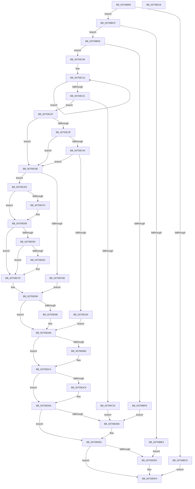

# PopFxRegisterDevice

- RVA: `0x00759B80`–`0x00759E19` (길이 `665` bytes)
- VA: `0x0000000140759B80`
- 실행 섹션: `PAGE`
- PDB 이름 있음: `예`; PDB Function 태그: `아니요`
- unwind 정보 RVA: `0x000CC1C8`
- 디코드: `184`개 명령, `665/665` bytes 표시
- 미해석 바이트: `0` (있으면 어셈블리에 `.byte`로 보존)

> 이 문서는 커널 이미지의 기계어와 PDB 기호를 분석해 생성했습니다. 4번과 5번은 함수 원형과 자료형을 바이너리 사용 방식에서 추정한 C 해석이며 원본 소스 복구 결과는 아닙니다.

## 1. Dependencies

- 직접 호출 지점: **18**; 고유 호출 대상: **17**
- 직접 호출자로 확인된 함수: **3**
- RIP 상대 이미지 참조: **0**

### Outgoing calls
- `0x00759BB8` → [IoGetDeviceAttachmentBaseRefWithTag](../../text/27/IoGetDeviceAttachmentBaseRefWithTag_function_00272788.md) (function, `0x00272788`)
- `0x00759BD7` → [IoGetAttachedDeviceReferenceWithTag](../../text/27/IoGetAttachedDeviceReferenceWithTag_function_00273B84.md) (function, `0x00273B84`)
- `0x00759C32` → [PopFxGetParentFxDevice](../../text/5D/PopFxGetParentFxDevice_function_005D2B9C.md) (function, `0x005D2B9C`)
- `0x00759C64` → [PopFxActivateComponent](../../text/2D/PopFxActivateComponent_function_002D9DBC.md) (function, `0x002D9DBC`)
- `0x00759C77` → [ExAllocatePool2](../../poolcode/B8/ExAllocatePool2_function_00B820F0.md) (function, `0x00B820F0`)
- `0x00759CD0` → [PopFxRegisterDeviceWorker](PopFxRegisterDeviceWorker_function_00759E20.md) (function, `0x00759E20`)
- `0x00759D03` → [PopFxBugCheck](../../text/2B/PopFxBugCheck_function_002BFC6C.md) (function, `0x002BFC6C`)
- `0x00759D1C` → [PopGenerateDeviceFriendlyName](../A9/PopGenerateDeviceFriendlyName_function_00A98968.md) (function, `0x00A98968`)
- `0x00759D28` → [PopFxAssignDeviceToDevNode](../../text/4C/PopFxAssignDeviceToDevNode_function_004C3CAC.md) (function, `0x004C3CAC`)
- `0x00759D39` → [ObfReferenceObjectWithTag](../../text/21/ObfReferenceObjectWithTag_function_00210710.md) (function, `0x00210710`)
- `0x00759D72` → [PopFxInsertDeviceRelation](../../text/5D/PopFxInsertDeviceRelation_function_005D2CE0.md) (function, `0x005D2CE0`)
- `0x00759D83` → [PopFxTraceDeviceRegistration](../A6/PopFxTraceDeviceRegistration_function_00A6F888.md) (function, `0x00A6F888`)
- `0x00759D8C` → [PopFxInsertDevice](../../text/4B/PopFxInsertDevice_function_004B95EC.md) (function, `0x004B95EC`)
- `0x00759DA6` → [ExFreePoolWithTag](../../poolcode/B8/ExFreePoolWithTag_function_00B82870.md) (function, `0x00B82870`)
- `0x00759DBF` → [PopFxIdleComponent](../../text/2C/PopFxIdleComponent_function_002C01D8.md) (function, `0x002C01D8`)
- `0x00759DD1` → [PopFxDereferenceDevice](../../text/27/PopFxDereferenceDevice_function_0027038C.md) (function, `0x0027038C`)
- `0x00759DE3` → [ObfDereferenceObjectWithTag](../../text/2F/ObfDereferenceObjectWithTag_function_002F78E0.md) (function, `0x002F78E0`)
- `0x00759DF5` → [ObfDereferenceObjectWithTag](../../text/2F/ObfDereferenceObjectWithTag_function_002F78E0.md) (function, `0x002F78E0`)

### Direct callers
- [PoFxEnableDStateReporting](PoFxEnableDStateReporting_function_007586A0.md) at `0x00758737`
- [PoFxRegisterDevice](PoFxRegisterDevice_function_00758940.md) at `0x00758B47`
- [PoFxRegisterPrimaryDevice](PoFxRegisterPrimaryDevice_function_00758C20.md) at `0x00758CEE`

### Static image references
- 디코드된 RIP-relative 메모리 참조가 없습니다.

## 2. Other-region calls and transfers

- 다른 실행 섹션으로 향하는 call: **15**
  - `0x00759BB8` → [IoGetDeviceAttachmentBaseRefWithTag](../../text/27/IoGetDeviceAttachmentBaseRefWithTag_function_00272788.md) (`PAGE` → `.text`)
  - `0x00759BD7` → [IoGetAttachedDeviceReferenceWithTag](../../text/27/IoGetAttachedDeviceReferenceWithTag_function_00273B84.md) (`PAGE` → `.text`)
  - `0x00759C32` → [PopFxGetParentFxDevice](../../text/5D/PopFxGetParentFxDevice_function_005D2B9C.md) (`PAGE` → `.text`)
  - `0x00759C64` → [PopFxActivateComponent](../../text/2D/PopFxActivateComponent_function_002D9DBC.md) (`PAGE` → `.text`)
  - `0x00759C77` → [ExAllocatePool2](../../poolcode/B8/ExAllocatePool2_function_00B820F0.md) (`PAGE` → `POOLCODE`)
  - `0x00759D03` → [PopFxBugCheck](../../text/2B/PopFxBugCheck_function_002BFC6C.md) (`PAGE` → `.text`)
  - `0x00759D28` → [PopFxAssignDeviceToDevNode](../../text/4C/PopFxAssignDeviceToDevNode_function_004C3CAC.md) (`PAGE` → `.text`)
  - `0x00759D39` → [ObfReferenceObjectWithTag](../../text/21/ObfReferenceObjectWithTag_function_00210710.md) (`PAGE` → `.text`)
  - `0x00759D72` → [PopFxInsertDeviceRelation](../../text/5D/PopFxInsertDeviceRelation_function_005D2CE0.md) (`PAGE` → `.text`)
  - `0x00759D8C` → [PopFxInsertDevice](../../text/4B/PopFxInsertDevice_function_004B95EC.md) (`PAGE` → `.text`)
  - `0x00759DA6` → [ExFreePoolWithTag](../../poolcode/B8/ExFreePoolWithTag_function_00B82870.md) (`PAGE` → `POOLCODE`)
  - `0x00759DBF` → [PopFxIdleComponent](../../text/2C/PopFxIdleComponent_function_002C01D8.md) (`PAGE` → `.text`)
  - `0x00759DD1` → [PopFxDereferenceDevice](../../text/27/PopFxDereferenceDevice_function_0027038C.md) (`PAGE` → `.text`)
  - `0x00759DE3` → [ObfDereferenceObjectWithTag](../../text/2F/ObfDereferenceObjectWithTag_function_002F78E0.md) (`PAGE` → `.text`)
  - `0x00759DF5` → [ObfDereferenceObjectWithTag](../../text/2F/ObfDereferenceObjectWithTag_function_002F78E0.md) (`PAGE` → `.text`)
- 별도 외부 분기/꼬리 이동을 확인하지 못했습니다.

## 3. Assembly (complete function range)

```asm
00759B80  48 8B C4                        mov rax, rsp
00759B83  44 89 48 20                     mov dword ptr [rax + 0x20], r9d
00759B87  4C 89 40 18                     mov qword ptr [rax + 0x18], r8
00759B8B  48 89 50 10                     mov qword ptr [rax + 0x10], rdx
00759B8F  48 89 48 08                     mov qword ptr [rax + 8], rcx
00759B93  55                              push rbp
00759B94  53                              push rbx
00759B95  56                              push rsi
00759B96  57                              push rdi
00759B97  41 54                           push r12
00759B99  41 55                           push r13
00759B9B  41 56                           push r14
00759B9D  41 57                           push r15
00759B9F  48 8B EC                        mov rbp, rsp
00759BA2  48 83 EC 68                     sub rsp, 0x68
00759BA6  45 33 F6                        xor r14d, r14d
00759BA9  BA 50 6F 46 78                  mov edx, 0x78466f50
00759BAE  4C 21 75 E8                     and qword ptr [rbp - 0x18], r14
00759BB2  48 8B D9                        mov rbx, rcx
00759BB5  45 33 E4                        xor r12d, r12d
00759BB8  E8 CB 8B B1 FF                  call 0x140272788
00759BBD  4C 8B E8                        mov r13, rax
00759BC0  48 85 C0                        test rax, rax
00759BC3  75 0A                           jne 0x140759bcf
00759BC5  BB 0D 00 00 C0                  mov ebx, 0xc000000d
00759BCA  E9 2B 02 00 00                  jmp 0x140759dfa
00759BCF  BA 50 6F 46 78                  mov edx, 0x78466f50
00759BD4  48 8B CB                        mov rcx, rbx
00759BD7  E8 A8 9F B1 FF                  call 0x140273b84
00759BDC  4C 8B F8                        mov r15, rax
00759BDF  48 85 C0                        test rax, rax
00759BE2  75 0A                           jne 0x140759bee
00759BE4  BB 0D 00 00 C0                  mov ebx, 0xc000000d
00759BE9  E9 FF 01 00 00                  jmp 0x140759ded
00759BEE  49 8B 85 38 01 00 00            mov rax, qword ptr [r13 + 0x138]
00759BF5  48 8B 78 28                     mov rdi, qword ptr [rax + 0x28]
00759BF9  48 85 FF                        test rdi, rdi
00759BFC  75 0A                           jne 0x140759c08
00759BFE  BB 0D 00 00 C0                  mov ebx, 0xc000000d
00759C03  E9 D3 01 00 00                  jmp 0x140759ddb
00759C08  0F 0D 8F 28 01 00 00            prefetchw byte ptr [rdi + 0x128]
00759C0F  8B 87 28 01 00 00               mov eax, dword ptr [rdi + 0x128]
00759C15  8B C8                           mov ecx, eax
00759C17  F0 0F B1 8F 28 01 00 00         lock cmpxchg dword ptr [rdi + 0x128], ecx
00759C1F  75 F4                           jne 0x140759c15
00759C21  A8 01                           test al, 1
00759C23  75 0A                           jne 0x140759c2f
00759C25  BB A3 00 00 C0                  mov ebx, 0xc00000a3
00759C2A  E9 AC 01 00 00                  jmp 0x140759ddb
00759C2F  48 8B CF                        mov rcx, rdi
00759C32  E8 65 8F E7 FF                  call 0x1405d2b9c
00759C37  48 8B F0                        mov rsi, rax
00759C3A  48 85 C0                        test rax, rax
00759C3D  74 4F                           je 0x140759c8e
00759C3F  8B 80 B8 03 00 00               mov eax, dword ptr [rax + 0x3b8]
00759C45  83 F8 FF                        cmp eax, -1
00759C48  74 44                           je 0x140759c8e
00759C4A  8B C8                           mov ecx, eax
00759C4C  45 33 C9                        xor r9d, r9d
00759C4F  48 8B 86 68 03 00 00            mov rax, qword ptr [rsi + 0x368]
00759C56  45 8D 41 01                     lea r8d, [r9 + 1]
00759C5A  4C 8B 24 C8                     mov r12, qword ptr [rax + rcx*8]
00759C5E  48 8B CE                        mov rcx, rsi
00759C61  49 8B D4                        mov rdx, r12
00759C64  E8 53 01 B8 FF                  call 0x1402d9dbc
00759C69  BA 48 00 00 00                  mov edx, 0x48
00759C6E  41 B8 50 46 58 4D               mov r8d, 0x4d584650
00759C74  8D 4A F8                        lea ecx, [rdx - 8]
00759C77  E8 74 84 42 00                  call 0x140b820f0
00759C7C  4C 8B F0                        mov r14, rax
00759C7F  48 85 C0                        test rax, rax
00759C82  75 0A                           jne 0x140759c8e
00759C84  BB 9A 00 00 C0                  mov ebx, 0xc000009a
00759C89  E9 1D 01 00 00                  jmp 0x140759dab
00759C8E  41 8A 4F 4C                     mov cl, byte ptr [r15 + 0x4c]
00759C92  48 8D 45 E8                     lea rax, [rbp - 0x18]
00759C96  4C 8B 4D 58                     mov r9, qword ptr [rbp + 0x58]
00759C9A  48 8D 97 80 00 00 00            lea rdx, [rdi + 0x80]
00759CA1  4C 8B 45 50                     mov r8, qword ptr [rbp + 0x50]
00759CA5  FE C1                           inc cl
00759CA7  48 89 44 24 40                  mov qword ptr [rsp + 0x40], rax
00759CAC  48 8B 45 70                     mov rax, qword ptr [rbp + 0x70]
00759CB0  48 89 44 24 38                  mov qword ptr [rsp + 0x38], rax
00759CB5  48 8B 45 68                     mov rax, qword ptr [rbp + 0x68]
00759CB9  88 4C 24 30                     mov byte ptr [rsp + 0x30], cl
00759CBD  48 8B 8F 90 00 00 00            mov rcx, qword ptr [rdi + 0x90]
00759CC4  48 89 44 24 28                  mov qword ptr [rsp + 0x28], rax
00759CC9  8B 45 60                        mov eax, dword ptr [rbp + 0x60]
00759CCC  89 44 24 20                     mov dword ptr [rsp + 0x20], eax
00759CD0  E8 4B 01 00 00                  call 0x140759e20
00759CD5  8B D8                           mov ebx, eax
00759CD7  85 C0                           test eax, eax
00759CD9  79 0A                           jns 0x140759ce5
00759CDB  48 83 65 E8 00                  and qword ptr [rbp - 0x18], 0
00759CE0  E9 B4 00 00 00                  jmp 0x140759d99
00759CE5  48 8B 45 E8                     mov rax, qword ptr [rbp - 0x18]
00759CE9  48 89 78 30                     mov qword ptr [rax + 0x30], rdi
00759CED  48 83 7F 50 00                  cmp qword ptr [rdi + 0x50], 0
00759CF2  74 15                           je 0x140759d09
00759CF4  48 8B 57 20                     mov rdx, qword ptr [rdi + 0x20]
00759CF8  45 33 C9                        xor r9d, r9d
00759CFB  45 33 C0                        xor r8d, r8d
00759CFE  B9 00 06 00 00                  mov ecx, 0x600
00759D03  E8 64 5F B6 FF                  call 0x1402bfc6c
00759D08  CC                              int3
00759D09  4C 8B 45 E8                     mov r8, qword ptr [rbp - 0x18]
00759D0D  BA 01 00 00 00                  mov edx, 1
00759D12  49 81 C0 D0 04 00 00            add r8, 0x4d0
00759D19  48 8B CF                        mov rcx, rdi
00759D1C  E8 47 EC 33 00                  call 0x140a98968
00759D21  48 8B 55 E8                     mov rdx, qword ptr [rbp - 0x18]
00759D25  48 8B CF                        mov rcx, rdi
00759D28  E8 7F 9F D6 FF                  call 0x1404c3cac
00759D2D  48 8B 5D 48                     mov rbx, qword ptr [rbp + 0x48]
00759D31  BA 50 6F 46 78                  mov edx, 0x78466f50
00759D36  48 8B CB                        mov rcx, rbx
00759D39  E8 D2 69 AB FF                  call 0x140210710
00759D3E  48 8B 45 E8                     mov rax, qword ptr [rbp - 0x18]
00759D42  48 89 58 60                     mov qword ptr [rax + 0x60], rbx
00759D46  48 8B 45 E8                     mov rax, qword ptr [rbp - 0x18]
00759D4A  4C 89 78 68                     mov qword ptr [rax + 0x68], r15
00759D4E  48 8B 45 E8                     mov rax, qword ptr [rbp - 0x18]
00759D52  8B 90 60 03 00 00               mov edx, dword ptr [rax + 0x360]
00759D58  F6 C2 01                        test dl, 1
00759D5B  75 20                           jne 0x140759d7d
00759D5D  4D 85 F6                        test r14, r14
00759D60  74 1B                           je 0x140759d7d
00759D62  48 8B 55 E8                     mov rdx, qword ptr [rbp - 0x18]
00759D66  4D 8B CE                        mov r9, r14
00759D69  41 B8 02 00 00 00               mov r8d, 2
00759D6F  49 8B CC                        mov rcx, r12
00759D72  E8 69 8F E7 FF                  call 0x1405d2ce0
00759D77  45 33 F6                        xor r14d, r14d
00759D7A  45 33 E4                        xor r12d, r12d
00759D7D  48 8B 4D E8                     mov rcx, qword ptr [rbp - 0x18]
00759D81  33 D2                           xor edx, edx
00759D83  E8 00 5B 31 00                  call 0x140a6f888
00759D88  4C 8B 45 E8                     mov r8, qword ptr [rbp - 0x18]
00759D8C  E8 5B F8 D5 FF                  call 0x1404b95ec
00759D91  45 33 FF                        xor r15d, r15d
00759D94  45 33 ED                        xor r13d, r13d
00759D97  33 DB                           xor ebx, ebx
00759D99  4D 85 F6                        test r14, r14
00759D9C  74 0D                           je 0x140759dab
00759D9E  BA 50 46 58 4D                  mov edx, 0x4d584650
00759DA3  49 8B CE                        mov rcx, r14
00759DA6  E8 C5 8A 42 00                  call 0x140b82870
00759DAB  4D 85 E4                        test r12, r12
00759DAE  74 14                           je 0x140759dc4
00759DB0  41 8B 54 24 10                  mov edx, dword ptr [r12 + 0x10]
00759DB5  45 33 C9                        xor r9d, r9d
00759DB8  48 8B CE                        mov rcx, rsi
00759DBB  45 8D 41 02                     lea r8d, [r9 + 2]
00759DBF  E8 14 64 B6 FF                  call 0x1402c01d8
00759DC4  48 85 F6                        test rsi, rsi
00759DC7  74 0D                           je 0x140759dd6
00759DC9  BA 06 00 00 00                  mov edx, 6
00759DCE  48 8B CE                        mov rcx, rsi
00759DD1  E8 B6 65 B1 FF                  call 0x14027038c
00759DD6  4D 85 FF                        test r15, r15
00759DD9  74 0D                           je 0x140759de8
00759DDB  BA 50 6F 46 78                  mov edx, 0x78466f50
00759DE0  49 8B CF                        mov rcx, r15
00759DE3  E8 F8 DA B9 FF                  call 0x1402f78e0
00759DE8  4D 85 ED                        test r13, r13
00759DEB  74 0D                           je 0x140759dfa
00759DED  BA 50 6F 46 78                  mov edx, 0x78466f50
00759DF2  49 8B CD                        mov rcx, r13
00759DF5  E8 E6 DA B9 FF                  call 0x1402f78e0
00759DFA  48 8B 45 E8                     mov rax, qword ptr [rbp - 0x18]
00759DFE  48 8B 4D 78                     mov rcx, qword ptr [rbp + 0x78]
00759E02  48 89 01                        mov qword ptr [rcx], rax
00759E05  8B C3                           mov eax, ebx
00759E07  48 83 C4 68                     add rsp, 0x68
00759E0B  41 5F                           pop r15
00759E0D  41 5E                           pop r14
00759E0F  41 5D                           pop r13
00759E11  41 5C                           pop r12
00759E13  5F                              pop rdi
00759E14  5E                              pop rsi
00759E15  5B                              pop rbx
00759E16  5D                              pop rbp
00759E17  C3                              ret
00759E18  CC                              int3
```

## 4. C-style interpretation (structured pseudocode)

```c
__int64 __fastcall PopFxRegisterDevice(__int64 a1, __int64 a2, __int64 a3, int a4, __int64 a5, __int64 a6, __int64 a7)
{
    __int64 result;
    __int64 v_r12;
    __int64 v_r13;
    __int64 v_r14;
    __int64 v_r15;
    __int64 v_rbx;
    __int64 v_rsp;
    unsigned __int64 v_stack_m58;
    unsigned __int64 v_stack_m68;
    unsigned __int64 v_stack_m70;
    unsigned __int8 v_stack_m78;
    unsigned __int64 v_stack_m80;
    unsigned int v_stack_m88;
    unsigned __int64 v_stack_p10;
    unsigned __int64 v_stack_p18;
    unsigned int v_stack_p20;
    unsigned __int64 v_stack_p8;

    *(unsigned int *)(v_rsp + 32) = a4;
    *(unsigned __int64 *)(v_rsp + 24) = a3;
    *(unsigned __int64 *)(v_rsp + 16) = a2;
    *(unsigned __int64 *)(v_rsp + 8) = a1;
    v_rsp = (v_rsp) - (104);
    v_r14 = 0;
    v_r12 = 0;
    result = IoGetDeviceAttachmentBaseRefWithTag(a1, (unsigned int)(0x78466F50ULL), a3, a4);
    if (result != 0) goto loc_00759BCF;
    goto loc_00759DFA;
loc_00759BCF:
    result = IoGetAttachedDeviceReferenceWithTag((unsigned int)(0xC000000DULL), (unsigned int)(0x78466F50ULL), a3, a4);
    if (result != 0) goto loc_00759BEE;
    goto loc_00759DED;
loc_00759BEE:
    if (*(unsigned __int64 *)(*(unsigned __int64 *)(result + 312) + 40) != 0) goto loc_00759C08;
    goto loc_00759DDB;
loc_00759C08:
loc_00759C15:
    if (*(unsigned __int64 *)(*(unsigned __int64 *)(result + 312) + 40) != 0) goto loc_00759C15;
    if ((((unsigned __int8)((unsigned int)(*(unsigned int *)(*(unsigned __int64 *)(*(unsigned __int64 *)(result + 312) + 40) + 296)))) & (1)) != 0) goto loc_00759C2F;
    goto loc_00759DDB;
loc_00759C2F:
    result = PopFxGetParentFxDevice(*(unsigned __int64 *)(*(unsigned __int64 *)(result + 312) + 40), (unsigned int)(0x78466F50ULL), a3, a4);
    if (result == 0) goto loc_00759C8E;
    if (((unsigned int)((unsigned int)(*(unsigned int *)(result + 952)))) == -1) goto loc_00759C8E;
    a4 = 0;
    result = PopFxActivateComponent(result, *(unsigned __int64 *)(*(unsigned __int64 *)(result + 872) + (unsigned int)((unsigned int)((unsigned int)(*(unsigned int *)(result + 952)))) * 8), a4 + 1, a4);
    result = ExAllocatePool2(72 - 8, 72, (unsigned int)(0x4D584650ULL), a4);
    if (result != 0) goto loc_00759C8E;
    goto loc_00759DAB;
loc_00759C8E:
    a1 = (unsigned __int8)((*(unsigned __int8 *)(result + 76)) + 1);
    v_stack_m68 = v_stack_m58;
    v_stack_m70 = a6;
    v_stack_m78 = (unsigned __int8)(a1);
    v_stack_m80 = a5;
    v_stack_m88 = (unsigned int)((unsigned int)(v_stack_p20));
    result = PopFxRegisterDeviceWorker(*(unsigned __int64 *)(*(unsigned __int64 *)(*(unsigned __int64 *)(result + 312) + 40) + 144), *(unsigned __int64 *)(*(unsigned __int64 *)(result + 312) + 40) + 128, v_stack_p10, v_stack_p18);
    if (!sign_flag) goto loc_00759CE5;
    goto loc_00759D99;
loc_00759CE5:
    *(unsigned __int64 *)(v_stack_m58 + 48) = *(unsigned __int64 *)(*(unsigned __int64 *)(result + 312) + 40);
    result = v_stack_m58;
    if ((*(unsigned __int64 *)(*(unsigned __int64 *)(*(unsigned __int64 *)(result + 312) + 40) + 80)) != 0) {
        a2 = *(unsigned __int64 *)(*(unsigned __int64 *)(*(unsigned __int64 *)(result + 312) + 40) + 32);
        a4 = 0;
        a3 = 0;
        a1 = 0x600ULL;
        result = PopFxBugCheck(a1, a2, a3, a4);
    }
    a3 = (v_stack_m58) + (0x4D0ULL);
    result = PopGenerateDeviceFriendlyName(*(unsigned __int64 *)(*(unsigned __int64 *)(result + 312) + 40), 1, a3, a4);
    result = PopFxAssignDeviceToDevNode(*(unsigned __int64 *)(*(unsigned __int64 *)(result + 312) + 40), v_stack_m58, a3, a4);
    result = ObfReferenceObjectWithTag(v_stack_p8, (unsigned int)(0x78466F50ULL), a3, a4);
    *(unsigned __int64 *)(v_stack_m58 + 96) = v_stack_p8;
    *(unsigned __int64 *)(v_stack_m58 + 104) = result;
    if ((((unsigned __int8)((unsigned int)(*(unsigned int *)(v_stack_m58 + 864)))) & (1)) != 0) goto loc_00759D7D;
    result = v_stack_m58;
    v_r12 = *(unsigned __int64 *)(*(unsigned __int64 *)(result + 872) + (unsigned int)((unsigned int)((unsigned int)(*(unsigned int *)(result + 952)))) * 8);
    v_r14 = result;
    if (result != 0) {
        a2 = v_stack_m58;
        a4 = result;
        a3 = 2;
        a1 = *(unsigned __int64 *)(*(unsigned __int64 *)(result + 872) + (unsigned int)((unsigned int)((unsigned int)(*(unsigned int *)(result + 952)))) * 8);
        result = PopFxInsertDeviceRelation(a1, a2, a3, a4);
        v_r14 = 0;
        v_r12 = 0;
    }
    a2 = 0;
    result = PopFxTraceDeviceRegistration(v_stack_m58, a2, a3, a4);
    result = PopFxInsertDevice(v_stack_m58, a2, v_stack_m58, a4);
    v_r15 = 0;
    v_r13 = 0;
    v_rbx = 0;
loc_00759D99:
    if (0 != 0) {
        a2 = 0x4D584650ULL;
        a1 = 0;
        result = ExFreePoolWithTag(a1, a2, v_stack_m58, a4);
    }
    if (0 != 0) {
        a2 = *(unsigned int *)(v_r12 + 16);
        a4 = 0;
        a1 = result;
        a3 = a4 + 2;
        result = PopFxIdleComponent(a1, a2, a3, a4);
    }
    if (result != 0) {
        a2 = 6;
        a1 = result;
        result = PopFxDereferenceDevice(a1, a2, a3, a4);
    }
    if (0 != 0) {
        a2 = 0x78466F50ULL;
        a1 = 0;
        result = ObfDereferenceObjectWithTag(a1, a2, a3, a4);
    }
    if (0 != 0) {
        a2 = 0x78466F50ULL;
        a1 = 0;
        result = ObfDereferenceObjectWithTag(a1, a2, a3, a4);
    }
    *(unsigned __int64 *)(a7) = v_stack_m58;
    v_rsp = (v_rsp) + (104);
    return 0;
}
```

## 5. (Beta) C Style

```c
int64_t PopFxRegisterDevice(int64_t Arg1, int64_t Arg2, int64_t Arg3, int32_t Arg4, int64_t Arg5, int64_t Arg6, void *Arg7)
{
    uint8_t *arg7 = (uint8_t *)Arg7;

    int64_t result;
    int64_t local_r12;
    int64_t local_r13;
    int64_t local_r14;
    int64_t local_r15;
    int64_t local_rbx;
    int64_t local_rsp;
    uint64_t v_stack_m58;
    uint64_t v_stack_m68;
    uint64_t v_stack_m70;
    uint8_t v_stack_m78;
    uint64_t v_stack_m80;
    uint32_t v_stack_m88;
    uint64_t v_stack_p10;
    uint64_t v_stack_p18;
    uint32_t v_stack_p20;
    uint64_t v_stack_p8;

    *(uint32_t *)(local_rsp + 0x20) = Arg4;
    *(uint64_t *)(local_rsp + 0x18) = Arg3;
    *(uint64_t *)(local_rsp + 0x10) = Arg2;
    *(uint64_t *)(local_rsp + 0x8) = Arg1;
    local_rsp = (local_rsp) - (104);
    local_r14 = 0;
    local_r12 = 0;
    result = IoGetDeviceAttachmentBaseRefWithTag(Arg1, (uint32_t)(0x78466F50ULL), Arg3, Arg4);
    if (result != 0) goto loc_00759BCF;
    goto loc_00759DFA;
loc_00759BCF:
    result = IoGetAttachedDeviceReferenceWithTag((uint32_t)(0xC000000DULL), (uint32_t)(0x78466F50ULL), Arg3, Arg4);
    if (result != 0) goto loc_00759BEE;
    goto loc_00759DED;
loc_00759BEE:
    if (*(uint64_t *)(*(uint64_t *)(result + 0x138) + 0x28) != 0) goto loc_00759C08;
    goto loc_00759DDB;
loc_00759C08:
loc_00759C15:
    if (*(uint64_t *)(*(uint64_t *)(result + 0x138) + 0x28) != 0) goto loc_00759C15;
    if ((((uint8_t)((uint32_t)(*(uint32_t *)(*(uint64_t *)(*(uint64_t *)(result + 0x138) + 0x28) + 0x128)))) & (1)) != 0) goto loc_00759C2F;
    goto loc_00759DDB;
loc_00759C2F:
    result = PopFxGetParentFxDevice(*(uint64_t *)(*(uint64_t *)(result + 0x138) + 0x28), (uint32_t)(0x78466F50ULL), Arg3, Arg4);
    if (result == 0) goto loc_00759C8E;
    if (((uint32_t)((uint32_t)(*(uint32_t *)(result + 0x3B8)))) == -1) goto loc_00759C8E;
    Arg4 = 0;
    result = PopFxActivateComponent(result, *(uint64_t *)(*(uint64_t *)(result + 0x368) + (uint32_t)((uint32_t)((uint32_t)(*(uint32_t *)(result + 0x3B8)))) * 8), Arg4 + 1, Arg4);
    result = ExAllocatePool2(72 - 8, 72, (uint32_t)(0x4D584650ULL), Arg4);
    if (result != 0) goto loc_00759C8E;
    goto loc_00759DAB;
loc_00759C8E:
    Arg1 = (uint8_t)((*(uint8_t *)(result + 0x4C)) + 1);
    v_stack_m68 = v_stack_m58;
    v_stack_m70 = Arg6;
    v_stack_m78 = (uint8_t)(Arg1);
    v_stack_m80 = Arg5;
    v_stack_m88 = (uint32_t)((uint32_t)(v_stack_p20));
    result = PopFxRegisterDeviceWorker(*(uint64_t *)(*(uint64_t *)(*(uint64_t *)(result + 0x138) + 0x28) + 0x90), *(uint64_t *)(*(uint64_t *)(result + 0x138) + 0x28) + 128, v_stack_p10, v_stack_p18);
    if (!sign_flag) goto loc_00759CE5;
    goto loc_00759D99;
loc_00759CE5:
    *(uint64_t *)(v_stack_m58 + 0x30) = *(uint64_t *)(*(uint64_t *)(result + 0x138) + 0x28);
    result = v_stack_m58;
    if ((*(uint64_t *)(*(uint64_t *)(*(uint64_t *)(result + 0x138) + 0x28) + 0x50)) != 0) {
        Arg2 = *(uint64_t *)(*(uint64_t *)(*(uint64_t *)(result + 0x138) + 0x28) + 0x20);
        Arg4 = 0;
        Arg3 = 0;
        Arg1 = 0x600ULL;
        result = PopFxBugCheck(Arg1, Arg2, Arg3, Arg4);
    }
    Arg3 = (v_stack_m58) + (0x4D0ULL);
    result = PopGenerateDeviceFriendlyName(*(uint64_t *)(*(uint64_t *)(result + 0x138) + 0x28), 1, Arg3, Arg4);
    result = PopFxAssignDeviceToDevNode(*(uint64_t *)(*(uint64_t *)(result + 0x138) + 0x28), v_stack_m58, Arg3, Arg4);
    result = ObfReferenceObjectWithTag(v_stack_p8, (uint32_t)(0x78466F50ULL), Arg3, Arg4);
    *(uint64_t *)(v_stack_m58 + 0x60) = v_stack_p8;
    *(uint64_t *)(v_stack_m58 + 0x68) = result;
    if ((((uint8_t)((uint32_t)(*(uint32_t *)(v_stack_m58 + 0x360)))) & (1)) != 0) goto loc_00759D7D;
    result = v_stack_m58;
    local_r12 = *(uint64_t *)(*(uint64_t *)(result + 0x368) + (uint32_t)((uint32_t)((uint32_t)(*(uint32_t *)(result + 0x3B8)))) * 8);
    local_r14 = result;
    if (result != 0) {
        Arg2 = v_stack_m58;
        Arg4 = result;
        Arg3 = 2;
        Arg1 = *(uint64_t *)(*(uint64_t *)(result + 0x368) + (uint32_t)((uint32_t)((uint32_t)(*(uint32_t *)(result + 0x3B8)))) * 8);
        result = PopFxInsertDeviceRelation(Arg1, Arg2, Arg3, Arg4);
        local_r14 = 0;
        local_r12 = 0;
    }
    Arg2 = 0;
    result = PopFxTraceDeviceRegistration(v_stack_m58, Arg2, Arg3, Arg4);
    result = PopFxInsertDevice(v_stack_m58, Arg2, v_stack_m58, Arg4);
    local_r15 = 0;
    local_r13 = 0;
    local_rbx = 0;
loc_00759D99:
    if (0 != 0) {
        Arg2 = 0x4D584650ULL;
        Arg1 = 0;
        result = ExFreePoolWithTag(Arg1, Arg2, v_stack_m58, Arg4);
    }
    if (0 != 0) {
        Arg2 = *(uint32_t *)(local_r12 + 0x10);
        Arg4 = 0;
        Arg1 = result;
        Arg3 = Arg4 + 2;
        result = PopFxIdleComponent(Arg1, Arg2, Arg3, Arg4);
    }
    if (result != 0) {
        Arg2 = 6;
        Arg1 = result;
        result = PopFxDereferenceDevice(Arg1, Arg2, Arg3, Arg4);
    }
    if (0 != 0) {
        Arg2 = 0x78466F50ULL;
        Arg1 = 0;
        result = ObfDereferenceObjectWithTag(Arg1, Arg2, Arg3, Arg4);
    }
    if (0 != 0) {
        Arg2 = 0x78466F50ULL;
        Arg1 = 0;
        result = ObfDereferenceObjectWithTag(Arg1, Arg2, Arg3, Arg4);
    }
    *(uint64_t *)(arg7) = v_stack_m58;
    local_rsp = (local_rsp) + (104);
    return 0;
}
```

### 관측된 메모리 오프셋

구조체 형식이 확인되지 않은 접근은 인자 기준의 오프셋으로만 기록했습니다.

| 기준 인자 | 오프셋 표현 | 폭 (bit) | 접근 |
|---|---:|---:|---|
| `Arg7` | `+ 0x0` | `64` | `W` |

## 6. Execution-region graph

[열기: 2D/3D 그래프와 함수 탐색 컨트롤 패널](../../../control-panel.html?section=page&rva=0x00759B80&view=graph)

- 2D 그래프는 위에서 아래로 흐르고, 3D 그래프는 빈 공간을 드래그해 회전합니다. Shift+드래그는 이동, 휠은 확대·축소, 함수 노드 선택은 대상 보고서 이동입니다.

### Static fallback


