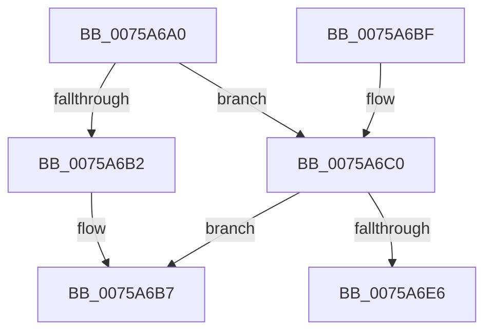

# PopFxResetSocSubsystemAccounting

- RVA: `0x0075A6A0`–`0x0075A6FF` (길이 `95` bytes)
- VA: `0x000000014075A6A0`
- 실행 섹션: `PAGE`
- PDB 이름 있음: `예`; PDB Function 태그: `아니요`
- unwind 정보 RVA: `0x000CC12C`
- 디코드: `27`개 명령, `95/95` bytes 표시
- 미해석 바이트: `0` (있으면 어셈블리에 `.byte`로 보존)

> 이 문서는 커널 이미지의 기계어와 PDB 기호를 분석해 생성했습니다. 4번과 5번은 함수 원형과 자료형을 바이너리 사용 방식에서 추정한 C 해석이며 원본 소스 복구 결과는 아닙니다.

## 1. Dependencies

- 직접 호출 지점: **3**; 고유 호출 대상: **3**
- 직접 호출자로 확인된 함수: **1**
- RIP 상대 이미지 참조: **1**

### Outgoing calls
- `0x0075A6A6` → [PopFxLookupSocSubsystemsByPlatformIdleState](../97/PopFxLookupSocSubsystemsByPlatformIdleState_function_0097ABEC.md) (function, `0x0097ABEC`)
- `0x0075A6DD` → [guard_dispatch_icall](../../text/6B/guard_dispatch_icall_function_006BAAD0.md) (function, `0x006BAAD0`)
- `0x0075A6F9` → [PopFxBugCheck](../../text/2B/PopFxBugCheck_function_002BFC6C.md) (function, `0x002BFC6C`)

### Direct callers
- [PopCaptureSleepStudyStatistics](../../text/43/PopCaptureSleepStudyStatistics_function_004399F4.md) at `0x00439E6B`

### Static image references
- `0x0075A6C0` → RVA `0x00E676B8` (`.data`; read)

## 2. Other-region calls and transfers

- 다른 실행 섹션으로 향하는 call: **2**
  - `0x0075A6DD` → [guard_dispatch_icall](../../text/6B/guard_dispatch_icall_function_006BAAD0.md) (`PAGE` → `.text`)
  - `0x0075A6F9` → [PopFxBugCheck](../../text/2B/PopFxBugCheck_function_002BFC6C.md) (`PAGE` → `.text`)
- 별도 외부 분기/꼬리 이동을 확인하지 못했습니다.

## 3. Assembly (complete function range)

```asm
0075A6A0  40 53                           push rbx
0075A6A2  48 83 EC 20                     sub rsp, 0x20
0075A6A6  E8 41 05 22 00                  call 0x14097abec
0075A6AB  33 DB                           xor ebx, ebx
0075A6AD  48 85 C0                        test rax, rax
0075A6B0  75 0E                           jne 0x14075a6c0
0075A6B2  BB EF 00 00 C0                  mov ebx, 0xc00000ef
0075A6B7  8B C3                           mov eax, ebx
0075A6B9  48 83 C4 20                     add rsp, 0x20
0075A6BD  5B                              pop rbx
0075A6BE  C3                              ret
0075A6BF  CC                              int3
0075A6C0  48 8B 05 F1 CF 70 00            mov rax, qword ptr [rip + 0x70cff1]
0075A6C7  48 8D 54 24 40                  lea rdx, [rsp + 0x40]
0075A6CC  89 4C 24 40                     mov dword ptr [rsp + 0x40], ecx
0075A6D0  B9 26 00 00 00                  mov ecx, 0x26
0075A6D5  89 5C 24 44                     mov dword ptr [rsp + 0x44], ebx
0075A6D9  48 8B 40 60                     mov rax, qword ptr [rax + 0x60]
0075A6DD  E8 EE 03 F6 FF                  call 0x1406baad0
0075A6E2  84 C0                           test al, al
0075A6E4  75 D1                           jne 0x14075a6b7
0075A6E6  4C 8B 05 CB CF 70 00            mov r8, qword ptr [rip + 0x70cfcb]
0075A6ED  45 33 C9                        xor r9d, r9d
0075A6F0  B9 05 06 00 00                  mov ecx, 0x605
0075A6F5  41 8D 51 26                     lea edx, [r9 + 0x26]
0075A6F9  E8 6E 55 B6 FF                  call 0x1402bfc6c
0075A6FE  CC                              int3
```

## 4. C-style interpretation (structured pseudocode)

```c
__int64 __fastcall PopFxResetSocSubsystemAccounting(int a1, __int64 a2, __int64 a3, int a4)
{
    __int64 result;
    __int64 v_rbx;
    __int64 v_rsp;
    unsigned __int64 v_stack_p40;
    unsigned int v_stack_p44;

    v_rsp = (v_rsp) - (32);
    result = PopFxLookupSocSubsystemsByPlatformIdleState(a1, a2, a3, a4);
    v_rbx = 0;
    if (result != 0) goto loc_0075A6C0;
loc_0075A6B7:
    v_rsp = (v_rsp) + (32);
    return (unsigned int)((unsigned int)((unsigned int)(0xC00000EFULL)));
loc_0075A6C0:
    v_stack_p40 = a1;
    v_stack_p44 = (unsigned int)((unsigned int)(0xC00000EFULL));
    result = guard_dispatch_icall(38, v_stack_p40, a3, a4);
    if ((unsigned __int8)(result) != 0) goto loc_0075A6B7;
    a4 = 0;
    result = PopFxBugCheck((unsigned int)(0x605ULL), a4 + 38, *(unsigned __int64 *)(v_rip + 7393227), a4);
    return result;
}
```

## 5. (Beta) C Style

```c
int64_t PopFxResetSocSubsystemAccounting(int32_t Arg1, int64_t Arg2, int64_t Arg3, int32_t Arg4)
{
    int64_t result;
    int64_t local_rbx;
    int64_t local_rsp;
    uint64_t v_stack_p40;
    uint32_t v_stack_p44;

    local_rsp = (local_rsp) - (32);
    result = PopFxLookupSocSubsystemsByPlatformIdleState(Arg1, Arg2, Arg3, Arg4);
    local_rbx = 0;
    if (result != 0) goto loc_0075A6C0;
loc_0075A6B7:
    local_rsp = (local_rsp) + (32);
    return (uint32_t)((uint32_t)((uint32_t)(0xC00000EFULL)));
loc_0075A6C0:
    v_stack_p40 = Arg1;
    v_stack_p44 = (uint32_t)((uint32_t)(0xC00000EFULL));
    result = guard_dispatch_icall(38, v_stack_p40, Arg3, Arg4);
    if ((uint8_t)(result) != 0) goto loc_0075A6B7;
    Arg4 = 0;
    result = PopFxBugCheck((uint32_t)(0x605ULL), Arg4 + 38, *(uint64_t *)(v_rip + 0x70CFCB), Arg4);
    return result;
}
```

## 6. Execution-region graph

[열기: 2D/3D 그래프와 함수 탐색 컨트롤 패널](../../../control-panel.html?section=page&rva=0x0075A6A0&view=graph)

- 2D 그래프는 위에서 아래로 흐르고, 3D 그래프는 빈 공간을 드래그해 회전합니다. Shift+드래그는 이동, 휠은 확대·축소, 함수 노드 선택은 대상 보고서 이동입니다.

### Static fallback


