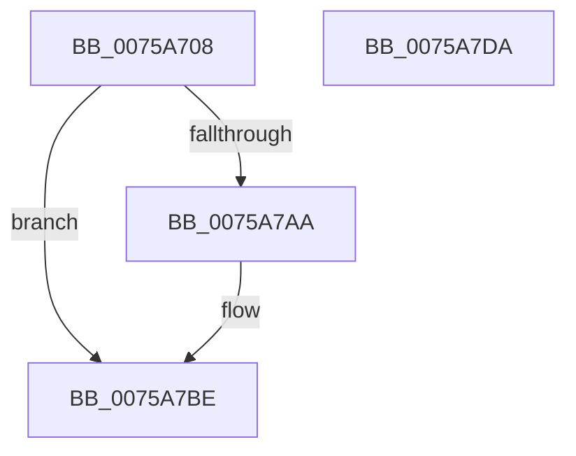

# PopFxValidateReturnedUnicodeString

- RVA: `0x0075A708`–`0x0075A7DB` (길이 `211` bytes)
- VA: `0x000000014075A708`
- 실행 섹션: `PAGE`
- PDB 이름 있음: `예`; PDB Function 태그: `아니요`
- unwind 정보 RVA: `0x0006B074`
- 디코드: `67`개 명령, `211/211` bytes 표시
- 미해석 바이트: `0` (있으면 어셈블리에 `.byte`로 보존)

> 이 문서는 커널 이미지의 기계어와 PDB 기호를 분석해 생성했습니다. 4번과 5번은 함수 원형과 자료형을 바이너리 사용 방식에서 추정한 C 해석이며 원본 소스 복구 결과는 아닙니다.

## 1. Dependencies

- 직접 호출 지점: **1**; 고유 호출 대상: **1**
- 직접 호출자로 확인된 함수: **2**
- RIP 상대 이미지 참조: **0**

### Outgoing calls
- `0x0075A7A1` → [RtlStringCbLengthW](../../text/45/RtlStringCbLengthW_function_004575EC.md) (function, `0x004575EC`)

### Direct callers
- [PopPluginInitializeSocSubsystemStaticInfo](PopPluginInitializeSocSubsystemStaticInfo_function_0075A98C.md) at `0x0075A9F8`
- [PopPluginInitializeSocSubsystemStaticInfo](PopPluginInitializeSocSubsystemStaticInfo_function_0075A98C.md) at `0x0075AA28`
- [PopPluginQuerySocSubsystemMetadata](PopPluginQuerySocSubsystemMetadata_function_0075AABC.md) at `0x0075AC20`
- [PopPluginQuerySocSubsystemMetadata](PopPluginQuerySocSubsystemMetadata_function_0075AABC.md) at `0x0075AC3D`

### Static image references
- 디코드된 RIP-relative 메모리 참조가 없습니다.

## 2. Other-region calls and transfers

- 다른 실행 섹션으로 향하는 call: **1**
  - `0x0075A7A1` → [RtlStringCbLengthW](../../text/45/RtlStringCbLengthW_function_004575EC.md) (`PAGE` → `.text`)
- 별도 외부 분기/꼬리 이동을 확인하지 못했습니다.

## 3. Assembly (complete function range)

```asm
0075A708  48 8B C4                        mov rax, rsp
0075A70B  48 89 58 10                     mov qword ptr [rax + 0x10], rbx
0075A70F  48 89 68 18                     mov qword ptr [rax + 0x18], rbp
0075A713  48 89 70 20                     mov qword ptr [rax + 0x20], rsi
0075A717  57                              push rdi
0075A718  41 56                           push r14
0075A71A  41 57                           push r15
0075A71C  48 83 EC 20                     sub rsp, 0x20
0075A720  0F B7 39                        movzx edi, word ptr [rcx]
0075A723  45 33 F6                        xor r14d, r14d
0075A726  48 8B 71 08                     mov rsi, qword ptr [rcx + 8]
0075A72A  4C 8B F9                        mov r15, rcx
0075A72D  0F B7 59 02                     movzx ebx, word ptr [rcx + 2]
0075A731  4C 89 70 08                     mov qword ptr [rax + 8], r14
0075A735  8B C7                           mov eax, edi
0075A737  48 D1 E8                        shr rax, 1
0075A73A  48 3B F2                        cmp rsi, rdx
0075A73D  41 8B E8                        mov ebp, r8d
0075A740  44 0F B7 C7                     movzx r8d, di
0075A744  0F 94 C1                        sete cl
0075A747  44 0F B7 1C 46                  movzx r11d, word ptr [rsi + rax*2]
0075A74C  0F B7 06                        movzx eax, word ptr [rsi]
0075A74F  66 F7 D8                        neg ax
0075A752  1A D2                           sbb dl, dl
0075A754  22 D1                           and dl, cl
0075A756  41 8B CE                        mov ecx, r14d
0075A759  66 41 F7 D8                     neg r8w
0075A75D  45 8B C6                        mov r8d, r14d
0075A760  1A C0                           sbb al, al
0075A762  22 C2                           and al, dl
0075A764  41 8B D6                        mov edx, r14d
0075A767  3B DD                           cmp ebx, ebp
0075A769  0F 44 C8                        cmove ecx, eax
0075A76C  40 F6 C7 01                     test dil, 1
0075A770  0F B6 C1                        movzx eax, cl
0075A773  48 8B CE                        mov rcx, rsi
0075A776  0F 44 D0                        cmove edx, eax
0075A779  F6 C3 01                        test bl, 1
0075A77C  0F B6 C2                        movzx eax, dl
0075A77F  41 8B D6                        mov edx, r14d
0075A782  44 0F 44 C0                     cmove r8d, eax
0075A786  66 45 85 DB                     test r11w, r11w
0075A78A  41 0F B6 C0                     movzx eax, r8b
0075A78E  4C 8D 44 24 40                  lea r8, [rsp + 0x40]
0075A793  0F 44 D0                        cmove edx, eax
0075A796  66 3B FB                        cmp di, bx
0075A799  45 1A DB                        sbb r11b, r11b
0075A79C  44 22 DA                        and r11b, dl
0075A79F  8B D5                           mov edx, ebp
0075A7A1  E8 46 CE CF FF                  call 0x1404575ec
0075A7A6  85 C0                           test eax, eax
0075A7A8  78 14                           js 0x14075a7be
0075A7AA  41 0F B7 0F                     movzx ecx, word ptr [r15]
0075A7AE  48 3B 4C 24 40                  cmp rcx, qword ptr [rsp + 0x40]
0075A7B3  41 0F B6 D3                     movzx edx, r11b
0075A7B7  41 0F 45 D6                     cmovne edx, r14d
0075A7BB  44 8A F2                        mov r14b, dl
0075A7BE  48 8B 5C 24 48                  mov rbx, qword ptr [rsp + 0x48]
0075A7C3  41 8A C6                        mov al, r14b
0075A7C6  48 8B 6C 24 50                  mov rbp, qword ptr [rsp + 0x50]
0075A7CB  48 8B 74 24 58                  mov rsi, qword ptr [rsp + 0x58]
0075A7D0  48 83 C4 20                     add rsp, 0x20
0075A7D4  41 5F                           pop r15
0075A7D6  41 5E                           pop r14
0075A7D8  5F                              pop rdi
0075A7D9  C3                              ret
0075A7DA  CC                              int3
```

## 4. C-style interpretation (structured pseudocode)

```c
__int64 __fastcall PopFxValidateReturnedUnicodeString(__int64 a1, __int64 a2, int a3)
{
    __int64 result;
    __int64 v_r11;
    __int64 v_r14;
    __int64 v_rsp;
    unsigned __int64 v_stack_p10;
    unsigned __int64 v_stack_p18;
    unsigned __int64 v_stack_p20;
    unsigned __int64 v_stack_p8;

    *(unsigned __int64 *)(v_rsp + 16) = v_rbx;
    *(unsigned __int64 *)(v_rsp + 24) = v_rbp;
    *(unsigned __int64 *)(v_rsp + 32) = v_rsi;
    v_rsp = (v_rsp) - (32);
    v_r14 = 0;
    *(unsigned __int64 *)(v_rsp + 8) = 0;
    result = ((unsigned int)((unsigned int)(*(unsigned __int16 *)(a1)))) >> (1);
    a1 = ((*(unsigned __int64 *)(a1 + 8)) == a2) ? 1 : 0;
    result = (unsigned __int16)(-(*(unsigned __int16 *)(*(unsigned __int64 *)(a1 + 8))));
    a2 = (unsigned __int8)((a2) & ((unsigned __int8)(a1)));
    a3 = (unsigned __int16)(-((unsigned __int16)(*(unsigned __int16 *)(a1))));
    result = (unsigned __int8)((result) & ((unsigned __int8)(a2)));
    a1 = 0;
    if (((unsigned int)(*(unsigned __int16 *)(a1 + 2))) == ((unsigned int)((unsigned int)(a3)))) { a1 = (unsigned int)(result); }
    a2 = 0;
    if ((((unsigned __int8)(*(unsigned __int16 *)(a1))) & (1)) == 0) { a2 = (unsigned int)((unsigned __int8)(a1)); }
    a3 = 0;
    if ((((unsigned __int8)(*(unsigned __int16 *)(a1 + 2))) & (1)) == 0) { a3 = (unsigned int)((unsigned __int8)(a2)); }
    a2 = 0;
    if ((unsigned __int16)(*(unsigned __int16 *)(*(unsigned __int64 *)(a1 + 8) + result * 2)) == 0) { a2 = (unsigned int)((unsigned __int8)(a3)); }
    v_r11 = (unsigned __int8)((*(unsigned __int16 *)(*(unsigned __int64 *)(a1 + 8) + result * 2)) & ((unsigned __int8)(a2)));
    result = RtlStringCbLengthW(*(unsigned __int64 *)(a1 + 8), (unsigned int)((unsigned int)((unsigned int)(a3))), v_stack_p8, a4);
    if (!(sign_flag)) {
        a1 = *(unsigned __int16 *)(a1);
        a2 = (unsigned __int8)(v_r11);
        if (a1 != v_stack_p8) { a2 = 0; }
        v_r14 = (unsigned __int8)(a2);
    }
    v_rsp = (v_rsp) + (32);
    return (unsigned __int8)(v_r14);
}
```

## 5. (Beta) C Style

```c
int64_t PopFxValidateReturnedUnicodeString(void *Arg1, int64_t Arg2, int32_t Arg3)
{
    uint8_t *arg1 = (uint8_t *)Arg1;

    int64_t result;
    int64_t local_r11;
    int64_t local_r14;
    int64_t local_rsp;
    uint64_t v_stack_p10;
    uint64_t v_stack_p18;
    uint64_t v_stack_p20;
    uint64_t v_stack_p8;

    *(uint64_t *)(local_rsp + 0x10) = local_rbx;
    *(uint64_t *)(local_rsp + 0x18) = local_rbp;
    *(uint64_t *)(local_rsp + 0x20) = local_rsi;
    local_rsp = (local_rsp) - (32);
    local_r14 = 0;
    *(uint64_t *)(local_rsp + 0x8) = 0;
    result = ((uint32_t)((uint32_t)(*(uint16_t *)(arg1)))) >> (1);
    Arg1 = ((*(uint64_t *)(arg1 + 0x8)) == Arg2) ? 1 : 0;
    result = (uint16_t)(-(*(uint16_t *)(*(uint64_t *)(arg1 + 0x8))));
    Arg2 = (uint8_t)((Arg2) & ((uint8_t)(Arg1)));
    Arg3 = (uint16_t)(-((uint16_t)(*(uint16_t *)(arg1))));
    result = (uint8_t)((result) & ((uint8_t)(Arg2)));
    Arg1 = 0;
    if (((uint32_t)(*(uint16_t *)(arg1 + 0x2))) == ((uint32_t)((uint32_t)(Arg3)))) { Arg1 = (uint32_t)(result); }
    Arg2 = 0;
    if ((((uint8_t)(*(uint16_t *)(arg1))) & (1)) == 0) { Arg2 = (uint32_t)((uint8_t)(Arg1)); }
    Arg3 = 0;
    if ((((uint8_t)(*(uint16_t *)(arg1 + 0x2))) & (1)) == 0) { Arg3 = (uint32_t)((uint8_t)(Arg2)); }
    Arg2 = 0;
    if ((uint16_t)(*(uint16_t *)(*(uint64_t *)(arg1 + 0x8) + result * 2)) == 0) { Arg2 = (uint32_t)((uint8_t)(Arg3)); }
    local_r11 = (uint8_t)((*(uint16_t *)(*(uint64_t *)(arg1 + 0x8) + result * 2)) & ((uint8_t)(Arg2)));
    result = RtlStringCbLengthW(*(uint64_t *)(arg1 + 0x8), (uint32_t)((uint32_t)((uint32_t)(Arg3))), v_stack_p8, a4);
    if (!(sign_flag)) {
        Arg1 = *(uint16_t *)(arg1);
        Arg2 = (uint8_t)(local_r11);
        if (Arg1 != v_stack_p8) { Arg2 = 0; }
        local_r14 = (uint8_t)(Arg2);
    }
    local_rsp = (local_rsp) + (32);
    return (uint8_t)(local_r14);
}
```

### 관측된 메모리 오프셋

구조체 형식이 확인되지 않은 접근은 인자 기준의 오프셋으로만 기록했습니다.

| 기준 인자 | 오프셋 표현 | 폭 (bit) | 접근 |
|---|---:|---:|---|
| `Arg1` | `+ 0x0` | `16` | `R` |
| `Arg1` | `+ 0x2` | `16` | `R` |
| `Arg1` | `+ 0x8` | `64` | `R` |

## 6. Execution-region graph

[열기: 2D/3D 그래프와 함수 탐색 컨트롤 패널](../../../control-panel.html?section=page&rva=0x0075A708&view=graph)

- 2D 그래프는 위에서 아래로 흐르고, 3D 그래프는 빈 공간을 드래그해 회전합니다. Shift+드래그는 이동, 휠은 확대·축소, 함수 노드 선택은 대상 보고서 이동입니다.

### Static fallback


