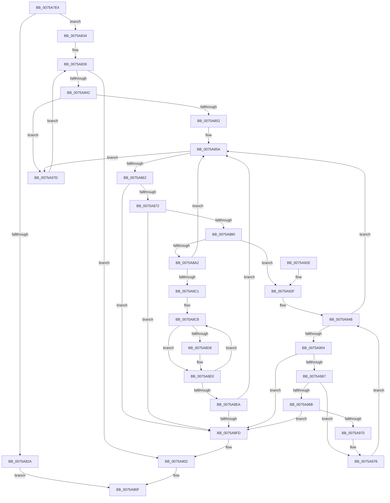

# PopFxVerifyDependencies

- RVA: `0x0075A7E4`–`0x0075A985` (길이 `417` bytes)
- VA: `0x000000014075A7E4`
- 실행 섹션: `PAGE`
- PDB 이름 있음: `예`; PDB Function 태그: `아니요`
- unwind 정보 RVA: `0x000CC188`
- 디코드: `114`개 명령, `417/417` bytes 표시
- 미해석 바이트: `0` (있으면 어셈블리에 `.byte`로 보존)

> 이 문서는 커널 이미지의 기계어와 PDB 기호를 분석해 생성했습니다. 4번과 5번은 함수 원형과 자료형을 바이너리 사용 방식에서 추정한 C 해석이며 원본 소스 복구 결과는 아닙니다.

## 1. Dependencies

- 직접 호출 지점: **2**; 고유 호출 대상: **2**
- 직접 호출자로 확인된 함수: **1**
- RIP 상대 이미지 참조: **0**

### Outgoing calls
- `0x0075A81B` → [ExAllocatePool2](../../poolcode/B8/ExAllocatePool2_function_00B820F0.md) (function, `0x00B820F0`)
- `0x0075A90A` → [ExFreePoolWithTag](../../poolcode/B8/ExFreePoolWithTag_function_00B82870.md) (function, `0x00B82870`)

### Direct callers
- [PopFxRegisterDeviceWorker](PopFxRegisterDeviceWorker_function_00759E20.md) at `0x0075A47C`

### Static image references
- 디코드된 RIP-relative 메모리 참조가 없습니다.

## 2. Other-region calls and transfers

- 다른 실행 섹션으로 향하는 call: **2**
  - `0x0075A81B` → [ExAllocatePool2](../../poolcode/B8/ExAllocatePool2_function_00B820F0.md) (`PAGE` → `POOLCODE`)
  - `0x0075A90A` → [ExFreePoolWithTag](../../poolcode/B8/ExFreePoolWithTag_function_00B82870.md) (`PAGE` → `POOLCODE`)
- 별도 외부 분기/꼬리 이동을 확인하지 못했습니다.

## 3. Assembly (complete function range)

```asm
0075A7E4  48 89 5C 24 08                  mov qword ptr [rsp + 8], rbx
0075A7E9  48 89 6C 24 10                  mov qword ptr [rsp + 0x10], rbp
0075A7EE  48 89 74 24 18                  mov qword ptr [rsp + 0x18], rsi
0075A7F3  57                              push rdi
0075A7F4  41 54                           push r12
0075A7F6  41 55                           push r13
0075A7F8  41 56                           push r14
0075A7FA  41 57                           push r15
0075A7FC  48 83 EC 20                     sub rsp, 0x20
0075A800  4C 8B EA                        mov r13, rdx
0075A803  45 8B E0                        mov r12d, r8d
0075A806  41 8B D0                        mov edx, r8d
0075A809  48 8B F9                        mov rdi, rcx
0075A80C  48 C1 E2 02                     shl rdx, 2
0075A810  B9 00 01 00 00                  mov ecx, 0x100
0075A815  41 B8 50 46 58 4D               mov r8d, 0x4d584650
0075A81B  E8 D0 78 42 00                  call 0x140b820f0
0075A820  33 DB                           xor ebx, ebx
0075A822  4C 8B D8                        mov r11, rax
0075A825  48 85 C0                        test rax, rax
0075A828  75 0A                           jne 0x14075a834
0075A82A  BB 9A 00 00 C0                  mov ebx, 0xc000009a
0075A82F  E9 DB 00 00 00                  jmp 0x14075a90f
0075A834  8B D3                           mov edx, ebx
0075A836  44 8B C3                        mov r8d, ebx
0075A839  45 3B C4                        cmp r8d, r12d
0075A83C  0F 83 C0 00 00 00               jae 0x14075a902
0075A842  41 8B C0                        mov eax, r8d
0075A845  48 8D 0C 40                     lea rcx, [rax + rax*2]
0075A849  39 1C 8F                        cmp dword ptr [rdi + rcx*4], ebx
0075A84C  0F 85 2B 01 00 00               jne 0x14075a97d
0075A852  8B C2                           mov eax, edx
0075A854  FF C2                           inc edx
0075A856  45 89 04 83                     mov dword ptr [r11 + rax*4], r8d
0075A85A  85 D2                           test edx, edx
0075A85C  0F 84 1B 01 00 00               je 0x14075a97d
0075A862  8D 6A FF                        lea ebp, [rdx - 1]
0075A865  41 8B 34 AB                     mov esi, dword ptr [r11 + rbp*4]
0075A869  41 3B F4                        cmp esi, r12d
0075A86C  0F 83 8B 00 00 00               jae 0x14075a8fd
0075A872  4C 8D 14 76                     lea r10, [rsi + rsi*2]
0075A876  46 8B 3C 97                     mov r15d, dword ptr [rdi + r10*4]
0075A87A  41 83 FF 02                     cmp r15d, 2
0075A87E  74 7D                           je 0x14075a8fd
0075A880  0F AE E8                        lfence
0075A883  49 8B 85 68 03 00 00            mov rax, qword ptr [r13 + 0x368]
0075A88A  48 8B 0C F0                     mov rcx, qword ptr [rax + rsi*8]
0075A88E  4C 8B B1 B0 00 00 00            mov r14, qword ptr [rcx + 0xb0]
0075A895  0F AE E8                        lfence
0075A898  41 83 FF 01                     cmp r15d, 1
0075A89C  0F 85 8D 00 00 00               jne 0x14075a92f
0075A8A2  42 C7 04 97 02 00 00 00         mov dword ptr [rdi + r10*4], 2
0075A8AA  8B D5                           mov edx, ebp
0075A8AC  49 8B 85 68 03 00 00            mov rax, qword ptr [r13 + 0x368]
0075A8B3  48 8B 0C F0                     mov rcx, qword ptr [rax + rsi*8]
0075A8B7  8B 81 AC 00 00 00               mov eax, dword ptr [rcx + 0xac]
0075A8BD  85 C0                           test eax, eax
0075A8BF  74 99                           je 0x14075a85a
0075A8C1  46 8B 4C 97 04                  mov r9d, dword ptr [rdi + r10*4 + 4]
0075A8C6  8B E8                           mov ebp, eax
0075A8C8  41 8B 06                        mov eax, dword ptr [r14]
0075A8CB  48 8D 0C 40                     lea rcx, [rax + rax*2]
0075A8CF  8B 44 8F 04                     mov eax, dword ptr [rdi + rcx*4 + 4]
0075A8D3  41 3B C1                        cmp eax, r9d
0075A8D6  76 08                           jbe 0x14075a8e0
0075A8D8  44 8B C8                        mov r9d, eax
0075A8DB  42 89 44 97 04                  mov dword ptr [rdi + r10*4 + 4], eax
0075A8E0  49 83 C6 08                     add r14, 8
0075A8E4  48 83 ED 01                     sub rbp, 1
0075A8E8  75 DE                           jne 0x14075a8c8
0075A8EA  48 8D 04 76                     lea rax, [rsi + rsi*2]
0075A8EE  FF 44 87 04                     inc dword ptr [rdi + rax*4 + 4]
0075A8F2  83 7C 87 04 04                  cmp dword ptr [rdi + rax*4 + 4], 4
0075A8F7  0F 86 5D FF FF FF               jbe 0x14075a85a
0075A8FD  BB 0D 00 00 C0                  mov ebx, 0xc000000d
0075A902  BA 50 46 58 4D                  mov edx, 0x4d584650
0075A907  49 8B CB                        mov rcx, r11
0075A90A  E8 61 7F 42 00                  call 0x140b82870
0075A90F  48 8B 6C 24 58                  mov rbp, qword ptr [rsp + 0x58]
0075A914  8B C3                           mov eax, ebx
0075A916  48 8B 5C 24 50                  mov rbx, qword ptr [rsp + 0x50]
0075A91B  48 8B 74 24 60                  mov rsi, qword ptr [rsp + 0x60]
0075A920  48 83 C4 20                     add rsp, 0x20
0075A924  41 5F                           pop r15
0075A926  41 5E                           pop r14
0075A928  41 5D                           pop r13
0075A92A  41 5C                           pop r12
0075A92C  5F                              pop rdi
0075A92D  C3                              ret
0075A92E  CC                              int3
0075A92F  42 C7 04 97 01 00 00 00         mov dword ptr [rdi + r10*4], 1
0075A937  44 8B CB                        mov r9d, ebx
0075A93A  49 8B 85 68 03 00 00            mov rax, qword ptr [r13 + 0x368]
0075A941  48 8B 0C F0                     mov rcx, qword ptr [rax + rsi*8]
0075A945  8B B1 AC 00 00 00               mov esi, dword ptr [rcx + 0xac]
0075A94B  44 3B CE                        cmp r9d, esi
0075A94E  0F 83 06 FF FF FF               jae 0x14075a85a
0075A954  41 8B C1                        mov eax, r9d
0075A957  45 8B 14 C6                     mov r10d, dword ptr [r14 + rax*8]
0075A95B  4B 8D 0C 52                     lea rcx, [r10 + r10*2]
0075A95F  8B 04 8F                        mov eax, dword ptr [rdi + rcx*4]
0075A962  83 F8 01                        cmp eax, 1
0075A965  74 96                           je 0x14075a8fd
0075A967  85 C0                           test eax, eax
0075A969  75 0D                           jne 0x14075a978
0075A96B  41 3B D4                        cmp edx, r12d
0075A96E  73 8D                           jae 0x14075a8fd
0075A970  8B C2                           mov eax, edx
0075A972  FF C2                           inc edx
0075A974  45 89 14 83                     mov dword ptr [r11 + rax*4], r10d
0075A978  41 FF C1                        inc r9d
0075A97B  EB CE                           jmp 0x14075a94b
0075A97D  41 FF C0                        inc r8d
0075A980  E9 B4 FE FF FF                  jmp 0x14075a839
```

## 4. C-style interpretation (structured pseudocode)

```c
__int64 __fastcall PopFxVerifyDependencies(__int64 a1, __int64 a2, int a3)
{
    __int64 result;
    __int64 v_r14;
    __int64 v_rbp;
    __int64 v_rbx;
    __int64 v_rsp;
    unsigned __int64 v_stack_p10;
    unsigned __int64 v_stack_p18;
    unsigned __int64 v_stack_p8;

    v_stack_p8 = v_rbx;
    v_stack_p10 = v_rbp;
    v_stack_p18 = v_rsi;
    v_rsp = (v_rsp) - (32);
    a2 = ((unsigned int)(a3)) << (2);
    result = ExAllocatePool2(256, a2, (unsigned int)(0x4D584650ULL), a4);
    v_rbx = 0;
    if (result != 0) goto loc_0075A834;
    goto loc_0075A90F;
loc_0075A834:
loc_0075A839:
    if (((unsigned int)((unsigned int)((unsigned int)((unsigned int)(0xC000009AULL))))) >= ((unsigned int)((unsigned int)(a3)))) goto loc_0075A902;
    if ((*(unsigned int *)(a1 + (unsigned int)((unsigned int)((unsigned int)((unsigned int)((unsigned int)(0xC000009AULL))))) + (unsigned int)((unsigned int)((unsigned int)((unsigned int)((unsigned int)(0xC000009AULL))))) * 2 * 4)) != ((unsigned int)((unsigned int)(0xC000009AULL)))) goto loc_0075A97D;
    a2 = (unsigned int)(((unsigned int)((unsigned int)((unsigned int)(0xC000009AULL)))) + 1);
    *(unsigned int *)(result + (unsigned int)((unsigned int)((unsigned int)((unsigned int)((unsigned int)(0xC000009AULL))))) * 4) = (unsigned int)((unsigned int)((unsigned int)((unsigned int)(0xC000009AULL))));
loc_0075A85A:
    if ((unsigned int)(a2) == 0) goto loc_0075A97D;
    if (((unsigned int)((unsigned int)(*(unsigned int *)(result + a2 - 1 * 4)))) >= ((unsigned int)((unsigned int)(a3)))) goto loc_0075A8FD;
    if (((unsigned int)((unsigned int)(*(unsigned int *)(a1 + (unsigned int)(*(unsigned int *)(result + a2 - 1 * 4)) + (unsigned int)(*(unsigned int *)(result + a2 - 1 * 4)) * 2 * 4)))) == 2) goto loc_0075A8FD;
    if (((unsigned int)((unsigned int)(*(unsigned int *)(a1 + (unsigned int)(*(unsigned int *)(result + a2 - 1 * 4)) + (unsigned int)(*(unsigned int *)(result + a2 - 1 * 4)) * 2 * 4)))) != 1) goto loc_0075A92F;
    *(unsigned int *)(a1 + (unsigned int)(*(unsigned int *)(result + a2 - 1 * 4)) + (unsigned int)(*(unsigned int *)(result + a2 - 1 * 4)) * 2 * 4) = 2;
    if ((unsigned int)((unsigned int)(*(unsigned int *)(*(unsigned __int64 *)(*(unsigned __int64 *)(a2 + 872) + (unsigned int)(*(unsigned int *)(result + a2 - 1 * 4)) * 8) + 172))) == 0) goto loc_0075A85A;
loc_0075A8C8:
    if (((unsigned int)((unsigned int)(*(unsigned int *)(a1 + (unsigned int)(*(unsigned int *)(*(unsigned __int64 *)(*(unsigned __int64 *)(*(unsigned __int64 *)(a2 + 872) + (unsigned int)(*(unsigned int *)(result + a2 - 1 * 4)) * 8) + 176))) + (unsigned int)(*(unsigned int *)(*(unsigned __int64 *)(*(unsigned __int64 *)(*(unsigned __int64 *)(a2 + 872) + (unsigned int)(*(unsigned int *)(result + a2 - 1 * 4)) * 8) + 176))) * 2 * 4 + 4)))) >= = ((unsigned int)((unsigned int)(*(unsigned int *)(a1 + (unsigned int)(*(unsigned int *)(result + a2 - 1 * 4)) + (unsigned int)(*(unsigned int *)(result + a2 - 1 * 4)) * 2 * 4 + 4))))) {
        a4 = (unsigned int)((unsigned int)(*(unsigned int *)(a1 + (unsigned int)(*(unsigned int *)(*(unsigned __int64 *)(*(unsigned __int64 *)(*(unsigned __int64 *)(a2 + 872) + (unsigned int)(*(unsigned int *)(result + a2 - 1 * 4)) * 8) + 176))) + (unsigned int)(*(unsigned int *)(*(unsigned __int64 *)(*(unsigned __int64 *)(*(unsigned __int64 *)(a2 + 872) + (unsigned int)(*(unsigned int *)(result + a2 - 1 * 4)) * 8) + 176))) * 2 * 4 + 4)));
        *(unsigned int *)(a1 + (unsigned int)(*(unsigned int *)(result + a2 - 1 * 4)) + (unsigned int)(*(unsigned int *)(result + a2 - 1 * 4)) * 2 * 4 + 4) = (unsigned int)((unsigned int)(*(unsigned int *)(a1 + (unsigned int)(*(unsigned int *)(*(unsigned __int64 *)(*(unsigned __int64 *)(*(unsigned __int64 *)(a2 + 872) + (unsigned int)(*(unsigned int *)(result + a2 - 1 * 4)) * 8) + 176))) + (unsigned int)(*(unsigned int *)(*(unsigned __int64 *)(*(unsigned __int64 *)(*(unsigned __int64 *)(a2 + 872) + (unsigned int)(*(unsigned int *)(result + a2 - 1 * 4)) * 8) + 176))) * 2 * 4 + 4)));
    }
    v_r14 = (*(unsigned __int64 *)(*(unsigned __int64 *)(*(unsigned __int64 *)(a2 + 872) + (unsigned int)(*(unsigned int *)(result + a2 - 1 * 4)) * 8) + 176)) + (8);
    v_rbp = ((unsigned int)((unsigned int)((unsigned int)(*(unsigned int *)(*(unsigned __int64 *)(*(unsigned __int64 *)(a2 + 872) + (unsigned int)(*(unsigned int *)(result + a2 - 1 * 4)) * 8) + 172))))) - (1);
    if (condition_is_not_equal) goto loc_0075A8C8;
    if ((*(unsigned int *)(a1 + (unsigned int)(*(unsigned int *)(result + a2 - 1 * 4)) + (unsigned int)(*(unsigned int *)(result + a2 - 1 * 4)) * 2 * 4 + 4)) <= 4) goto loc_0075A85A;
loc_0075A8FD:
loc_0075A902:
    result = ExFreePoolWithTag(result, (unsigned int)(0x4D584650ULL), (unsigned int)((unsigned int)((unsigned int)(0xC000009AULL))), a4);
loc_0075A90F:
    v_rsp = (v_rsp) + (32);
    return (unsigned int)((unsigned int)((unsigned int)(0xC000000DULL)));
loc_0075A92F:
    *(unsigned int *)(a1 + (unsigned int)(*(unsigned int *)(result + a2 - 1 * 4)) + (unsigned int)(*(unsigned int *)(result + a2 - 1 * 4)) * 2 * 4) = 1;
loc_0075A94B:
    if (((unsigned int)((unsigned int)((unsigned int)(v_stack_p8)))) >= ((unsigned int)((unsigned int)(*(unsigned int *)(*(unsigned __int64 *)(*(unsigned __int64 *)(a2 + 872) + v_stack_p18 * 8) + 172))))) goto loc_0075A85A;
    if (((unsigned int)((unsigned int)(*(unsigned int *)(a1 + (unsigned int)(*(unsigned int *)(v_r14 + (unsigned int)((unsigned int)((unsigned int)((unsigned int)(v_stack_p8)))) * 8)) + (unsigned int)(*(unsigned int *)(v_r14 + (unsigned int)((unsigned int)((unsigned int)((unsigned int)(v_stack_p8)))) * 8)) * 2 * 4)))) == 1) goto loc_0075A8FD;
    if ((unsigned int)((unsigned int)(*(unsigned int *)(a1 + (unsigned int)(*(unsigned int *)(v_r14 + (unsigned int)((unsigned int)((unsigned int)((unsigned int)(v_stack_p8)))) * 8)) + (unsigned int)(*(unsigned int *)(v_r14 + (unsigned int)((unsigned int)((unsigned int)((unsigned int)(v_stack_p8)))) * 8)) * 2 * 4))) != 0) goto loc_0075A978;
    if (((unsigned int)((unsigned int)(0x4D584650ULL))) >= ((unsigned int)((unsigned int)(a3)))) goto loc_0075A8FD;
    a2 = (unsigned int)(((unsigned int)(0x4D584650ULL)) + 1);
    *(unsigned int *)(result + (unsigned int)((unsigned int)((unsigned int)(0x4D584650ULL))) * 4) = (unsigned int)((unsigned int)(*(unsigned int *)(v_r14 + (unsigned int)((unsigned int)((unsigned int)((unsigned int)(v_stack_p8)))) * 8)));
loc_0075A978:
    a4 = (unsigned int)(((unsigned int)((unsigned int)(v_stack_p8))) + 1);
    goto loc_0075A94B;
loc_0075A97D:
    a3 = (unsigned int)(((unsigned int)((unsigned int)((unsigned int)(0xC000009AULL)))) + 1);
    goto loc_0075A839;
}
```

## 5. (Beta) C Style

```c
int64_t PopFxVerifyDependencies(void *Arg1, void *Arg2, int32_t Arg3)
{
    uint8_t *arg1 = (uint8_t *)Arg1;
    uint8_t *arg2 = (uint8_t *)Arg2;

    int64_t result;
    int64_t local_r14;
    int64_t local_rbp;
    int64_t local_rbx;
    int64_t local_rsp;
    uint64_t v_stack_p10;
    uint64_t v_stack_p18;
    uint64_t v_stack_p8;

    v_stack_p8 = local_rbx;
    v_stack_p10 = local_rbp;
    v_stack_p18 = local_rsi;
    local_rsp = (local_rsp) - (32);
    Arg2 = ((uint32_t)(Arg3)) << (2);
    result = ExAllocatePool2(256, Arg2, (uint32_t)(0x4D584650ULL), a4);
    local_rbx = 0;
    if (result != 0) goto loc_0075A834;
    goto loc_0075A90F;
loc_0075A834:
loc_0075A839:
    if (((uint32_t)((uint32_t)((uint32_t)((uint32_t)(0xC000009AULL))))) >= ((uint32_t)((uint32_t)(Arg3)))) goto loc_0075A902;
    if ((*(uint32_t *)(arg1 + (uint32_t)((uint32_t)((uint32_t)((uint32_t)((uint32_t)(0xC000009AULL))))) + (uint32_t)((uint32_t)((uint32_t)((uint32_t)((uint32_t)(0xC000009AULL))))) * 2 * 4)) != ((uint32_t)((uint32_t)(0xC000009AULL)))) goto loc_0075A97D;
    Arg2 = (uint32_t)(((uint32_t)((uint32_t)((uint32_t)(0xC000009AULL)))) + 1);
    *(uint32_t *)(result + (uint32_t)((uint32_t)((uint32_t)((uint32_t)((uint32_t)(0xC000009AULL))))) * 4) = (uint32_t)((uint32_t)((uint32_t)((uint32_t)(0xC000009AULL))));
loc_0075A85A:
    if ((uint32_t)(Arg2) == 0) goto loc_0075A97D;
    if (((uint32_t)((uint32_t)(*(uint32_t *)(result + arg2 - 0x1 * 4)))) >= ((uint32_t)((uint32_t)(Arg3)))) goto loc_0075A8FD;
    if (((uint32_t)((uint32_t)(*(uint32_t *)(arg1 + (uint32_t)(*(uint32_t *)(result + arg2 - 0x1 * 4)) + (uint32_t)(*(uint32_t *)(result + arg2 - 0x1 * 4)) * 2 * 4)))) == 2) goto loc_0075A8FD;
    if (((uint32_t)((uint32_t)(*(uint32_t *)(arg1 + (uint32_t)(*(uint32_t *)(result + arg2 - 0x1 * 4)) + (uint32_t)(*(uint32_t *)(result + arg2 - 0x1 * 4)) * 2 * 4)))) != 1) goto loc_0075A92F;
    *(uint32_t *)(arg1 + (uint32_t)(*(uint32_t *)(result + arg2 - 0x1 * 4)) + (uint32_t)(*(uint32_t *)(result + arg2 - 0x1 * 4)) * 2 * 4) = 2;
    if ((uint32_t)((uint32_t)(*(uint32_t *)(*(uint64_t *)(*(uint64_t *)(arg2 + 0x368) + (uint32_t)(*(uint32_t *)(result + arg2 - 0x1 * 4)) * 8) + 0xAC))) == 0) goto loc_0075A85A;
loc_0075A8C8:
    if (((uint32_t)((uint32_t)(*(uint32_t *)(arg1 + (uint32_t)(*(uint32_t *)(*(uint64_t *)(*(uint64_t *)(*(uint64_t *)(arg2 + 0x368) + (uint32_t)(*(uint32_t *)(result + arg2 - 0x1 * 4)) * 8) + 0xB0))) + (uint32_t)(*(uint32_t *)(*(uint64_t *)(*(uint64_t *)(*(uint64_t *)(arg2 + 0x368) + (uint32_t)(*(uint32_t *)(result + arg2 - 0x1 * 4)) * 8) + 0xB0))) * 2 * 4 + 0x4)))) >= = ((uint32_t)((uint32_t)(*(uint32_t *)(arg1 + (uint32_t)(*(uint32_t *)(result + arg2 - 0x1 * 4)) + (uint32_t)(*(uint32_t *)(result + arg2 - 0x1 * 4)) * 2 * 4 + 0x4))))) {
        a4 = (uint32_t)((uint32_t)(*(uint32_t *)(arg1 + (uint32_t)(*(uint32_t *)(*(uint64_t *)(*(uint64_t *)(*(uint64_t *)(arg2 + 0x368) + (uint32_t)(*(uint32_t *)(result + arg2 - 0x1 * 4)) * 8) + 0xB0))) + (uint32_t)(*(uint32_t *)(*(uint64_t *)(*(uint64_t *)(*(uint64_t *)(arg2 + 0x368) + (uint32_t)(*(uint32_t *)(result + arg2 - 0x1 * 4)) * 8) + 0xB0))) * 2 * 4 + 0x4)));
        *(uint32_t *)(arg1 + (uint32_t)(*(uint32_t *)(result + arg2 - 0x1 * 4)) + (uint32_t)(*(uint32_t *)(result + arg2 - 0x1 * 4)) * 2 * 4 + 0x4) = (uint32_t)((uint32_t)(*(uint32_t *)(arg1 + (uint32_t)(*(uint32_t *)(*(uint64_t *)(*(uint64_t *)(*(uint64_t *)(arg2 + 0x368) + (uint32_t)(*(uint32_t *)(result + arg2 - 0x1 * 4)) * 8) + 0xB0))) + (uint32_t)(*(uint32_t *)(*(uint64_t *)(*(uint64_t *)(*(uint64_t *)(arg2 + 0x368) + (uint32_t)(*(uint32_t *)(result + arg2 - 0x1 * 4)) * 8) + 0xB0))) * 2 * 4 + 0x4)));
    }
    local_r14 = (*(uint64_t *)(*(uint64_t *)(*(uint64_t *)(arg2 + 0x368) + (uint32_t)(*(uint32_t *)(result + arg2 - 0x1 * 4)) * 8) + 0xB0)) + (8);
    local_rbp = ((uint32_t)((uint32_t)((uint32_t)(*(uint32_t *)(*(uint64_t *)(*(uint64_t *)(arg2 + 0x368) + (uint32_t)(*(uint32_t *)(result + arg2 - 0x1 * 4)) * 8) + 0xAC))))) - (1);
    if (condition_is_not_equal) goto loc_0075A8C8;
    if ((*(uint32_t *)(arg1 + (uint32_t)(*(uint32_t *)(result + arg2 - 0x1 * 4)) + (uint32_t)(*(uint32_t *)(result + arg2 - 0x1 * 4)) * 2 * 4 + 0x4)) <= 4) goto loc_0075A85A;
loc_0075A8FD:
loc_0075A902:
    result = ExFreePoolWithTag(result, (uint32_t)(0x4D584650ULL), (uint32_t)((uint32_t)((uint32_t)(0xC000009AULL))), a4);
loc_0075A90F:
    local_rsp = (local_rsp) + (32);
    return (uint32_t)((uint32_t)((uint32_t)(0xC000000DULL)));
loc_0075A92F:
    *(uint32_t *)(arg1 + (uint32_t)(*(uint32_t *)(result + arg2 - 0x1 * 4)) + (uint32_t)(*(uint32_t *)(result + arg2 - 0x1 * 4)) * 2 * 4) = 1;
loc_0075A94B:
    if (((uint32_t)((uint32_t)((uint32_t)(v_stack_p8)))) >= ((uint32_t)((uint32_t)(*(uint32_t *)(*(uint64_t *)(*(uint64_t *)(arg2 + 0x368) + v_stack_p18 * 8) + 0xAC))))) goto loc_0075A85A;
    if (((uint32_t)((uint32_t)(*(uint32_t *)(arg1 + (uint32_t)(*(uint32_t *)(local_r14 + (uint32_t)((uint32_t)((uint32_t)((uint32_t)(v_stack_p8)))) * 8)) + (uint32_t)(*(uint32_t *)(local_r14 + (uint32_t)((uint32_t)((uint32_t)((uint32_t)(v_stack_p8)))) * 8)) * 2 * 4)))) == 1) goto loc_0075A8FD;
    if ((uint32_t)((uint32_t)(*(uint32_t *)(arg1 + (uint32_t)(*(uint32_t *)(local_r14 + (uint32_t)((uint32_t)((uint32_t)((uint32_t)(v_stack_p8)))) * 8)) + (uint32_t)(*(uint32_t *)(local_r14 + (uint32_t)((uint32_t)((uint32_t)((uint32_t)(v_stack_p8)))) * 8)) * 2 * 4))) != 0) goto loc_0075A978;
    if (((uint32_t)((uint32_t)(0x4D584650ULL))) >= ((uint32_t)((uint32_t)(Arg3)))) goto loc_0075A8FD;
    Arg2 = (uint32_t)(((uint32_t)(0x4D584650ULL)) + 1);
    *(uint32_t *)(result + (uint32_t)((uint32_t)((uint32_t)(0x4D584650ULL))) * 4) = (uint32_t)((uint32_t)(*(uint32_t *)(local_r14 + (uint32_t)((uint32_t)((uint32_t)((uint32_t)(v_stack_p8)))) * 8)));
loc_0075A978:
    a4 = (uint32_t)(((uint32_t)((uint32_t)(v_stack_p8))) + 1);
    goto loc_0075A94B;
loc_0075A97D:
    Arg3 = (uint32_t)(((uint32_t)((uint32_t)((uint32_t)(0xC000009AULL)))) + 1);
    goto loc_0075A839;
}
```

### 관측된 메모리 오프셋

구조체 형식이 확인되지 않은 접근은 인자 기준의 오프셋으로만 기록했습니다.

| 기준 인자 | 오프셋 표현 | 폭 (bit) | 접근 |
|---|---:|---:|---|
| `Arg1` | `+ 0x0 + r10*4` | `32` | `R` |
| `Arg1` | `+ 0x0 + r10*4` | `32` | `W` |
| `Arg1` | `+ 0x0 + rcx*4` | `32` | `R` |
| `Arg1` | `+ 0x4 + r10*4` | `32` | `R` |
| `Arg1` | `+ 0x4 + r10*4` | `32` | `W` |
| `Arg1` | `+ 0x4 + rax*4` | `32` | `R` |
| `Arg1` | `+ 0x4 + rax*4` | `32` | `R/W` |
| `Arg1` | `+ 0x4 + rcx*4` | `32` | `R` |
| `Arg2` | `+ 0x368` | `64` | `R` |

## 6. Execution-region graph

[열기: 2D/3D 그래프와 함수 탐색 컨트롤 패널](../../../control-panel.html?section=page&rva=0x0075A7E4&view=graph)

- 2D 그래프는 위에서 아래로 흐르고, 3D 그래프는 빈 공간을 드래그해 회전합니다. Shift+드래그는 이동, 휠은 확대·축소, 함수 노드 선택은 대상 보고서 이동입니다.

### Static fallback


