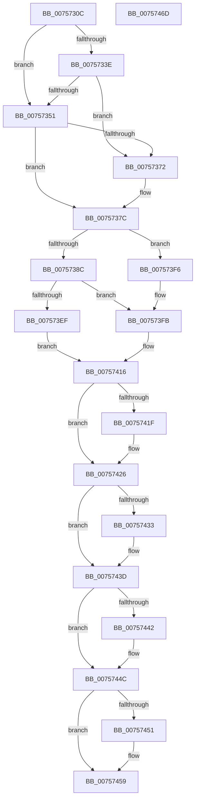

# PopHandleCancelQueryRemove

- RVA: `0x0075730C`–`0x0075746E` (길이 `354` bytes)
- VA: `0x000000014075730C`
- 실행 섹션: `PAGE`
- PDB 이름 있음: `예`; PDB Function 태그: `아니요`
- unwind 정보 RVA: `0x000CC044`
- 디코드: `100`개 명령, `354/354` bytes 표시
- 미해석 바이트: `0` (있으면 어셈블리에 `.byte`로 보존)

> 이 문서는 커널 이미지의 기계어와 PDB 기호를 분석해 생성했습니다. 4번과 5번은 함수 원형과 자료형을 바이너리 사용 방식에서 추정한 C 해석이며 원본 소스 복구 결과는 아닙니다.

## 1. Dependencies

- 직접 호출 지점: **14**; 고유 호출 대상: **10**
- 직접 호출자로 확인된 함수: **1**
- RIP 상대 이미지 참조: **3**

### Outgoing calls
- `0x00757348` → [IoGetDeviceObjectPointer](../95/IoGetDeviceObjectPointer_function_00953220.md) (function, `0x00953220`)
- `0x00757367` → [IoGetDeviceObjectPointer](../95/IoGetDeviceObjectPointer_function_00953220.md) (function, `0x00953220`)
- `0x00757375` → [PopAcquireCoolingInterface](PopAcquireCoolingInterface_function_00756DF0.md) (function, `0x00756DF0`)
- `0x00757383` → [PopAcquireRwLockExclusive](../../text/43/PopAcquireRwLockExclusive_function_00430B44.md) (function, `0x00430B44`)
- `0x007573A9` → [PopDiagTraceCoolingExtension](../A3/PopDiagTraceCoolingExtension_function_00A39C28.md) (function, `0x00A39C28`)
- `0x007573B3` → [PopPropogateCoolingChange](../../text/4E/PopPropogateCoolingChange_function_004E8FA0.md) (function, `0x004E8FA0`)
- `0x007573E6` → [IoRegisterPlugPlayNotification](../95/IoRegisterPlugPlayNotification_function_009535A0.md) (function, `0x009535A0`)
- `0x00757401` → [PopReleaseRwLock](../../text/2D/PopReleaseRwLock_function_002DFBBC.md) (function, `0x002DFBBC`)
- `0x00757409` → [PopOrphanCoolingExtension](PopOrphanCoolingExtension_function_00757474.md) (function, `0x00757474`)
- `0x00757411` → [PopAcquireRwLockExclusive](../../text/43/PopAcquireRwLockExclusive_function_00430B44.md) (function, `0x00430B44`)
- `0x00757429` → [PopReleaseRwLock](../../text/2D/PopReleaseRwLock_function_002DFBBC.md) (function, `0x002DFBBC`)
- `0x00757438` → [PnpUnregisterPlugPlayNotification](../../text/47/PnpUnregisterPlugPlayNotification_function_0047AFAC.md) (function, `0x0047AFAC`)
- `0x00757447` → [PnpUnregisterPlugPlayNotification](../../text/47/PnpUnregisterPlugPlayNotification_function_0047AFAC.md) (function, `0x0047AFAC`)
- `0x00757454` → [ObfDereferenceObject](../../text/2F/ObfDereferenceObject_function_002F9350.md) (function, `0x002F9350`)

### Direct callers
- [PopCoolingExtensionPnpNotification](PopCoolingExtensionPnpNotification_function_00757110.md) at `0x007571B7`

### Static image references
- `0x00757391` → RVA `0x000231A8` (`.rdata`; read)
- `0x007573B8` → RVA `0x00F8C440` (`.data`; read)
- `0x007573D2` → RVA `0x00757110` (`PopCoolingExtensionPnpNotification`; read)

## 2. Other-region calls and transfers

- 다른 실행 섹션으로 향하는 call: **8**
  - `0x00757383` → [PopAcquireRwLockExclusive](../../text/43/PopAcquireRwLockExclusive_function_00430B44.md) (`PAGE` → `.text`)
  - `0x007573B3` → [PopPropogateCoolingChange](../../text/4E/PopPropogateCoolingChange_function_004E8FA0.md) (`PAGE` → `.text`)
  - `0x00757401` → [PopReleaseRwLock](../../text/2D/PopReleaseRwLock_function_002DFBBC.md) (`PAGE` → `.text`)
  - `0x00757411` → [PopAcquireRwLockExclusive](../../text/43/PopAcquireRwLockExclusive_function_00430B44.md) (`PAGE` → `.text`)
  - `0x00757429` → [PopReleaseRwLock](../../text/2D/PopReleaseRwLock_function_002DFBBC.md) (`PAGE` → `.text`)
  - `0x00757438` → [PnpUnregisterPlugPlayNotification](../../text/47/PnpUnregisterPlugPlayNotification_function_0047AFAC.md) (`PAGE` → `.text`)
  - `0x00757447` → [PnpUnregisterPlugPlayNotification](../../text/47/PnpUnregisterPlugPlayNotification_function_0047AFAC.md) (`PAGE` → `.text`)
  - `0x00757454` → [ObfDereferenceObject](../../text/2F/ObfDereferenceObject_function_002F9350.md) (`PAGE` → `.text`)
- 별도 외부 분기/꼬리 이동을 확인하지 못했습니다.

## 3. Assembly (complete function range)

```asm
0075730C  48 8B C4                        mov rax, rsp
0075730F  48 89 58 20                     mov qword ptr [rax + 0x20], rbx
00757313  55                              push rbp
00757314  56                              push rsi
00757315  57                              push rdi
00757316  41 56                           push r14
00757318  41 57                           push r15
0075731A  48 83 EC 40                     sub rsp, 0x40
0075731E  45 33 FF                        xor r15d, r15d
00757321  48 8B D9                        mov rbx, rcx
00757324  48 81 C1 B0 00 00 00            add rcx, 0xb0
0075732B  4C 89 78 08                     mov qword ptr [rax + 8], r15
0075732F  4C 89 78 10                     mov qword ptr [rax + 0x10], r15
00757333  BF FF 01 1F 00                  mov edi, 0x1f01ff
00757338  66 44 39 39                     cmp word ptr [rcx], r15w
0075733C  74 13                           je 0x140757351
0075733E  4C 8D 48 18                     lea r9, [rax + 0x18]
00757342  8B D7                           mov edx, edi
00757344  4C 8D 40 08                     lea r8, [rax + 8]
00757348  E8 D3 BE 1F 00                  call 0x140953220
0075734D  85 C0                           test eax, eax
0075734F  79 21                           jns 0x140757372
00757351  48 8D 8B C0 00 00 00            lea rcx, [rbx + 0xc0]
00757358  8B D7                           mov edx, edi
0075735A  4C 8D 8C 24 80 00 00 00         lea r9, [rsp + 0x80]
00757362  4C 8D 44 24 70                  lea r8, [rsp + 0x70]
00757367  E8 B4 BE 1F 00                  call 0x140953220
0075736C  8B F8                           mov edi, eax
0075736E  85 C0                           test eax, eax
00757370  78 0A                           js 0x14075737c
00757372  48 8B CB                        mov rcx, rbx
00757375  E8 76 FA FF FF                  call 0x140756df0
0075737A  8B F8                           mov edi, eax
0075737C  48 8D 73 20                     lea rsi, [rbx + 0x20]
00757380  48 8B CE                        mov rcx, rsi
00757383  E8 BC 97 CD FF                  call 0x140430b44
00757388  85 FF                           test edi, edi
0075738A  78 6A                           js 0x1407573f6
0075738C  48 8B 44 24 70                  mov rax, qword ptr [rsp + 0x70]
00757391  48 8D 15 10 BE 8C FF            lea rdx, [rip - 0x7341f0]
00757398  48 8B CB                        mov rcx, rbx
0075739B  48 89 83 D0 00 00 00            mov qword ptr [rbx + 0xd0], rax
007573A2  C6 43 50 01                     mov byte ptr [rbx + 0x50], 1
007573A6  4D 8B F7                        mov r14, r15
007573A9  E8 7A 28 2E 00                  call 0x140a39c28
007573AE  33 D2                           xor edx, edx
007573B0  48 8B CB                        mov rcx, rbx
007573B3  E8 E8 1B D9 FF                  call 0x1404e8fa0
007573B8  4C 8B 0D 81 50 83 00            mov r9, qword ptr [rip + 0x835081]
007573BF  48 8D 44 24 78                  lea rax, [rsp + 0x78]
007573C4  4C 8B 83 D0 00 00 00            mov r8, qword ptr [rbx + 0xd0]
007573CB  33 D2                           xor edx, edx
007573CD  48 89 44 24 30                  mov qword ptr [rsp + 0x30], rax
007573D2  48 8D 05 37 FD FF FF            lea rax, [rip - 0x2c9]
007573D9  48 89 5C 24 28                  mov qword ptr [rsp + 0x28], rbx
007573DE  48 89 44 24 20                  mov qword ptr [rsp + 0x20], rax
007573E3  8D 4A 03                        lea ecx, [rdx + 3]
007573E6  E8 B5 C1 1F 00                  call 0x1409535a0
007573EB  85 C0                           test eax, eax
007573ED  78 0C                           js 0x1407573fb
007573EF  48 8B 7C 24 78                  mov rdi, qword ptr [rsp + 0x78]
007573F4  EB 20                           jmp 0x140757416
007573F6  4C 8B 74 24 70                  mov r14, qword ptr [rsp + 0x70]
007573FB  48 8B CE                        mov rcx, rsi
007573FE  49 8B FF                        mov rdi, r15
00757401  E8 B6 87 B8 FF                  call 0x1402dfbbc
00757406  48 8B CB                        mov rcx, rbx
00757409  E8 66 00 00 00                  call 0x140757474
0075740E  48 8B CE                        mov rcx, rsi
00757411  E8 2E 97 CD FF                  call 0x140430b44
00757416  48 8B 6B 48                     mov rbp, qword ptr [rbx + 0x48]
0075741A  48 85 ED                        test rbp, rbp
0075741D  74 07                           je 0x140757426
0075741F  48 89 7B 48                     mov qword ptr [rbx + 0x48], rdi
00757423  49 8B FF                        mov rdi, r15
00757426  48 8B CE                        mov rcx, rsi
00757429  E8 8E 87 B8 FF                  call 0x1402dfbbc
0075742E  48 85 ED                        test rbp, rbp
00757431  74 0A                           je 0x14075743d
00757433  B2 01                           mov dl, 1
00757435  48 8B CD                        mov rcx, rbp
00757438  E8 6F 3B D2 FF                  call 0x14047afac
0075743D  48 85 FF                        test rdi, rdi
00757440  74 0A                           je 0x14075744c
00757442  B2 01                           mov dl, 1
00757444  48 8B CF                        mov rcx, rdi
00757447  E8 60 3B D2 FF                  call 0x14047afac
0075744C  4D 85 F6                        test r14, r14
0075744F  74 08                           je 0x140757459
00757451  49 8B CE                        mov rcx, r14
00757454  E8 F7 1E BA FF                  call 0x1402f9350
00757459  48 8B 9C 24 88 00 00 00         mov rbx, qword ptr [rsp + 0x88]
00757461  48 83 C4 40                     add rsp, 0x40
00757465  41 5F                           pop r15
00757467  41 5E                           pop r14
00757469  5F                              pop rdi
0075746A  5E                              pop rsi
0075746B  5D                              pop rbp
0075746C  C3                              ret
0075746D  CC                              int3
```

## 4. C-style interpretation (structured pseudocode)

```c
__int64 __fastcall PopHandleCancelQueryRemove(__int64 a1)
{
    __int64 result;
    __int64 v_r15;
    __int64 v_rdi;
    __int64 v_rsp;
    unsigned __int64 v_stack_m38;
    unsigned __int64 v_stack_m40;
    unsigned __int64 v_stack_m48;
    unsigned __int64 v_stack_p10;
    unsigned __int64 v_stack_p18;
    unsigned __int64 v_stack_p20;
    unsigned __int64 v_stack_p8;

    *(unsigned __int64 *)(v_rsp + 32) = v_rbx;
    v_rsp = (v_rsp) - (64);
    v_r15 = 0;
    a1 = (a1) + (176);
    *(unsigned __int64 *)(v_rsp + 8) = 0;
    *(unsigned __int64 *)(v_rsp + 16) = 0;
    if ((*(unsigned __int16 *)(a1)) == 0) goto loc_00757351;
    result = IoGetDeviceObjectPointer(a1, (unsigned int)((unsigned int)((unsigned int)(0x1F01FFULL))), v_rsp + 8, v_rsp + 24);
    if (!sign_flag) goto loc_00757372;
loc_00757351:
    result = IoGetDeviceObjectPointer(a1 + 192, (unsigned int)((unsigned int)((unsigned int)(0x1F01FFULL))), v_stack_p8, v_stack_p18);
    v_rdi = (unsigned int)((unsigned int)(result));
    if (!(sign_flag)) {
        a1 = a1;
        result = PopAcquireCoolingInterface(a1, (unsigned int)((unsigned int)((unsigned int)(0x1F01FFULL))), v_stack_p8, v_stack_p18);
        v_rdi = (unsigned int)(result);
    }
    result = PopAcquireRwLockExclusive(a1 + 32, (unsigned int)((unsigned int)((unsigned int)(0x1F01FFULL))), v_stack_p8, v_stack_p18);
    if (sign_flag) goto loc_007573F6;
    *(unsigned __int64 *)(a1 + 208) = v_stack_p8;
    *(unsigned __int8 *)(a1 + 80) = 1;
    result = PopDiagTraceCoolingExtension(a1, v_rip - 7553520, v_stack_p8, v_stack_p18);
    a2 = 0;
    result = PopPropogateCoolingChange(a1, a2, v_stack_p8, v_stack_p18);
    a2 = 0;
    v_stack_m38 = v_stack_p10;
    v_stack_m40 = a1;
    v_stack_m48 = v_rip - 713;
    result = IoRegisterPlugPlayNotification(a2 + 3, a2, *(unsigned __int64 *)(a1 + 208), *(unsigned __int64 *)(v_rip + 8605825));
    if (sign_flag) goto loc_007573FB;
    goto loc_00757416;
loc_007573F6:
loc_007573FB:
    result = PopReleaseRwLock(a1 + 32, a2, *(unsigned __int64 *)(a1 + 208), *(unsigned __int64 *)(v_rip + 8605825));
    result = PopOrphanCoolingExtension(a1, a2, *(unsigned __int64 *)(a1 + 208), *(unsigned __int64 *)(v_rip + 8605825));
    result = PopAcquireRwLockExclusive(a1 + 32, a2, *(unsigned __int64 *)(a1 + 208), *(unsigned __int64 *)(v_rip + 8605825));
loc_00757416:
    v_rdi = 0;
    if (*(unsigned __int64 *)(a1 + 72) != 0) {
        *(unsigned __int64 *)(a1 + 72) = 0;
        v_rdi = 0;
    }
    result = PopReleaseRwLock(a1 + 32, a2, *(unsigned __int64 *)(a1 + 208), *(unsigned __int64 *)(v_rip + 8605825));
    if (*(unsigned __int64 *)(a1 + 72) != 0) {
        a2 = 1;
        a1 = *(unsigned __int64 *)(a1 + 72);
        result = PnpUnregisterPlugPlayNotification(a1, a2, *(unsigned __int64 *)(a1 + 208), *(unsigned __int64 *)(v_rip + 8605825));
    }
    if (v_rdi != 0) {
        a2 = 1;
        a1 = v_rdi;
        result = PnpUnregisterPlugPlayNotification(a1, a2, *(unsigned __int64 *)(a1 + 208), *(unsigned __int64 *)(v_rip + 8605825));
    }
    if (v_stack_p8 != 0) {
        a1 = v_stack_p8;
        result = ObfDereferenceObject(a1, a2, *(unsigned __int64 *)(a1 + 208), *(unsigned __int64 *)(v_rip + 8605825));
    }
    v_rsp = (v_rsp) + (64);
    return result;
}
```

## 5. (Beta) C Style

```c
int64_t PopHandleCancelQueryRemove(void *Arg1)
{
    uint8_t *arg1 = (uint8_t *)Arg1;

    int64_t result;
    int64_t local_r15;
    int64_t local_rdi;
    int64_t local_rsp;
    uint64_t v_stack_m38;
    uint64_t v_stack_m40;
    uint64_t v_stack_m48;
    uint64_t v_stack_p10;
    uint64_t v_stack_p18;
    uint64_t v_stack_p20;
    uint64_t v_stack_p8;

    *(uint64_t *)(local_rsp + 0x20) = local_rbx;
    local_rsp = (local_rsp) - (64);
    local_r15 = 0;
    Arg1 = (Arg1) + (176);
    *(uint64_t *)(local_rsp + 0x8) = 0;
    *(uint64_t *)(local_rsp + 0x10) = 0;
    if ((*(uint16_t *)(arg1)) == 0) goto loc_00757351;
    result = IoGetDeviceObjectPointer(Arg1, (uint32_t)((uint32_t)((uint32_t)(0x1F01FFULL))), local_rsp + 8, local_rsp + 24);
    if (!sign_flag) goto loc_00757372;
loc_00757351:
    result = IoGetDeviceObjectPointer(Arg1 + 192, (uint32_t)((uint32_t)((uint32_t)(0x1F01FFULL))), v_stack_p8, v_stack_p18);
    local_rdi = (uint32_t)((uint32_t)(result));
    if (!(sign_flag)) {
        Arg1 = Arg1;
        result = PopAcquireCoolingInterface(Arg1, (uint32_t)((uint32_t)((uint32_t)(0x1F01FFULL))), v_stack_p8, v_stack_p18);
        local_rdi = (uint32_t)(result);
    }
    result = PopAcquireRwLockExclusive(Arg1 + 32, (uint32_t)((uint32_t)((uint32_t)(0x1F01FFULL))), v_stack_p8, v_stack_p18);
    if (sign_flag) goto loc_007573F6;
    *(uint64_t *)(arg1 + 0xD0) = v_stack_p8;
    *(uint8_t *)(arg1 + 0x50) = 1;
    result = PopDiagTraceCoolingExtension(Arg1, v_rip - 7553520, v_stack_p8, v_stack_p18);
    a2 = 0;
    result = PopPropogateCoolingChange(Arg1, a2, v_stack_p8, v_stack_p18);
    a2 = 0;
    v_stack_m38 = v_stack_p10;
    v_stack_m40 = Arg1;
    v_stack_m48 = v_rip - 713;
    result = IoRegisterPlugPlayNotification(a2 + 3, a2, *(uint64_t *)(arg1 + 0xD0), *(uint64_t *)(v_rip + 0x835081));
    if (sign_flag) goto loc_007573FB;
    goto loc_00757416;
loc_007573F6:
loc_007573FB:
    result = PopReleaseRwLock(Arg1 + 32, a2, *(uint64_t *)(arg1 + 0xD0), *(uint64_t *)(v_rip + 0x835081));
    result = PopOrphanCoolingExtension(Arg1, a2, *(uint64_t *)(arg1 + 0xD0), *(uint64_t *)(v_rip + 0x835081));
    result = PopAcquireRwLockExclusive(Arg1 + 32, a2, *(uint64_t *)(arg1 + 0xD0), *(uint64_t *)(v_rip + 0x835081));
loc_00757416:
    local_rdi = 0;
    if (*(uint64_t *)(arg1 + 0x48) != 0) {
        *(uint64_t *)(arg1 + 0x48) = 0;
        local_rdi = 0;
    }
    result = PopReleaseRwLock(Arg1 + 32, a2, *(uint64_t *)(arg1 + 0xD0), *(uint64_t *)(v_rip + 0x835081));
    if (*(uint64_t *)(arg1 + 0x48) != 0) {
        a2 = 1;
        Arg1 = *(uint64_t *)(arg1 + 0x48);
        result = PnpUnregisterPlugPlayNotification(Arg1, a2, *(uint64_t *)(arg1 + 0xD0), *(uint64_t *)(v_rip + 0x835081));
    }
    if (local_rdi != 0) {
        a2 = 1;
        Arg1 = local_rdi;
        result = PnpUnregisterPlugPlayNotification(Arg1, a2, *(uint64_t *)(arg1 + 0xD0), *(uint64_t *)(v_rip + 0x835081));
    }
    if (v_stack_p8 != 0) {
        Arg1 = v_stack_p8;
        result = ObfDereferenceObject(Arg1, a2, *(uint64_t *)(arg1 + 0xD0), *(uint64_t *)(v_rip + 0x835081));
    }
    local_rsp = (local_rsp) + (64);
    return result;
}
```

### 관측된 메모리 오프셋

구조체 형식이 확인되지 않은 접근은 인자 기준의 오프셋으로만 기록했습니다.

| 기준 인자 | 오프셋 표현 | 폭 (bit) | 접근 |
|---|---:|---:|---|
| `Arg1` | `+ 0x0` | `16` | `R` |
| `Arg1` | `+ 0x20` | `64` | `R` |
| `Arg1` | `+ 0x48` | `64` | `R` |
| `Arg1` | `+ 0x48` | `64` | `W` |
| `Arg1` | `+ 0x50` | `8` | `W` |
| `Arg1` | `+ 0xC0` | `64` | `R` |
| `Arg1` | `+ 0xD0` | `64` | `R` |
| `Arg1` | `+ 0xD0` | `64` | `W` |

## 6. Execution-region graph

[열기: 2D/3D 그래프와 함수 탐색 컨트롤 패널](../../../control-panel.html?section=page&rva=0x0075730C&view=graph)

- 2D 그래프는 위에서 아래로 흐르고, 3D 그래프는 빈 공간을 드래그해 회전합니다. Shift+드래그는 이동, 휠은 확대·축소, 함수 노드 선택은 대상 보고서 이동입니다.

### Static fallback


