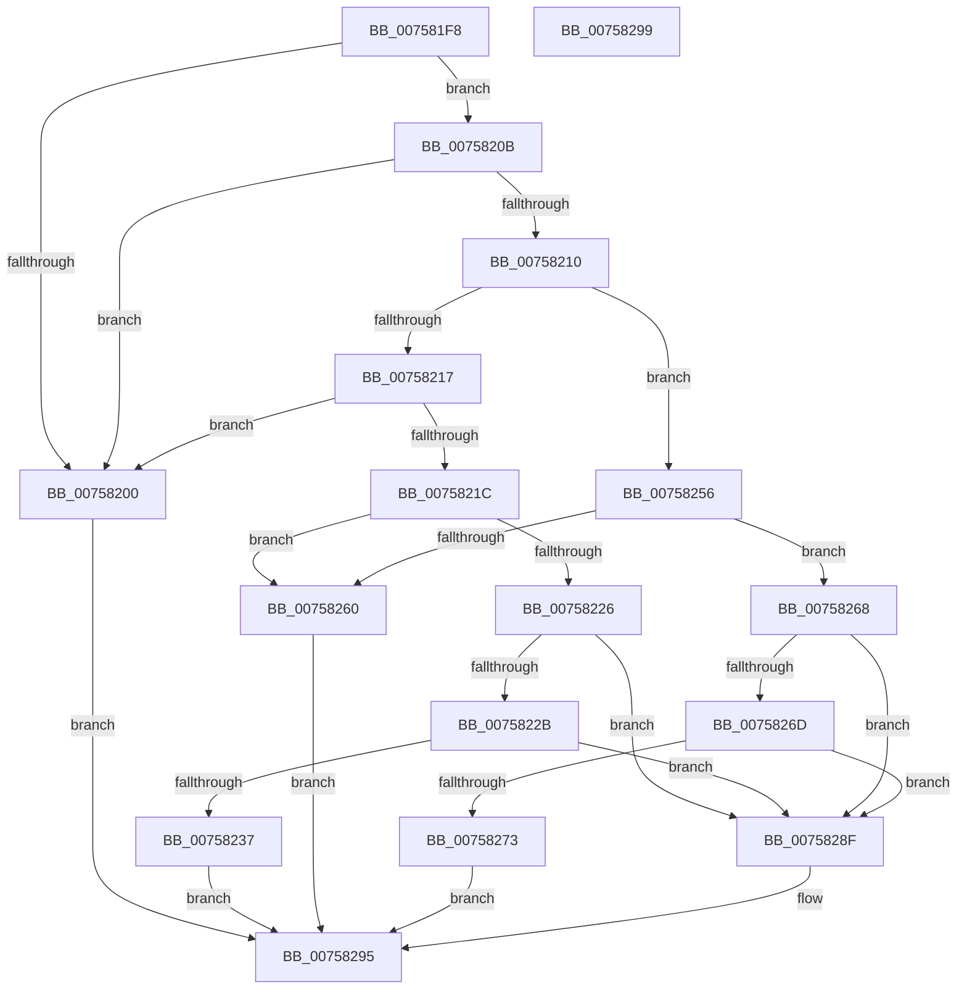

# PopHandleProvIdentifierRequest

- RVA: `0x007581F8`–`0x0075829A` (길이 `162` bytes)
- VA: `0x00000001407581F8`
- 실행 섹션: `PAGE`
- PDB 이름 있음: `예`; PDB Function 태그: `아니요`
- unwind 정보 RVA: `0x000DB714`
- 디코드: `44`개 명령, `162/162` bytes 표시
- 미해석 바이트: `0` (있으면 어셈블리에 `.byte`로 보존)

> 이 문서는 커널 이미지의 기계어와 PDB 기호를 분석해 생성했습니다. 4번과 5번은 함수 원형과 자료형을 바이너리 사용 방식에서 추정한 C 해석이며 원본 소스 복구 결과는 아닙니다.

## 1. Dependencies

- 직접 호출 지점: **0**; 고유 호출 대상: **0**
- 직접 호출자로 확인된 함수: **1**
- RIP 상대 이미지 참조: **3**

### Outgoing calls
- 직접 디코드된 call 명령이 없습니다.

### Direct callers
- [PopPowerInformationInternal](../A8/PopPowerInformationInternal_function_00A8B7C0.md) at `0x00A8D222`

### Static image references
- `0x0075821C` → RVA `0x00F0C890` (`.data`; read)
- `0x0075822B` → RVA `0x00F0C892` (`.data`; read)
- `0x00758237` → RVA `0x00F0C898` (`.data`; read)

## 2. Other-region calls and transfers

- 다른 실행 섹션으로 향하는 call: **0**
- 별도 외부 분기/꼬리 이동을 확인하지 못했습니다.

## 3. Assembly (complete function range)

```asm
007581F8  45 33 D2                        xor r10d, r10d
007581FB  48 85 C9                        test rcx, rcx
007581FE  75 0B                           jne 0x14075820b
00758200  41 BA 0D 00 00 C0               mov r10d, 0xc000000d
00758206  E9 8A 00 00 00                  jmp 0x140758295
0075820B  83 FA 18                        cmp edx, 0x18
0075820E  72 F0                           jb 0x140758200
00758210  8B 49 08                        mov ecx, dword ptr [rcx + 8]
00758213  85 C9                           test ecx, ecx
00758215  74 3F                           je 0x140758256
00758217  83 F9 01                        cmp ecx, 1
0075821A  75 E4                           jne 0x140758200
0075821C  66 44 39 15 6C 46 7B 00         cmp word ptr [rip + 0x7b466c], r10w
00758224  74 3A                           je 0x140758260
00758226  4D 85 C0                        test r8, r8
00758229  74 64                           je 0x14075828f
0075822B  0F B7 05 60 46 7B 00            movzx eax, word ptr [rip + 0x7b4660]
00758232  44 3B C8                        cmp r9d, eax
00758235  72 58                           jb 0x14075828f
00758237  48 8B 05 5A 46 7B 00            mov rax, qword ptr [rip + 0x7b465a]
0075823E  48 8B 4C 24 28                  mov rcx, qword ptr [rsp + 0x28]
00758243  48 89 01                        mov qword ptr [rcx], rax
00758246  48 8B 44 24 30                  mov rax, qword ptr [rsp + 0x30]
0075824B  0F B7 0D 40 46 7B 00            movzx ecx, word ptr [rip + 0x7b4640]
00758252  89 08                           mov dword ptr [rax], ecx
00758254  EB 3F                           jmp 0x140758295
00758256  66 44 39 15 32 46 7B 00         cmp word ptr [rip + 0x7b4632], r10w
0075825E  75 08                           jne 0x140758268
00758260  41 BA BB 00 00 C0               mov r10d, 0xc00000bb
00758266  EB 2D                           jmp 0x140758295
00758268  4D 85 C0                        test r8, r8
0075826B  74 22                           je 0x14075828f
0075826D  41 83 F9 02                     cmp r9d, 2
00758271  72 1C                           jb 0x14075828f
00758273  48 8B 44 24 28                  mov rax, qword ptr [rsp + 0x28]
00758278  48 8D 0D 13 46 7B 00            lea rcx, [rip + 0x7b4613]
0075827F  48 89 08                        mov qword ptr [rax], rcx
00758282  48 8B 44 24 30                  mov rax, qword ptr [rsp + 0x30]
00758287  C7 00 02 00 00 00               mov dword ptr [rax], 2
0075828D  EB 06                           jmp 0x140758295
0075828F  41 BA 23 00 00 C0               mov r10d, 0xc0000023
00758295  41 8B C2                        mov eax, r10d
00758298  C3                              ret
00758299  CC                              int3
```

## 4. C-style interpretation (structured pseudocode)

```c
__int64 __fastcall PopHandleProvIdentifierRequest(__int64 a1, int a2, __int64 a3, int a4, __int64 a5, __int64 a6)
{
    __int64 v_r10;

    v_r10 = 0;
    if (a1 != 0) goto loc_0075820B;
loc_00758200:
    goto loc_00758295;
loc_0075820B:
    if (a2 < 24) goto loc_00758200;
    if ((unsigned int)((unsigned int)(*(unsigned int *)(a1 + 8))) == 0) goto loc_00758256;
    if (((unsigned int)((unsigned int)(*(unsigned int *)(a1 + 8)))) != 1) goto loc_00758200;
    if ((*(unsigned __int16 *)(v_rip + 8078956)) == ((unsigned __int16)((unsigned int)(0xC000000DULL)))) goto loc_00758260;
    if (a3 == 0) goto loc_0075828F;
    if (a4 < ((unsigned int)(*(unsigned __int16 *)(v_rip + 8078944)))) goto loc_0075828F;
    *(unsigned __int64 *)(a5) = *(unsigned __int64 *)(v_rip + 8078938);
    *(unsigned int *)(a6) = (unsigned int)(*(unsigned __int16 *)(v_rip + 8078912));
    goto loc_00758295;
loc_00758256:
    if ((*(unsigned __int16 *)(v_rip + 8078898)) != ((unsigned __int16)((unsigned int)(0xC000000DULL)))) goto loc_00758268;
loc_00758260:
    goto loc_00758295;
loc_00758268:
    if (a3 == 0) goto loc_0075828F;
    if (a4 < 2) goto loc_0075828F;
    *(unsigned __int64 *)(a5) = v_rip + 8078867;
    *(unsigned int *)(a6) = 2;
    goto loc_00758295;
loc_0075828F:
loc_00758295:
    return (unsigned int)((unsigned int)((unsigned int)(0xC0000023ULL)));
}
```

## 5. (Beta) C Style

```c
int64_t PopHandleProvIdentifierRequest(int64_t Arg1, int32_t Arg2, int64_t Arg3, int32_t Arg4, void *Arg5, void *Arg6)
{
    uint8_t *arg5 = (uint8_t *)Arg5;
    uint8_t *arg6 = (uint8_t *)Arg6;

    int64_t local_r10;

    local_r10 = 0;
    if (Arg1 != 0) goto loc_0075820B;
loc_00758200:
    goto loc_00758295;
loc_0075820B:
    if (Arg2 < 24) goto loc_00758200;
    if ((uint32_t)((uint32_t)(*(uint32_t *)(Arg1 + 0x8))) == 0) goto loc_00758256;
    if (((uint32_t)((uint32_t)(*(uint32_t *)(Arg1 + 0x8)))) != 1) goto loc_00758200;
    if ((*(uint16_t *)(v_rip + 0x7B466C)) == ((uint16_t)((uint32_t)(0xC000000DULL)))) goto loc_00758260;
    if (Arg3 == 0) goto loc_0075828F;
    if (Arg4 < ((uint32_t)(*(uint16_t *)(v_rip + 0x7B4660)))) goto loc_0075828F;
    *(uint64_t *)(arg5) = *(uint64_t *)(v_rip + 0x7B465A);
    *(uint32_t *)(arg6) = (uint32_t)(*(uint16_t *)(v_rip + 0x7B4640));
    goto loc_00758295;
loc_00758256:
    if ((*(uint16_t *)(v_rip + 0x7B4632)) != ((uint16_t)((uint32_t)(0xC000000DULL)))) goto loc_00758268;
loc_00758260:
    goto loc_00758295;
loc_00758268:
    if (Arg3 == 0) goto loc_0075828F;
    if (Arg4 < 2) goto loc_0075828F;
    *(uint64_t *)(arg5) = v_rip + 8078867;
    *(uint32_t *)(arg6) = 2;
    goto loc_00758295;
loc_0075828F:
loc_00758295:
    return (uint32_t)((uint32_t)((uint32_t)(0xC0000023ULL)));
}
```

### 관측된 메모리 오프셋

구조체 형식이 확인되지 않은 접근은 인자 기준의 오프셋으로만 기록했습니다.

| 기준 인자 | 오프셋 표현 | 폭 (bit) | 접근 |
|---|---:|---:|---|
| `Arg5` | `+ 0x0` | `64` | `W` |
| `Arg6` | `+ 0x0` | `32` | `W` |

## 6. Execution-region graph

[열기: 2D/3D 그래프와 함수 탐색 컨트롤 패널](../../../control-panel.html?section=page&rva=0x007581F8&view=graph)

- 2D 그래프는 위에서 아래로 흐르고, 3D 그래프는 빈 공간을 드래그해 회전합니다. Shift+드래그는 이동, 휠은 확대·축소, 함수 노드 선택은 대상 보고서 이동입니다.

### Static fallback


