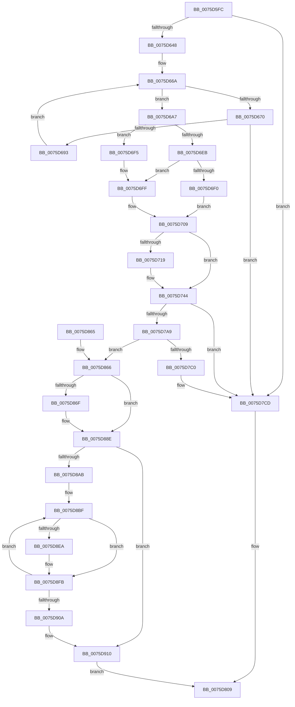

# PopHiberInitializeResources

- RVA: `0x0075D5FC`–`0x0075D96C` (길이 `880` bytes)
- VA: `0x000000014075D5FC`
- 실행 섹션: `PAGE`
- PDB 이름 있음: `예`; PDB Function 태그: `아니요`
- unwind 정보 RVA: `0x000CC494`
- 디코드: `227`개 명령, `880/880` bytes 표시
- 미해석 바이트: `0` (있으면 어셈블리에 `.byte`로 보존)

> 이 문서는 커널 이미지의 기계어와 PDB 기호를 분석해 생성했습니다. 4번과 5번은 함수 원형과 자료형을 바이너리 사용 방식에서 추정한 C 해석이며 원본 소스 복구 결과는 아닙니다.

## 1. Dependencies

- 직접 호출 지점: **13**; 고유 호출 대상: **10**
- 직접 호출자로 확인된 함수: **1**
- RIP 상대 이미지 참조: **7**

### Outgoing calls
- `0x0075D686` → [RtlGetCompressionWorkSpaceSize](../../text/3B/RtlGetCompressionWorkSpaceSize_function_003B2560.md) (function, `0x003B2560`)
- `0x0075D6D1` → [IoGetDumpStackTransferSizes](../../text/59/IoGetDumpStackTransferSizes_function_00592A0C.md) (function, `0x00592A0C`)
- `0x0075D6DC` → [Feature_CrashDumpOneMBTransferSize__private_IsEnabledDeviceUsageNoInline](../../text/5D/Feature_CrashDumpOneMBTransferSize__private_IsEnabledDeviceUsageNoInline_function_005D4A08.md) (function, `0x005D4A08`)
- `0x0075D731` → [PopCalculateHiberFileSize](PopCalculateHiberFileSize_function_0075CC98.md) (function, `0x0075CC98`)
- `0x0075D79C` → [ExAllocatePool2](../../poolcode/B8/ExAllocatePool2_function_00B820F0.md) (function, `0x00B820F0`)
- `0x0075D7AF` → [MmAllocateDumpHibernateResources](../AB/MmAllocateDumpHibernateResources_function_00AB3B4C.md) (function, `0x00AB3B4C`)
- `0x0075D7C8` → [ExFreePoolWithTag](../../poolcode/B8/ExFreePoolWithTag_function_00B82870.md) (function, `0x00B82870`)
- `0x0075D7EC` → [memset](../../text/6C/memset_function_006C6C40.md) (function, `0x006C6C40`)
- `0x0075D826` → [PoSetHiberRange](../../text/47/PoSetHiberRange_function_0047C580.md) (function, `0x0047C580`)
- `0x0075D889` → [memset](../../text/6C/memset_function_006C6C40.md) (function, `0x006C6C40`)
- `0x0075D89E` → [memset](../../text/6C/memset_function_006C6C40.md) (function, `0x006C6C40`)
- `0x0075D921` → [MmMarkHiberRange](../7F/MmMarkHiberRange_function_007FE3D0.md) (function, `0x007FE3D0`)
- `0x0075D945` → [PoSetHiberRange](../../text/47/PoSetHiberRange_function_0047C580.md) (function, `0x0047C580`)

### Direct callers
- [PopAllocateHiberContext](../AD/PopAllocateHiberContext_function_00ADC05C.md) at `0x00ADC38A`

### Static image references
- `0x0075D610` → RVA `0x00FC6A80` (`ALMOSTRO`; read)
- `0x0075D61A` → RVA `0x00F0CF0C` (`.data`; read)
- `0x0075D673` → RVA `0x00029238` (`.rdata`; read)
- `0x0075D710` → RVA `0x00FC50E4` (`ALMOSTRO`; read)
- `0x0075D7CD` → RVA `0x00F0BFD8` (`.data`; read)
- `0x0075D7F1` → RVA `0x00F0BF48` (`.data`; read)
- `0x0075D802` → RVA `0x00F0BFD0` (`.data`; read)

## 2. Other-region calls and transfers

- 다른 실행 섹션으로 향하는 call: **10**
  - `0x0075D686` → [RtlGetCompressionWorkSpaceSize](../../text/3B/RtlGetCompressionWorkSpaceSize_function_003B2560.md) (`PAGE` → `.text`)
  - `0x0075D6D1` → [IoGetDumpStackTransferSizes](../../text/59/IoGetDumpStackTransferSizes_function_00592A0C.md) (`PAGE` → `.text`)
  - `0x0075D6DC` → [Feature_CrashDumpOneMBTransferSize__private_IsEnabledDeviceUsageNoInline](../../text/5D/Feature_CrashDumpOneMBTransferSize__private_IsEnabledDeviceUsageNoInline_function_005D4A08.md) (`PAGE` → `.text`)
  - `0x0075D79C` → [ExAllocatePool2](../../poolcode/B8/ExAllocatePool2_function_00B820F0.md) (`PAGE` → `POOLCODE`)
  - `0x0075D7C8` → [ExFreePoolWithTag](../../poolcode/B8/ExFreePoolWithTag_function_00B82870.md) (`PAGE` → `POOLCODE`)
  - `0x0075D7EC` → [memset](../../text/6C/memset_function_006C6C40.md) (`PAGE` → `.text`)
  - `0x0075D826` → [PoSetHiberRange](../../text/47/PoSetHiberRange_function_0047C580.md) (`PAGE` → `.text`)
  - `0x0075D889` → [memset](../../text/6C/memset_function_006C6C40.md) (`PAGE` → `.text`)
  - `0x0075D89E` → [memset](../../text/6C/memset_function_006C6C40.md) (`PAGE` → `.text`)
  - `0x0075D945` → [PoSetHiberRange](../../text/47/PoSetHiberRange_function_0047C580.md) (`PAGE` → `.text`)
- 별도 외부 분기/꼬리 이동을 확인하지 못했습니다.

## 3. Assembly (complete function range)

```asm
0075D5FC  40 55                           push rbp
0075D5FE  53                              push rbx
0075D5FF  56                              push rsi
0075D600  57                              push rdi
0075D601  41 54                           push r12
0075D603  41 55                           push r13
0075D605  41 56                           push r14
0075D607  41 57                           push r15
0075D609  48 8B EC                        mov rbp, rsp
0075D60C  48 83 EC 78                     sub rsp, 0x78
0075D610  44 8B 35 69 94 86 00            mov r14d, dword ptr [rip + 0x869469]
0075D617  45 33 ED                        xor r13d, r13d
0075D61A  F7 05 E8 F8 7A 00 00 00 00 10   test dword ptr [rip + 0x7af8e8], 0x10000000
0075D624  48 8B F9                        mov rdi, rcx
0075D627  44 89 6D 48                     mov dword ptr [rbp + 0x48], r13d
0075D62B  45 8B FD                        mov r15d, r13d
0075D62E  44 89 6D 50                     mov dword ptr [rbp + 0x50], r13d
0075D632  4C 89 6D B8                     mov qword ptr [rbp - 0x48], r13
0075D636  44 89 6D 58                     mov dword ptr [rbp + 0x58], r13d
0075D63A  44 89 6D 60                     mov dword ptr [rbp + 0x60], r13d
0075D63E  4C 89 6D C8                     mov qword ptr [rbp - 0x38], r13
0075D642  0F 85 85 01 00 00               jne 0x14075d7cd
0075D648  49 69 C6 A8 00 00 00            imul rax, r14, 0xa8
0075D64F  41 8B DD                        mov ebx, r13d
0075D652  45 8B E5                        mov r12d, r13d
0075D655  48 89 45 E8                     mov qword ptr [rbp - 0x18], rax
0075D659  48 8D B0 FF 0F 00 00            lea rsi, [rax + 0xfff]
0075D660  8B 45 48                        mov eax, dword ptr [rbp + 0x48]
0075D663  48 81 E6 00 F0 FF FF            and rsi, 0xfffffffffffff000
0075D66A  41 83 FC 05                     cmp r12d, 5
0075D66E  73 37                           jae 0x14075d6a7
0075D670  41 8B CC                        mov ecx, r12d
0075D673  48 8D 05 BE BB 8C FF            lea rax, [rip - 0x734442]
0075D67A  4C 8D 45 50                     lea r8, [rbp + 0x50]
0075D67E  48 8D 55 48                     lea rdx, [rbp + 0x48]
0075D682  0F B7 0C 48                     movzx ecx, word ptr [rax + rcx*2]
0075D686  E8 D5 4E C5 FF                  call 0x1403b2560
0075D68B  85 C0                           test eax, eax
0075D68D  0F 88 3A 01 00 00               js 0x14075d7cd
0075D693  8B 45 48                        mov eax, dword ptr [rbp + 0x48]
0075D696  3B D8                           cmp ebx, eax
0075D698  0F 46 D8                        cmovbe ebx, eax
0075D69B  3B 5D 50                        cmp ebx, dword ptr [rbp + 0x50]
0075D69E  0F 46 5D 50                     cmovbe ebx, dword ptr [rbp + 0x50]
0075D6A2  41 FF C4                        inc r12d
0075D6A5  EB C3                           jmp 0x14075d66a
0075D6A7  83 C0 07                        add eax, 7
0075D6AA  48 89 75 D0                     mov qword ptr [rbp - 0x30], rsi
0075D6AE  BA F8 FF FF FF                  mov edx, 0xfffffff8
0075D6B3  8D 4B 07                        lea ecx, [rbx + 7]
0075D6B6  23 C2                           and eax, edx
0075D6B8  23 CA                           and ecx, edx
0075D6BA  89 45 48                        mov dword ptr [rbp + 0x48], eax
0075D6BD  48 8D 55 58                     lea rdx, [rbp + 0x58]
0075D6C1  8B C1                           mov eax, ecx
0075D6C3  89 4D C0                        mov dword ptr [rbp - 0x40], ecx
0075D6C6  41 0F AF C6                     imul eax, r14d
0075D6CA  48 8D 4D 60                     lea rcx, [rbp + 0x60]
0075D6CE  48 03 F0                        add rsi, rax
0075D6D1  E8 36 53 E3 FF                  call 0x140592a0c
0075D6D6  8B 5D 58                        mov ebx, dword ptr [rbp + 0x58]
0075D6D9  C1 EB 0C                        shr ebx, 0xc
0075D6DC  E8 27 73 E7 FF                  call 0x1405d4a08
0075D6E1  41 BD 10 00 00 00               mov r13d, 0x10
0075D6E7  85 C0                           test eax, eax
0075D6E9  75 0A                           jne 0x14075d6f5
0075D6EB  41 3B DD                        cmp ebx, r13d
0075D6EE  73 0F                           jae 0x14075d6ff
0075D6F0  41 8B DD                        mov ebx, r13d
0075D6F3  EB 14                           jmp 0x14075d709
0075D6F5  B8 01 00 00 00                  mov eax, 1
0075D6FA  3B D8                           cmp ebx, eax
0075D6FC  0F 42 D8                        cmovb ebx, eax
0075D6FF  B8 00 01 00 00                  mov eax, 0x100
0075D704  3B D8                           cmp ebx, eax
0075D706  0F 47 D8                        cmova ebx, eax
0075D709  44 8B E3                        mov r12d, ebx
0075D70C  41 C1 E4 0C                     shl r12d, 0xc
0075D710  44 39 3D CD 79 86 00            cmp dword ptr [rip + 0x8679cd], r15d
0075D717  74 2B                           je 0x14075d744
0075D719  48 81 C6 FF 0F 00 00            add rsi, 0xfff
0075D720  48 8D 4D B8                     lea rcx, [rbp - 0x48]
0075D724  48 81 E6 00 F0 FF FF            and rsi, 0xfffffffffffff000
0075D72B  33 D2                           xor edx, edx
0075D72D  48 89 75 C8                     mov qword ptr [rbp - 0x38], rsi
0075D731  E8 62 F5 FF FF                  call 0x14075cc98
0075D736  4C 8B 7D B8                     mov r15, qword ptr [rbp - 0x48]
0075D73A  49 C1 EF 09                     shr r15, 9
0075D73E  4D 03 FF                        add r15, r15
0075D741  49 03 F7                        add rsi, r15
0075D744  41 6B C4 11                     imul eax, r12d, 0x11
0075D748  48 8D 96 FF 0F 00 00            lea rdx, [rsi + 0xfff]
0075D74F  49 C7 C0 00 F0 FF FF            mov r8, 0xfffffffffffff000
0075D756  41 69 CE 84 00 01 00            imul ecx, r14d, 0x10084
0075D75D  49 23 D0                        and rdx, r8
0075D760  41 F7 DC                        neg r12d
0075D763  48 89 55 E0                     mov qword ptr [rbp - 0x20], rdx
0075D767  FF C9                           dec ecx
0075D769  03 C1                           add eax, ecx
0075D76B  B9 40 00 00 00                  mov ecx, 0x40
0075D770  41 23 C4                        and eax, r12d
0075D773  48 03 D0                        add rdx, rax
0075D776  89 45 B8                        mov dword ptr [rbp - 0x48], eax
0075D779  41 8B C6                        mov eax, r14d
0075D77C  48 89 55 F0                     mov qword ptr [rbp - 0x10], rdx
0075D780  C1 E0 11                        shl eax, 0x11
0075D783  48 05 FF 0F 00 00               add rax, 0xfff
0075D789  48 03 C2                        add rax, rdx
0075D78C  49 23 C0                        and rax, r8
0075D78F  41 B8 68 69 62 72               mov r8d, 0x72626968
0075D795  48 8B D0                        mov rdx, rax
0075D798  48 89 45 D8                     mov qword ptr [rbp - 0x28], rax
0075D79C  E8 4F 49 42 00                  call 0x140b820f0
0075D7A1  48 8B F0                        mov rsi, rax
0075D7A4  48 85 C0                        test rax, rax
0075D7A7  74 24                           je 0x14075d7cd
0075D7A9  41 8B CE                        mov ecx, r14d
0075D7AC  C1 E1 10                        shl ecx, 0x10
0075D7AF  E8 98 63 35 00                  call 0x140ab3b4c
0075D7B4  4C 8B E0                        mov r12, rax
0075D7B7  48 85 C0                        test rax, rax
0075D7BA  0F 85 A6 00 00 00               jne 0x14075d866
0075D7C0  BA 68 69 62 72                  mov edx, 0x72626968
0075D7C5  48 8B CE                        mov rcx, rsi
0075D7C8  E8 A3 50 42 00                  call 0x140b82870
0075D7CD  48 8B 35 04 E8 7A 00            mov rsi, qword ptr [rip + 0x7ae804]
0075D7D4  B8 01 00 00 00                  mov eax, 1
0075D7D9  48 8B CE                        mov rcx, rsi
0075D7DC  33 D2                           xor edx, edx
0075D7DE  41 B8 A8 00 00 00               mov r8d, 0xa8
0075D7E4  44 8B F0                        mov r14d, eax
0075D7E7  44 8B E8                        mov r13d, eax
0075D7EA  8B D8                           mov ebx, eax
0075D7EC  E8 4F 94 F6 FF                  call 0x1406c6c40
0075D7F1  48 8B 05 50 E7 7A 00            mov rax, qword ptr [rip + 0x7ae750]
0075D7F8  41 BC 00 30 00 00               mov r12d, 0x3000
0075D7FE  48 89 46 08                     mov qword ptr [rsi + 8], rax
0075D802  4C 8B 3D C7 E7 7A 00            mov r15, qword ptr [rip + 0x7ae7c7]
0075D809  4C 8B 05 C0 E7 7A 00            mov r8, qword ptr [rip + 0x7ae7c0]
0075D810  41 B9 00 30 00 00               mov r9d, 0x3000
0075D816  BA 00 80 00 00                  mov edx, 0x8000
0075D81B  C7 44 24 20 68 69 62 72         mov dword ptr [rsp + 0x20], 0x72626968
0075D823  48 8B CF                        mov rcx, rdi
0075D826  E8 55 ED D1 FF                  call 0x14047c580
0075D82B  44 89 B7 20 01 00 00            mov dword ptr [rdi + 0x120], r14d
0075D832  48 89 B7 28 01 00 00            mov qword ptr [rdi + 0x128], rsi
0075D839  4C 89 BF 30 01 00 00            mov qword ptr [rdi + 0x130], r15
0075D840  44 89 A7 38 01 00 00            mov dword ptr [rdi + 0x138], r12d
0075D847  44 89 AF 3C 01 00 00            mov dword ptr [rdi + 0x13c], r13d
0075D84E  89 9F B8 01 00 00               mov dword ptr [rdi + 0x1b8], ebx
0075D854  48 83 C4 78                     add rsp, 0x78
0075D858  41 5F                           pop r15
0075D85A  41 5E                           pop r14
0075D85C  41 5D                           pop r13
0075D85E  41 5C                           pop r12
0075D860  5F                              pop rdi
0075D861  5E                              pop rsi
0075D862  5B                              pop rbx
0075D863  5D                              pop rbp
0075D864  C3                              ret
0075D865  CC                              int3
0075D866  83 3D 77 78 86 00 00            cmp dword ptr [rip + 0x867877], 0
0075D86D  74 1F                           je 0x14075d88e
0075D86F  48 8B 4D C8                     mov rcx, qword ptr [rbp - 0x38]
0075D873  4D 8B C7                        mov r8, r15
0075D876  48 03 CE                        add rcx, rsi
0075D879  4C 89 BF D8 01 00 00            mov qword ptr [rdi + 0x1d8], r15
0075D880  33 D2                           xor edx, edx
0075D882  48 89 8F D0 01 00 00            mov qword ptr [rdi + 0x1d0], rcx
0075D889  E8 B2 93 F6 FF                  call 0x1406c6c40
0075D88E  4C 8B 7D E0                     mov r15, qword ptr [rbp - 0x20]
0075D892  33 D2                           xor edx, edx
0075D894  4C 8B 45 E8                     mov r8, qword ptr [rbp - 0x18]
0075D898  48 8B CE                        mov rcx, rsi
0075D89B  4C 03 FE                        add r15, rsi
0075D89E  E8 9D 93 F6 FF                  call 0x1406c6c40
0075D8A3  45 33 C0                        xor r8d, r8d
0075D8A6  45 85 F6                        test r14d, r14d
0075D8A9  74 65                           je 0x14075d910
0075D8AB  44 8B 4D C0                     mov r9d, dword ptr [rbp - 0x40]
0075D8AF  48 8D 56 08                     lea rdx, [rsi + 8]
0075D8B3  4C 8B 55 D0                     mov r10, qword ptr [rbp - 0x30]
0075D8B7  45 8D 68 01                     lea r13d, [r8 + 1]
0075D8BB  4C 8B 5D F0                     mov r11, qword ptr [rbp - 0x10]
0075D8BF  41 8B C0                        mov eax, r8d
0075D8C2  41 8B C8                        mov ecx, r8d
0075D8C5  C1 E0 11                        shl eax, 0x11
0075D8C8  49 03 C3                        add rax, r11
0075D8CB  C1 E1 10                        shl ecx, 0x10
0075D8CE  48 03 C6                        add rax, rsi
0075D8D1  49 03 CC                        add rcx, r12
0075D8D4  48 89 42 F8                     mov qword ptr [rdx - 8], rax
0075D8D8  48 05 00 00 01 00               add rax, 0x10000
0075D8DE  48 89 42 10                     mov qword ptr [rdx + 0x10], rax
0075D8E2  48 89 0A                        mov qword ptr [rdx], rcx
0075D8E5  45 85 C9                        test r9d, r9d
0075D8E8  74 11                           je 0x14075d8fb
0075D8EA  41 8B C9                        mov ecx, r9d
0075D8ED  41 0F AF C8                     imul ecx, r8d
0075D8F1  49 03 CA                        add rcx, r10
0075D8F4  48 03 CE                        add rcx, rsi
0075D8F7  48 89 4A 08                     mov qword ptr [rdx + 8], rcx
0075D8FB  45 03 C5                        add r8d, r13d
0075D8FE  48 81 C2 A8 00 00 00            add rdx, 0xa8
0075D905  45 3B C6                        cmp r8d, r14d
0075D908  72 B5                           jb 0x14075d8bf
0075D90A  41 BD 10 00 00 00               mov r13d, 0x10
0075D910  45 8B C6                        mov r8d, r14d
0075D913  49 8B D4                        mov rdx, r12
0075D916  41 C1 E0 04                     shl r8d, 4
0075D91A  48 8B CF                        mov rcx, rdi
0075D91D  49 C1 E0 0C                     shl r8, 0xc
0075D921  E8 AA 0A 0A 00                  call 0x1407fe3d0
0075D926  48 8B 45 D0                     mov rax, qword ptr [rbp - 0x30]
0075D92A  BA 00 80 00 00                  mov edx, 0x8000
0075D92F  4C 8B 4D D8                     mov r9, qword ptr [rbp - 0x28]
0075D933  48 8B CF                        mov rcx, rdi
0075D936  4C 2B C8                        sub r9, rax
0075D939  C7 44 24 20 68 69 62 72         mov dword ptr [rsp + 0x20], 0x72626968
0075D941  4C 8D 04 30                     lea r8, [rax + rsi]
0075D945  E8 36 EC D1 FF                  call 0x14047c580
0075D94A  48 8B 45 D8                     mov rax, qword ptr [rbp - 0x28]
0075D94E  48 89 87 48 01 00 00            mov qword ptr [rdi + 0x148], rax
0075D955  48 89 B7 40 01 00 00            mov qword ptr [rdi + 0x140], rsi
0075D95C  4C 89 A7 50 01 00 00            mov qword ptr [rdi + 0x150], r12
0075D963  44 8B 65 B8                     mov r12d, dword ptr [rbp - 0x48]
0075D967  E9 9D FE FF FF                  jmp 0x14075d809
```

## 4. C-style interpretation (structured pseudocode)

```c
__int64 __fastcall PopHiberInitializeResources(__int64 a1)
{
    __int64 result;
    __int64 v_r12;
    __int64 v_r13;
    __int64 v_r15;
    __int64 v_rbx;
    __int64 v_rsi;
    __int64 v_rsp;
    unsigned __int64 v_stack_m50;
    unsigned __int64 v_stack_m58;
    unsigned __int64 v_stack_m60;
    unsigned __int64 v_stack_m68;
    unsigned __int64 v_stack_m70;
    unsigned __int64 v_stack_m78;
    unsigned int v_stack_m80;
    unsigned __int64 v_stack_m88;
    unsigned int v_stack_m98;
    unsigned int v_stack_p10;
    unsigned int v_stack_p18;
    unsigned int v_stack_p20;
    unsigned int v_stack_p8;

    v_rsp = (v_rsp) - (120);
    v_r13 = 0;
    v_stack_p8 = 0;
    v_stack_p10 = 0;
    v_stack_m88 = 0;
    v_stack_p18 = 0;
    v_stack_p20 = 0;
    v_stack_m78 = 0;
    if (((*(unsigned int *)(v_rip + 8059112)) & (0x10000000ULL)) != 0) goto loc_0075D7CD;
    result = (result) * ((unsigned int)(*(unsigned int *)(v_rip + 8819817)));
    v_stack_m58 = result;
    v_rsi = (result + 4095) & (0xFFFFFFFFFFFFF000ULL);
loc_0075D66A:
    if (0 >= 5) goto loc_0075D6A7;
    result = RtlGetCompressionWorkSpaceSize(*(unsigned __int16 *)(v_rip - 7554114 + 0 * 2), v_stack_p8, v_stack_p10, a4);
    if (sign_flag) goto loc_0075D7CD;
    v_rbx = 0;
    if (0 <= ((unsigned int)((unsigned int)(v_stack_p8)))) { v_rbx = (unsigned int)((unsigned int)(v_stack_p8)); }
    if (((unsigned int)(v_rbx)) <= v_stack_p10) { v_rbx = v_stack_p10; }
    v_r12 = (unsigned int)((0) + 1);
    goto loc_0075D66A;
loc_0075D6A7:
    result = (unsigned int)(((unsigned int)(v_stack_p8)) + (7));
    v_stack_m70 = v_rsi;
    result = (unsigned int)((result) & ((unsigned int)((unsigned int)(0xFFFFFFF8ULL))));
    a1 = (unsigned int)((v_rbx + 7) & ((unsigned int)((unsigned int)(0xFFFFFFF8ULL))));
    v_stack_p8 = (unsigned int)(result);
    v_stack_m80 = (unsigned int)(a1);
    result = (unsigned int)(((unsigned int)((unsigned int)(a1))) * ((unsigned int)((unsigned int)(*(unsigned int *)(v_rip + 8819817)))));
    v_rsi = (v_rsi) + (result);
    result = IoGetDumpStackTransferSizes(v_stack_p20, v_stack_p18, v_stack_p10, a4);
    v_rbx = (unsigned int)(((unsigned int)(v_stack_p18)) >> (12));
    result = Feature_CrashDumpOneMBTransferSize__private_IsEnabledDeviceUsageNoInline(v_stack_p20, v_stack_p18, v_stack_p10, a4);
    if ((unsigned int)(result) != 0) goto loc_0075D6F5;
    if (((unsigned int)(v_rbx)) >= 16) goto loc_0075D6FF;
    goto loc_0075D709;
loc_0075D6F5:
    v_rbx = 16;
    if (16 < 1) { v_rbx = 1; }
loc_0075D6FF:
    if (((unsigned int)(v_rbx)) > 256) { v_rbx = 256; }
loc_0075D709:
    v_r12 = (unsigned int)(((unsigned int)((unsigned int)(v_rbx))) << (12));
    result = 256;
    v_r15 = 0;
    if ((*(unsigned int *)(v_rip + 8813005)) != 0) {
        v_rsi = (v_rsi) + (0xFFFULL);
        a1 = v_stack_m88;
        v_rsi = (v_rsi) & (0xFFFFFFFFFFFFF000ULL);
        a2 = 0;
        v_stack_m78 = v_rsi;
        result = PopCalculateHiberFileSize(a1, a2, v_stack_p10, a4);
        v_r15 = v_stack_m88;
        v_r15 = (v_r15) >> (9);
        v_r15 = (v_r15) + (v_r15);
        v_rsi = (v_rsi) + (v_r15);
    }
    result = (unsigned int)((result) * ((unsigned int)(v_r12)));
    a1 = (unsigned int)((a1) * ((unsigned int)((unsigned int)(*(unsigned int *)(v_rip + 8819817)))));
    a2 = (v_rsi + 4095) & (0xFFFFFFFFFFFFF000ULL);
    v_r12 = (unsigned int)(-(v_r12));
    v_stack_m60 = a2;
    a1 = (unsigned int)((a1) - 1);
    result = (unsigned int)((result) + ((unsigned int)(a1)));
    result = (unsigned int)((result) & ((unsigned int)(v_r12)));
    a2 = (a2) + (result);
    v_stack_m88 = (unsigned int)(result);
    v_stack_m50 = a2;
    result = (unsigned int)(((unsigned int)((unsigned int)((unsigned int)(*(unsigned int *)(v_rip + 8819817))))) << (17));
    result = (result) + (0xFFFULL);
    result = (result) + (a2);
    result = (result) & (0xFFFFFFFFFFFFF000ULL);
    v_stack_m68 = result;
    result = ExAllocatePool2(64, result, (unsigned int)(0x72626968ULL), a4);
    if (result == 0) goto loc_0075D7CD;
    a1 = (unsigned int)(((unsigned int)((unsigned int)((unsigned int)(*(unsigned int *)(v_rip + 8819817))))) << (16));
    result = MmAllocateDumpHibernateResources(a1, result, (unsigned int)(0x72626968ULL), a4);
    if (result != 0) goto loc_0075D866;
    result = ExFreePoolWithTag(result, (unsigned int)(0x72626968ULL), (unsigned int)(0x72626968ULL), a4);
loc_0075D7CD:
    a2 = 0;
    result = memset(*(unsigned __int64 *)(v_rip + 8054788), a2, 168, a4);
    *(unsigned __int64 *)(*(unsigned __int64 *)(v_rip + 8054788) + 8) = *(unsigned __int64 *)(v_rip + 8054608);
loc_0075D809:
    v_stack_m98 = 0x72626968ULL;
    result = PoSetHiberRange(a1, (unsigned int)(0x8000ULL), *(unsigned __int64 *)(v_rip + 8054720), (unsigned int)(0x3000ULL));
    *(unsigned int *)(a1 + 288) = 1;
    *(unsigned __int64 *)(a1 + 296) = *(unsigned __int64 *)(v_rip + 8054788);
    *(unsigned __int64 *)(a1 + 304) = *(unsigned __int64 *)(v_rip + 8054727);
    *(unsigned int *)(a1 + 312) = (unsigned int)((unsigned int)(0x3000ULL));
    *(unsigned int *)(a1 + 316) = 1;
    *(unsigned int *)(a1 + 440) = 1;
    v_rsp = (v_rsp) + (120);
    return result;
loc_0075D866:
    if ((*(unsigned int *)(v_rip + 8812663)) != 0) {
        a1 = v_stack_m78;
        a3 = *(unsigned __int64 *)(v_rip + 8054727);
        a1 = (a1) + (*(unsigned __int64 *)(v_rip + 8054788));
        *(unsigned __int64 *)(a1 + 472) = *(unsigned __int64 *)(v_rip + 8054727);
        a2 = 0;
        *(unsigned __int64 *)(a1 + 464) = a1;
        result = memset(a1, a2, a3, (unsigned int)(0x3000ULL));
    }
    a2 = 0;
    v_r15 = (v_stack_m60) + (*(unsigned __int64 *)(v_rip + 8054788));
    result = memset(*(unsigned __int64 *)(v_rip + 8054788), a2, v_stack_m58, (unsigned int)(0x3000ULL));
    a3 = 0;
    if (1 == 0) goto loc_0075D910;
loc_0075D8BF:
    result = (unsigned int)((0) << (17));
    result = (result) + (v_stack_m50);
    a1 = (unsigned int)((0) << (16));
    result = (result) + (*(unsigned __int64 *)(v_rip + 8054788));
    a1 = (a1) + ((unsigned int)(0x3000ULL));
    *(unsigned __int64 *)(*(unsigned __int64 *)(v_rip + 8054788) + 8 - 8) = result;
    result = (result) + (0x10000ULL);
    *(unsigned __int64 *)(*(unsigned __int64 *)(v_rip + 8054788) + 8 + 16) = result;
    *(unsigned __int64 *)(*(unsigned __int64 *)(v_rip + 8054788) + 8) = a1;
    if ((unsigned int)((unsigned int)(v_stack_m80)) != 0) {
        a1 = (unsigned int)((unsigned int)(v_stack_m80));
        a1 = (unsigned int)((a1) * (0));
        a1 = (a1) + (v_stack_m70);
        a1 = (a1) + (*(unsigned __int64 *)(v_rip + 8054788));
        *(unsigned __int64 *)(*(unsigned __int64 *)(v_rip + 8054788) + 8 + 8) = a1;
    }
    a3 = (unsigned int)((a3) + ((unsigned int)(a3 + 1)));
    a2 = (*(unsigned __int64 *)(v_rip + 8054788) + 8) + (168);
    if (((unsigned int)(a3)) < 1) goto loc_0075D8BF;
loc_0075D910:
    a3 = (unsigned int)((1) << (4));
    a3 = (a3) << (12);
    result = MmMarkHiberRange(a1, (unsigned int)(0x3000ULL), a3, (unsigned int)(v_stack_m80));
    a4 = (v_stack_m68) - (v_stack_m70);
    v_stack_p20 = 0x72626968ULL;
    result = PoSetHiberRange(a1, (unsigned int)(0x8000ULL), v_stack_m70 + *(unsigned __int64 *)(v_rip + 8054788) * 1, a4);
    *(unsigned __int64 *)(a1 + 328) = v_stack_m68;
    *(unsigned __int64 *)(a1 + 320) = *(unsigned __int64 *)(v_rip + 8054788);
    *(unsigned __int64 *)(a1 + 336) = (unsigned int)(0x3000ULL);
    goto loc_0075D809;
}
```

## 5. (Beta) C Style

```c
int64_t PopHiberInitializeResources(void *Arg1)
{
    uint8_t *arg1 = (uint8_t *)Arg1;

    int64_t result;
    int64_t local_r12;
    int64_t local_r13;
    int64_t local_r15;
    int64_t local_rbx;
    int64_t local_rsi;
    int64_t local_rsp;
    uint64_t v_stack_m50;
    uint64_t v_stack_m58;
    uint64_t v_stack_m60;
    uint64_t v_stack_m68;
    uint64_t v_stack_m70;
    uint64_t v_stack_m78;
    uint32_t v_stack_m80;
    uint64_t v_stack_m88;
    uint32_t v_stack_m98;
    uint32_t v_stack_p10;
    uint32_t v_stack_p18;
    uint32_t v_stack_p20;
    uint32_t v_stack_p8;

    local_rsp = (local_rsp) - (120);
    local_r13 = 0;
    v_stack_p8 = 0;
    v_stack_p10 = 0;
    v_stack_m88 = 0;
    v_stack_p18 = 0;
    v_stack_p20 = 0;
    v_stack_m78 = 0;
    if (((*(uint32_t *)(v_rip + 0x7AF8E8)) & (0x10000000ULL)) != 0) goto loc_0075D7CD;
    result = (result) * ((uint32_t)(*(uint32_t *)(v_rip + 0x869469)));
    v_stack_m58 = result;
    local_rsi = (result + 4095) & (0xFFFFFFFFFFFFF000ULL);
loc_0075D66A:
    if (0 >= 5) goto loc_0075D6A7;
    result = RtlGetCompressionWorkSpaceSize(*(uint16_t *)(v_rip - 0x734442 + 0x0 * 2), v_stack_p8, v_stack_p10, a4);
    if (sign_flag) goto loc_0075D7CD;
    local_rbx = 0;
    if (0 <= ((uint32_t)((uint32_t)(v_stack_p8)))) { local_rbx = (uint32_t)((uint32_t)(v_stack_p8)); }
    if (((uint32_t)(local_rbx)) <= v_stack_p10) { local_rbx = v_stack_p10; }
    local_r12 = (uint32_t)((0) + 1);
    goto loc_0075D66A;
loc_0075D6A7:
    result = (uint32_t)(((uint32_t)(v_stack_p8)) + (7));
    v_stack_m70 = local_rsi;
    result = (uint32_t)((result) & ((uint32_t)((uint32_t)(0xFFFFFFF8ULL))));
    Arg1 = (uint32_t)((local_rbx + 7) & ((uint32_t)((uint32_t)(0xFFFFFFF8ULL))));
    v_stack_p8 = (uint32_t)(result);
    v_stack_m80 = (uint32_t)(Arg1);
    result = (uint32_t)(((uint32_t)((uint32_t)(Arg1))) * ((uint32_t)((uint32_t)(*(uint32_t *)(v_rip + 0x869469)))));
    local_rsi = (local_rsi) + (result);
    result = IoGetDumpStackTransferSizes(v_stack_p20, v_stack_p18, v_stack_p10, a4);
    local_rbx = (uint32_t)(((uint32_t)(v_stack_p18)) >> (12));
    result = Feature_CrashDumpOneMBTransferSize__private_IsEnabledDeviceUsageNoInline(v_stack_p20, v_stack_p18, v_stack_p10, a4);
    if ((uint32_t)(result) != 0) goto loc_0075D6F5;
    if (((uint32_t)(local_rbx)) >= 16) goto loc_0075D6FF;
    goto loc_0075D709;
loc_0075D6F5:
    local_rbx = 16;
    if (16 < 1) { local_rbx = 1; }
loc_0075D6FF:
    if (((uint32_t)(local_rbx)) > 256) { local_rbx = 256; }
loc_0075D709:
    local_r12 = (uint32_t)(((uint32_t)((uint32_t)(local_rbx))) << (12));
    result = 256;
    local_r15 = 0;
    if ((*(uint32_t *)(v_rip + 0x8679CD)) != 0) {
        local_rsi = (local_rsi) + (0xFFFULL);
        Arg1 = v_stack_m88;
        local_rsi = (local_rsi) & (0xFFFFFFFFFFFFF000ULL);
        a2 = 0;
        v_stack_m78 = local_rsi;
        result = PopCalculateHiberFileSize(Arg1, a2, v_stack_p10, a4);
        local_r15 = v_stack_m88;
        local_r15 = (local_r15) >> (9);
        local_r15 = (local_r15) + (local_r15);
        local_rsi = (local_rsi) + (local_r15);
    }
    result = (uint32_t)((result) * ((uint32_t)(local_r12)));
    Arg1 = (uint32_t)((Arg1) * ((uint32_t)((uint32_t)(*(uint32_t *)(v_rip + 0x869469)))));
    a2 = (local_rsi + 4095) & (0xFFFFFFFFFFFFF000ULL);
    local_r12 = (uint32_t)(-(local_r12));
    v_stack_m60 = a2;
    Arg1 = (uint32_t)((Arg1) - 1);
    result = (uint32_t)((result) + ((uint32_t)(Arg1)));
    result = (uint32_t)((result) & ((uint32_t)(local_r12)));
    a2 = (a2) + (result);
    v_stack_m88 = (uint32_t)(result);
    v_stack_m50 = a2;
    result = (uint32_t)(((uint32_t)((uint32_t)((uint32_t)(*(uint32_t *)(v_rip + 0x869469))))) << (17));
    result = (result) + (0xFFFULL);
    result = (result) + (a2);
    result = (result) & (0xFFFFFFFFFFFFF000ULL);
    v_stack_m68 = result;
    result = ExAllocatePool2(64, result, (uint32_t)(0x72626968ULL), a4);
    if (result == 0) goto loc_0075D7CD;
    Arg1 = (uint32_t)(((uint32_t)((uint32_t)((uint32_t)(*(uint32_t *)(v_rip + 0x869469))))) << (16));
    result = MmAllocateDumpHibernateResources(Arg1, result, (uint32_t)(0x72626968ULL), a4);
    if (result != 0) goto loc_0075D866;
    result = ExFreePoolWithTag(result, (uint32_t)(0x72626968ULL), (uint32_t)(0x72626968ULL), a4);
loc_0075D7CD:
    a2 = 0;
    result = memset(*(uint64_t *)(v_rip + 0x7AE804), a2, 168, a4);
    *(uint64_t *)(*(uint64_t *)(v_rip + 0x7AE804) + 0x8) = *(uint64_t *)(v_rip + 0x7AE750);
loc_0075D809:
    v_stack_m98 = 0x72626968ULL;
    result = PoSetHiberRange(Arg1, (uint32_t)(0x8000ULL), *(uint64_t *)(v_rip + 0x7AE7C0), (uint32_t)(0x3000ULL));
    *(uint32_t *)(arg1 + 0x120) = 1;
    *(uint64_t *)(arg1 + 0x128) = *(uint64_t *)(v_rip + 0x7AE804);
    *(uint64_t *)(arg1 + 0x130) = *(uint64_t *)(v_rip + 0x7AE7C7);
    *(uint32_t *)(arg1 + 0x138) = (uint32_t)((uint32_t)(0x3000ULL));
    *(uint32_t *)(arg1 + 0x13C) = 1;
    *(uint32_t *)(arg1 + 0x1B8) = 1;
    local_rsp = (local_rsp) + (120);
    return result;
loc_0075D866:
    if ((*(uint32_t *)(v_rip + 0x867877)) != 0) {
        Arg1 = v_stack_m78;
        a3 = *(uint64_t *)(v_rip + 0x7AE7C7);
        Arg1 = (Arg1) + (*(uint64_t *)(v_rip + 0x7AE804));
        *(uint64_t *)(arg1 + 0x1D8) = *(uint64_t *)(v_rip + 0x7AE7C7);
        a2 = 0;
        *(void **)(arg1 + 0x1D0) = Arg1;
        result = memset(Arg1, a2, a3, (uint32_t)(0x3000ULL));
    }
    a2 = 0;
    local_r15 = (v_stack_m60) + (*(uint64_t *)(v_rip + 0x7AE804));
    result = memset(*(uint64_t *)(v_rip + 0x7AE804), a2, v_stack_m58, (uint32_t)(0x3000ULL));
    a3 = 0;
    if (1 == 0) goto loc_0075D910;
loc_0075D8BF:
    result = (uint32_t)((0) << (17));
    result = (result) + (v_stack_m50);
    Arg1 = (uint32_t)((0) << (16));
    result = (result) + (*(uint64_t *)(v_rip + 0x7AE804));
    Arg1 = (Arg1) + ((uint32_t)(0x3000ULL));
    *(uint64_t *)(*(uint64_t *)(v_rip + 0x7AE804) + 0x8 - 0x8) = result;
    result = (result) + (0x10000ULL);
    *(uint64_t *)(*(uint64_t *)(v_rip + 0x7AE804) + 0x8 + 0x10) = result;
    *(void **)(*(uint64_t *)(v_rip + 0x7AE804) + 0x8) = Arg1;
    if ((uint32_t)((uint32_t)(v_stack_m80)) != 0) {
        Arg1 = (uint32_t)((uint32_t)(v_stack_m80));
        Arg1 = (uint32_t)((Arg1) * (0));
        Arg1 = (Arg1) + (v_stack_m70);
        Arg1 = (Arg1) + (*(uint64_t *)(v_rip + 0x7AE804));
        *(void **)(*(uint64_t *)(v_rip + 0x7AE804) + 0x8 + 0x8) = Arg1;
    }
    a3 = (uint32_t)((a3) + ((uint32_t)(a3 + 1)));
    a2 = (*(uint64_t *)(v_rip + 0x7AE804) + 8) + (168);
    if (((uint32_t)(a3)) < 1) goto loc_0075D8BF;
loc_0075D910:
    a3 = (uint32_t)((1) << (4));
    a3 = (a3) << (12);
    result = MmMarkHiberRange(Arg1, (uint32_t)(0x3000ULL), a3, (uint32_t)(v_stack_m80));
    a4 = (v_stack_m68) - (v_stack_m70);
    v_stack_p20 = 0x72626968ULL;
    result = PoSetHiberRange(Arg1, (uint32_t)(0x8000ULL), v_stack_m70 + *(uint64_t *)(v_rip + 0x7AE804) * 1, a4);
    *(uint64_t *)(arg1 + 0x148) = v_stack_m68;
    *(uint64_t *)(arg1 + 0x140) = *(uint64_t *)(v_rip + 0x7AE804);
    *(uint64_t *)(arg1 + 0x150) = (uint32_t)(0x3000ULL);
    goto loc_0075D809;
}
```

### 관측된 메모리 오프셋

구조체 형식이 확인되지 않은 접근은 인자 기준의 오프셋으로만 기록했습니다.

| 기준 인자 | 오프셋 표현 | 폭 (bit) | 접근 |
|---|---:|---:|---|
| `Arg1` | `+ 0x120` | `32` | `W` |
| `Arg1` | `+ 0x128` | `64` | `W` |
| `Arg1` | `+ 0x130` | `64` | `W` |
| `Arg1` | `+ 0x138` | `32` | `W` |
| `Arg1` | `+ 0x13C` | `32` | `W` |
| `Arg1` | `+ 0x140` | `64` | `W` |
| `Arg1` | `+ 0x148` | `64` | `W` |
| `Arg1` | `+ 0x150` | `64` | `W` |
| `Arg1` | `+ 0x1B8` | `32` | `W` |
| `Arg1` | `+ 0x1D0` | `64` | `W` |
| `Arg1` | `+ 0x1D8` | `64` | `W` |

## 6. Execution-region graph

[열기: 2D/3D 그래프와 함수 탐색 컨트롤 패널](../../../control-panel.html?section=page&rva=0x0075D5FC&view=graph)

- 2D 그래프는 위에서 아래로 흐르고, 3D 그래프는 빈 공간을 드래그해 회전합니다. Shift+드래그는 이동, 휠은 확대·축소, 함수 노드 선택은 대상 보고서 이동입니다.

### Static fallback


