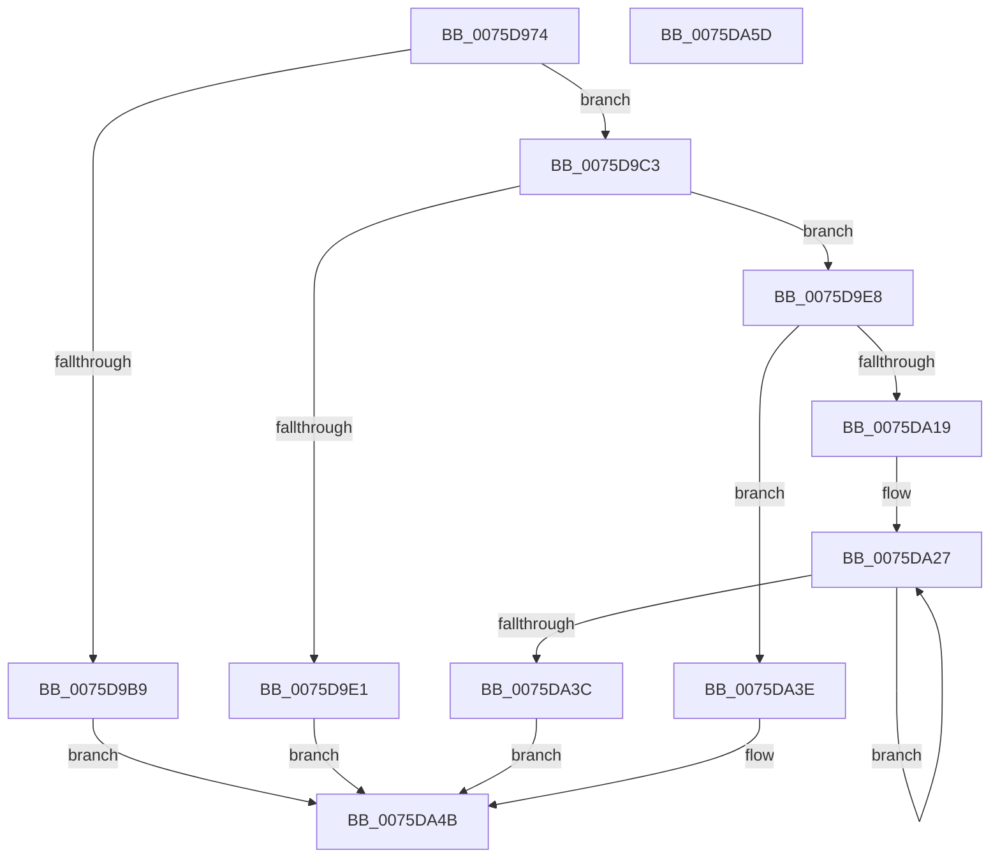

# PopInitHiberPersistedRegValues

- RVA: `0x0075D974`–`0x0075DA5E` (길이 `234` bytes)
- VA: `0x000000014075D974`
- 실행 섹션: `PAGE`
- PDB 이름 있음: `예`; PDB Function 태그: `아니요`
- unwind 정보 RVA: `0x000937EC`
- 디코드: `62`개 명령, `234/234` bytes 표시
- 미해석 바이트: `0` (있으면 어셈블리에 `.byte`로 보존)

> 이 문서는 커널 이미지의 기계어와 PDB 기호를 분석해 생성했습니다. 4번과 5번은 함수 원형과 자료형을 바이너리 사용 방식에서 추정한 C 해석이며 원본 소스 복구 결과는 아닙니다.

## 1. Dependencies

- 직접 호출 지점: **5**; 고유 호출 대상: **4**
- 직접 호출자로 확인된 함수: **1**
- RIP 상대 이미지 참조: **4**

### Outgoing calls
- `0x0075D9AD` → [RtlGetPersistedStateLocation](../8C/RtlGetPersistedStateLocation_function_008C8DE0.md) (function, `0x008C8DE0`)
- `0x0075D9D4` → [ExAllocatePool2](../../poolcode/B8/ExAllocatePool2_function_00B820F0.md) (function, `0x00B820F0`)
- `0x0075DA0E` → [RtlGetPersistedStateLocation](../8C/RtlGetPersistedStateLocation_function_008C8DE0.md) (function, `0x008C8DE0`)
- `0x0075DA2C` → [PopQueryHiberPersistedRegValue](PopQueryHiberPersistedRegValue_function_0075DDFC.md) (function, `0x0075DDFC`)
- `0x0075DA46` → [ExFreePoolWithTag](../../poolcode/B8/ExFreePoolWithTag_function_00B82870.md) (function, `0x00B82870`)

### Direct callers
- [PopInitializeHibernateGlobals](PopInitializeHibernateGlobals_function_0075DA64.md) at `0x0075DA7E`

### Static image references
- `0x0075D98E` → RVA `0x00029610` (`.rdata`; read)
- `0x0075D999` → RVA `0x00029350` (`.rdata`; read)
- `0x0075DA19` → RVA `0x00F0DE50` (`.data`; write)
- `0x0075DA20` → RVA `0x00E07528` (`.data`; read)

## 2. Other-region calls and transfers

- 다른 실행 섹션으로 향하는 call: **2**
  - `0x0075D9D4` → [ExAllocatePool2](../../poolcode/B8/ExAllocatePool2_function_00B820F0.md) (`PAGE` → `POOLCODE`)
  - `0x0075DA46` → [ExFreePoolWithTag](../../poolcode/B8/ExFreePoolWithTag_function_00B82870.md) (`PAGE` → `POOLCODE`)
- 별도 외부 분기/꼬리 이동을 확인하지 못했습니다.

## 3. Assembly (complete function range)

```asm
0075D974  4C 8B DC                        mov r11, rsp
0075D977  49 89 5B 10                     mov qword ptr [r11 + 0x10], rbx
0075D97B  49 89 73 18                     mov qword ptr [r11 + 0x18], rsi
0075D97F  57                              push rdi
0075D980  48 83 EC 40                     sub rsp, 0x40
0075D984  33 DB                           xor ebx, ebx
0075D986  49 8D 43 08                     lea rax, [r11 + 8]
0075D98A  49 89 43 E8                     mov qword ptr [r11 - 0x18], rax
0075D98E  4C 8D 05 7B BC 8C FF            lea r8, [rip - 0x734385]
0075D995  89 5C 24 28                     mov dword ptr [rsp + 0x28], ebx
0075D999  48 8D 0D B0 B9 8C FF            lea rcx, [rip - 0x734650]
0075D9A0  45 33 C9                        xor r9d, r9d
0075D9A3  49 89 5B D8                     mov qword ptr [r11 - 0x28], rbx
0075D9A7  33 D2                           xor edx, edx
0075D9A9  89 5C 24 50                     mov dword ptr [rsp + 0x50], ebx
0075D9AD  E8 2E B4 16 00                  call 0x1408c8de0
0075D9B2  3D 05 00 00 80                  cmp eax, 0x80000005
0075D9B7  74 0A                           je 0x14075d9c3
0075D9B9  BF 01 00 00 C0                  mov edi, 0xc0000001
0075D9BE  E9 88 00 00 00                  jmp 0x14075da4b
0075D9C3  8B 7C 24 50                     mov edi, dword ptr [rsp + 0x50]
0075D9C7  B9 00 01 00 00                  mov ecx, 0x100
0075D9CC  8B D7                           mov edx, edi
0075D9CE  41 B8 68 69 62 72               mov r8d, 0x72626968
0075D9D4  E8 17 47 42 00                  call 0x140b820f0
0075D9D9  48 8B F0                        mov rsi, rax
0075D9DC  48 85 C0                        test rax, rax
0075D9DF  75 07                           jne 0x14075d9e8
0075D9E1  BF 9A 00 00 C0                  mov edi, 0xc000009a
0075D9E6  EB 63                           jmp 0x14075da4b
0075D9E8  48 8D 44 24 50                  lea rax, [rsp + 0x50]
0075D9ED  45 33 C9                        xor r9d, r9d
0075D9F0  48 89 44 24 30                  mov qword ptr [rsp + 0x30], rax
0075D9F5  4C 8D 05 14 BC 8C FF            lea r8, [rip - 0x7343ec]
0075D9FC  89 7C 24 28                     mov dword ptr [rsp + 0x28], edi
0075DA00  48 8D 0D 49 B9 8C FF            lea rcx, [rip - 0x7346b7]
0075DA07  33 D2                           xor edx, edx
0075DA09  48 89 74 24 20                  mov qword ptr [rsp + 0x20], rsi
0075DA0E  E8 CD B3 16 00                  call 0x1408c8de0
0075DA13  8B F8                           mov edi, eax
0075DA15  85 C0                           test eax, eax
0075DA17  78 25                           js 0x14075da3e
0075DA19  48 89 35 30 04 7B 00            mov qword ptr [rip + 0x7b0430], rsi
0075DA20  48 8D 35 01 9B 6A 00            lea rsi, [rip + 0x6a9b01]
0075DA27  48 8B 16                        mov rdx, qword ptr [rsi]
0075DA2A  8B CB                           mov ecx, ebx
0075DA2C  E8 CB 03 00 00                  call 0x14075ddfc
0075DA31  FF C3                           inc ebx
0075DA33  48 8D 76 18                     lea rsi, [rsi + 0x18]
0075DA37  83 FB 04                        cmp ebx, 4
0075DA3A  72 EB                           jb 0x14075da27
0075DA3C  EB 0D                           jmp 0x14075da4b
0075DA3E  BA 68 69 62 72                  mov edx, 0x72626968
0075DA43  48 8B CE                        mov rcx, rsi
0075DA46  E8 25 4E 42 00                  call 0x140b82870
0075DA4B  48 8B 5C 24 58                  mov rbx, qword ptr [rsp + 0x58]
0075DA50  8B C7                           mov eax, edi
0075DA52  48 8B 74 24 60                  mov rsi, qword ptr [rsp + 0x60]
0075DA57  48 83 C4 40                     add rsp, 0x40
0075DA5B  5F                              pop rdi
0075DA5C  C3                              ret
0075DA5D  CC                              int3
```

## 4. C-style interpretation (structured pseudocode)

```c
__int64 __fastcall PopInitHiberPersistedRegValues(__int64 a1, int a2, __int64 a3, int a4)
{
    __int64 result;
    __int64 v_rbx;
    __int64 v_rsp;
    unsigned __int64 v_stack_m18;
    unsigned int v_stack_m20;
    unsigned __int64 v_stack_m28;
    unsigned __int64 v_stack_p10;
    unsigned __int64 v_stack_p18;
    unsigned int v_stack_p8;

    *(unsigned __int64 *)(v_rsp + 16) = v_rbx;
    *(unsigned __int64 *)(v_rsp + 24) = v_rsi;
    v_rsp = (v_rsp) - (64);
    v_rbx = 0;
    *(unsigned __int64 *)(v_rsp - 24) = v_rsp + 8;
    v_stack_m20 = 0;
    a4 = 0;
    *(unsigned __int64 *)(v_rsp - 40) = 0;
    a2 = 0;
    v_stack_p8 = 0;
    result = RtlGetPersistedStateLocation(v_rip - 7554640, a2, v_rip - 7553925, a4);
    if (((unsigned int)(result)) == 0x80000005ULL) goto loc_0075D9C3;
    goto loc_0075DA4B;
loc_0075D9C3:
    result = ExAllocatePool2(256, (unsigned int)((unsigned int)((unsigned int)(v_stack_p8))), (unsigned int)(0x72626968ULL), a4);
    if (result != 0) goto loc_0075D9E8;
    goto loc_0075DA4B;
loc_0075D9E8:
    a4 = 0;
    v_stack_m18 = v_stack_p8;
    v_stack_m20 = (unsigned int)((unsigned int)(0xC000009AULL));
    a2 = 0;
    v_stack_m28 = result;
    result = RtlGetPersistedStateLocation(v_rip - 7554743, a2, v_rip - 7554028, a4);
    if (sign_flag) goto loc_0075DA3E;
    *(unsigned __int64 *)(v_rip + 8062000) = result;
loc_0075DA27:
    result = PopQueryHiberPersistedRegValue(0, *(unsigned __int64 *)(v_rip + 6986497), v_rip - 7554028, a4);
    v_rbx = (unsigned int)((v_rbx) + 1);
    if (((unsigned int)(v_rbx)) < 4) goto loc_0075DA27;
    goto loc_0075DA4B;
loc_0075DA3E:
    result = ExFreePoolWithTag(v_rip + 6986497 + 24, (unsigned int)(0x72626968ULL), v_rip - 7554028, a4);
loc_0075DA4B:
    v_rsp = (v_rsp) + (64);
    return (unsigned int)((unsigned int)((unsigned int)((unsigned int)(result))));
}
```

## 5. (Beta) C Style

```c
int64_t PopInitHiberPersistedRegValues(int64_t Arg1, int32_t Arg2, int64_t Arg3, int32_t Arg4)
{
    int64_t result;
    int64_t local_rbx;
    int64_t local_rsp;
    uint64_t v_stack_m18;
    uint32_t v_stack_m20;
    uint64_t v_stack_m28;
    uint64_t v_stack_p10;
    uint64_t v_stack_p18;
    uint32_t v_stack_p8;

    *(uint64_t *)(local_rsp + 0x10) = local_rbx;
    *(uint64_t *)(local_rsp + 0x18) = local_rsi;
    local_rsp = (local_rsp) - (64);
    local_rbx = 0;
    *(uint64_t *)(local_rsp - 0x18) = local_rsp + 8;
    v_stack_m20 = 0;
    Arg4 = 0;
    *(uint64_t *)(local_rsp - 0x28) = 0;
    Arg2 = 0;
    v_stack_p8 = 0;
    result = RtlGetPersistedStateLocation(v_rip - 7554640, Arg2, v_rip - 7553925, Arg4);
    if (((uint32_t)(result)) == 0x80000005ULL) goto loc_0075D9C3;
    goto loc_0075DA4B;
loc_0075D9C3:
    result = ExAllocatePool2(256, (uint32_t)((uint32_t)((uint32_t)(v_stack_p8))), (uint32_t)(0x72626968ULL), Arg4);
    if (result != 0) goto loc_0075D9E8;
    goto loc_0075DA4B;
loc_0075D9E8:
    Arg4 = 0;
    v_stack_m18 = v_stack_p8;
    v_stack_m20 = (uint32_t)((uint32_t)(0xC000009AULL));
    Arg2 = 0;
    v_stack_m28 = result;
    result = RtlGetPersistedStateLocation(v_rip - 7554743, Arg2, v_rip - 7554028, Arg4);
    if (sign_flag) goto loc_0075DA3E;
    *(uint64_t *)(v_rip + 0x7B0430) = result;
loc_0075DA27:
    result = PopQueryHiberPersistedRegValue(0, *(uint64_t *)(v_rip + 0x6A9B01), v_rip - 7554028, Arg4);
    local_rbx = (uint32_t)((local_rbx) + 1);
    if (((uint32_t)(local_rbx)) < 4) goto loc_0075DA27;
    goto loc_0075DA4B;
loc_0075DA3E:
    result = ExFreePoolWithTag(v_rip + 6986497 + 24, (uint32_t)(0x72626968ULL), v_rip - 7554028, Arg4);
loc_0075DA4B:
    local_rsp = (local_rsp) + (64);
    return (uint32_t)((uint32_t)((uint32_t)((uint32_t)(result))));
}
```

## 6. Execution-region graph

[열기: 2D/3D 그래프와 함수 탐색 컨트롤 패널](../../../control-panel.html?section=page&rva=0x0075D974&view=graph)

- 2D 그래프는 위에서 아래로 흐르고, 3D 그래프는 빈 공간을 드래그해 회전합니다. Shift+드래그는 이동, 휠은 확대·축소, 함수 노드 선택은 대상 보고서 이동입니다.

### Static fallback


