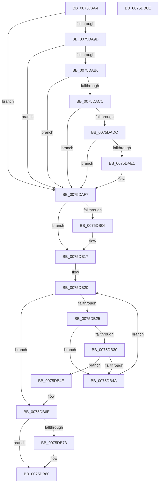

# PopInitializeHibernateGlobals

- RVA: `0x0075DA64`–`0x0075DB8F` (길이 `299` bytes)
- VA: `0x000000014075DA64`
- 실행 섹션: `PAGE`
- PDB 이름 있음: `예`; PDB Function 태그: `아니요`
- unwind 정보 RVA: `0x000CC548`
- 디코드: `87`개 명령, `299/299` bytes 표시
- 미해석 바이트: `0` (있으면 어셈블리에 `.byte`로 보존)

> 이 문서는 커널 이미지의 기계어와 PDB 기호를 분석해 생성했습니다. 4번과 5번은 함수 원형과 자료형을 바이너리 사용 방식에서 추정한 C 해석이며 원본 소스 복구 결과는 아닙니다.

## 1. Dependencies

- 직접 호출 지점: **10**; 고유 호출 대상: **7**
- 직접 호출자로 확인된 함수: **1**
- RIP 상대 이미지 참조: **2**

### Outgoing calls
- `0x0075DA7E` → [PopInitHiberPersistedRegValues](PopInitHiberPersistedRegValues_function_0075D974.md) (function, `0x0075D974`)
- `0x0075DA91` → [ZwQuerySystemInformation](../../text/6A/ZwQuerySystemInformation_function_006AD790.md) (function, `0x006AD790`)
- `0x0075DAA9` → [ExAllocatePool2](../../poolcode/B8/ExAllocatePool2_function_00B820F0.md) (function, `0x00B820F0`)
- `0x0075DAC3` → [ZwQuerySystemInformation](../../text/6A/ZwQuerySystemInformation_function_006AD790.md) (function, `0x006AD790`)
- `0x0075DAF2` → [PoDisableSleepStates](PoDisableSleepStates_function_00757EE0.md) (function, `0x00757EE0`)
- `0x0075DAFB` → [PopValidateWinresume](PopValidateWinresume_function_0075DFF4.md) (function, `0x0075DFF4`)
- `0x0075DB12` → [PoDisableSleepStates](PoDisableSleepStates_function_00757EE0.md) (function, `0x00757EE0`)
- `0x0075DB41` → [PoDisableSleepStates](PoDisableSleepStates_function_00757EE0.md) (function, `0x00757EE0`)
- `0x0075DB68` → [PoShutdownBugCheck](PoShutdownBugCheck_function_0075E580.md) (function, `0x0075E580`)
- `0x0075DB7B` → [ExFreePoolWithTag](../../poolcode/B8/ExFreePoolWithTag_function_00B82870.md) (function, `0x00B82870`)

### Direct callers
- [PoInitHiberServices](PoInitHiberServices_function_007537C4.md) at `0x007537EB`

### Static image references
- `0x0075DAE5` → RVA `0x00FC6BA5` (`ALMOSTRO`; write)
- `0x0075DB19` → RVA `0x00000000` (`image boundary/outside`; read)

## 2. Other-region calls and transfers

- 다른 실행 섹션으로 향하는 call: **4**
  - `0x0075DA91` → [ZwQuerySystemInformation](../../text/6A/ZwQuerySystemInformation_function_006AD790.md) (`PAGE` → `.text`)
  - `0x0075DAA9` → [ExAllocatePool2](../../poolcode/B8/ExAllocatePool2_function_00B820F0.md) (`PAGE` → `POOLCODE`)
  - `0x0075DAC3` → [ZwQuerySystemInformation](../../text/6A/ZwQuerySystemInformation_function_006AD790.md) (`PAGE` → `.text`)
  - `0x0075DB7B` → [ExFreePoolWithTag](../../poolcode/B8/ExFreePoolWithTag_function_00B82870.md) (`PAGE` → `POOLCODE`)
- 별도 외부 분기/꼬리 이동을 확인하지 못했습니다.

## 3. Assembly (complete function range)

```asm
0075DA64  48 89 5C 24 20                  mov qword ptr [rsp + 0x20], rbx
0075DA69  55                              push rbp
0075DA6A  57                              push rdi
0075DA6B  41 57                           push r15
0075DA6D  48 8B EC                        mov rbp, rsp
0075DA70  48 83 EC 30                     sub rsp, 0x30
0075DA74  83 65 28 00                     and dword ptr [rbp + 0x28], 0
0075DA78  33 DB                           xor ebx, ebx
0075DA7A  C6 45 20 00                     mov byte ptr [rbp + 0x20], 0
0075DA7E  E8 F1 FE FF FF                  call 0x14075d974
0075DA83  8D 7B 70                        lea edi, [rbx + 0x70]
0075DA86  45 33 C0                        xor r8d, r8d
0075DA89  8B CF                           mov ecx, edi
0075DA8B  4C 8D 4D 28                     lea r9, [rbp + 0x28]
0075DA8F  33 D2                           xor edx, edx
0075DA91  E8 FA FC F4 FF                  call 0x1406ad790
0075DA96  3D 23 00 00 C0                  cmp eax, 0xc0000023
0075DA9B  75 5A                           jne 0x14075daf7
0075DA9D  8B 55 28                        mov edx, dword ptr [rbp + 0x28]
0075DAA0  8D 4B 40                        lea ecx, [rbx + 0x40]
0075DAA3  41 B8 68 69 62 72               mov r8d, 0x72626968
0075DAA9  E8 42 46 42 00                  call 0x140b820f0
0075DAAE  48 8B D8                        mov rbx, rax
0075DAB1  48 85 C0                        test rax, rax
0075DAB4  74 41                           je 0x14075daf7
0075DAB6  44 8B 45 28                     mov r8d, dword ptr [rbp + 0x28]
0075DABA  4C 8D 4D 28                     lea r9, [rbp + 0x28]
0075DABE  48 8B D0                        mov rdx, rax
0075DAC1  8B CF                           mov ecx, edi
0075DAC3  E8 C8 FC F4 FF                  call 0x1406ad790
0075DAC8  85 C0                           test eax, eax
0075DACA  78 2B                           js 0x14075daf7
0075DACC  8B 4D 28                        mov ecx, dword ptr [rbp + 0x28]
0075DACF  83 C1 FE                        add ecx, -2
0075DAD2  89 4D 28                        mov dword ptr [rbp + 0x28], ecx
0075DAD5  8B C1                           mov eax, ecx
0075DAD7  80 3B 00                        cmp byte ptr [rbx], 0
0075DADA  74 1B                           je 0x14075daf7
0075DADC  39 43 04                        cmp dword ptr [rbx + 4], eax
0075DADF  77 16                           ja 0x14075daf7
0075DAE1  4C 8D 45 30                     lea r8, [rbp + 0x30]
0075DAE5  C6 05 B9 90 86 00 01            mov byte ptr [rip + 0x8690b9], 1
0075DAEC  8D 57 98                        lea edx, [rdi - 0x68]
0075DAEF  8D 4F 92                        lea ecx, [rdi - 0x6e]
0075DAF2  E8 E9 A3 FF FF                  call 0x140757ee0
0075DAF7  48 8D 4D 20                     lea rcx, [rbp + 0x20]
0075DAFB  E8 F4 04 00 00                  call 0x14075dff4
0075DB00  80 7D 20 00                     cmp byte ptr [rbp + 0x20], 0
0075DB04  74 11                           je 0x14075db17
0075DB06  BA 08 00 00 00                  mov edx, 8
0075DB0B  4C 8D 45 30                     lea r8, [rbp + 0x30]
0075DB0F  8D 4A FC                        lea ecx, [rdx - 4]
0075DB12  E8 C9 A3 FF FF                  call 0x140757ee0
0075DB17  33 FF                           xor edi, edi
0075DB19  4C 8D 3D E0 24 8A FF            lea r15, [rip - 0x75db20]
0075DB20  83 FF 02                        cmp edi, 2
0075DB23  73 49                           jae 0x14075db6e
0075DB25  41 83 BC BF 40 72 FC 00 00      cmp dword ptr [r15 + rdi*4 + 0xfc7240], 0
0075DB2E  74 1A                           je 0x14075db4a
0075DB30  41 8B 8C BF 00 B4 B4 00         mov ecx, dword ptr [r15 + rdi*4 + 0xb4b400]
0075DB38  4C 8D 45 30                     lea r8, [rbp + 0x30]
0075DB3C  BA 08 00 00 00                  mov edx, 8
0075DB41  E8 9A A3 FF FF                  call 0x140757ee0
0075DB46  85 C0                           test eax, eax
0075DB48  78 04                           js 0x14075db4e
0075DB4A  FF C7                           inc edi
0075DB4C  EB D2                           jmp 0x14075db20
0075DB4E  48 83 64 24 28 00               and qword ptr [rsp + 0x28], 0
0075DB54  BA A0 00 00 00                  mov edx, 0xa0
0075DB59  48 83 64 24 20 00               and qword ptr [rsp + 0x20], 0
0075DB5F  45 33 C9                        xor r9d, r9d
0075DB62  B1 01                           mov cl, 1
0075DB64  44 8D 42 70                     lea r8d, [rdx + 0x70]
0075DB68  E8 13 0A 00 00                  call 0x14075e580
0075DB6D  CC                              int3
0075DB6E  48 85 DB                        test rbx, rbx
0075DB71  74 0D                           je 0x14075db80
0075DB73  BA 68 69 62 72                  mov edx, 0x72626968
0075DB78  48 8B CB                        mov rcx, rbx
0075DB7B  E8 F0 4C 42 00                  call 0x140b82870
0075DB80  48 8B 5C 24 68                  mov rbx, qword ptr [rsp + 0x68]
0075DB85  48 83 C4 30                     add rsp, 0x30
0075DB89  41 5F                           pop r15
0075DB8B  5F                              pop rdi
0075DB8C  5D                              pop rbp
0075DB8D  C3                              ret
0075DB8E  CC                              int3
```

## 4. C-style interpretation (structured pseudocode)

```c
__int64 __fastcall PopInitializeHibernateGlobals(__int64 a1, int a2, int a3)
{
    __int64 result;
    __int64 v_rbx;
    __int64 v_rdi;
    __int64 v_rsp;
    unsigned __int64 v_stack_m20;
    unsigned __int64 v_stack_m28;
    unsigned int v_stack_p10;
    unsigned __int64 v_stack_p18;
    unsigned __int64 v_stack_p20;
    unsigned __int8 v_stack_p8;

    v_stack_p20 = v_rbx;
    v_rsp = (v_rsp) - (48);
    v_rbx = 0;
    v_stack_p8 = 0;
    result = PopInitHiberPersistedRegValues(a1, a2, a3, a4);
    a3 = 0;
    a2 = 0;
    result = ZwQuerySystemInformation((unsigned int)((unsigned int)(v_rbx + 112)), a2, a3, v_stack_p10);
    if (((unsigned int)(result)) != 0xC0000023ULL) goto loc_0075DAF7;
    result = ExAllocatePool2(v_rbx + 64, (unsigned int)(v_stack_p10), (unsigned int)(0x72626968ULL), v_stack_p10);
    if (result == 0) goto loc_0075DAF7;
    result = ZwQuerySystemInformation((unsigned int)((unsigned int)(v_rbx + 112)), result, (unsigned int)(v_stack_p10), v_stack_p10);
    if (sign_flag) goto loc_0075DAF7;
    a1 = (unsigned int)(((unsigned int)(v_stack_p10)) + (-2));
    v_stack_p10 = (unsigned int)(a1);
    if ((*(unsigned __int8 *)(result)) == 0) goto loc_0075DAF7;
    result = (unsigned int)((unsigned int)(a1));
    if ((*(unsigned int *)(result + 4)) <= ((unsigned int)((unsigned int)((unsigned int)(a1))))) {
        a3 = v_stack_p18;
        *(unsigned __int8 *)(v_rip + 8818873) = 1;
        a2 = v_rbx + 112 - 104;
        a1 = v_rbx + 112 - 110;
        result = PoDisableSleepStates(a1, a2, a3, v_stack_p10);
    }
    result = PopValidateWinresume(v_stack_p8, a2, a3, v_stack_p10);
    if (v_stack_p8 != 0) {
        a2 = 8;
        a3 = v_stack_p18;
        a1 = a2 - 4;
        result = PoDisableSleepStates(a1, a2, a3, v_stack_p10);
    }
    v_rdi = 0;
loc_0075DB20:
    if (0 >= 2) goto loc_0075DB6E;
    if ((*(unsigned int *)(v_rip - 7723808 + v_rdi * 4 + 16544320)) == 0) goto loc_0075DB4A;
    result = PoDisableSleepStates((unsigned int)(*(unsigned int *)(v_rip - 7723808 + v_rdi * 4 + 11842560)), 8, v_stack_p18, v_stack_p10);
    if (sign_flag) goto loc_0075DB4E;
loc_0075DB4A:
    v_rdi = (unsigned int)((v_rdi) + 1);
    goto loc_0075DB20;
loc_0075DB4E:
    a4 = 0;
    result = PoShutdownBugCheck(1, 160, 160 + 112, a4);
loc_0075DB6E:
    if (result != 0) {
        a2 = 0x72626968ULL;
        a1 = result;
        result = ExFreePoolWithTag(a1, a2, 160 + 112, a4);
    }
    v_rsp = (v_rsp) + (48);
    return result;
}
```

## 5. (Beta) C Style

```c
int64_t PopInitializeHibernateGlobals(int64_t Arg1, int32_t Arg2, int32_t Arg3)
{
    int64_t result;
    int64_t local_rbx;
    int64_t local_rdi;
    int64_t local_rsp;
    uint64_t v_stack_m20;
    uint64_t v_stack_m28;
    uint32_t v_stack_p10;
    uint64_t v_stack_p18;
    uint64_t v_stack_p20;
    uint8_t v_stack_p8;

    v_stack_p20 = local_rbx;
    local_rsp = (local_rsp) - (48);
    local_rbx = 0;
    v_stack_p8 = 0;
    result = PopInitHiberPersistedRegValues(Arg1, Arg2, Arg3, a4);
    Arg3 = 0;
    Arg2 = 0;
    result = ZwQuerySystemInformation((uint32_t)((uint32_t)(local_rbx + 112)), Arg2, Arg3, v_stack_p10);
    if (((uint32_t)(result)) != 0xC0000023ULL) goto loc_0075DAF7;
    result = ExAllocatePool2(local_rbx + 64, (uint32_t)(v_stack_p10), (uint32_t)(0x72626968ULL), v_stack_p10);
    if (result == 0) goto loc_0075DAF7;
    result = ZwQuerySystemInformation((uint32_t)((uint32_t)(local_rbx + 112)), result, (uint32_t)(v_stack_p10), v_stack_p10);
    if (sign_flag) goto loc_0075DAF7;
    Arg1 = (uint32_t)(((uint32_t)(v_stack_p10)) + (-2));
    v_stack_p10 = (uint32_t)(Arg1);
    if ((*(uint8_t *)(result)) == 0) goto loc_0075DAF7;
    result = (uint32_t)((uint32_t)(Arg1));
    if ((*(uint32_t *)(result + 0x4)) <= ((uint32_t)((uint32_t)((uint32_t)(Arg1))))) {
        Arg3 = v_stack_p18;
        *(uint8_t *)(v_rip + 0x8690B9) = 1;
        Arg2 = local_rbx + 112 - 104;
        Arg1 = local_rbx + 112 - 110;
        result = PoDisableSleepStates(Arg1, Arg2, Arg3, v_stack_p10);
    }
    result = PopValidateWinresume(v_stack_p8, Arg2, Arg3, v_stack_p10);
    if (v_stack_p8 != 0) {
        Arg2 = 8;
        Arg3 = v_stack_p18;
        Arg1 = Arg2 - 4;
        result = PoDisableSleepStates(Arg1, Arg2, Arg3, v_stack_p10);
    }
    local_rdi = 0;
loc_0075DB20:
    if (0 >= 2) goto loc_0075DB6E;
    if ((*(uint32_t *)(v_rip - 0x75DB20 + local_rdi * 4 + 0xFC7240)) == 0) goto loc_0075DB4A;
    result = PoDisableSleepStates((uint32_t)(*(uint32_t *)(v_rip - 0x75DB20 + local_rdi * 4 + 0xB4B400)), 8, v_stack_p18, v_stack_p10);
    if (sign_flag) goto loc_0075DB4E;
loc_0075DB4A:
    local_rdi = (uint32_t)((local_rdi) + 1);
    goto loc_0075DB20;
loc_0075DB4E:
    a4 = 0;
    result = PoShutdownBugCheck(1, 160, 160 + 112, a4);
loc_0075DB6E:
    if (result != 0) {
        Arg2 = 0x72626968ULL;
        Arg1 = result;
        result = ExFreePoolWithTag(Arg1, Arg2, 160 + 112, a4);
    }
    local_rsp = (local_rsp) + (48);
    return result;
}
```

## 6. Execution-region graph

[열기: 2D/3D 그래프와 함수 탐색 컨트롤 패널](../../../control-panel.html?section=page&rva=0x0075DA64&view=graph)

- 2D 그래프는 위에서 아래로 흐르고, 3D 그래프는 빈 공간을 드래그해 회전합니다. Shift+드래그는 이동, 휠은 확대·축소, 함수 노드 선택은 대상 보고서 이동입니다.

### Static fallback


