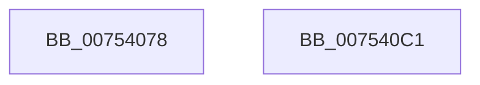

# PopInitializeTimer

- RVA: `0x00754078`–`0x007540C2` (길이 `74` bytes)
- VA: `0x0000000140754078`
- 실행 섹션: `PAGE`
- PDB 이름 있음: `예`; PDB Function 태그: `아니요`
- unwind 정보 RVA: `0x0005CAAC`
- 디코드: `18`개 명령, `74/74` bytes 표시
- 미해석 바이트: `0` (있으면 어셈블리에 `.byte`로 보존)

> 이 문서는 커널 이미지의 기계어와 PDB 기호를 분석해 생성했습니다. 4번과 5번은 함수 원형과 자료형을 바이너리 사용 방식에서 추정한 C 해석이며 원본 소스 복구 결과는 아닙니다.

## 1. Dependencies

- 직접 호출 지점: **1**; 고유 호출 대상: **1**
- 직접 호출자로 확인된 함수: **7**
- RIP 상대 이미지 참조: **0**

### Outgoing calls
- `0x0075408E` → [KeInitializeTimer2](../../text/3A/KeInitializeTimer2_function_003A30B0.md) (function, `0x003A30B0`)

### Direct callers
- [PopCheckPowerSourceAfterRtcWakeInitialize](../../text/5D/PopCheckPowerSourceAfterRtcWakeInitialize_function_005D5A24.md) at `0x005D5A46`
- [PopPowerRequestInitialize](../../init/C3/PopPowerRequestInitialize_function_00C3E2AC.md) at `0x00C3E456`
- [PopPowerRequestInitialize](../../init/C3/PopPowerRequestInitialize_function_00C3E2AC.md) at `0x00C3E479`
- [PpmPerfInitialize](../../init/C3/PpmPerfInitialize_function_00C3EB34.md) at `0x00C3ED01`
- [PopUserShutdownScenarioInitialize](../../init/C3/PopUserShutdownScenarioInitialize_function_00C3F0D0.md) at `0x00C3F10F`
- [PopThermalInit](../../init/C3/PopThermalInit_function_00C3F128.md) at `0x00C3F17E`
- [PopDripsWatchdogInitialize](../../init/C4/PopDripsWatchdogInitialize_function_00C43BCC.md) at `0x00C43C80`
- [PopDripsWatchdogInitializeCallbackTimer](../../init/C4/PopDripsWatchdogInitializeCallbackTimer_function_00C43CAC.md) at `0x00C43CED`

### Static image references
- 디코드된 RIP-relative 메모리 참조가 없습니다.

## 2. Other-region calls and transfers

- 다른 실행 섹션으로 향하는 call: **1**
  - `0x0075408E` → [KeInitializeTimer2](../../text/3A/KeInitializeTimer2_function_003A30B0.md) (`PAGE` → `.text`)
- 별도 외부 분기/꼬리 이동을 확인하지 못했습니다.

## 3. Assembly (complete function range)

```asm
00754078  48 89 5C 24 08                  mov qword ptr [rsp + 8], rbx
0075407D  57                              push rdi
0075407E  48 83 EC 20                     sub rsp, 0x20
00754082  49 8B D9                        mov rbx, r9
00754085  48 8B F9                        mov rdi, rcx
00754088  41 B9 08 00 00 00               mov r9d, 8
0075408E  E8 1D F0 C4 FF                  call 0x1403a30b0
00754093  33 C0                           xor eax, eax
00754095  87 87 A8 00 00 00               xchg dword ptr [rdi + 0xa8], eax
0075409B  48 8B 44 24 50                  mov rax, qword ptr [rsp + 0x50]
007540A0  48 83 A7 88 00 00 00 00         and qword ptr [rdi + 0x88], 0
007540A8  48 89 9F 98 00 00 00            mov qword ptr [rdi + 0x98], rbx
007540AF  48 8B 5C 24 30                  mov rbx, qword ptr [rsp + 0x30]
007540B4  48 89 87 A0 00 00 00            mov qword ptr [rdi + 0xa0], rax
007540BB  48 83 C4 20                     add rsp, 0x20
007540BF  5F                              pop rdi
007540C0  C3                              ret
007540C1  CC                              int3
```

## 4. C-style interpretation (structured pseudocode)

```c
__int64 __fastcall PopInitializeTimer(__int64 a1, __int64 a2, __int64 a3, __int64 a4, __int64 a5)
{
    __int64 result;
    __int64 v_rsp;
    unsigned __int64 v_stack_p8;

    v_stack_p8 = v_rbx;
    v_rsp = (v_rsp) - (32);
    result = KeInitializeTimer2(a1, a2, a3, 8);
    result = 0;
    *(unsigned __int64 *)(a1 + 152) = a4;
    *(unsigned __int64 *)(a1 + 160) = a5;
    v_rsp = (v_rsp) + (32);
    return a5;
}
```

## 5. (Beta) C Style

```c
int64_t PopInitializeTimer(void *Arg1, int64_t Arg2, int64_t Arg3, int64_t Arg4, int64_t Arg5)
{
    uint8_t *arg1 = (uint8_t *)Arg1;

    int64_t result;
    int64_t local_rsp;
    uint64_t v_stack_p8;

    v_stack_p8 = local_rbx;
    local_rsp = (local_rsp) - (32);
    result = KeInitializeTimer2(Arg1, Arg2, Arg3, 8);
    result = 0;
    *(uint64_t *)(arg1 + 0x98) = Arg4;
    *(uint64_t *)(arg1 + 0xA0) = Arg5;
    local_rsp = (local_rsp) + (32);
    return Arg5;
}
```

### 관측된 메모리 오프셋

구조체 형식이 확인되지 않은 접근은 인자 기준의 오프셋으로만 기록했습니다.

| 기준 인자 | 오프셋 표현 | 폭 (bit) | 접근 |
|---|---:|---:|---|
| `Arg1` | `+ 0x88` | `64` | `R/W` |
| `Arg1` | `+ 0x98` | `64` | `W` |
| `Arg1` | `+ 0xA0` | `64` | `W` |
| `Arg1` | `+ 0xA8` | `32` | `R/W` |

## 6. Execution-region graph

[열기: 2D/3D 그래프와 함수 탐색 컨트롤 패널](../../../control-panel.html?section=page&rva=0x00754078&view=graph)

- 2D 그래프는 위에서 아래로 흐르고, 3D 그래프는 빈 공간을 드래그해 회전합니다. Shift+드래그는 이동, 휠은 확대·축소, 함수 노드 선택은 대상 보고서 이동입니다.

### Static fallback


