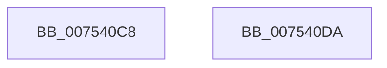

# PopInitializeWorkItem

- RVA: `0x007540C8`–`0x007540DB` (길이 `19` bytes)
- VA: `0x00000001407540C8`
- 실행 섹션: `PAGE`
- PDB 이름 있음: `예`; PDB Function 태그: `아니요`
- unwind 정보 RVA: `0x000DB714`
- 디코드: `7`개 명령, `19/19` bytes 표시
- 미해석 바이트: `0` (있으면 어셈블리에 `.byte`로 보존)

> 이 문서는 커널 이미지의 기계어와 PDB 기호를 분석해 생성했습니다. 4번과 5번은 함수 원형과 자료형을 바이너리 사용 방식에서 추정한 C 해석이며 원본 소스 복구 결과는 아닙니다.

## 1. Dependencies

- 직접 호출 지점: **0**; 고유 호출 대상: **0**
- 직접 호출자로 확인된 함수: **7**
- RIP 상대 이미지 참조: **0**

### Outgoing calls
- 직접 디코드된 call 명령이 없습니다.

### Direct callers
- [PopInitializeIRTimer](../../text/5C/PopInitializeIRTimer_function_005CE5D0.md) at `0x005CE61B`
- [PopPowerRequestInitialize](../../init/C3/PopPowerRequestInitialize_function_00C3E2AC.md) at `0x00C3E388`
- [PopDirectedDripsInitializePhase0](../../init/C3/PopDirectedDripsInitializePhase0_function_00C3E4BC.md) at `0x00C3E538`
- [PopInitializeWin32kActivator](../../init/C3/PopInitializeWin32kActivator_function_00C3E7C4.md) at `0x00C3E7E9`
- [PopThermalInit](../../init/C3/PopThermalInit_function_00C3F128.md) at `0x00C3F1F5`
- [PopInitializePowerButtonHold](../../init/C4/PopInitializePowerButtonHold_function_00C425A8.md) at `0x00C426A1`
- [PoInitSystem](../../init/C7/PoInitSystem_function_00C72358.md) at `0x00C7259D`
- [PoInitSystem](../../init/C7/PoInitSystem_function_00C72358.md) at `0x00C725B0`
- [PoInitSystem](../../init/C7/PoInitSystem_function_00C72358.md) at `0x00C725C3`
- [PoInitSystem](../../init/C7/PoInitSystem_function_00C72358.md) at `0x00C725D6`
- [PoInitSystem](../../init/C7/PoInitSystem_function_00C72358.md) at `0x00C725FE`
- [PoInitSystem](../../init/C7/PoInitSystem_function_00C72358.md) at `0x00C72611`
- [PoInitSystem](../../init/C7/PoInitSystem_function_00C72358.md) at `0x00C72624`

### Static image references
- 디코드된 RIP-relative 메모리 참조가 없습니다.

## 2. Other-region calls and transfers

- 다른 실행 섹션으로 향하는 call: **0**
- 별도 외부 분기/꼬리 이동을 확인하지 못했습니다.

## 3. Assembly (complete function range)

```asm
007540C8  33 C0                           xor eax, eax
007540CA  87 41 20                        xchg dword ptr [rcx + 0x20], eax
007540CD  48 83 21 00                     and qword ptr [rcx], 0
007540D1  48 89 51 10                     mov qword ptr [rcx + 0x10], rdx
007540D5  4C 89 41 18                     mov qword ptr [rcx + 0x18], r8
007540D9  C3                              ret
007540DA  CC                              int3
```

## 4. C-style interpretation (structured pseudocode)

```c
__int64 __fastcall PopInitializeWorkItem(__int64 a1, __int64 a2, __int64 a3)
{
    __int64 result;

    result = 0;
    *(unsigned __int64 *)(a1 + 16) = a2;
    *(unsigned __int64 *)(a1 + 24) = a3;
    return result;
}
```

## 5. (Beta) C Style

```c
int64_t PopInitializeWorkItem(void *Arg1, int64_t Arg2, int64_t Arg3)
{
    uint8_t *arg1 = (uint8_t *)Arg1;

    int64_t result;

    result = 0;
    *(uint64_t *)(arg1 + 0x10) = Arg2;
    *(uint64_t *)(arg1 + 0x18) = Arg3;
    return result;
}
```

### 관측된 메모리 오프셋

구조체 형식이 확인되지 않은 접근은 인자 기준의 오프셋으로만 기록했습니다.

| 기준 인자 | 오프셋 표현 | 폭 (bit) | 접근 |
|---|---:|---:|---|
| `Arg1` | `+ 0x0` | `64` | `R/W` |
| `Arg1` | `+ 0x10` | `64` | `W` |
| `Arg1` | `+ 0x18` | `64` | `W` |
| `Arg1` | `+ 0x20` | `32` | `R/W` |

## 6. Execution-region graph

[열기: 2D/3D 그래프와 함수 탐색 컨트롤 패널](../../../control-panel.html?section=page&rva=0x007540C8&view=graph)

- 2D 그래프는 위에서 아래로 흐르고, 3D 그래프는 빈 공간을 드래그해 회전합니다. Shift+드래그는 이동, 휠은 확대·축소, 함수 노드 선택은 대상 보고서 이동입니다.

### Static fallback


