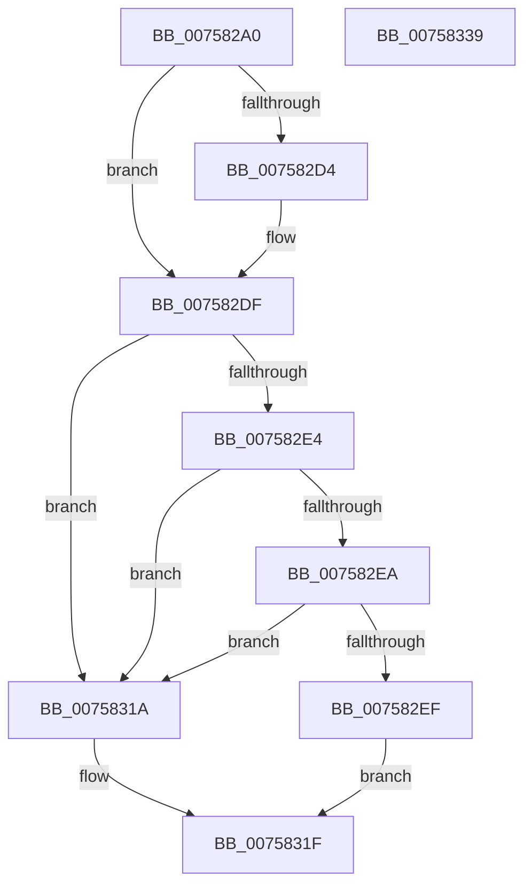

# PopLidSwitchReliabilityUpdateCallback

- RVA: `0x007582A0`–`0x0075833A` (길이 `154` bytes)
- VA: `0x00000001407582A0`
- 실행 섹션: `PAGE`
- PDB 이름 있음: `예`; PDB Function 태그: `아니요`
- unwind 정보 RVA: `0x000CC0B0`
- 디코드: `43`개 명령, `154/154` bytes 표시
- 미해석 바이트: `0` (있으면 어셈블리에 `.byte`로 보존)

> 이 문서는 커널 이미지의 기계어와 PDB 기호를 분석해 생성했습니다. 4번과 5번은 함수 원형과 자료형을 바이너리 사용 방식에서 추정한 C 해석이며 원본 소스 복구 결과는 아닙니다.

## 1. Dependencies

- 직접 호출 지점: **3**; 고유 호출 대상: **3**
- 직접 호출자로 확인된 함수: **0**
- RIP 상대 이미지 참조: **3**

### Outgoing calls
- `0x00758309` → [PopBroadcastSessionInfo](../91/PopBroadcastSessionInfo_function_00912598.md) (function, `0x00912598`)
- `0x00758313` → [PopPowerButtonLidReliabilityUpdated](../76/PopPowerButtonLidReliabilityUpdated_function_00765A68.md) (function, `0x00765A68`)
- `0x00758329` → [_security_check_cookie](../../text/6A/_security_check_cookie_function_006AC640.md) (function, `0x006AC640`)

### Direct callers
- 이 함수 시작 RVA로 연결되는 직접 call은 확인되지 않았습니다. 간접 호출은 완전히 역산할 수 없습니다.

### Static image references
- `0x007582AA` → RVA `0x00E0A740` (`.data`; read)
- `0x007582B9` → RVA `0x00024898` (`.rdata`; read)
- `0x007582D4` → RVA `0x000248A0` (`.rdata`; read)

## 2. Other-region calls and transfers

- 다른 실행 섹션으로 향하는 call: **1**
  - `0x00758329` → [_security_check_cookie](../../text/6A/_security_check_cookie_function_006AC640.md) (`PAGE` → `.text`)
- 별도 외부 분기/꼬리 이동을 확인하지 못했습니다.

## 3. Assembly (complete function range)

```asm
007582A0  48 89 5C 24 18                  mov qword ptr [rsp + 0x18], rbx
007582A5  57                              push rdi
007582A6  48 83 EC 40                     sub rsp, 0x40
007582AA  48 8B 05 8F 24 6B 00            mov rax, qword ptr [rip + 0x6b248f]
007582B1  48 33 C4                        xor rax, rsp
007582B4  48 89 44 24 38                  mov qword ptr [rsp + 0x38], rax
007582B9  4C 8B 0D D8 C5 8C FF            mov r9, qword ptr [rip - 0x733a28]
007582C0  33 DB                           xor ebx, ebx
007582C2  48 8B FA                        mov rdi, rdx
007582C5  48 89 5C 24 20                  mov qword ptr [rsp + 0x20], rbx
007582CA  48 89 5C 24 28                  mov qword ptr [rsp + 0x28], rbx
007582CF  4C 2B 09                        sub r9, qword ptr [rcx]
007582D2  75 0B                           jne 0x1407582df
007582D4  4C 8B 0D C5 C5 8C FF            mov r9, qword ptr [rip - 0x733a3b]
007582DB  4C 2B 49 08                     sub r9, qword ptr [rcx + 8]
007582DF  4D 85 C9                        test r9, r9
007582E2  75 36                           jne 0x14075831a
007582E4  41 83 F8 04                     cmp r8d, 4
007582E8  75 30                           jne 0x14075831a
007582EA  48 85 FF                        test rdi, rdi
007582ED  74 2B                           je 0x14075831a
007582EF  0F 10 01                        movups xmm0, xmmword ptr [rcx]
007582F2  8B 02                           mov eax, dword ptr [rdx]
007582F4  4C 8D 44 24 20                  lea r8, [rsp + 0x20]
007582F9  41 8D 51 14                     lea edx, [r9 + 0x14]
007582FD  89 44 24 30                     mov dword ptr [rsp + 0x30], eax
00758301  33 C9                           xor ecx, ecx
00758303  F3 0F 7F 44 24 20               movdqu xmmword ptr [rsp + 0x20], xmm0
00758309  E8 8A A2 1B 00                  call 0x140912598
0075830E  39 1F                           cmp dword ptr [rdi], ebx
00758310  0F 95 C1                        setne cl
00758313  E8 50 D7 00 00                  call 0x140765a68
00758318  EB 05                           jmp 0x14075831f
0075831A  BB 0D 00 00 C0                  mov ebx, 0xc000000d
0075831F  8B C3                           mov eax, ebx
00758321  48 8B 4C 24 38                  mov rcx, qword ptr [rsp + 0x38]
00758326  48 33 CC                        xor rcx, rsp
00758329  E8 12 43 F5 FF                  call 0x1406ac640
0075832E  48 8B 5C 24 60                  mov rbx, qword ptr [rsp + 0x60]
00758333  48 83 C4 40                     add rsp, 0x40
00758337  5F                              pop rdi
00758338  C3                              ret
00758339  CC                              int3
```

## 4. C-style interpretation (structured pseudocode)

```c
__int64 __fastcall PopLidSwitchReliabilityUpdateCallback(__int64 a1, __int64 a2, int a3)
{
    __int64 result;
    __int64 v_rbx;
    __int64 v_rsp;
    unsigned __int64 v_stack_m10;
    unsigned int v_stack_m18;
    unsigned __int64 v_stack_m20;
    unsigned __int64 v_stack_m28;
    unsigned __int64 v_stack_p18;

    v_stack_p18 = v_rbx;
    v_rsp = (v_rsp) - (64);
    result = (*(unsigned __int64 *)(v_rip + 7021711)) ^ (v_rsp);
    v_stack_m10 = result;
    v_rbx = 0;
    v_stack_m28 = 0;
    v_stack_m20 = 0;
    a4 = (*(unsigned __int64 *)(v_rip - 7551528)) - (*(unsigned __int64 *)(a1));
    if (!(condition_is_not_equal)) {
        a4 = *(unsigned __int64 *)(v_rip - 7551547);
        a4 = (a4) - (*(unsigned __int64 *)(a1 + 8));
    }
    if (a4 != 0) goto loc_0075831A;
    if (a3 != 4) goto loc_0075831A;
    if (a2 == 0) goto loc_0075831A;
    v_stack_m18 = (unsigned int)((unsigned int)(*(unsigned int *)(a2)));
    a1 = 0;
    v_stack_m28 = v_xmm0;
    result = PopBroadcastSessionInfo(a1, a4 + 20, v_stack_m28, a4);
    a1 = ((*(unsigned int *)(a2)) != 0) ? 1 : 0;
    result = PopPowerButtonLidReliabilityUpdated(a1, a4 + 20, v_stack_m28, a4);
    goto loc_0075831F;
loc_0075831A:
loc_0075831F:
    a1 = (v_stack_m10) ^ (v_rsp);
    result = _security_check_cookie(a1, a4 + 20, v_stack_m28, a4);
    v_rsp = (v_rsp) + (64);
    return result;
}
```

## 5. (Beta) C Style

```c
int64_t PopLidSwitchReliabilityUpdateCallback(void *Arg1, void *Arg2, int32_t Arg3)
{
    uint8_t *arg1 = (uint8_t *)Arg1;
    uint8_t *arg2 = (uint8_t *)Arg2;

    int64_t result;
    int64_t local_rbx;
    int64_t local_rsp;
    uint64_t v_stack_m10;
    uint32_t v_stack_m18;
    uint64_t v_stack_m20;
    uint64_t v_stack_m28;
    uint64_t v_stack_p18;

    v_stack_p18 = local_rbx;
    local_rsp = (local_rsp) - (64);
    result = (*(uint64_t *)(v_rip + 0x6B248F)) ^ (local_rsp);
    v_stack_m10 = result;
    local_rbx = 0;
    v_stack_m28 = 0;
    v_stack_m20 = 0;
    a4 = (*(uint64_t *)(v_rip - 0x733A28)) - (*(uint64_t *)(arg1));
    if (!(condition_is_not_equal)) {
        a4 = *(uint64_t *)(v_rip - 0x733A3B);
        a4 = (a4) - (*(uint64_t *)(arg1 + 0x8));
    }
    if (a4 != 0) goto loc_0075831A;
    if (Arg3 != 4) goto loc_0075831A;
    if (Arg2 == NULL) goto loc_0075831A;
    v_stack_m18 = (uint32_t)((uint32_t)(*(uint32_t *)(arg2)));
    Arg1 = 0;
    v_stack_m28 = v_xmm0;
    result = PopBroadcastSessionInfo(Arg1, a4 + 20, v_stack_m28, a4);
    Arg1 = ((*(uint32_t *)(arg2)) != 0) ? 1 : 0;
    result = PopPowerButtonLidReliabilityUpdated(Arg1, a4 + 20, v_stack_m28, a4);
    goto loc_0075831F;
loc_0075831A:
loc_0075831F:
    Arg1 = (v_stack_m10) ^ (local_rsp);
    result = _security_check_cookie(Arg1, a4 + 20, v_stack_m28, a4);
    local_rsp = (local_rsp) + (64);
    return result;
}
```

### 관측된 메모리 오프셋

구조체 형식이 확인되지 않은 접근은 인자 기준의 오프셋으로만 기록했습니다.

| 기준 인자 | 오프셋 표현 | 폭 (bit) | 접근 |
|---|---:|---:|---|
| `Arg1` | `+ 0x0` | `64` | `R` |
| `Arg1` | `+ 0x0` | `128` | `R` |
| `Arg1` | `+ 0x8` | `64` | `R` |
| `Arg2` | `+ 0x0` | `32` | `R` |

## 6. Execution-region graph

[열기: 2D/3D 그래프와 함수 탐색 컨트롤 패널](../../../control-panel.html?section=page&rva=0x007582A0&view=graph)

- 2D 그래프는 위에서 아래로 흐르고, 3D 그래프는 빈 공간을 드래그해 회전합니다. Shift+드래그는 이동, 휠은 확대·축소, 함수 노드 선택은 대상 보고서 이동입니다.

### Static fallback


