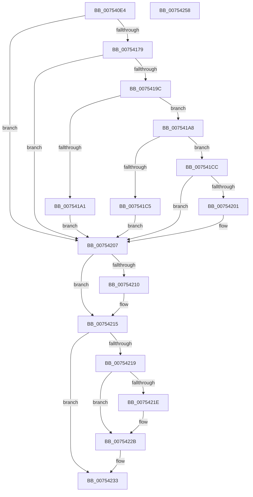

# PopLoadFileInMemory

- RVA: `0x007540E4`–`0x00754259` (길이 `373` bytes)
- VA: `0x00000001407540E4`
- 실행 섹션: `PAGE`
- PDB 이름 있음: `예`; PDB Function 태그: `아니요`
- unwind 정보 RVA: `0x000CBD44`
- 디코드: `102`개 명령, `373/373` bytes 표시
- 미해석 바이트: `0` (있으면 어셈블리에 `.byte`로 보존)

> 이 문서는 커널 이미지의 기계어와 PDB 기호를 분석해 생성했습니다. 4번과 5번은 함수 원형과 자료형을 바이너리 사용 방식에서 추정한 C 해석이며 원본 소스 복구 결과는 아닙니다.

## 1. Dependencies

- 직접 호출 지점: **7**; 고유 호출 대상: **7**
- 직접 호출자로 확인된 함수: **1**
- RIP 상대 이미지 참조: **1**

### Outgoing calls
- `0x0075416A` → [ZwOpenFile](../../text/6A/ZwOpenFile_function_006AD730.md) (function, `0x006AD730`)
- `0x00754191` → [ZwQueryInformationFile](../../text/6A/ZwQueryInformationFile_function_006AD2F0.md) (function, `0x006AD2F0`)
- `0x007541B8` → [ExAllocatePool2](../../poolcode/B8/ExAllocatePool2_function_00B820F0.md) (function, `0x00B820F0`)
- `0x007541F6` → [ZwReadFile](../../text/6A/ZwReadFile_function_006AD190.md) (function, `0x006AD190`)
- `0x00754210` → [ZwClose](../../text/6A/ZwClose_function_006AD2B0.md) (function, `0x006AD2B0`)
- `0x00754226` → [ExFreePoolWithTag](../../poolcode/B8/ExFreePoolWithTag_function_00B82870.md) (function, `0x00B82870`)
- `0x0075423C` → [_security_check_cookie](../../text/6A/_security_check_cookie_function_006AC640.md) (function, `0x006AC640`)

### Direct callers
- [PopValidateWinresume](PopValidateWinresume_function_0075DFF4.md) at `0x0075E115`
- [PopValidateWinresume](PopValidateWinresume_function_0075DFF4.md) at `0x0075E192`

### Static image references
- `0x007540FC` → RVA `0x00E0A740` (`.data`; read)

## 2. Other-region calls and transfers

- 다른 실행 섹션으로 향하는 call: **7**
  - `0x0075416A` → [ZwOpenFile](../../text/6A/ZwOpenFile_function_006AD730.md) (`PAGE` → `.text`)
  - `0x00754191` → [ZwQueryInformationFile](../../text/6A/ZwQueryInformationFile_function_006AD2F0.md) (`PAGE` → `.text`)
  - `0x007541B8` → [ExAllocatePool2](../../poolcode/B8/ExAllocatePool2_function_00B820F0.md) (`PAGE` → `POOLCODE`)
  - `0x007541F6` → [ZwReadFile](../../text/6A/ZwReadFile_function_006AD190.md) (`PAGE` → `.text`)
  - `0x00754210` → [ZwClose](../../text/6A/ZwClose_function_006AD2B0.md) (`PAGE` → `.text`)
  - `0x00754226` → [ExFreePoolWithTag](../../poolcode/B8/ExFreePoolWithTag_function_00B82870.md) (`PAGE` → `POOLCODE`)
  - `0x0075423C` → [_security_check_cookie](../../text/6A/_security_check_cookie_function_006AC640.md) (`PAGE` → `.text`)
- 별도 외부 분기/꼬리 이동을 확인하지 못했습니다.

## 3. Assembly (complete function range)

```asm
007540E4  48 89 5C 24 20                  mov qword ptr [rsp + 0x20], rbx
007540E9  55                              push rbp
007540EA  56                              push rsi
007540EB  57                              push rdi
007540EC  41 56                           push r14
007540EE  41 57                           push r15
007540F0  48 8D 6C 24 C9                  lea rbp, [rsp - 0x37]
007540F5  48 81 EC C0 00 00 00            sub rsp, 0xc0
007540FC  48 8B 05 3D 66 6B 00            mov rax, qword ptr [rip + 0x6b663d]
00754103  48 33 C4                        xor rax, rsp
00754106  48 89 45 27                     mov qword ptr [rbp + 0x27], rax
0075410A  33 C0                           xor eax, eax
0075410C  48 89 4D EF                     mov qword ptr [rbp - 0x11], rcx
00754110  21 45 FB                        and dword ptr [rbp - 5], eax
00754113  48 8D 4D C7                     lea rcx, [rbp - 0x39]
00754117  48 21 45 C7                     and qword ptr [rbp - 0x39], rax
0075411B  4C 8D 4D CF                     lea r9, [rbp - 0x31]
0075411F  48 21 45 E7                     and qword ptr [rbp - 0x19], rax
00754123  0F 57 C0                        xorps xmm0, xmm0
00754126  4D 8B F8                        mov r15, r8
00754129  48 C7 45 DF 30 00 00 00         mov qword ptr [rbp - 0x21], 0x30
00754131  21 45 E3                        and dword ptr [rbp - 0x1d], eax
00754134  4C 8D 45 DF                     lea r8, [rbp - 0x21]
00754138  4C 8B F2                        mov r14, rdx
0075413B  C7 44 24 28 20 00 00 00         mov dword ptr [rsp + 0x28], 0x20
00754143  BA 00 00 00 80                  mov edx, 0x80000000
00754148  48 89 45 1F                     mov qword ptr [rbp + 0x1f], rax
0075414C  0F 11 45 0F                     movups xmmword ptr [rbp + 0xf], xmm0
00754150  33 FF                           xor edi, edi
00754152  C7 45 F7 40 02 00 00            mov dword ptr [rbp - 9], 0x240
00754159  0F 11 45 CF                     movups xmmword ptr [rbp - 0x31], xmm0
0075415D  C7 44 24 20 01 00 00 00         mov dword ptr [rsp + 0x20], 1
00754165  F3 0F 7F 45 FF                  movdqu xmmword ptr [rbp - 1], xmm0
0075416A  E8 C1 95 F5 FF                  call 0x1406ad730
0075416F  8B D8                           mov ebx, eax
00754171  85 C0                           test eax, eax
00754173  0F 88 8E 00 00 00               js 0x140754207
00754179  48 8B 4D C7                     mov rcx, qword ptr [rbp - 0x39]
0075417D  44 8D 4F 18                     lea r9d, [rdi + 0x18]
00754181  4C 8D 45 0F                     lea r8, [rbp + 0xf]
00754185  C7 44 24 20 05 00 00 00         mov dword ptr [rsp + 0x20], 5
0075418D  48 8D 55 CF                     lea rdx, [rbp - 0x31]
00754191  E8 5A 91 F5 FF                  call 0x1406ad2f0
00754196  8B D8                           mov ebx, eax
00754198  85 C0                           test eax, eax
0075419A  78 6B                           js 0x140754207
0075419C  39 7D 1B                        cmp dword ptr [rbp + 0x1b], edi
0075419F  74 07                           je 0x1407541a8
007541A1  BB 01 00 00 C0                  mov ebx, 0xc0000001
007541A6  EB 5F                           jmp 0x140754207
007541A8  8B 75 17                        mov esi, dword ptr [rbp + 0x17]
007541AB  B9 00 01 00 00                  mov ecx, 0x100
007541B0  8B D6                           mov edx, esi
007541B2  41 B8 4D 65 6D 20               mov r8d, 0x206d654d
007541B8  E8 33 DF 42 00                  call 0x140b820f0
007541BD  48 8B F8                        mov rdi, rax
007541C0  48 85 C0                        test rax, rax
007541C3  75 07                           jne 0x1407541cc
007541C5  BB 9A 00 00 C0                  mov ebx, 0xc000009a
007541CA  EB 3B                           jmp 0x140754207
007541CC  48 83 64 24 40 00               and qword ptr [rsp + 0x40], 0
007541D2  48 8D 45 CF                     lea rax, [rbp - 0x31]
007541D6  48 83 64 24 38 00               and qword ptr [rsp + 0x38], 0
007541DC  45 33 C9                        xor r9d, r9d
007541DF  48 8B 4D C7                     mov rcx, qword ptr [rbp - 0x39]
007541E3  45 33 C0                        xor r8d, r8d
007541E6  89 74 24 30                     mov dword ptr [rsp + 0x30], esi
007541EA  33 D2                           xor edx, edx
007541EC  48 89 7C 24 28                  mov qword ptr [rsp + 0x28], rdi
007541F1  48 89 44 24 20                  mov qword ptr [rsp + 0x20], rax
007541F6  E8 95 8F F5 FF                  call 0x1406ad190
007541FB  8B D8                           mov ebx, eax
007541FD  85 C0                           test eax, eax
007541FF  78 06                           js 0x140754207
00754201  49 89 3E                        mov qword ptr [r14], rdi
00754204  41 89 37                        mov dword ptr [r15], esi
00754207  48 8B 4D C7                     mov rcx, qword ptr [rbp - 0x39]
0075420B  48 85 C9                        test rcx, rcx
0075420E  74 05                           je 0x140754215
00754210  E8 9B 90 F5 FF                  call 0x1406ad2b0
00754215  85 DB                           test ebx, ebx
00754217  79 1A                           jns 0x140754233
00754219  48 85 FF                        test rdi, rdi
0075421C  74 0D                           je 0x14075422b
0075421E  BA 4D 65 6D 20                  mov edx, 0x206d654d
00754223  48 8B CF                        mov rcx, rdi
00754226  E8 45 E6 42 00                  call 0x140b82870
0075422B  49 83 26 00                     and qword ptr [r14], 0
0075422F  41 83 27 00                     and dword ptr [r15], 0
00754233  8B C3                           mov eax, ebx
00754235  48 8B 4D 27                     mov rcx, qword ptr [rbp + 0x27]
00754239  48 33 CC                        xor rcx, rsp
0075423C  E8 FF 83 F5 FF                  call 0x1406ac640
00754241  48 8B 9C 24 08 01 00 00         mov rbx, qword ptr [rsp + 0x108]
00754249  48 81 C4 C0 00 00 00            add rsp, 0xc0
00754250  41 5F                           pop r15
00754252  41 5E                           pop r14
00754254  5F                              pop rdi
00754255  5E                              pop rsi
00754256  5D                              pop rbp
00754257  C3                              ret
00754258  CC                              int3
```

## 4. C-style interpretation (structured pseudocode)

```c
__int64 __fastcall PopLoadFileInMemory(__int64 a1, __int64 a2, __int64 a3)
{
    __int64 result;
    __int64 v_rdi;
    __int64 v_rsp;
    unsigned __int64 v_stack_m38;
    unsigned __int64 v_stack_m40;
    unsigned int v_stack_m44;
    unsigned int v_stack_m48;
    unsigned __int64 v_stack_m50;
    unsigned __int64 v_stack_m5F;
    unsigned __int64 v_stack_m60;
    unsigned int v_stack_m64;
    unsigned int v_stack_m68;
    unsigned __int64 v_stack_m70;
    unsigned __int64 v_stack_m78;
    unsigned int v_stack_m7C;
    unsigned __int64 v_stack_m80;
    unsigned __int64 v_stack_m90;
    unsigned __int64 v_stack_m98;
    unsigned __int64 v_stack_mA8;
    unsigned __int64 v_stack_mB0;
    unsigned int v_stack_mB8;
    unsigned int v_stack_mC0;
    unsigned int v_stack_mC8;
    unsigned __int64 v_stack_p20;

    v_stack_p20 = v_rbx;
    v_rsp = (v_rsp) - (192);
    result = (*(unsigned __int64 *)(v_rip + 7038525)) ^ (v_rsp);
    v_stack_m38 = result;
    result = 0;
    v_stack_m70 = a1;
    v_stack_m80 = 48;
    v_stack_mC0 = 32;
    v_stack_m40 = 0;
    v_stack_m50 = v_xmm0;
    v_rdi = 0;
    v_stack_m68 = 576;
    v_stack_m90 = v_xmm0;
    v_stack_mC8 = 1;
    v_stack_m60 = v_xmm0;
    result = ZwOpenFile(v_stack_m98, (unsigned int)(0x80000000ULL), v_stack_m80, v_stack_m90);
    if (sign_flag) goto loc_00754207;
    v_stack_mC8 = 5;
    result = ZwQueryInformationFile(v_stack_m98, v_stack_m90, v_stack_m50, v_rdi + 24);
    if (sign_flag) goto loc_00754207;
    if (v_stack_m44 == 0) goto loc_007541A8;
    goto loc_00754207;
loc_007541A8:
    result = ExAllocatePool2(256, (unsigned int)((unsigned int)((unsigned int)(v_stack_m48))), (unsigned int)(0x206D654DULL), v_rdi + 24);
    if (result != 0) goto loc_007541CC;
    goto loc_00754207;
loc_007541CC:
    a4 = 0;
    a3 = 0;
    v_stack_mB8 = (unsigned int)((unsigned int)(v_stack_m48));
    a2 = 0;
    v_stack_mC0 = result;
    v_stack_mC8 = v_stack_m90;
    result = ZwReadFile(v_stack_m98, a2, a3, a4);
    if (!(sign_flag)) {
        *(unsigned __int64 *)(a2) = result;
        *(unsigned int *)(a3) = (unsigned int)((unsigned int)(v_stack_m48));
    }
    if (v_stack_m98 != 0) {
        result = ZwClose(v_stack_m98, a2, a3, a4);
    }
    if (!sign_flag) goto loc_00754233;
    if (result != 0) {
        a2 = 0x206D654DULL;
        a1 = result;
        result = ExFreePoolWithTag(a1, a2, a3, a4);
    }
loc_00754233:
    a1 = (v_stack_m38) ^ (v_rsp);
    result = _security_check_cookie(a1, a2, a3, a4);
    v_rsp = (v_rsp) + (192);
    return result;
}
```

## 5. (Beta) C Style

```c
int64_t PopLoadFileInMemory(int64_t Arg1, void *Arg2, void *Arg3)
{
    uint8_t *arg2 = (uint8_t *)Arg2;
    uint8_t *arg3 = (uint8_t *)Arg3;

    int64_t result;
    int64_t local_rdi;
    int64_t local_rsp;
    uint64_t v_stack_m38;
    uint64_t v_stack_m40;
    uint32_t v_stack_m44;
    uint32_t v_stack_m48;
    uint64_t v_stack_m50;
    uint64_t v_stack_m5F;
    uint64_t v_stack_m60;
    uint32_t v_stack_m64;
    uint32_t v_stack_m68;
    uint64_t v_stack_m70;
    uint64_t v_stack_m78;
    uint32_t v_stack_m7C;
    uint64_t v_stack_m80;
    uint64_t v_stack_m90;
    uint64_t v_stack_m98;
    uint64_t v_stack_mA8;
    uint64_t v_stack_mB0;
    uint32_t v_stack_mB8;
    uint32_t v_stack_mC0;
    uint32_t v_stack_mC8;
    uint64_t v_stack_p20;

    v_stack_p20 = local_rbx;
    local_rsp = (local_rsp) - (192);
    result = (*(uint64_t *)(v_rip + 0x6B663D)) ^ (local_rsp);
    v_stack_m38 = result;
    result = 0;
    v_stack_m70 = Arg1;
    v_stack_m80 = 48;
    v_stack_mC0 = 32;
    v_stack_m40 = 0;
    v_stack_m50 = v_xmm0;
    local_rdi = 0;
    v_stack_m68 = 576;
    v_stack_m90 = v_xmm0;
    v_stack_mC8 = 1;
    v_stack_m60 = v_xmm0;
    result = ZwOpenFile(v_stack_m98, (uint32_t)(0x80000000ULL), v_stack_m80, v_stack_m90);
    if (sign_flag) goto loc_00754207;
    v_stack_mC8 = 5;
    result = ZwQueryInformationFile(v_stack_m98, v_stack_m90, v_stack_m50, local_rdi + 24);
    if (sign_flag) goto loc_00754207;
    if (v_stack_m44 == 0) goto loc_007541A8;
    goto loc_00754207;
loc_007541A8:
    result = ExAllocatePool2(256, (uint32_t)((uint32_t)((uint32_t)(v_stack_m48))), (uint32_t)(0x206D654DULL), local_rdi + 24);
    if (result != 0) goto loc_007541CC;
    goto loc_00754207;
loc_007541CC:
    a4 = 0;
    Arg3 = 0;
    v_stack_mB8 = (uint32_t)((uint32_t)(v_stack_m48));
    Arg2 = 0;
    v_stack_mC0 = result;
    v_stack_mC8 = v_stack_m90;
    result = ZwReadFile(v_stack_m98, Arg2, Arg3, a4);
    if (!(sign_flag)) {
        *(uint64_t *)(arg2) = result;
        *(uint32_t *)(arg3) = (uint32_t)((uint32_t)(v_stack_m48));
    }
    if (v_stack_m98 != 0) {
        result = ZwClose(v_stack_m98, Arg2, Arg3, a4);
    }
    if (!sign_flag) goto loc_00754233;
    if (result != 0) {
        Arg2 = 0x206D654DULL;
        Arg1 = result;
        result = ExFreePoolWithTag(Arg1, Arg2, Arg3, a4);
    }
loc_00754233:
    Arg1 = (v_stack_m38) ^ (local_rsp);
    result = _security_check_cookie(Arg1, Arg2, Arg3, a4);
    local_rsp = (local_rsp) + (192);
    return result;
}
```

### 관측된 메모리 오프셋

구조체 형식이 확인되지 않은 접근은 인자 기준의 오프셋으로만 기록했습니다.

| 기준 인자 | 오프셋 표현 | 폭 (bit) | 접근 |
|---|---:|---:|---|
| `Arg2` | `+ 0x0` | `64` | `R/W` |
| `Arg2` | `+ 0x0` | `64` | `W` |
| `Arg3` | `+ 0x0` | `32` | `R/W` |
| `Arg3` | `+ 0x0` | `32` | `W` |

## 6. Execution-region graph

[열기: 2D/3D 그래프와 함수 탐색 컨트롤 패널](../../../control-panel.html?section=page&rva=0x007540E4&view=graph)

- 2D 그래프는 위에서 아래로 흐르고, 3D 그래프는 빈 공간을 드래그해 회전합니다. Shift+드래그는 이동, 휠은 확대·축소, 함수 노드 선택은 대상 보고서 이동입니다.

### Static fallback


