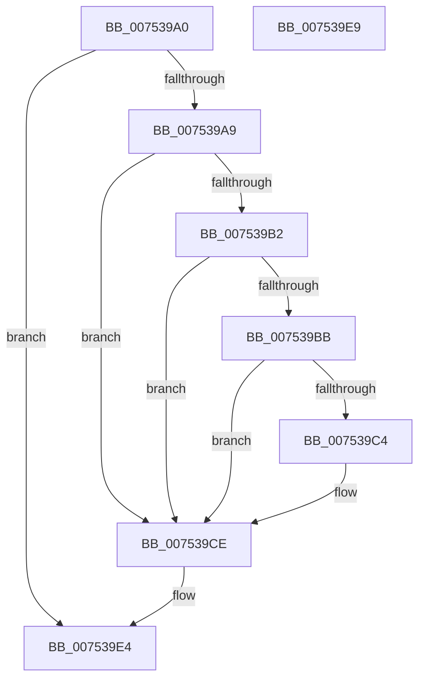

# PopNewProcessorCallback

- RVA: `0x007539A0`–`0x007539EA` (길이 `74` bytes)
- VA: `0x00000001407539A0`
- 실행 섹션: `PAGE`
- PDB 이름 있음: `예`; PDB Function 태그: `아니요`
- unwind 정보 RVA: `0x0005C788`
- 디코드: `19`개 명령, `74/74` bytes 표시
- 미해석 바이트: `0` (있으면 어셈블리에 `.byte`로 보존)

> 이 문서는 커널 이미지의 기계어와 PDB 기호를 분석해 생성했습니다. 4번과 5번은 함수 원형과 자료형을 바이너리 사용 방식에서 추정한 C 해석이며 원본 소스 복구 결과는 아닙니다.

## 1. Dependencies

- 직접 호출 지점: **4**; 고유 호출 대상: **4**
- 직접 호출자로 확인된 함수: **0**
- RIP 상대 이미지 참조: **3**

### Outgoing calls
- `0x007539BB` → [PopCheckSkipTick](PopCheckSkipTick_function_007538CC.md) (function, `0x007538CC`)
- `0x007539D5` → [PpmCheckInitProcessors](../A8/PpmCheckInitProcessors_function_00A84AE8.md) (function, `0x00A84AE8`)
- `0x007539DA` → [PpmEnableWmiInterface](../76/PpmEnableWmiInterface_function_00768604.md) (function, `0x00768604`)
- `0x007539DF` → [PpmIdleRegisterDefaultStates](PpmIdleRegisterDefaultStates_function_00755110.md) (function, `0x00755110`)

### Direct callers
- 이 함수 시작 RVA로 연결되는 직접 call은 확인되지 않았습니다. 간접 호출은 완전히 역산할 수 없습니다.

### Static image references
- `0x007539A9` → RVA `0x00FC50DC` (`ALMOSTRO`; read)
- `0x007539B2` → RVA `0x00FC5290` (`ALMOSTRO`; read)
- `0x007539C4` → RVA `0x00FC50DC` (`ALMOSTRO`; write)

## 2. Other-region calls and transfers

- 다른 실행 섹션으로 향하는 call: **0**
- 별도 외부 분기/꼬리 이동을 확인하지 못했습니다.

## 3. Assembly (complete function range)

```asm
007539A0  48 83 EC 28                     sub rsp, 0x28
007539A4  83 3A 01                        cmp dword ptr [rdx], 1
007539A7  75 3B                           jne 0x1407539e4
007539A9  83 3D 2C 17 87 00 00            cmp dword ptr [rip + 0x87172c], 0
007539B0  75 1C                           jne 0x1407539ce
007539B2  83 3D D7 18 87 00 01            cmp dword ptr [rip + 0x8718d7], 1
007539B9  75 13                           jne 0x1407539ce
007539BB  E8 0C FF FF FF                  call 0x1407538cc
007539C0  84 C0                           test al, al
007539C2  75 0A                           jne 0x1407539ce
007539C4  C7 05 0E 17 87 00 01 00 00 00   mov dword ptr [rip + 0x87170e], 1
007539CE  BA 01 00 00 00                  mov edx, 1
007539D3  33 C9                           xor ecx, ecx
007539D5  E8 0E 11 33 00                  call 0x140a84ae8
007539DA  E8 25 4C 01 00                  call 0x140768604
007539DF  E8 2C 17 00 00                  call 0x140755110
007539E4  48 83 C4 28                     add rsp, 0x28
007539E8  C3                              ret
007539E9  CC                              int3
```

## 4. C-style interpretation (structured pseudocode)

```c
__int64 __fastcall PopNewProcessorCallback(int a1, __int64 a2)
{
    __int64 result;
    __int64 v_rsp;

    v_rsp = (v_rsp) - (40);
    if ((*(unsigned int *)(a2)) != 1) goto loc_007539E4;
    if ((*(unsigned int *)(v_rip + 8853292)) != 0) goto loc_007539CE;
    if ((*(unsigned int *)(v_rip + 8853719)) != 1) goto loc_007539CE;
    result = PopCheckSkipTick(a1, a2, a3, a4);
    if ((unsigned __int8)(result) == 0) {
        *(unsigned int *)(v_rip + 8853262) = 1;
    }
    a1 = 0;
    result = PpmCheckInitProcessors(a1, 1, a3, a4);
    result = PpmEnableWmiInterface(a1, 1, a3, a4);
    result = PpmIdleRegisterDefaultStates(a1, 1, a3, a4);
loc_007539E4:
    v_rsp = (v_rsp) + (40);
    return result;
}
```

## 5. (Beta) C Style

```c
int64_t PopNewProcessorCallback(int32_t Arg1, void *Arg2)
{
    uint8_t *arg2 = (uint8_t *)Arg2;

    int64_t result;
    int64_t local_rsp;

    local_rsp = (local_rsp) - (40);
    if ((*(uint32_t *)(arg2)) != 1) goto loc_007539E4;
    if ((*(uint32_t *)(v_rip + 0x87172C)) != 0) goto loc_007539CE;
    if ((*(uint32_t *)(v_rip + 0x8718D7)) != 1) goto loc_007539CE;
    result = PopCheckSkipTick(Arg1, Arg2, a3, a4);
    if ((uint8_t)(result) == 0) {
        *(uint32_t *)(v_rip + 0x87170E) = 1;
    }
    Arg1 = 0;
    result = PpmCheckInitProcessors(Arg1, 1, a3, a4);
    result = PpmEnableWmiInterface(Arg1, 1, a3, a4);
    result = PpmIdleRegisterDefaultStates(Arg1, 1, a3, a4);
loc_007539E4:
    local_rsp = (local_rsp) + (40);
    return result;
}
```

### 관측된 메모리 오프셋

구조체 형식이 확인되지 않은 접근은 인자 기준의 오프셋으로만 기록했습니다.

| 기준 인자 | 오프셋 표현 | 폭 (bit) | 접근 |
|---|---:|---:|---|
| `Arg2` | `+ 0x0` | `32` | `R` |

## 6. Execution-region graph

[열기: 2D/3D 그래프와 함수 탐색 컨트롤 패널](../../../control-panel.html?section=page&rva=0x007539A0&view=graph)

- 2D 그래프는 위에서 아래로 흐르고, 3D 그래프는 빈 공간을 드래그해 회전합니다. Shift+드래그는 이동, 휠은 확대·축소, 함수 노드 선택은 대상 보고서 이동입니다.

### Static fallback


