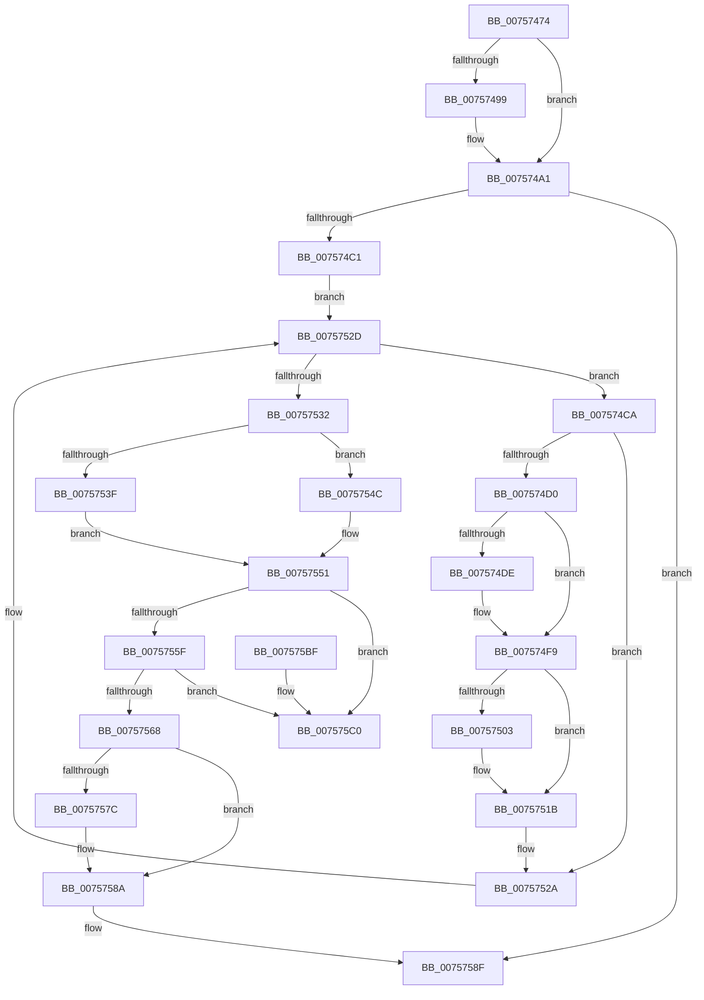

# PopOrphanCoolingExtension

- RVA: `0x00757474`–`0x007575C7` (길이 `339` bytes)
- VA: `0x0000000140757474`
- 실행 섹션: `PAGE`
- PDB 이름 있음: `예`; PDB Function 태그: `아니요`
- unwind 정보 RVA: `0x0006B020`
- 디코드: `87`개 명령, `339/339` bytes 표시
- 미해석 바이트: `0` (있으면 어셈블리에 `.byte`로 보존)

> 이 문서는 커널 이미지의 기계어와 PDB 기호를 분석해 생성했습니다. 4번과 5번은 함수 원형과 자료형을 바이너리 사용 방식에서 추정한 C 해석이며 원본 소스 복구 결과는 아닙니다.

## 1. Dependencies

- 직접 호출 지점: **16**; 고유 호출 대상: **12**
- 직접 호출자로 확인된 함수: **2**
- RIP 상대 이미지 참조: **2**

### Outgoing calls
- `0x00757490` → [Feature_Servicing_CoolingFrameworkDeviceCleanupFix__private_IsEnabledDeviceUsageNoInline](../../text/5D/Feature_Servicing_CoolingFrameworkDeviceCleanupFix__private_IsEnabledDeviceUsageNoInline_function_005D1004.md) (function, `0x005D1004`)
- `0x0075749C` → [PopDisableCoolingExtension](PopDisableCoolingExtension_function_00757208.md) (function, `0x00757208`)
- `0x007574A8` → [PopAcquireRwLockExclusive](../../text/43/PopAcquireRwLockExclusive_function_00430B44.md) (function, `0x00430B44`)
- `0x007574B1` → [PopAcquireRwLockExclusive](../../text/43/PopAcquireRwLockExclusive_function_00430B44.md) (function, `0x00430B44`)
- `0x007574E5` → [PopThermalUpdatePassiveTimeTracking](../AA/PopThermalUpdatePassiveTimeTracking_function_00AA15EC.md) (function, `0x00AA15EC`)
- `0x007574ED` → [PopTraceThermalRequestPassiveHistogram](../../text/42/PopTraceThermalRequestPassiveHistogram_function_0042FFB4.md) (function, `0x0042FFB4`)
- `0x007574F4` → [PopThermalUpdateTelemetryClientCount](../../text/5D/PopThermalUpdateTelemetryClientCount_function_005D58C4.md) (function, `0x005D58C4`)
- `0x0075750E` → [PopThermalUpdateActiveTimeTracking](../AB/PopThermalUpdateActiveTimeTracking_function_00ABA79C.md) (function, `0x00ABA79C`)
- `0x00757516` → [PopTraceThermalRequestActiveActivity](../../text/4E/PopTraceThermalRequestActiveActivity_function_004E9104.md) (function, `0x004E9104`)
- `0x00757525` → [PopDiagTraceThermalRequest](../AD/PopDiagTraceThermalRequest_function_00ADF828.md) (function, `0x00ADF828`)
- `0x00757532` → [Feature_Servicing_CoolingFrameworkDeviceCleanupFix__private_IsEnabledDeviceUsageNoInline](../../text/5D/Feature_Servicing_CoolingFrameworkDeviceCleanupFix__private_IsEnabledDeviceUsageNoInline_function_005D1004.md) (function, `0x005D1004`)
- `0x0075754C` → [PopGetDope](../../text/4C/PopGetDope_function_004CB77C.md) (function, `0x004CB77C`)
- `0x00757573` → [Feature_Servicing_CoolingFrameworkDeviceCleanupFix__private_IsEnabledDeviceUsageNoInline](../../text/5D/Feature_Servicing_CoolingFrameworkDeviceCleanupFix__private_IsEnabledDeviceUsageNoInline_function_005D1004.md) (function, `0x005D1004`)
- `0x00757585` → [ObfDereferenceObjectWithTag](../../text/2F/ObfDereferenceObjectWithTag_function_002F78E0.md) (function, `0x002F78E0`)
- `0x00757593` → [PopReleaseRwLock](../../text/2D/PopReleaseRwLock_function_002DFBBC.md) (function, `0x002DFBBC`)
- `0x0075759F` → [PopReleaseRwLock](../../text/2D/PopReleaseRwLock_function_002DFBBC.md) (function, `0x002DFBBC`)

### Direct callers
- [PopCoolingExtensionPnpNotification](PopCoolingExtensionPnpNotification_function_00757110.md) at `0x00757167`
- [PopCoolingExtensionPnpNotification](PopCoolingExtensionPnpNotification_function_00757110.md) at `0x0075717E`
- [PopHandleCancelQueryRemove](PopHandleCancelQueryRemove_function_0075730C.md) at `0x00757409`

### Static image references
- `0x007574A1` → RVA `0x00F0BB30` (`.data`; read)
- `0x0075751B` → RVA `0x00022050` (`.rdata`; read)

## 2. Other-region calls and transfers

- 다른 실행 섹션으로 향하는 call: **12**
  - `0x00757490` → [Feature_Servicing_CoolingFrameworkDeviceCleanupFix__private_IsEnabledDeviceUsageNoInline](../../text/5D/Feature_Servicing_CoolingFrameworkDeviceCleanupFix__private_IsEnabledDeviceUsageNoInline_function_005D1004.md) (`PAGE` → `.text`)
  - `0x007574A8` → [PopAcquireRwLockExclusive](../../text/43/PopAcquireRwLockExclusive_function_00430B44.md) (`PAGE` → `.text`)
  - `0x007574B1` → [PopAcquireRwLockExclusive](../../text/43/PopAcquireRwLockExclusive_function_00430B44.md) (`PAGE` → `.text`)
  - `0x007574ED` → [PopTraceThermalRequestPassiveHistogram](../../text/42/PopTraceThermalRequestPassiveHistogram_function_0042FFB4.md) (`PAGE` → `.text`)
  - `0x007574F4` → [PopThermalUpdateTelemetryClientCount](../../text/5D/PopThermalUpdateTelemetryClientCount_function_005D58C4.md) (`PAGE` → `.text`)
  - `0x00757516` → [PopTraceThermalRequestActiveActivity](../../text/4E/PopTraceThermalRequestActiveActivity_function_004E9104.md) (`PAGE` → `.text`)
  - `0x00757532` → [Feature_Servicing_CoolingFrameworkDeviceCleanupFix__private_IsEnabledDeviceUsageNoInline](../../text/5D/Feature_Servicing_CoolingFrameworkDeviceCleanupFix__private_IsEnabledDeviceUsageNoInline_function_005D1004.md) (`PAGE` → `.text`)
  - `0x0075754C` → [PopGetDope](../../text/4C/PopGetDope_function_004CB77C.md) (`PAGE` → `.text`)
  - `0x00757573` → [Feature_Servicing_CoolingFrameworkDeviceCleanupFix__private_IsEnabledDeviceUsageNoInline](../../text/5D/Feature_Servicing_CoolingFrameworkDeviceCleanupFix__private_IsEnabledDeviceUsageNoInline_function_005D1004.md) (`PAGE` → `.text`)
  - `0x00757585` → [ObfDereferenceObjectWithTag](../../text/2F/ObfDereferenceObjectWithTag_function_002F78E0.md) (`PAGE` → `.text`)
  - `0x00757593` → [PopReleaseRwLock](../../text/2D/PopReleaseRwLock_function_002DFBBC.md) (`PAGE` → `.text`)
  - `0x0075759F` → [PopReleaseRwLock](../../text/2D/PopReleaseRwLock_function_002DFBBC.md) (`PAGE` → `.text`)
- 별도 외부 분기/꼬리 이동을 확인하지 못했습니다.

## 3. Assembly (complete function range)

```asm
00757474  48 8B C4                        mov rax, rsp
00757477  48 89 58 08                     mov qword ptr [rax + 8], rbx
0075747B  48 89 68 10                     mov qword ptr [rax + 0x10], rbp
0075747F  48 89 70 18                     mov qword ptr [rax + 0x18], rsi
00757483  48 89 78 20                     mov qword ptr [rax + 0x20], rdi
00757487  41 56                           push r14
00757489  48 83 EC 20                     sub rsp, 0x20
0075748D  48 8B D9                        mov rbx, rcx
00757490  E8 6F 9B E7 FF                  call 0x1405d1004
00757495  85 C0                           test eax, eax
00757497  74 08                           je 0x1407574a1
00757499  48 8B CB                        mov rcx, rbx
0075749C  E8 67 FD FF FF                  call 0x140757208
007574A1  48 8D 0D 88 46 7B 00            lea rcx, [rip + 0x7b4688]
007574A8  E8 97 96 CD FF                  call 0x140430b44
007574AD  48 8D 4B 20                     lea rcx, [rbx + 0x20]
007574B1  E8 8E 96 CD FF                  call 0x140430b44
007574B6  48 83 7B 40 00                  cmp qword ptr [rbx + 0x40], 0
007574BB  0F 84 CE 00 00 00               je 0x14075758f
007574C1  4C 8D 73 10                     lea r14, [rbx + 0x10]
007574C5  49 8B 3E                        mov rdi, qword ptr [r14]
007574C8  EB 63                           jmp 0x14075752d
007574CA  80 7F 12 00                     cmp byte ptr [rdi + 0x12], 0
007574CE  74 5A                           je 0x14075752a
007574D0  C6 47 12 00                     mov byte ptr [rdi + 0x12], 0
007574D4  48 83 BB 98 00 00 00 00         cmp qword ptr [rbx + 0x98], 0
007574DC  74 1B                           je 0x1407574f9
007574DE  8A 57 10                        mov dl, byte ptr [rdi + 0x10]
007574E1  48 8D 4F 28                     lea rcx, [rdi + 0x28]
007574E5  E8 02 A1 34 00                  call 0x140aa15ec
007574EA  48 8B CF                        mov rcx, rdi
007574ED  E8 C2 8A CD FF                  call 0x14042ffb4
007574F2  33 C9                           xor ecx, ecx
007574F4  E8 CB E3 E7 FF                  call 0x1405d58c4
007574F9  48 83 BB 90 00 00 00 00         cmp qword ptr [rbx + 0x90], 0
00757501  74 18                           je 0x14075751b
00757503  80 7F 11 00                     cmp byte ptr [rdi + 0x11], 0
00757507  48 8D 4F 28                     lea rcx, [rdi + 0x28]
0075750B  0F 94 C2                        sete dl
0075750E  E8 89 32 36 00                  call 0x140aba79c
00757513  48 8B CF                        mov rcx, rdi
00757516  E8 E9 1B D9 FF                  call 0x1404e9104
0075751B  48 8D 15 2E AB 8C FF            lea rdx, [rip - 0x7354d2]
00757522  48 8B CF                        mov rcx, rdi
00757525  E8 FE 82 38 00                  call 0x140adf828
0075752A  48 8B 3F                        mov rdi, qword ptr [rdi]
0075752D  49 3B FE                        cmp rdi, r14
00757530  75 98                           jne 0x1407574ca
00757532  E8 CD 9A E7 FF                  call 0x1405d1004
00757537  48 8B 4B 40                     mov rcx, qword ptr [rbx + 0x40]
0075753B  85 C0                           test eax, eax
0075753D  74 0D                           je 0x14075754c
0075753F  48 8B 81 38 01 00 00            mov rax, qword ptr [rcx + 0x138]
00757546  48 8B 40 18                     mov rax, qword ptr [rax + 0x18]
0075754A  EB 05                           jmp 0x140757551
0075754C  E8 2B 42 D7 FF                  call 0x1404cb77c
00757551  48 83 60 40 00                  and qword ptr [rax + 0x40], 0
00757556  48 8B 0B                        mov rcx, qword ptr [rbx]
00757559  48 39 59 08                     cmp qword ptr [rcx + 8], rbx
0075755D  75 61                           jne 0x1407575c0
0075755F  48 8B 43 08                     mov rax, qword ptr [rbx + 8]
00757563  48 39 18                        cmp qword ptr [rax], rbx
00757566  75 58                           jne 0x1407575c0
00757568  48 89 08                        mov qword ptr [rax], rcx
0075756B  48 89 41 08                     mov qword ptr [rcx + 8], rax
0075756F  48 83 23 00                     and qword ptr [rbx], 0
00757573  E8 8C 9A E7 FF                  call 0x1405d1004
00757578  85 C0                           test eax, eax
0075757A  74 0E                           je 0x14075758a
0075757C  48 8B 4B 40                     mov rcx, qword ptr [rbx + 0x40]
00757580  BA 50 6F 44 67                  mov edx, 0x67446f50
00757585  E8 56 03 BA FF                  call 0x1402f78e0
0075758A  48 83 63 40 00                  and qword ptr [rbx + 0x40], 0
0075758F  48 8D 4B 20                     lea rcx, [rbx + 0x20]
00757593  E8 24 86 B8 FF                  call 0x1402dfbbc
00757598  48 8D 0D 91 45 7B 00            lea rcx, [rip + 0x7b4591]
0075759F  E8 18 86 B8 FF                  call 0x1402dfbbc
007575A4  48 8B 5C 24 30                  mov rbx, qword ptr [rsp + 0x30]
007575A9  48 8B 6C 24 38                  mov rbp, qword ptr [rsp + 0x38]
007575AE  48 8B 74 24 40                  mov rsi, qword ptr [rsp + 0x40]
007575B3  48 8B 7C 24 48                  mov rdi, qword ptr [rsp + 0x48]
007575B8  48 83 C4 20                     add rsp, 0x20
007575BC  41 5E                           pop r14
007575BE  C3                              ret
007575BF  CC                              int3
007575C0  B9 03 00 00 00                  mov ecx, 3
007575C5  CD 29                           int 0x29
```

## 4. C-style interpretation (structured pseudocode)

```c
__int64 __fastcall PopOrphanCoolingExtension(__int64 a1)
{
    __int64 result;
    __int64 v_rsp;
    unsigned __int64 v_stack_p10;
    unsigned __int64 v_stack_p18;
    unsigned __int64 v_stack_p20;
    unsigned __int64 v_stack_p8;

    *(unsigned __int64 *)(v_rsp + 8) = v_rbx;
    *(unsigned __int64 *)(v_rsp + 16) = v_rbp;
    *(unsigned __int64 *)(v_rsp + 24) = v_rsi;
    *(unsigned __int64 *)(v_rsp + 32) = v_rdi;
    v_rsp = (v_rsp) - (32);
    result = Feature_Servicing_CoolingFrameworkDeviceCleanupFix__private_IsEnabledDeviceUsageNoInline(a1, a2, a3, a4);
    if ((unsigned int)(result) != 0) {
        a1 = a1;
        result = PopDisableCoolingExtension(a1, a2, a3, a4);
    }
    result = PopAcquireRwLockExclusive(v_rip + 8078984, a2, a3, a4);
    result = PopAcquireRwLockExclusive(a1 + 32, a2, a3, a4);
    if ((*(unsigned __int64 *)(a1 + 64)) == 0) goto loc_0075758F;
    goto loc_0075752D;
loc_007574CA:
    if ((*(unsigned __int8 *)(*(unsigned __int64 *)(a1 + 16) + 18)) == 0) goto loc_0075752A;
    *(unsigned __int8 *)(*(unsigned __int64 *)(a1 + 16) + 18) = 0;
    if ((*(unsigned __int64 *)(a1 + 152)) != 0) {
        a2 = *(unsigned __int8 *)(*(unsigned __int64 *)(a1 + 16) + 16);
        a1 = *(unsigned __int64 *)(a1 + 16) + 40;
        result = PopThermalUpdatePassiveTimeTracking(a1, a2, a3, a4);
        a1 = *(unsigned __int64 *)(a1 + 16);
        result = PopTraceThermalRequestPassiveHistogram(a1, a2, a3, a4);
        a1 = 0;
        result = PopThermalUpdateTelemetryClientCount(a1, a2, a3, a4);
    }
    if ((*(unsigned __int64 *)(a1 + 144)) != 0) {
        a1 = *(unsigned __int64 *)(a1 + 16) + 40;
        a2 = ((*(unsigned __int8 *)(*(unsigned __int64 *)(a1 + 16) + 17)) == 0) ? 1 : 0;
        result = PopThermalUpdateActiveTimeTracking(a1, a2, a3, a4);
        a1 = *(unsigned __int64 *)(a1 + 16);
        result = PopTraceThermalRequestActiveActivity(a1, a2, a3, a4);
    }
    result = PopDiagTraceThermalRequest(*(unsigned __int64 *)(a1 + 16), v_rip - 7558354, a3, a4);
loc_0075752A:
loc_0075752D:
    if ((*(unsigned __int64 *)(*(unsigned __int64 *)(a1 + 16))) != (a1 + 16)) goto loc_007574CA;
    result = Feature_Servicing_CoolingFrameworkDeviceCleanupFix__private_IsEnabledDeviceUsageNoInline(*(unsigned __int64 *)(a1 + 16), v_rip - 7558354, a3, a4);
    if ((unsigned int)(result) == 0) goto loc_0075754C;
    goto loc_00757551;
loc_0075754C:
    result = PopGetDope(*(unsigned __int64 *)(a1 + 64), v_rip - 7558354, a3, a4);
loc_00757551:
    if ((*(unsigned __int64 *)(*(unsigned __int64 *)(a1) + 8)) != a1) goto loc_007575C0;
    if ((*(unsigned __int64 *)(*(unsigned __int64 *)(a1 + 8))) != a1) goto loc_007575C0;
    *(unsigned __int64 *)(*(unsigned __int64 *)(a1 + 8)) = *(unsigned __int64 *)(a1);
    *(unsigned __int64 *)(*(unsigned __int64 *)(a1) + 8) = *(unsigned __int64 *)(a1 + 8);
    result = Feature_Servicing_CoolingFrameworkDeviceCleanupFix__private_IsEnabledDeviceUsageNoInline(*(unsigned __int64 *)(a1), v_rip - 7558354, a3, a4);
    if ((unsigned int)(result) != 0) {
        a1 = *(unsigned __int64 *)(a1 + 64);
        a2 = 0x67446F50ULL;
        result = ObfDereferenceObjectWithTag(a1, a2, a3, a4);
    }
loc_0075758F:
    result = PopReleaseRwLock(a1 + 32, a2, a3, a4);
    result = PopReleaseRwLock(v_rip + 8078737, a2, a3, a4);
    v_rsp = (v_rsp) + (32);
    return result;
loc_007575C0:
    return result;
}
```

## 5. (Beta) C Style

```c
int64_t PopOrphanCoolingExtension(void *Arg1)
{
    uint8_t *arg1 = (uint8_t *)Arg1;

    int64_t result;
    int64_t local_rsp;
    uint64_t v_stack_p10;
    uint64_t v_stack_p18;
    uint64_t v_stack_p20;
    uint64_t v_stack_p8;

    *(uint64_t *)(local_rsp + 0x8) = local_rbx;
    *(uint64_t *)(local_rsp + 0x10) = local_rbp;
    *(uint64_t *)(local_rsp + 0x18) = local_rsi;
    *(uint64_t *)(local_rsp + 0x20) = local_rdi;
    local_rsp = (local_rsp) - (32);
    result = Feature_Servicing_CoolingFrameworkDeviceCleanupFix__private_IsEnabledDeviceUsageNoInline(Arg1, a2, a3, a4);
    if ((uint32_t)(result) != 0) {
        Arg1 = Arg1;
        result = PopDisableCoolingExtension(Arg1, a2, a3, a4);
    }
    result = PopAcquireRwLockExclusive(v_rip + 8078984, a2, a3, a4);
    result = PopAcquireRwLockExclusive(Arg1 + 32, a2, a3, a4);
    if ((*(uint64_t *)(arg1 + 0x40)) == 0) goto loc_0075758F;
    goto loc_0075752D;
loc_007574CA:
    if ((*(uint8_t *)(*(uint64_t *)(arg1 + 0x10) + 0x12)) == 0) goto loc_0075752A;
    *(uint8_t *)(*(uint64_t *)(arg1 + 0x10) + 0x12) = 0;
    if ((*(uint64_t *)(arg1 + 0x98)) != 0) {
        a2 = *(uint8_t *)(*(uint64_t *)(arg1 + 0x10) + 0x10);
        Arg1 = *(uint64_t *)(arg1 + 0x10) + 40;
        result = PopThermalUpdatePassiveTimeTracking(Arg1, a2, a3, a4);
        Arg1 = *(uint64_t *)(arg1 + 0x10);
        result = PopTraceThermalRequestPassiveHistogram(Arg1, a2, a3, a4);
        Arg1 = 0;
        result = PopThermalUpdateTelemetryClientCount(Arg1, a2, a3, a4);
    }
    if ((*(uint64_t *)(arg1 + 0x90)) != 0) {
        Arg1 = *(uint64_t *)(arg1 + 0x10) + 40;
        a2 = ((*(uint8_t *)(*(uint64_t *)(arg1 + 0x10) + 0x11)) == 0) ? 1 : 0;
        result = PopThermalUpdateActiveTimeTracking(Arg1, a2, a3, a4);
        Arg1 = *(uint64_t *)(arg1 + 0x10);
        result = PopTraceThermalRequestActiveActivity(Arg1, a2, a3, a4);
    }
    result = PopDiagTraceThermalRequest(*(uint64_t *)(arg1 + 0x10), v_rip - 7558354, a3, a4);
loc_0075752A:
loc_0075752D:
    if ((*(uint64_t *)(*(uint64_t *)(arg1 + 0x10))) != (Arg1 + 16)) goto loc_007574CA;
    result = Feature_Servicing_CoolingFrameworkDeviceCleanupFix__private_IsEnabledDeviceUsageNoInline(*(uint64_t *)(arg1 + 0x10), v_rip - 7558354, a3, a4);
    if ((uint32_t)(result) == 0) goto loc_0075754C;
    goto loc_00757551;
loc_0075754C:
    result = PopGetDope(*(uint64_t *)(arg1 + 0x40), v_rip - 7558354, a3, a4);
loc_00757551:
    if ((*(uint64_t *)(*(uint64_t *)(arg1) + 0x8)) != Arg1) goto loc_007575C0;
    if ((*(uint64_t *)(*(uint64_t *)(arg1 + 0x8))) != Arg1) goto loc_007575C0;
    *(uint64_t *)(*(uint64_t *)(arg1 + 0x8)) = *(uint64_t *)(arg1);
    *(uint64_t *)(*(uint64_t *)(arg1) + 0x8) = *(uint64_t *)(arg1 + 0x8);
    result = Feature_Servicing_CoolingFrameworkDeviceCleanupFix__private_IsEnabledDeviceUsageNoInline(*(uint64_t *)(arg1), v_rip - 7558354, a3, a4);
    if ((uint32_t)(result) != 0) {
        Arg1 = *(uint64_t *)(arg1 + 0x40);
        a2 = 0x67446F50ULL;
        result = ObfDereferenceObjectWithTag(Arg1, a2, a3, a4);
    }
loc_0075758F:
    result = PopReleaseRwLock(Arg1 + 32, a2, a3, a4);
    result = PopReleaseRwLock(v_rip + 8078737, a2, a3, a4);
    local_rsp = (local_rsp) + (32);
    return result;
loc_007575C0:
    return result;
}
```

### 관측된 메모리 오프셋

구조체 형식이 확인되지 않은 접근은 인자 기준의 오프셋으로만 기록했습니다.

| 기준 인자 | 오프셋 표현 | 폭 (bit) | 접근 |
|---|---:|---:|---|
| `Arg1` | `+ 0x0` | `64` | `R` |
| `Arg1` | `+ 0x0` | `64` | `R/W` |
| `Arg1` | `+ 0x8` | `64` | `R` |
| `Arg1` | `+ 0x10` | `64` | `R` |
| `Arg1` | `+ 0x20` | `64` | `R` |
| `Arg1` | `+ 0x40` | `64` | `R` |
| `Arg1` | `+ 0x40` | `64` | `R/W` |
| `Arg1` | `+ 0x90` | `64` | `R` |
| `Arg1` | `+ 0x98` | `64` | `R` |

## 6. Execution-region graph

[열기: 2D/3D 그래프와 함수 탐색 컨트롤 패널](../../../control-panel.html?section=page&rva=0x00757474&view=graph)

- 2D 그래프는 위에서 아래로 흐르고, 3D 그래프는 빈 공간을 드래그해 회전합니다. Shift+드래그는 이동, 휠은 확대·축소, 함수 노드 선택은 대상 보고서 이동입니다.

### Static fallback


