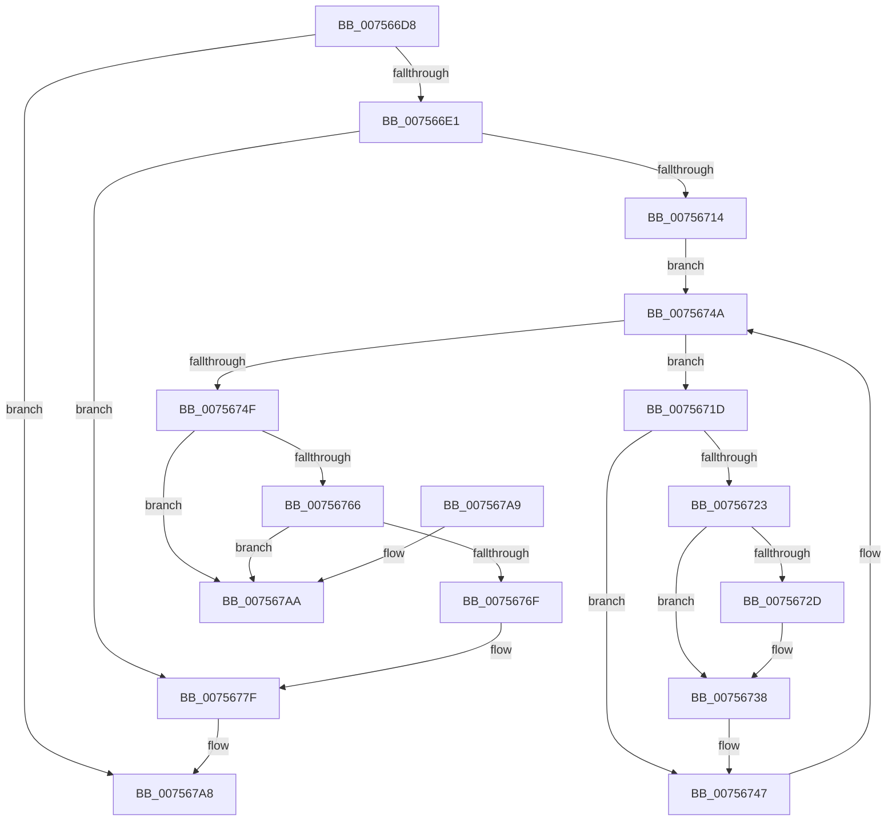

# PopOrphanPowerLimitExtension

- RVA: `0x007566D8`–`0x007567B1` (길이 `217` bytes)
- VA: `0x00000001407566D8`
- 실행 섹션: `PAGE`
- PDB 이름 있음: `예`; PDB Function 태그: `아니요`
- unwind 정보 RVA: `0x000CBFF8`
- 디코드: `57`개 명령, `217/217` bytes 표시
- 미해석 바이트: `0` (있으면 어셈블리에 `.byte`로 보존)

> 이 문서는 커널 이미지의 기계어와 PDB 기호를 분석해 생성했습니다. 4번과 5번은 함수 원형과 자료형을 바이너리 사용 방식에서 추정한 C 해석이며 원본 소스 복구 결과는 아닙니다.

## 1. Dependencies

- 직접 호출 지점: **7**; 고유 호출 대상: **5**
- 직접 호출자로 확인된 함수: **1**
- RIP 상대 이미지 참조: **2**

### Outgoing calls
- `0x007566FF` → [PopAcquireRwLockExclusive](../../text/43/PopAcquireRwLockExclusive_function_00430B44.md) (function, `0x00430B44`)
- `0x00756708` → [PopAcquireRwLockExclusive](../../text/43/PopAcquireRwLockExclusive_function_00430B44.md) (function, `0x00430B44`)
- `0x0075672F` → [PopThermalUpdateTelemetryClientCount](../../text/5D/PopThermalUpdateTelemetryClientCount_function_005D58C4.md) (function, `0x005D58C4`)
- `0x00756742` → [PopDiagTracePowerLimitRequest](../76/PopDiagTracePowerLimitRequest_function_007626D0.md) (function, `0x007626D0`)
- `0x00756753` → [PopGetDope](../../text/4C/PopGetDope_function_004CB77C.md) (function, `0x004CB77C`)
- `0x00756783` → [PopReleaseRwLock](../../text/2D/PopReleaseRwLock_function_002DFBBC.md) (function, `0x002DFBBC`)
- `0x0075678F` → [PopReleaseRwLock](../../text/2D/PopReleaseRwLock_function_002DFBBC.md) (function, `0x002DFBBC`)

### Direct callers
- [PopPowerLimitPnpNotification](PopPowerLimitPnpNotification_function_007567C0.md) at `0x00756826`

### Static image references
- `0x007566F8` → RVA `0x00F0BB50` (`.data`; read)
- `0x00756738` → RVA `0x000230F8` (`.rdata`; read)

## 2. Other-region calls and transfers

- 다른 실행 섹션으로 향하는 call: **6**
  - `0x007566FF` → [PopAcquireRwLockExclusive](../../text/43/PopAcquireRwLockExclusive_function_00430B44.md) (`PAGE` → `.text`)
  - `0x00756708` → [PopAcquireRwLockExclusive](../../text/43/PopAcquireRwLockExclusive_function_00430B44.md) (`PAGE` → `.text`)
  - `0x0075672F` → [PopThermalUpdateTelemetryClientCount](../../text/5D/PopThermalUpdateTelemetryClientCount_function_005D58C4.md) (`PAGE` → `.text`)
  - `0x00756753` → [PopGetDope](../../text/4C/PopGetDope_function_004CB77C.md) (`PAGE` → `.text`)
  - `0x00756783` → [PopReleaseRwLock](../../text/2D/PopReleaseRwLock_function_002DFBBC.md) (`PAGE` → `.text`)
  - `0x0075678F` → [PopReleaseRwLock](../../text/2D/PopReleaseRwLock_function_002DFBBC.md) (`PAGE` → `.text`)
- 별도 외부 분기/꼬리 이동을 확인하지 못했습니다.

## 3. Assembly (complete function range)

```asm
007566D8  48 85 C9                        test rcx, rcx
007566DB  0F 84 C7 00 00 00               je 0x1407567a8
007566E1  48 89 5C 24 08                  mov qword ptr [rsp + 8], rbx
007566E6  48 89 6C 24 10                  mov qword ptr [rsp + 0x10], rbp
007566EB  48 89 74 24 18                  mov qword ptr [rsp + 0x18], rsi
007566F0  57                              push rdi
007566F1  48 83 EC 20                     sub rsp, 0x20
007566F5  48 8B D9                        mov rbx, rcx
007566F8  48 8D 0D 51 54 7B 00            lea rcx, [rip + 0x7b5451]
007566FF  E8 40 A4 CD FF                  call 0x140430b44
00756704  48 8D 4B 20                     lea rcx, [rbx + 0x20]
00756708  E8 37 A4 CD FF                  call 0x140430b44
0075670D  48 83 7B 38 00                  cmp qword ptr [rbx + 0x38], 0
00756712  74 6B                           je 0x14075677f
00756714  48 8D 73 10                     lea rsi, [rbx + 0x10]
00756718  48 8B 3E                        mov rdi, qword ptr [rsi]
0075671B  EB 2D                           jmp 0x14075674a
0075671D  80 7F 10 00                     cmp byte ptr [rdi + 0x10], 0
00756721  74 24                           je 0x140756747
00756723  80 7F 30 00                     cmp byte ptr [rdi + 0x30], 0
00756727  C6 47 10 00                     mov byte ptr [rdi + 0x10], 0
0075672B  74 0B                           je 0x140756738
0075672D  33 C9                           xor ecx, ecx
0075672F  E8 90 F1 E7 FF                  call 0x1405d58c4
00756734  C6 47 30 00                     mov byte ptr [rdi + 0x30], 0
00756738  48 8D 15 B9 C9 8C FF            lea rdx, [rip - 0x733647]
0075673F  48 8B CF                        mov rcx, rdi
00756742  E8 89 BF 00 00                  call 0x1407626d0
00756747  48 8B 3F                        mov rdi, qword ptr [rdi]
0075674A  48 3B FE                        cmp rdi, rsi
0075674D  75 CE                           jne 0x14075671d
0075674F  48 8B 4B 38                     mov rcx, qword ptr [rbx + 0x38]
00756753  E8 24 50 D7 FF                  call 0x1404cb77c
00756758  48 83 60 48 00                  and qword ptr [rax + 0x48], 0
0075675D  48 8B 0B                        mov rcx, qword ptr [rbx]
00756760  48 39 59 08                     cmp qword ptr [rcx + 8], rbx
00756764  75 44                           jne 0x1407567aa
00756766  48 8B 43 08                     mov rax, qword ptr [rbx + 8]
0075676A  48 39 18                        cmp qword ptr [rax], rbx
0075676D  75 3B                           jne 0x1407567aa
0075676F  48 89 08                        mov qword ptr [rax], rcx
00756772  48 89 41 08                     mov qword ptr [rcx + 8], rax
00756776  48 83 23 00                     and qword ptr [rbx], 0
0075677A  48 83 63 38 00                  and qword ptr [rbx + 0x38], 0
0075677F  48 8D 4B 20                     lea rcx, [rbx + 0x20]
00756783  E8 34 94 B8 FF                  call 0x1402dfbbc
00756788  48 8D 0D C1 53 7B 00            lea rcx, [rip + 0x7b53c1]
0075678F  E8 28 94 B8 FF                  call 0x1402dfbbc
00756794  48 8B 5C 24 30                  mov rbx, qword ptr [rsp + 0x30]
00756799  48 8B 6C 24 38                  mov rbp, qword ptr [rsp + 0x38]
0075679E  48 8B 74 24 40                  mov rsi, qword ptr [rsp + 0x40]
007567A3  48 83 C4 20                     add rsp, 0x20
007567A7  5F                              pop rdi
007567A8  C3                              ret
007567A9  CC                              int3
007567AA  B9 03 00 00 00                  mov ecx, 3
007567AF  CD 29                           int 0x29
```

## 4. C-style interpretation (structured pseudocode)

```c
__int64 __fastcall PopOrphanPowerLimitExtension(__int64 a1)
{
    __int64 result;
    __int64 v_rsp;
    unsigned __int64 v_stack_p10;
    unsigned __int64 v_stack_p18;
    unsigned __int64 v_stack_p8;

    if (a1 == 0) goto loc_007567A8;
    v_stack_p8 = v_rbx;
    v_stack_p10 = v_rbp;
    v_stack_p18 = v_rsi;
    v_rsp = (v_rsp) - (32);
    result = PopAcquireRwLockExclusive(v_rip + 8082513, a2, a3, a4);
    result = PopAcquireRwLockExclusive(a1 + 32, a2, a3, a4);
    if ((*(unsigned __int64 *)(a1 + 56)) == 0) goto loc_0075677F;
    goto loc_0075674A;
loc_0075671D:
    if ((*(unsigned __int8 *)(*(unsigned __int64 *)(a1 + 16) + 16)) == 0) goto loc_00756747;
    *(unsigned __int8 *)(*(unsigned __int64 *)(a1 + 16) + 16) = 0;
    if ((*(unsigned __int8 *)(*(unsigned __int64 *)(a1 + 16) + 48)) != 0) {
        a1 = 0;
        result = PopThermalUpdateTelemetryClientCount(a1, a2, a3, a4);
        *(unsigned __int8 *)(*(unsigned __int64 *)(a1 + 16) + 48) = 0;
    }
    result = PopDiagTracePowerLimitRequest(*(unsigned __int64 *)(a1 + 16), v_rip - 7550535, a3, a4);
loc_00756747:
loc_0075674A:
    if ((*(unsigned __int64 *)(*(unsigned __int64 *)(a1 + 16))) != (a1 + 16)) goto loc_0075671D;
    result = PopGetDope(*(unsigned __int64 *)(a1 + 56), v_rip - 7550535, a3, a4);
    if ((*(unsigned __int64 *)(*(unsigned __int64 *)(a1) + 8)) != 0) goto loc_007567AA;
    if ((*(unsigned __int64 *)(*(unsigned __int64 *)(a1 + 8))) != 0) goto loc_007567AA;
    *(unsigned __int64 *)(*(unsigned __int64 *)(a1 + 8)) = *(unsigned __int64 *)(a1);
    *(unsigned __int64 *)(*(unsigned __int64 *)(a1) + 8) = *(unsigned __int64 *)(a1 + 8);
loc_0075677F:
    result = PopReleaseRwLock(a1 + 32, v_rip - 7550535, a3, a4);
    result = PopReleaseRwLock(v_rip + 8082369, v_rip - 7550535, a3, a4);
    v_rsp = (v_rsp) + (32);
loc_007567A8:
    return result;
loc_007567AA:
    return result;
}
```

## 5. (Beta) C Style

```c
int64_t PopOrphanPowerLimitExtension(int64_t Arg1)
{
    int64_t result;
    int64_t local_rsp;
    uint64_t v_stack_p10;
    uint64_t v_stack_p18;
    uint64_t v_stack_p8;

    if (Arg1 == 0) goto loc_007567A8;
    v_stack_p8 = local_rbx;
    v_stack_p10 = local_rbp;
    v_stack_p18 = local_rsi;
    local_rsp = (local_rsp) - (32);
    result = PopAcquireRwLockExclusive(v_rip + 8082513, a2, a3, a4);
    result = PopAcquireRwLockExclusive(Arg1 + 32, a2, a3, a4);
    if ((*(uint64_t *)(Arg1 + 0x38)) == 0) goto loc_0075677F;
    goto loc_0075674A;
loc_0075671D:
    if ((*(uint8_t *)(*(uint64_t *)(Arg1 + 0x10) + 0x10)) == 0) goto loc_00756747;
    *(uint8_t *)(*(uint64_t *)(Arg1 + 0x10) + 0x10) = 0;
    if ((*(uint8_t *)(*(uint64_t *)(Arg1 + 0x10) + 0x30)) != 0) {
        Arg1 = 0;
        result = PopThermalUpdateTelemetryClientCount(Arg1, a2, a3, a4);
        *(uint8_t *)(*(uint64_t *)(Arg1 + 0x10) + 0x30) = 0;
    }
    result = PopDiagTracePowerLimitRequest(*(uint64_t *)(Arg1 + 0x10), v_rip - 7550535, a3, a4);
loc_00756747:
loc_0075674A:
    if ((*(uint64_t *)(*(uint64_t *)(Arg1 + 0x10))) != (Arg1 + 16)) goto loc_0075671D;
    result = PopGetDope(*(uint64_t *)(Arg1 + 0x38), v_rip - 7550535, a3, a4);
    if ((*(uint64_t *)(*(uint64_t *)(Arg1) + 0x8)) != 0) goto loc_007567AA;
    if ((*(uint64_t *)(*(uint64_t *)(Arg1 + 0x8))) != 0) goto loc_007567AA;
    *(uint64_t *)(*(uint64_t *)(Arg1 + 0x8)) = *(uint64_t *)(Arg1);
    *(uint64_t *)(*(uint64_t *)(Arg1) + 0x8) = *(uint64_t *)(Arg1 + 0x8);
loc_0075677F:
    result = PopReleaseRwLock(Arg1 + 32, v_rip - 7550535, a3, a4);
    result = PopReleaseRwLock(v_rip + 8082369, v_rip - 7550535, a3, a4);
    local_rsp = (local_rsp) + (32);
loc_007567A8:
    return result;
loc_007567AA:
    return result;
}
```

## 6. Execution-region graph

[열기: 2D/3D 그래프와 함수 탐색 컨트롤 패널](../../../control-panel.html?section=page&rva=0x007566D8&view=graph)

- 2D 그래프는 위에서 아래로 흐르고, 3D 그래프는 빈 공간을 드래그해 회전합니다. Shift+드래그는 이동, 휠은 확대·축소, 함수 노드 선택은 대상 보고서 이동입니다.

### Static fallback


