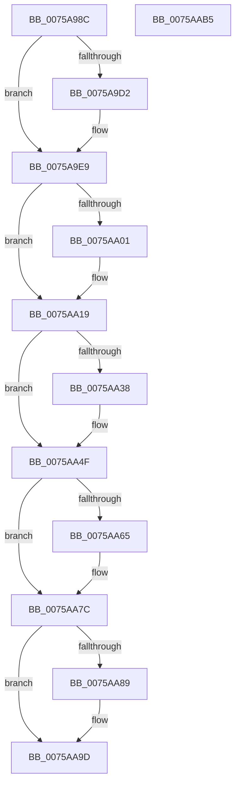

# PopPluginInitializeSocSubsystemStaticInfo

- RVA: `0x0075A98C`–`0x0075AAB6` (길이 `298` bytes)
- VA: `0x000000014075A98C`
- 실행 섹션: `PAGE`
- PDB 이름 있음: `예`; PDB Function 태그: `아니요`
- unwind 정보 RVA: `0x0007D3C0`
- 디코드: `77`개 명령, `298/298` bytes 표시
- 미해석 바이트: `0` (있으면 어셈블리에 `.byte`로 보존)

> 이 문서는 커널 이미지의 기계어와 PDB 기호를 분석해 생성했습니다. 4번과 5번은 함수 원형과 자료형을 바이너리 사용 방식에서 추정한 C 해석이며 원본 소스 복구 결과는 아닙니다.

## 1. Dependencies

- 직접 호출 지점: **9**; 고유 호출 대상: **4**
- 직접 호출자로 확인된 함수: **1**
- RIP 상대 이미지 참조: **1**

### Outgoing calls
- `0x0075A9C9` → [guard_dispatch_icall](../../text/6B/guard_dispatch_icall_function_006BAAD0.md) (function, `0x006BAAD0`)
- `0x0075A9E3` → [PopFxBugCheck](../../text/2B/PopFxBugCheck_function_002BFC6C.md) (function, `0x002BFC6C`)
- `0x0075A9F8` → [PopFxValidateReturnedUnicodeString](PopFxValidateReturnedUnicodeString_function_0075A708.md) (function, `0x0075A708`)
- `0x0075AA13` → [PopFxBugCheck](../../text/2B/PopFxBugCheck_function_002BFC6C.md) (function, `0x002BFC6C`)
- `0x0075AA28` → [PopFxValidateReturnedUnicodeString](PopFxValidateReturnedUnicodeString_function_0075A708.md) (function, `0x0075A708`)
- `0x0075AA49` → [PopFxBugCheck](../../text/2B/PopFxBugCheck_function_002BFC6C.md) (function, `0x002BFC6C`)
- `0x0075AA5C` → [wcsncmp](../../text/50/wcsncmp_function_00501CA0.md) (function, `0x00501CA0`)
- `0x0075AA76` → [PopFxBugCheck](../../text/2B/PopFxBugCheck_function_002BFC6C.md) (function, `0x002BFC6C`)
- `0x0075AA97` → [PopFxBugCheck](../../text/2B/PopFxBugCheck_function_002BFC6C.md) (function, `0x002BFC6C`)

### Direct callers
- [PopFxInitializeSocSubsystemStaticInfo](PopFxInitializeSocSubsystemStaticInfo_function_00758EC8.md) at `0x0075907D`

### Static image references
- `0x0075A9A0` → RVA `0x00E676B8` (`.data`; read)

## 2. Other-region calls and transfers

- 다른 실행 섹션으로 향하는 call: **7**
  - `0x0075A9C9` → [guard_dispatch_icall](../../text/6B/guard_dispatch_icall_function_006BAAD0.md) (`PAGE` → `.text`)
  - `0x0075A9E3` → [PopFxBugCheck](../../text/2B/PopFxBugCheck_function_002BFC6C.md) (`PAGE` → `.text`)
  - `0x0075AA13` → [PopFxBugCheck](../../text/2B/PopFxBugCheck_function_002BFC6C.md) (`PAGE` → `.text`)
  - `0x0075AA49` → [PopFxBugCheck](../../text/2B/PopFxBugCheck_function_002BFC6C.md) (`PAGE` → `.text`)
  - `0x0075AA5C` → [wcsncmp](../../text/50/wcsncmp_function_00501CA0.md) (`PAGE` → `.text`)
  - `0x0075AA76` → [PopFxBugCheck](../../text/2B/PopFxBugCheck_function_002BFC6C.md) (`PAGE` → `.text`)
  - `0x0075AA97` → [PopFxBugCheck](../../text/2B/PopFxBugCheck_function_002BFC6C.md) (`PAGE` → `.text`)
- 별도 외부 분기/꼬리 이동을 확인하지 못했습니다.

## 3. Assembly (complete function range)

```asm
0075A98C  48 89 5C 24 08                  mov qword ptr [rsp + 8], rbx
0075A991  48 89 6C 24 10                  mov qword ptr [rsp + 0x10], rbp
0075A996  48 89 74 24 18                  mov qword ptr [rsp + 0x18], rsi
0075A99B  57                              push rdi
0075A99C  48 83 EC 40                     sub rsp, 0x40
0075A9A0  48 8B 05 11 CD 70 00            mov rax, qword ptr [rip + 0x70cd11]
0075A9A7  BD 25 00 00 00                  mov ebp, 0x25
0075A9AC  0F 10 42 10                     movups xmm0, xmmword ptr [rdx + 0x10]
0075A9B0  8B CD                           mov ecx, ebp
0075A9B2  48 8B DA                        mov rbx, rdx
0075A9B5  0F 10 4A 20                     movups xmm1, xmmword ptr [rdx + 0x20]
0075A9B9  48 8B 40 60                     mov rax, qword ptr [rax + 0x60]
0075A9BD  F3 0F 7F 44 24 20               movdqu xmmword ptr [rsp + 0x20], xmm0
0075A9C3  F3 0F 7F 4C 24 30               movdqu xmmword ptr [rsp + 0x30], xmm1
0075A9C9  E8 02 01 F6 FF                  call 0x1406baad0
0075A9CE  84 C0                           test al, al
0075A9D0  75 17                           jne 0x14075a9e9
0075A9D2  4C 8B 05 DF CC 70 00            mov r8, qword ptr [rip + 0x70ccdf]
0075A9D9  45 33 C9                        xor r9d, r9d
0075A9DC  8B D5                           mov edx, ebp
0075A9DE  B9 05 06 00 00                  mov ecx, 0x605
0075A9E3  E8 84 52 B6 FF                  call 0x1402bfc6c
0075A9E8  CC                              int3
0075A9E9  44 0F B7 44 24 22               movzx r8d, word ptr [rsp + 0x22]
0075A9EF  48 8D 4B 10                     lea rcx, [rbx + 0x10]
0075A9F3  48 8B 54 24 28                  mov rdx, qword ptr [rsp + 0x28]
0075A9F8  E8 0B FD FF FF                  call 0x14075a708
0075A9FD  84 C0                           test al, al
0075A9FF  75 18                           jne 0x14075aa19
0075AA01  4C 8D 4B 18                     lea r9, [rbx + 0x18]
0075AA05  41 B8 6D 61 4E 50               mov r8d, 0x504e616d
0075AA0B  48 8B D5                        mov rdx, rbp
0075AA0E  B9 06 07 00 00                  mov ecx, 0x706
0075AA13  E8 54 52 B6 FF                  call 0x1402bfc6c
0075AA18  CC                              int3
0075AA19  44 0F B7 44 24 32               movzx r8d, word ptr [rsp + 0x32]
0075AA1F  48 8D 4B 20                     lea rcx, [rbx + 0x20]
0075AA23  48 8B 54 24 38                  mov rdx, qword ptr [rsp + 0x38]
0075AA28  E8 DB FC FF FF                  call 0x14075a708
0075AA2D  48 8D 7B 28                     lea rdi, [rbx + 0x28]
0075AA31  40 8A F0                        mov sil, al
0075AA34  84 C0                           test al, al
0075AA36  75 17                           jne 0x14075aa4f
0075AA38  4C 8B CF                        mov r9, rdi
0075AA3B  41 B8 6D 61 4E 53               mov r8d, 0x534e616d
0075AA41  48 8B D5                        mov rdx, rbp
0075AA44  B9 06 07 00 00                  mov ecx, 0x706
0075AA49  E8 1E 52 B6 FF                  call 0x1402bfc6c
0075AA4E  CC                              int3
0075AA4F  48 8B 53 18                     mov rdx, qword ptr [rbx + 0x18]
0075AA53  41 B8 40 00 00 00               mov r8d, 0x40
0075AA59  48 8B 0F                        mov rcx, qword ptr [rdi]
0075AA5C  E8 3F 72 DA FF                  call 0x140501ca0
0075AA61  85 C0                           test eax, eax
0075AA63  75 17                           jne 0x14075aa7c
0075AA65  4C 8B CF                        mov r9, rdi
0075AA68  41 B8 65 6D 61 4E               mov r8d, 0x4e616d65
0075AA6E  48 8B D5                        mov rdx, rbp
0075AA71  B9 06 07 00 00                  mov ecx, 0x706
0075AA76  E8 F1 51 B6 FF                  call 0x1402bfc6c
0075AA7B  CC                              int3
0075AA7C  4C 8D 4B 30                     lea r9, [rbx + 0x30]
0075AA80  41 81 39 E8 03 00 00            cmp dword ptr [r9], 0x3e8
0075AA87  76 14                           jbe 0x14075aa9d
0075AA89  41 B8 75 6F 43 4D               mov r8d, 0x4d436f75
0075AA8F  48 8B D5                        mov rdx, rbp
0075AA92  B9 06 07 00 00                  mov ecx, 0x706
0075AA97  E8 D0 51 B6 FF                  call 0x1402bfc6c
0075AA9C  CC                              int3
0075AA9D  48 8B 5C 24 50                  mov rbx, qword ptr [rsp + 0x50]
0075AAA2  40 8A C6                        mov al, sil
0075AAA5  48 8B 74 24 60                  mov rsi, qword ptr [rsp + 0x60]
0075AAAA  48 8B 6C 24 58                  mov rbp, qword ptr [rsp + 0x58]
0075AAAF  48 83 C4 40                     add rsp, 0x40
0075AAB3  5F                              pop rdi
0075AAB4  C3                              ret
0075AAB5  CC                              int3
```

## 4. C-style interpretation (structured pseudocode)

```c
__int64 __fastcall PopPluginInitializeSocSubsystemStaticInfo(__int64 a1, __int64 a2, __int64 a3, int a4)
{
    __int64 result;
    __int64 v_rsp;
    unsigned __int64 v_stack_m10;
    unsigned __int16 v_stack_m16;
    unsigned __int64 v_stack_m18;
    unsigned __int64 v_stack_m20;
    unsigned __int16 v_stack_m26;
    unsigned __int64 v_stack_m28;
    unsigned __int64 v_stack_p10;
    unsigned __int64 v_stack_p18;
    unsigned __int64 v_stack_p8;

    v_stack_p8 = v_rbx;
    v_stack_p10 = v_rbp;
    v_stack_p18 = v_rsi;
    v_rsp = (v_rsp) - (64);
    v_stack_m28 = v_xmm0;
    v_stack_m18 = v_xmm1;
    result = guard_dispatch_icall(37, a2, a3, a4);
    if ((unsigned __int8)(result) == 0) {
        a3 = *(unsigned __int64 *)(v_rip + 7392479);
        a4 = 0;
        a2 = 37;
        a1 = 0x605ULL;
        result = PopFxBugCheck(a1, a2, a3, a4);
    }
    result = PopFxValidateReturnedUnicodeString(a2 + 16, v_stack_m20, v_stack_m26, a4);
    if ((unsigned __int8)(result) == 0) {
        a4 = a2 + 24;
        a3 = 0x504E616DULL;
        a2 = 37;
        a1 = 0x706ULL;
        result = PopFxBugCheck(a1, a2, a3, a4);
    }
    result = PopFxValidateReturnedUnicodeString(a2 + 32, v_stack_m10, v_stack_m16, a4);
    if ((unsigned __int8)(result) == 0) {
        a4 = a2 + 40;
        a3 = 0x534E616DULL;
        a2 = 37;
        a1 = 0x706ULL;
        result = PopFxBugCheck(a1, a2, a3, a4);
    }
    result = wcsncmp(*(unsigned __int64 *)(a2 + 40), *(unsigned __int64 *)(a2 + 24), 64, a4);
    if ((unsigned int)(result) == 0) {
        a4 = a2 + 40;
        a3 = 0x4E616D65ULL;
        a2 = 37;
        a1 = 0x706ULL;
        result = PopFxBugCheck(a1, a2, a3, a4);
    }
    if ((*(unsigned int *)(a2 + 48)) >= = 1000) {
        a3 = 0x4D436F75ULL;
        a2 = 37;
        a1 = 0x706ULL;
        result = PopFxBugCheck(a1, a2, a3, a2 + 48);
    }
    v_rsp = (v_rsp) + (64);
    return (unsigned __int8)((unsigned __int8)(result));
}
```

## 5. (Beta) C Style

```c
int64_t PopPluginInitializeSocSubsystemStaticInfo(int64_t Arg1, void *Arg2, int64_t Arg3, int32_t Arg4)
{
    uint8_t *arg2 = (uint8_t *)Arg2;

    int64_t result;
    int64_t local_rsp;
    uint64_t v_stack_m10;
    uint16_t v_stack_m16;
    uint64_t v_stack_m18;
    uint64_t v_stack_m20;
    uint16_t v_stack_m26;
    uint64_t v_stack_m28;
    uint64_t v_stack_p10;
    uint64_t v_stack_p18;
    uint64_t v_stack_p8;

    v_stack_p8 = local_rbx;
    v_stack_p10 = local_rbp;
    v_stack_p18 = local_rsi;
    local_rsp = (local_rsp) - (64);
    v_stack_m28 = v_xmm0;
    v_stack_m18 = v_xmm1;
    result = guard_dispatch_icall(37, Arg2, Arg3, Arg4);
    if ((uint8_t)(result) == 0) {
        Arg3 = *(uint64_t *)(v_rip + 0x70CCDF);
        Arg4 = 0;
        Arg2 = 37;
        Arg1 = 0x605ULL;
        result = PopFxBugCheck(Arg1, Arg2, Arg3, Arg4);
    }
    result = PopFxValidateReturnedUnicodeString(Arg2 + 16, v_stack_m20, v_stack_m26, Arg4);
    if ((uint8_t)(result) == 0) {
        Arg4 = Arg2 + 24;
        Arg3 = 0x504E616DULL;
        Arg2 = 37;
        Arg1 = 0x706ULL;
        result = PopFxBugCheck(Arg1, Arg2, Arg3, Arg4);
    }
    result = PopFxValidateReturnedUnicodeString(Arg2 + 32, v_stack_m10, v_stack_m16, Arg4);
    if ((uint8_t)(result) == 0) {
        Arg4 = Arg2 + 40;
        Arg3 = 0x534E616DULL;
        Arg2 = 37;
        Arg1 = 0x706ULL;
        result = PopFxBugCheck(Arg1, Arg2, Arg3, Arg4);
    }
    result = wcsncmp(*(uint64_t *)(arg2 + 0x28), *(uint64_t *)(arg2 + 0x18), 64, Arg4);
    if ((uint32_t)(result) == 0) {
        Arg4 = Arg2 + 40;
        Arg3 = 0x4E616D65ULL;
        Arg2 = 37;
        Arg1 = 0x706ULL;
        result = PopFxBugCheck(Arg1, Arg2, Arg3, Arg4);
    }
    if ((*(uint32_t *)(arg2 + 0x30)) >= = 1000) {
        Arg3 = 0x4D436F75ULL;
        Arg2 = 37;
        Arg1 = 0x706ULL;
        result = PopFxBugCheck(Arg1, Arg2, Arg3, Arg2 + 48);
    }
    local_rsp = (local_rsp) + (64);
    return (uint8_t)((uint8_t)(result));
}
```

### 관측된 메모리 오프셋

구조체 형식이 확인되지 않은 접근은 인자 기준의 오프셋으로만 기록했습니다.

| 기준 인자 | 오프셋 표현 | 폭 (bit) | 접근 |
|---|---:|---:|---|
| `Arg2` | `+ 0x0` | `32` | `R` |
| `Arg2` | `+ 0x0` | `64` | `R` |
| `Arg2` | `+ 0x10` | `64` | `R` |
| `Arg2` | `+ 0x10` | `128` | `R` |
| `Arg2` | `+ 0x18` | `64` | `R` |
| `Arg2` | `+ 0x20` | `64` | `R` |
| `Arg2` | `+ 0x20` | `128` | `R` |
| `Arg2` | `+ 0x28` | `64` | `R` |
| `Arg2` | `+ 0x30` | `64` | `R` |

## 6. Execution-region graph

[열기: 2D/3D 그래프와 함수 탐색 컨트롤 패널](../../../control-panel.html?section=page&rva=0x0075A98C&view=graph)

- 2D 그래프는 위에서 아래로 흐르고, 3D 그래프는 빈 공간을 드래그해 회전합니다. Shift+드래그는 이동, 휠은 확대·축소, 함수 노드 선택은 대상 보고서 이동입니다.

### Static fallback


