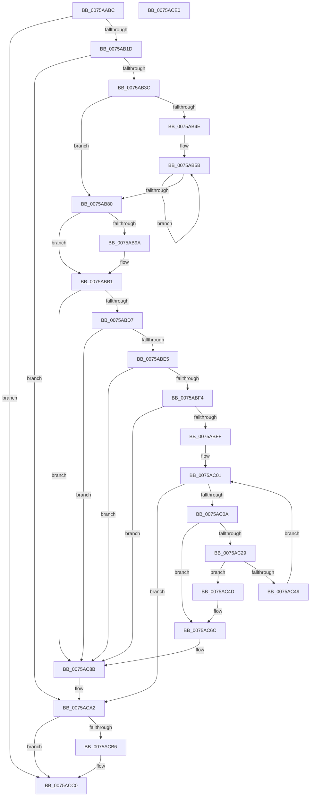

# PopPluginQuerySocSubsystemMetadata

- RVA: `0x0075AABC`–`0x0075ACE1` (길이 `549` bytes)
- VA: `0x000000014075AABC`
- 실행 섹션: `PAGE`
- PDB 이름 있음: `예`; PDB Function 태그: `아니요`
- unwind 정보 RVA: `0x000C4928`
- 디코드: `146`개 명령, `549/549` bytes 표시
- 미해석 바이트: `0` (있으면 어셈블리에 `.byte`로 보존)

> 이 문서는 커널 이미지의 기계어와 PDB 기호를 분석해 생성했습니다. 4번과 5번은 함수 원형과 자료형을 바이너리 사용 방식에서 추정한 C 해석이며 원본 소스 복구 결과는 아닙니다.

## 1. Dependencies

- 직접 호출 지점: **12**; 고유 호출 대상: **6**
- 직접 호출자로 확인된 함수: **1**
- RIP 상대 이미지 참조: **1**

### Outgoing calls
- `0x0075AB0C` → [ExAllocatePool2](../../poolcode/B8/ExAllocatePool2_function_00B820F0.md) (function, `0x00B820F0`)
- `0x0075AB2B` → [ExAllocatePool2](../../poolcode/B8/ExAllocatePool2_function_00B820F0.md) (function, `0x00B820F0`)
- `0x0075AB8E` → [guard_dispatch_icall](../../text/6B/guard_dispatch_icall_function_006BAAD0.md) (function, `0x006BAAD0`)
- `0x0075ABAB` → [PopFxBugCheck](../../text/2B/PopFxBugCheck_function_002BFC6C.md) (function, `0x002BFC6C`)
- `0x0075ABBF` → [RtlHashUnicodeString](../97/RtlHashUnicodeString_function_0097A780.md) (function, `0x0097A780`)
- `0x0075AC20` → [PopFxValidateReturnedUnicodeString](PopFxValidateReturnedUnicodeString_function_0075A708.md) (function, `0x0075A708`)
- `0x0075AC3D` → [PopFxValidateReturnedUnicodeString](PopFxValidateReturnedUnicodeString_function_0075A708.md) (function, `0x0075A708`)
- `0x0075AC66` → [PopFxBugCheck](../../text/2B/PopFxBugCheck_function_002BFC6C.md) (function, `0x002BFC6C`)
- `0x0075AC85` → [PopFxBugCheck](../../text/2B/PopFxBugCheck_function_002BFC6C.md) (function, `0x002BFC6C`)
- `0x0075AC9C` → [PopFxBugCheck](../../text/2B/PopFxBugCheck_function_002BFC6C.md) (function, `0x002BFC6C`)
- `0x0075ACAC` → [ExFreePoolWithTag](../../poolcode/B8/ExFreePoolWithTag_function_00B82870.md) (function, `0x00B82870`)
- `0x0075ACBB` → [ExFreePoolWithTag](../../poolcode/B8/ExFreePoolWithTag_function_00B82870.md) (function, `0x00B82870`)

### Direct callers
- [PopFxLogSocSubsystemMetadata](../97/PopFxLogSocSubsystemMetadata_function_0097AC1C.md) at `0x0097AD88`

### Static image references
- `0x0075AAE3` → RVA `0x00E676B8` (`.data`; read)

## 2. Other-region calls and transfers

- 다른 실행 섹션으로 향하는 call: **9**
  - `0x0075AB0C` → [ExAllocatePool2](../../poolcode/B8/ExAllocatePool2_function_00B820F0.md) (`PAGE` → `POOLCODE`)
  - `0x0075AB2B` → [ExAllocatePool2](../../poolcode/B8/ExAllocatePool2_function_00B820F0.md) (`PAGE` → `POOLCODE`)
  - `0x0075AB8E` → [guard_dispatch_icall](../../text/6B/guard_dispatch_icall_function_006BAAD0.md) (`PAGE` → `.text`)
  - `0x0075ABAB` → [PopFxBugCheck](../../text/2B/PopFxBugCheck_function_002BFC6C.md) (`PAGE` → `.text`)
  - `0x0075AC66` → [PopFxBugCheck](../../text/2B/PopFxBugCheck_function_002BFC6C.md) (`PAGE` → `.text`)
  - `0x0075AC85` → [PopFxBugCheck](../../text/2B/PopFxBugCheck_function_002BFC6C.md) (`PAGE` → `.text`)
  - `0x0075AC9C` → [PopFxBugCheck](../../text/2B/PopFxBugCheck_function_002BFC6C.md) (`PAGE` → `.text`)
  - `0x0075ACAC` → [ExFreePoolWithTag](../../poolcode/B8/ExFreePoolWithTag_function_00B82870.md) (`PAGE` → `POOLCODE`)
  - `0x0075ACBB` → [ExFreePoolWithTag](../../poolcode/B8/ExFreePoolWithTag_function_00B82870.md) (`PAGE` → `POOLCODE`)
- 별도 외부 분기/꼬리 이동을 확인하지 못했습니다.

## 3. Assembly (complete function range)

```asm
0075AABC  48 8B C4                        mov rax, rsp
0075AABF  48 89 58 10                     mov qword ptr [rax + 0x10], rbx
0075AAC3  48 89 68 18                     mov qword ptr [rax + 0x18], rbp
0075AAC7  48 89 70 20                     mov qword ptr [rax + 0x20], rsi
0075AACB  48 89 48 08                     mov qword ptr [rax + 8], rcx
0075AACF  57                              push rdi
0075AAD0  41 54                           push r12
0075AAD2  41 55                           push r13
0075AAD4  41 56                           push r14
0075AAD6  41 57                           push r15
0075AAD8  48 83 EC 30                     sub rsp, 0x30
0075AADC  45 8B 60 1C                     mov r12d, dword ptr [r8 + 0x1c]
0075AAE0  49 8B D8                        mov rbx, r8
0075AAE3  48 8B 2D CE CB 70 00            mov rbp, qword ptr [rip + 0x70cbce]
0075AAEA  44 8B EA                        mov r13d, edx
0075AAED  83 60 08 00                     and dword ptr [rax + 8], 0
0075AAF1  41 8B FC                        mov edi, r12d
0075AAF4  48 C1 E7 04                     shl rdi, 4
0075AAF8  41 B8 50 46 58 4D               mov r8d, 0x4d584650
0075AAFE  48 8B D7                        mov rdx, rdi
0075AB01  B9 00 01 00 00                  mov ecx, 0x100
0075AB06  45 32 F6                        xor r14b, r14b
0075AB09  41 8B F4                        mov esi, r12d
0075AB0C  E8 DF 75 42 00                  call 0x140b820f0
0075AB11  4C 8B F8                        mov r15, rax
0075AB14  48 85 C0                        test rax, rax
0075AB17  0F 84 A3 01 00 00               je 0x14075acc0
0075AB1D  41 B8 50 46 58 4D               mov r8d, 0x4d584650
0075AB23  48 8B D7                        mov rdx, rdi
0075AB26  B9 00 01 00 00                  mov ecx, 0x100
0075AB2B  E8 C0 75 42 00                  call 0x140b820f0
0075AB30  48 8B F8                        mov rdi, rax
0075AB33  48 85 C0                        test rax, rax
0075AB36  0F 84 66 01 00 00               je 0x14075aca2
0075AB3C  48 8B 43 10                     mov rax, qword ptr [rbx + 0x10]
0075AB40  0F 10 00                        movups xmm0, xmmword ptr [rax]
0075AB43  F3 0F 7F 44 24 20               movdqu xmmword ptr [rsp + 0x20], xmm0
0075AB49  45 85 E4                        test r12d, r12d
0075AB4C  74 32                           je 0x14075ab80
0075AB4E  4D 8B C7                        mov r8, r15
0075AB51  48 8D 53 20                     lea rdx, [rbx + 0x20]
0075AB55  4C 2B C7                        sub r8, rdi
0075AB58  48 8B CF                        mov rcx, rdi
0075AB5B  48 8B 02                        mov rax, qword ptr [rdx]
0075AB5E  0F 10 00                        movups xmm0, xmmword ptr [rax]
0075AB61  F3 41 0F 7F 04 08               movdqu xmmword ptr [r8 + rcx], xmm0
0075AB67  48 8B 02                        mov rax, qword ptr [rdx]
0075AB6A  48 8D 52 08                     lea rdx, [rdx + 8]
0075AB6E  0F 10 48 10                     movups xmm1, xmmword ptr [rax + 0x10]
0075AB72  F3 0F 7F 09                     movdqu xmmword ptr [rcx], xmm1
0075AB76  48 8D 49 10                     lea rcx, [rcx + 0x10]
0075AB7A  48 83 EE 01                     sub rsi, 1
0075AB7E  75 DB                           jne 0x14075ab5b
0075AB80  48 8B 45 60                     mov rax, qword ptr [rbp + 0x60]
0075AB84  BE 28 00 00 00                  mov esi, 0x28
0075AB89  8B CE                           mov ecx, esi
0075AB8B  48 8B D3                        mov rdx, rbx
0075AB8E  E8 3D FF F5 FF                  call 0x1406baad0
0075AB93  44 8A F0                        mov r14b, al
0075AB96  84 C0                           test al, al
0075AB98  75 17                           jne 0x14075abb1
0075AB9A  4C 8B 05 17 CB 70 00            mov r8, qword ptr [rip + 0x70cb17]
0075ABA1  45 33 C9                        xor r9d, r9d
0075ABA4  8B D6                           mov edx, esi
0075ABA6  B9 05 06 00 00                  mov ecx, 0x605
0075ABAB  E8 BC 50 B6 FF                  call 0x1402bfc6c
0075ABB0  CC                              int3
0075ABB1  48 8B 4B 10                     mov rcx, qword ptr [rbx + 0x10]
0075ABB5  4C 8D 4C 24 60                  lea r9, [rsp + 0x60]
0075ABBA  45 33 C0                        xor r8d, r8d
0075ABBD  33 D2                           xor edx, edx
0075ABBF  E8 BC FB 21 00                  call 0x14097a780
0075ABC4  48 8B 4B 10                     mov rcx, qword ptr [rbx + 0x10]
0075ABC8  0F B7 44 24 22                  movzx eax, word ptr [rsp + 0x22]
0075ABCD  66 39 41 02                     cmp word ptr [rcx + 2], ax
0075ABD1  0F 85 B4 00 00 00               jne 0x14075ac8b
0075ABD7  0F B7 44 24 20                  movzx eax, word ptr [rsp + 0x20]
0075ABDC  66 39 01                        cmp word ptr [rcx], ax
0075ABDF  0F 85 A6 00 00 00               jne 0x14075ac8b
0075ABE5  48 8B 44 24 28                  mov rax, qword ptr [rsp + 0x28]
0075ABEA  48 39 41 08                     cmp qword ptr [rcx + 8], rax
0075ABEE  0F 85 97 00 00 00               jne 0x14075ac8b
0075ABF4  44 39 6C 24 60                  cmp dword ptr [rsp + 0x60], r13d
0075ABF9  0F 85 8C 00 00 00               jne 0x14075ac8b
0075ABFF  33 F6                           xor esi, esi
0075AC01  41 3B F4                        cmp esi, r12d
0075AC04  0F 83 98 00 00 00               jae 0x14075aca2
0075AC0A  48 8B 4C F3 20                  mov rcx, qword ptr [rbx + rsi*8 + 0x20]
0075AC0F  44 8B F6                        mov r14d, esi
0075AC12  4D 03 F6                        add r14, r14
0075AC15  47 0F B7 44 F7 02               movzx r8d, word ptr [r15 + r14*8 + 2]
0075AC1B  4B 8B 54 F7 08                  mov rdx, qword ptr [r15 + r14*8 + 8]
0075AC20  E8 E3 FA FF FF                  call 0x14075a708
0075AC25  84 C0                           test al, al
0075AC27  74 43                           je 0x14075ac6c
0075AC29  48 8B 4C F3 20                  mov rcx, qword ptr [rbx + rsi*8 + 0x20]
0075AC2E  46 0F B7 44 F7 02               movzx r8d, word ptr [rdi + r14*8 + 2]
0075AC34  48 83 C1 10                     add rcx, 0x10
0075AC38  4A 8B 54 F7 08                  mov rdx, qword ptr [rdi + r14*8 + 8]
0075AC3D  E8 C6 FA FF FF                  call 0x14075a708
0075AC42  44 8A F0                        mov r14b, al
0075AC45  84 C0                           test al, al
0075AC47  74 04                           je 0x14075ac4d
0075AC49  FF C6                           inc esi
0075AC4B  EB B4                           jmp 0x14075ac01
0075AC4D  4C 8B 4C F3 20                  mov r9, qword ptr [rbx + rsi*8 + 0x20]
0075AC52  BA 28 00 00 00                  mov edx, 0x28
0075AC57  49 83 C1 18                     add r9, 0x18
0075AC5B  B9 06 07 00 00                  mov ecx, 0x706
0075AC60  41 B8 75 6C 61 56               mov r8d, 0x56616c75
0075AC66  E8 01 50 B6 FF                  call 0x1402bfc6c
0075AC6B  CC                              int3
0075AC6C  4C 8B 4C F3 20                  mov r9, qword ptr [rbx + rsi*8 + 0x20]
0075AC71  BA 28 00 00 00                  mov edx, 0x28
0075AC76  49 83 C1 08                     add r9, 8
0075AC7A  B9 06 07 00 00                  mov ecx, 0x706
0075AC7F  41 B8 20 79 65 4B               mov r8d, 0x4b657920
0075AC85  E8 E2 4F B6 FF                  call 0x1402bfc6c
0075AC8A  CC                              int3
0075AC8B  41 B9 6D 61 4E 53               mov r9d, 0x534e616d
0075AC91  4C 8B C6                        mov r8, rsi
0075AC94  48 8B D5                        mov rdx, rbp
0075AC97  B9 05 07 00 00                  mov ecx, 0x705
0075AC9C  E8 CB 4F B6 FF                  call 0x1402bfc6c
0075ACA1  CC                              int3
0075ACA2  BB 50 46 58 4D                  mov ebx, 0x4d584650
0075ACA7  49 8B CF                        mov rcx, r15
0075ACAA  8B D3                           mov edx, ebx
0075ACAC  E8 BF 7B 42 00                  call 0x140b82870
0075ACB1  48 85 FF                        test rdi, rdi
0075ACB4  74 0A                           je 0x14075acc0
0075ACB6  8B D3                           mov edx, ebx
0075ACB8  48 8B CF                        mov rcx, rdi
0075ACBB  E8 B0 7B 42 00                  call 0x140b82870
0075ACC0  48 8B 5C 24 68                  mov rbx, qword ptr [rsp + 0x68]
0075ACC5  41 8A C6                        mov al, r14b
0075ACC8  48 8B 6C 24 70                  mov rbp, qword ptr [rsp + 0x70]
0075ACCD  48 8B 74 24 78                  mov rsi, qword ptr [rsp + 0x78]
0075ACD2  48 83 C4 30                     add rsp, 0x30
0075ACD6  41 5F                           pop r15
0075ACD8  41 5E                           pop r14
0075ACDA  41 5D                           pop r13
0075ACDC  41 5C                           pop r12
0075ACDE  5F                              pop rdi
0075ACDF  C3                              ret
0075ACE0  CC                              int3
```

## 4. C-style interpretation (structured pseudocode)

```c
__int64 __fastcall PopPluginQuerySocSubsystemMetadata(__int64 a1, int a2, __int64 a3, int a4)
{
    __int64 result;
    __int64 v_r14;
    __int64 v_rdi;
    __int64 v_rsi;
    __int64 v_rsp;
    unsigned __int64 v_stack_m30;
    unsigned __int16 v_stack_m36;
    unsigned __int64 v_stack_m38;
    unsigned __int64 v_stack_p10;
    unsigned __int64 v_stack_p18;
    unsigned __int64 v_stack_p20;
    unsigned __int64 v_stack_p8;

    *(unsigned __int64 *)(v_rsp + 16) = v_rbx;
    *(unsigned __int64 *)(v_rsp + 24) = v_rbp;
    *(unsigned __int64 *)(v_rsp + 32) = v_rsi;
    *(unsigned __int64 *)(v_rsp + 8) = a1;
    v_rsp = (v_rsp) - (48);
    v_rdi = ((unsigned int)((unsigned int)((unsigned int)(*(unsigned int *)(a3 + 28))))) << (4);
    v_r14 = 0;
    result = ExAllocatePool2(256, v_rdi, (unsigned int)(0x4D584650ULL), a4);
    if (result == 0) goto loc_0075ACC0;
    result = ExAllocatePool2(256, v_rdi, (unsigned int)(0x4D584650ULL), a4);
    if (result == 0) goto loc_0075ACA2;
    v_stack_m38 = v_xmm0;
    if ((unsigned int)((unsigned int)(*(unsigned int *)(a3 + 28))) == 0) goto loc_0075AB80;
    a3 = (result) - (result);
loc_0075AB5B:
    *(unsigned __int64 *)(a3 + result * 1) = v_xmm0;
    *(unsigned __int64 *)(result) = v_xmm1;
    v_rsi = ((unsigned int)((unsigned int)((unsigned int)(*(unsigned int *)(a3 + 28))))) - (1);
    if (condition_is_not_equal) goto loc_0075AB5B;
loc_0075AB80:
    result = guard_dispatch_icall(40, a3, a3, a4);
    if ((unsigned __int8)(result) == 0) {
        a3 = *(unsigned __int64 *)(v_rip + 7392023);
        a4 = 0;
        a2 = 40;
        a1 = 0x605ULL;
        result = PopFxBugCheck(a1, a2, a3, a4);
    }
    a3 = 0;
    a2 = 0;
    result = RtlHashUnicodeString(*(unsigned __int64 *)(a3 + 16), a2, a3, v_stack_p8);
    if ((*(unsigned __int16 *)(*(unsigned __int64 *)(a3 + 16) + 2)) != ((unsigned __int16)(v_stack_m36))) goto loc_0075AC8B;
    if ((*(unsigned __int16 *)(*(unsigned __int64 *)(a3 + 16))) != ((unsigned __int16)(v_stack_m38))) goto loc_0075AC8B;
    if ((*(unsigned __int64 *)(*(unsigned __int64 *)(a3 + 16) + 8)) != v_stack_m30) goto loc_0075AC8B;
    if (v_stack_p8 != ((unsigned int)((unsigned int)(a2)))) goto loc_0075AC8B;
    v_rsi = 0;
loc_0075AC01:
    if (0 >= ((unsigned int)((unsigned int)(*(unsigned int *)(a3 + 28))))) goto loc_0075ACA2;
    v_r14 = (0) + (0);
    result = PopFxValidateReturnedUnicodeString(*(unsigned __int64 *)(a3 + v_rsi * 8 + 32), *(unsigned __int64 *)(result + v_r14 * 8 + 8), *(unsigned __int16 *)(result + v_r14 * 8 + 2), v_stack_p8);
    if ((unsigned __int8)(result) == 0) goto loc_0075AC6C;
    a1 = (*(unsigned __int64 *)(a3 + v_rsi * 8 + 32)) + (16);
    result = PopFxValidateReturnedUnicodeString(a1, *(unsigned __int64 *)(result + v_r14 * 8 + 8), *(unsigned __int16 *)(result + v_r14 * 8 + 2), v_stack_p8);
    if ((unsigned __int8)(result) == 0) goto loc_0075AC4D;
    v_rsi = (unsigned int)((v_rsi) + 1);
    goto loc_0075AC01;
loc_0075AC4D:
    a4 = (*(unsigned __int64 *)(a3 + v_rsi * 8 + 32)) + (24);
    result = PopFxBugCheck((unsigned int)(0x706ULL), 40, (unsigned int)(0x56616C75ULL), a4);
loc_0075AC6C:
    a4 = (*(unsigned __int64 *)(a3 + v_rsi * 8 + 32)) + (8);
    result = PopFxBugCheck((unsigned int)(0x706ULL), 40, (unsigned int)(0x4B657920ULL), a4);
loc_0075AC8B:
    result = PopFxBugCheck((unsigned int)(0x705ULL), *(unsigned __int64 *)(v_rip + 7392206), v_rsi, (unsigned int)(0x534E616DULL));
loc_0075ACA2:
    result = ExFreePoolWithTag(result, (unsigned int)((unsigned int)((unsigned int)(0x4D584650ULL))), v_rsi, (unsigned int)(0x534E616DULL));
    if (result != 0) {
        a2 = (unsigned int)((unsigned int)(0x4D584650ULL));
        a1 = result;
        result = ExFreePoolWithTag(a1, a2, v_rsi, (unsigned int)(0x534E616DULL));
    }
    v_rsp = (v_rsp) + (48);
    return (unsigned __int8)((unsigned __int8)(result));
}
```

## 5. (Beta) C Style

```c
int64_t PopPluginQuerySocSubsystemMetadata(int64_t Arg1, int32_t Arg2, void *Arg3, int32_t Arg4)
{
    uint8_t *arg3 = (uint8_t *)Arg3;

    int64_t result;
    int64_t local_r14;
    int64_t local_rdi;
    int64_t local_rsi;
    int64_t local_rsp;
    uint64_t v_stack_m30;
    uint16_t v_stack_m36;
    uint64_t v_stack_m38;
    uint64_t v_stack_p10;
    uint64_t v_stack_p18;
    uint64_t v_stack_p20;
    uint64_t v_stack_p8;

    *(uint64_t *)(local_rsp + 0x10) = local_rbx;
    *(uint64_t *)(local_rsp + 0x18) = local_rbp;
    *(uint64_t *)(local_rsp + 0x20) = local_rsi;
    *(uint64_t *)(local_rsp + 0x8) = Arg1;
    local_rsp = (local_rsp) - (48);
    local_rdi = ((uint32_t)((uint32_t)((uint32_t)(*(uint32_t *)(arg3 + 0x1C))))) << (4);
    local_r14 = 0;
    result = ExAllocatePool2(256, local_rdi, (uint32_t)(0x4D584650ULL), Arg4);
    if (result == 0) goto loc_0075ACC0;
    result = ExAllocatePool2(256, local_rdi, (uint32_t)(0x4D584650ULL), Arg4);
    if (result == 0) goto loc_0075ACA2;
    v_stack_m38 = v_xmm0;
    if ((uint32_t)((uint32_t)(*(uint32_t *)(arg3 + 0x1C))) == 0) goto loc_0075AB80;
    Arg3 = (result) - (result);
loc_0075AB5B:
    *(uint64_t *)(arg3 + result * 1) = v_xmm0;
    *(uint64_t *)(result) = v_xmm1;
    local_rsi = ((uint32_t)((uint32_t)((uint32_t)(*(uint32_t *)(arg3 + 0x1C))))) - (1);
    if (condition_is_not_equal) goto loc_0075AB5B;
loc_0075AB80:
    result = guard_dispatch_icall(40, Arg3, Arg3, Arg4);
    if ((uint8_t)(result) == 0) {
        Arg3 = *(uint64_t *)(v_rip + 0x70CB17);
        Arg4 = 0;
        Arg2 = 40;
        Arg1 = 0x605ULL;
        result = PopFxBugCheck(Arg1, Arg2, Arg3, Arg4);
    }
    Arg3 = 0;
    Arg2 = 0;
    result = RtlHashUnicodeString(*(uint64_t *)(arg3 + 0x10), Arg2, Arg3, v_stack_p8);
    if ((*(uint16_t *)(*(uint64_t *)(arg3 + 0x10) + 0x2)) != ((uint16_t)(v_stack_m36))) goto loc_0075AC8B;
    if ((*(uint16_t *)(*(uint64_t *)(arg3 + 0x10))) != ((uint16_t)(v_stack_m38))) goto loc_0075AC8B;
    if ((*(uint64_t *)(*(uint64_t *)(arg3 + 0x10) + 0x8)) != v_stack_m30) goto loc_0075AC8B;
    if (v_stack_p8 != ((uint32_t)((uint32_t)(Arg2)))) goto loc_0075AC8B;
    local_rsi = 0;
loc_0075AC01:
    if (0 >= ((uint32_t)((uint32_t)(*(uint32_t *)(arg3 + 0x1C))))) goto loc_0075ACA2;
    local_r14 = (0) + (0);
    result = PopFxValidateReturnedUnicodeString(*(uint64_t *)(arg3 + local_rsi * 8 + 0x20), *(uint64_t *)(result + local_r14 * 8 + 0x8), *(uint16_t *)(result + local_r14 * 8 + 0x2), v_stack_p8);
    if ((uint8_t)(result) == 0) goto loc_0075AC6C;
    Arg1 = (*(uint64_t *)(arg3 + local_rsi * 8 + 0x20)) + (16);
    result = PopFxValidateReturnedUnicodeString(Arg1, *(uint64_t *)(result + local_r14 * 8 + 0x8), *(uint16_t *)(result + local_r14 * 8 + 0x2), v_stack_p8);
    if ((uint8_t)(result) == 0) goto loc_0075AC4D;
    local_rsi = (uint32_t)((local_rsi) + 1);
    goto loc_0075AC01;
loc_0075AC4D:
    Arg4 = (*(uint64_t *)(arg3 + local_rsi * 8 + 0x20)) + (24);
    result = PopFxBugCheck((uint32_t)(0x706ULL), 40, (uint32_t)(0x56616C75ULL), Arg4);
loc_0075AC6C:
    Arg4 = (*(uint64_t *)(arg3 + local_rsi * 8 + 0x20)) + (8);
    result = PopFxBugCheck((uint32_t)(0x706ULL), 40, (uint32_t)(0x4B657920ULL), Arg4);
loc_0075AC8B:
    result = PopFxBugCheck((uint32_t)(0x705ULL), *(uint64_t *)(v_rip + 0x70CBCE), local_rsi, (uint32_t)(0x534E616DULL));
loc_0075ACA2:
    result = ExFreePoolWithTag(result, (uint32_t)((uint32_t)((uint32_t)(0x4D584650ULL))), local_rsi, (uint32_t)(0x534E616DULL));
    if (result != 0) {
        Arg2 = (uint32_t)((uint32_t)(0x4D584650ULL));
        Arg1 = result;
        result = ExFreePoolWithTag(Arg1, Arg2, local_rsi, (uint32_t)(0x534E616DULL));
    }
    local_rsp = (local_rsp) + (48);
    return (uint8_t)((uint8_t)(result));
}
```

### 관측된 메모리 오프셋

구조체 형식이 확인되지 않은 접근은 인자 기준의 오프셋으로만 기록했습니다.

| 기준 인자 | 오프셋 표현 | 폭 (bit) | 접근 |
|---|---:|---:|---|
| `Arg3` | `+ 0x0` | `64` | `R` |
| `Arg3` | `+ 0x8` | `64` | `R` |
| `Arg3` | `+ 0x10` | `64` | `R` |
| `Arg3` | `+ 0x1C` | `32` | `R` |
| `Arg3` | `+ 0x20` | `64` | `R` |
| `Arg3` | `+ 0x20 + rsi*8` | `64` | `R` |

## 6. Execution-region graph

[열기: 2D/3D 그래프와 함수 탐색 컨트롤 패널](../../../control-panel.html?section=page&rva=0x0075AABC&view=graph)

- 2D 그래프는 위에서 아래로 흐르고, 3D 그래프는 빈 공간을 드래그해 회전합니다. Shift+드래그는 이동, 휠은 확대·축소, 함수 노드 선택은 대상 보고서 이동입니다.

### Static fallback


