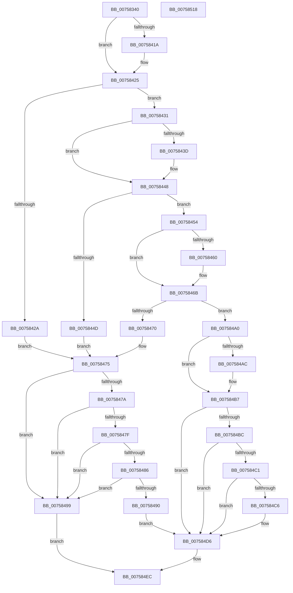

# PopPowerButtonSettingCallback

- RVA: `0x00758340`–`0x00758519` (길이 `473` bytes)
- VA: `0x0000000140758340`
- 실행 섹션: `PAGE`
- PDB 이름 있음: `예`; PDB Function 태그: `아니요`
- unwind 정보 RVA: `0x000BD760`
- 디코드: `122`개 명령, `473/473` bytes 표시
- 미해석 바이트: `0` (있으면 어셈블리에 `.byte`로 보존)

> 이 문서는 커널 이미지의 기계어와 PDB 기호를 분석해 생성했습니다. 4번과 5번은 함수 원형과 자료형을 바이너리 사용 방식에서 추정한 C 해석이며 원본 소스 복구 결과는 아닙니다.

## 1. Dependencies

- 직접 호출 지점: **4**; 고유 호출 대상: **4**
- 직접 호출자로 확인된 함수: **0**
- RIP 상대 이미지 참조: **10**

### Outgoing calls
- `0x0075836D` → [PopAcquirePolicyLock](../../pagelk/B7/PopAcquirePolicyLock_function_00B783C0.md) (function, `0x00B783C0`)
- `0x007584E5` → [PopApplyPolicy](../91/PopApplyPolicy_function_009107B0.md) (function, `0x009107B0`)
- `0x007584EC` → [PopReleasePolicyLock](../../pagelk/B7/PopReleasePolicyLock_function_00B78410.md) (function, `0x00B78410`)
- `0x007584FE` → [_security_check_cookie](../../text/6A/_security_check_cookie_function_006AC640.md) (function, `0x006AC640`)

### Direct callers
- 이 함수 시작 RVA로 연결되는 직접 call은 확인되지 않았습니다. 간접 호출은 완전히 역산할 수 없습니다.

### Static image references
- `0x00758352` → RVA `0x00E0A740` (`.data`; read)
- `0x00758372` → RVA `0x00F0CE68` (`.data`; read)
- `0x007583CA` → RVA `0x000246D8` (`.rdata`; read)
- `0x0075841A` → RVA `0x000246E0` (`.rdata`; read)
- `0x00758431` → RVA `0x00024D38` (`.rdata`; read)
- `0x0075843D` → RVA `0x00024D40` (`.rdata`; read)
- `0x00758454` → RVA `0x00024C18` (`.rdata`; read)
- `0x00758460` → RVA `0x00024C20` (`.rdata`; read)
- `0x007584A0` → RVA `0x00024688` (`.rdata`; read)
- `0x007584AC` → RVA `0x00024690` (`.rdata`; read)

## 2. Other-region calls and transfers

- 다른 실행 섹션으로 향하는 call: **3**
  - `0x0075836D` → [PopAcquirePolicyLock](../../pagelk/B7/PopAcquirePolicyLock_function_00B783C0.md) (`PAGE` → `PAGELK`)
  - `0x007584EC` → [PopReleasePolicyLock](../../pagelk/B7/PopReleasePolicyLock_function_00B78410.md) (`PAGE` → `PAGELK`)
  - `0x007584FE` → [_security_check_cookie](../../text/6A/_security_check_cookie_function_006AC640.md) (`PAGE` → `.text`)
- 별도 외부 분기/꼬리 이동을 확인하지 못했습니다.

## 3. Assembly (complete function range)

```asm
00758340  48 89 5C 24 08                  mov qword ptr [rsp + 8], rbx
00758345  48 89 74 24 18                  mov qword ptr [rsp + 0x18], rsi
0075834A  57                              push rdi
0075834B  48 81 EC 20 01 00 00            sub rsp, 0x120
00758352  48 8B 05 E7 23 6B 00            mov rax, qword ptr [rip + 0x6b23e7]
00758359  48 33 C4                        xor rax, rsp
0075835C  48 89 84 24 10 01 00 00         mov qword ptr [rsp + 0x110], rax
00758364  41 8B F0                        mov esi, r8d
00758367  48 8B FA                        mov rdi, rdx
0075836A  48 8B D9                        mov rbx, rcx
0075836D  E8 4E 00 42 00                  call 0x140b783c0
00758372  48 8B 05 EF 4A 7B 00            mov rax, qword ptr [rip + 0x7b4aef]
00758379  4C 8D 4C 24 20                  lea r9, [rsp + 0x20]
0075837E  B9 80 00 00 00                  mov ecx, 0x80
00758383  0F 10 00                        movups xmm0, xmmword ptr [rax]
00758386  0F 10 48 10                     movups xmm1, xmmword ptr [rax + 0x10]
0075838A  41 0F 11 01                     movups xmmword ptr [r9], xmm0
0075838E  0F 10 40 20                     movups xmm0, xmmword ptr [rax + 0x20]
00758392  41 0F 11 49 10                  movups xmmword ptr [r9 + 0x10], xmm1
00758397  0F 10 48 30                     movups xmm1, xmmword ptr [rax + 0x30]
0075839B  41 0F 11 41 20                  movups xmmword ptr [r9 + 0x20], xmm0
007583A0  0F 10 40 40                     movups xmm0, xmmword ptr [rax + 0x40]
007583A4  41 0F 11 49 30                  movups xmmword ptr [r9 + 0x30], xmm1
007583A9  0F 10 48 50                     movups xmm1, xmmword ptr [rax + 0x50]
007583AD  41 0F 11 41 40                  movups xmmword ptr [r9 + 0x40], xmm0
007583B2  0F 10 40 60                     movups xmm0, xmmword ptr [rax + 0x60]
007583B6  41 0F 11 49 50                  movups xmmword ptr [r9 + 0x50], xmm1
007583BB  41 0F 11 41 60                  movups xmmword ptr [r9 + 0x60], xmm0
007583C0  4C 03 C9                        add r9, rcx
007583C3  0F 10 40 70                     movups xmm0, xmmword ptr [rax + 0x70]
007583C7  48 03 C1                        add rax, rcx
007583CA  48 8B 0D 07 C3 8C FF            mov rcx, qword ptr [rip - 0x733cf9]
007583D1  41 0F 11 41 F0                  movups xmmword ptr [r9 - 0x10], xmm0
007583D6  0F 10 08                        movups xmm1, xmmword ptr [rax]
007583D9  0F 10 40 10                     movups xmm0, xmmword ptr [rax + 0x10]
007583DD  41 0F 11 09                     movups xmmword ptr [r9], xmm1
007583E1  0F 10 48 20                     movups xmm1, xmmword ptr [rax + 0x20]
007583E5  41 0F 11 41 10                  movups xmmword ptr [r9 + 0x10], xmm0
007583EA  0F 10 40 30                     movups xmm0, xmmword ptr [rax + 0x30]
007583EE  41 0F 11 49 20                  movups xmmword ptr [r9 + 0x20], xmm1
007583F3  0F 10 48 40                     movups xmm1, xmmword ptr [rax + 0x40]
007583F7  41 0F 11 41 30                  movups xmmword ptr [r9 + 0x30], xmm0
007583FC  0F 10 40 50                     movups xmm0, xmmword ptr [rax + 0x50]
00758400  48 8B 40 60                     mov rax, qword ptr [rax + 0x60]
00758404  41 0F 11 49 40                  movups xmmword ptr [r9 + 0x40], xmm1
00758409  41 0F 11 41 50                  movups xmmword ptr [r9 + 0x50], xmm0
0075840E  49 89 41 60                     mov qword ptr [r9 + 0x60], rax
00758412  48 8B 03                        mov rax, qword ptr [rbx]
00758415  48 2B C8                        sub rcx, rax
00758418  75 0B                           jne 0x140758425
0075841A  48 8B 0D BF C2 8C FF            mov rcx, qword ptr [rip - 0x733d41]
00758421  48 2B 4B 08                     sub rcx, qword ptr [rbx + 8]
00758425  48 85 C9                        test rcx, rcx
00758428  75 07                           jne 0x140758431
0075842A  48 8D 44 24 24                  lea rax, [rsp + 0x24]
0075842F  EB 44                           jmp 0x140758475
00758431  48 8B 0D 00 C9 8C FF            mov rcx, qword ptr [rip - 0x733700]
00758438  48 2B C8                        sub rcx, rax
0075843B  75 0B                           jne 0x140758448
0075843D  48 8B 0D FC C8 8C FF            mov rcx, qword ptr [rip - 0x733704]
00758444  48 2B 4B 08                     sub rcx, qword ptr [rbx + 8]
00758448  48 85 C9                        test rcx, rcx
0075844B  75 07                           jne 0x140758454
0075844D  48 8D 44 24 30                  lea rax, [rsp + 0x30]
00758452  EB 21                           jmp 0x140758475
00758454  48 8B 0D BD C7 8C FF            mov rcx, qword ptr [rip - 0x733843]
0075845B  48 2B C8                        sub rcx, rax
0075845E  75 0B                           jne 0x14075846b
00758460  48 8B 0D B9 C7 8C FF            mov rcx, qword ptr [rip - 0x733847]
00758467  48 2B 4B 08                     sub rcx, qword ptr [rbx + 8]
0075846B  48 85 C9                        test rcx, rcx
0075846E  75 30                           jne 0x1407584a0
00758470  48 8D 44 24 3C                  lea rax, [rsp + 0x3c]
00758475  83 FE 04                        cmp esi, 4
00758478  75 1F                           jne 0x140758499
0075847A  48 85 FF                        test rdi, rdi
0075847D  74 1A                           je 0x140758499
0075847F  8B 0F                           mov ecx, dword ptr [rdi]
00758481  83 F9 08                        cmp ecx, 8
00758484  77 13                           ja 0x140758499
00758486  BA 4D 01 00 00                  mov edx, 0x14d
0075848B  0F A3 CA                        bt edx, ecx
0075848E  73 09                           jae 0x140758499
00758490  48 83 60 04 00                  and qword ptr [rax + 4], 0
00758495  89 08                           mov dword ptr [rax], ecx
00758497  EB 3D                           jmp 0x1407584d6
00758499  BB 0D 00 00 C0                  mov ebx, 0xc000000d
0075849E  EB 4C                           jmp 0x1407584ec
007584A0  48 8B 0D E1 C1 8C FF            mov rcx, qword ptr [rip - 0x733e1f]
007584A7  48 2B C8                        sub rcx, rax
007584AA  75 0B                           jne 0x1407584b7
007584AC  48 8B 0D DD C1 8C FF            mov rcx, qword ptr [rip - 0x733e23]
007584B3  48 2B 4B 08                     sub rcx, qword ptr [rbx + 8]
007584B7  48 85 C9                        test rcx, rcx
007584BA  75 1A                           jne 0x1407584d6
007584BC  83 FE 04                        cmp esi, 4
007584BF  75 15                           jne 0x1407584d6
007584C1  48 85 FF                        test rdi, rdi
007584C4  74 10                           je 0x1407584d6
007584C6  8B 0F                           mov ecx, dword ptr [rdi]
007584C8  83 F9 07                        cmp ecx, 7
007584CB  8B 44 24 48                     mov eax, dword ptr [rsp + 0x48]
007584CF  0F 46 C1                        cmovbe eax, ecx
007584D2  89 44 24 48                     mov dword ptr [rsp + 0x48], eax
007584D6  41 B9 E8 00 00 00               mov r9d, 0xe8
007584DC  4C 8D 44 24 20                  lea r8, [rsp + 0x20]
007584E1  33 D2                           xor edx, edx
007584E3  B1 01                           mov cl, 1
007584E5  E8 C6 82 1B 00                  call 0x1409107b0
007584EA  8B D8                           mov ebx, eax
007584EC  E8 1F FF 41 00                  call 0x140b78410
007584F1  8B C3                           mov eax, ebx
007584F3  48 8B 8C 24 10 01 00 00         mov rcx, qword ptr [rsp + 0x110]
007584FB  48 33 CC                        xor rcx, rsp
007584FE  E8 3D 41 F5 FF                  call 0x1406ac640
00758503  4C 8D 9C 24 20 01 00 00         lea r11, [rsp + 0x120]
0075850B  49 8B 5B 10                     mov rbx, qword ptr [r11 + 0x10]
0075850F  49 8B 73 20                     mov rsi, qword ptr [r11 + 0x20]
00758513  49 8B E3                        mov rsp, r11
00758516  5F                              pop rdi
00758517  C3                              ret
00758518  CC                              int3
```

## 4. C-style interpretation (structured pseudocode)

```c
__int64 __fastcall PopPowerButtonSettingCallback(__int64 a1, __int64 a2, int a3)
{
    __int64 result;
    __int64 v_rsp;
    unsigned __int64 v_stack_m104;
    unsigned __int64 v_stack_m108;
    unsigned __int64 v_stack_m18;
    unsigned __int64 v_stack_m8;
    unsigned int v_stack_mE0;
    unsigned __int64 v_stack_mEC;
    unsigned __int64 v_stack_mF8;
    unsigned __int64 v_stack_p18;
    unsigned __int64 v_stack_p8;

    v_stack_p8 = v_rbx;
    v_stack_p18 = v_rsi;
    v_rsp = (v_rsp) - (288);
    result = (*(unsigned __int64 *)(v_rip + 7021543)) ^ (v_rsp);
    v_stack_m18 = result;
    result = PopAcquirePolicyLock(a1, a2, a3, a4);
    *(unsigned __int64 *)(v_stack_m108) = v_xmm0;
    *(unsigned __int64 *)(v_stack_m108 + 16) = v_xmm1;
    *(unsigned __int64 *)(v_stack_m108 + 32) = v_xmm0;
    *(unsigned __int64 *)(v_stack_m108 + 48) = v_xmm1;
    *(unsigned __int64 *)(v_stack_m108 + 64) = v_xmm0;
    *(unsigned __int64 *)(v_stack_m108 + 80) = v_xmm1;
    *(unsigned __int64 *)(v_stack_m108 + 96) = v_xmm0;
    a4 = (v_stack_m108) + (128);
    result = (*(unsigned __int64 *)(v_rip + 8080111)) + (128);
    *(unsigned __int64 *)(a4 - 16) = v_xmm0;
    *(unsigned __int64 *)(a4) = v_xmm1;
    *(unsigned __int64 *)(a4 + 16) = v_xmm0;
    *(unsigned __int64 *)(a4 + 32) = v_xmm1;
    *(unsigned __int64 *)(a4 + 48) = v_xmm0;
    *(unsigned __int64 *)(a4 + 64) = v_xmm1;
    *(unsigned __int64 *)(a4 + 80) = v_xmm0;
    *(unsigned __int64 *)(a4 + 96) = *(unsigned __int64 *)(result + 96);
    a1 = (*(unsigned __int64 *)(v_rip - 7552249)) - (*(unsigned __int64 *)(a1));
    if (!(condition_is_not_equal)) {
        a1 = *(unsigned __int64 *)(v_rip - 7552321);
        a1 = (a1) - (*(unsigned __int64 *)(a1 + 8));
    }
    if (a1 != 0) goto loc_00758431;
    goto loc_00758475;
loc_00758431:
    a1 = (*(unsigned __int64 *)(v_rip - 7550720)) - (v_stack_m104);
    if (!(condition_is_not_equal)) {
        a1 = *(unsigned __int64 *)(v_rip - 7550724);
        a1 = (a1) - (*(unsigned __int64 *)(a1 + 8));
    }
    if (a1 != 0) goto loc_00758454;
    goto loc_00758475;
loc_00758454:
    a1 = (*(unsigned __int64 *)(v_rip - 7551043)) - (v_stack_mF8);
    if (!(condition_is_not_equal)) {
        a1 = *(unsigned __int64 *)(v_rip - 7551047);
        a1 = (a1) - (*(unsigned __int64 *)(a1 + 8));
    }
    if (a1 != 0) goto loc_007584A0;
loc_00758475:
    if (((unsigned int)((unsigned int)(a3))) != 4) goto loc_00758499;
    if (a2 == 0) goto loc_00758499;
    if (((unsigned int)((unsigned int)(*(unsigned int *)(a2)))) > 8) goto loc_00758499;
    if (((unsigned int)((unsigned int)(*(unsigned int *)(a2)))) >= 8) goto loc_00758499;
    *(unsigned int *)(v_stack_mEC) = (unsigned int)((unsigned int)(*(unsigned int *)(a2)));
    goto loc_007584D6;
loc_00758499:
    goto loc_007584EC;
loc_007584A0:
    a1 = (*(unsigned __int64 *)(v_rip - 7552543)) - (v_stack_mEC);
    if (!(condition_is_not_equal)) {
        a1 = *(unsigned __int64 *)(v_rip - 7552547);
        a1 = (a1) - (*(unsigned __int64 *)((unsigned int)(0xC000000DULL) + 8));
    }
    if (a1 != 0) goto loc_007584D6;
    if (((unsigned int)((unsigned int)(a3))) != 4) goto loc_007584D6;
    result = v_stack_mEC;
    if (a2 != 0) {
        a1 = *(unsigned int *)(a2);
        result = v_stack_mE0;
        if (((unsigned int)(a1)) <= 7) { result = (unsigned int)(a1); }
        v_stack_mE0 = (unsigned int)(result);
    }
    a2 = 0;
    result = PopApplyPolicy(1, a2, v_stack_m108, 232);
loc_007584EC:
    result = PopReleasePolicyLock(1, a2, v_stack_m108, 232);
    a1 = (v_stack_m18) ^ (v_rsp);
    result = _security_check_cookie(a1, a2, v_stack_m108, 232);
    return result;
}
```

## 5. (Beta) C Style

```c
int64_t PopPowerButtonSettingCallback(void *Arg1, int64_t Arg2, int32_t Arg3)
{
    uint8_t *arg1 = (uint8_t *)Arg1;

    int64_t result;
    int64_t local_rsp;
    uint64_t v_stack_m104;
    uint64_t v_stack_m108;
    uint64_t v_stack_m18;
    uint64_t v_stack_m8;
    uint32_t v_stack_mE0;
    uint64_t v_stack_mEC;
    uint64_t v_stack_mF8;
    uint64_t v_stack_p18;
    uint64_t v_stack_p8;

    v_stack_p8 = local_rbx;
    v_stack_p18 = local_rsi;
    local_rsp = (local_rsp) - (288);
    result = (*(uint64_t *)(v_rip + 0x6B23E7)) ^ (local_rsp);
    v_stack_m18 = result;
    result = PopAcquirePolicyLock(Arg1, Arg2, Arg3, a4);
    *(uint64_t *)(v_stack_m108) = v_xmm0;
    *(uint64_t *)(v_stack_m108 + 0x10) = v_xmm1;
    *(uint64_t *)(v_stack_m108 + 0x20) = v_xmm0;
    *(uint64_t *)(v_stack_m108 + 0x30) = v_xmm1;
    *(uint64_t *)(v_stack_m108 + 0x40) = v_xmm0;
    *(uint64_t *)(v_stack_m108 + 0x50) = v_xmm1;
    *(uint64_t *)(v_stack_m108 + 0x60) = v_xmm0;
    a4 = (v_stack_m108) + (128);
    result = (*(uint64_t *)(v_rip + 0x7B4AEF)) + (128);
    *(uint64_t *)(a4 - 0x10) = v_xmm0;
    *(uint64_t *)(a4) = v_xmm1;
    *(uint64_t *)(a4 + 0x10) = v_xmm0;
    *(uint64_t *)(a4 + 0x20) = v_xmm1;
    *(uint64_t *)(a4 + 0x30) = v_xmm0;
    *(uint64_t *)(a4 + 0x40) = v_xmm1;
    *(uint64_t *)(a4 + 0x50) = v_xmm0;
    *(uint64_t *)(a4 + 0x60) = *(uint64_t *)(result + 0x60);
    Arg1 = (*(uint64_t *)(v_rip - 0x733CF9)) - (*(uint64_t *)(arg1));
    if (!(condition_is_not_equal)) {
        Arg1 = *(uint64_t *)(v_rip - 0x733D41);
        Arg1 = (Arg1) - (*(uint64_t *)(arg1 + 0x8));
    }
    if (Arg1 != NULL) goto loc_00758431;
    goto loc_00758475;
loc_00758431:
    Arg1 = (*(uint64_t *)(v_rip - 0x733700)) - (v_stack_m104);
    if (!(condition_is_not_equal)) {
        Arg1 = *(uint64_t *)(v_rip - 0x733704);
        Arg1 = (Arg1) - (*(uint64_t *)(arg1 + 0x8));
    }
    if (Arg1 != NULL) goto loc_00758454;
    goto loc_00758475;
loc_00758454:
    Arg1 = (*(uint64_t *)(v_rip - 0x733843)) - (v_stack_mF8);
    if (!(condition_is_not_equal)) {
        Arg1 = *(uint64_t *)(v_rip - 0x733847);
        Arg1 = (Arg1) - (*(uint64_t *)(arg1 + 0x8));
    }
    if (Arg1 != NULL) goto loc_007584A0;
loc_00758475:
    if (((uint32_t)((uint32_t)(Arg3))) != 4) goto loc_00758499;
    if (Arg2 == 0) goto loc_00758499;
    if (((uint32_t)((uint32_t)(*(uint32_t *)(Arg2)))) > 8) goto loc_00758499;
    if (((uint32_t)((uint32_t)(*(uint32_t *)(Arg2)))) >= 8) goto loc_00758499;
    *(uint32_t *)(v_stack_mEC) = (uint32_t)((uint32_t)(*(uint32_t *)(Arg2)));
    goto loc_007584D6;
loc_00758499:
    goto loc_007584EC;
loc_007584A0:
    Arg1 = (*(uint64_t *)(v_rip - 0x733E1F)) - (v_stack_mEC);
    if (!(condition_is_not_equal)) {
        Arg1 = *(uint64_t *)(v_rip - 0x733E23);
        Arg1 = (Arg1) - (*(uint64_t *)((uint32_t)(0xC000000DULL) + 0x8));
    }
    if (Arg1 != NULL) goto loc_007584D6;
    if (((uint32_t)((uint32_t)(Arg3))) != 4) goto loc_007584D6;
    result = v_stack_mEC;
    if (Arg2 != 0) {
        Arg1 = *(uint32_t *)(Arg2);
        result = v_stack_mE0;
        if (((uint32_t)(Arg1)) <= 7) { result = (uint32_t)(Arg1); }
        v_stack_mE0 = (uint32_t)(result);
    }
    Arg2 = 0;
    result = PopApplyPolicy(1, Arg2, v_stack_m108, 232);
loc_007584EC:
    result = PopReleasePolicyLock(1, Arg2, v_stack_m108, 232);
    Arg1 = (v_stack_m18) ^ (local_rsp);
    result = _security_check_cookie(Arg1, Arg2, v_stack_m108, 232);
    return result;
}
```

### 관측된 메모리 오프셋

구조체 형식이 확인되지 않은 접근은 인자 기준의 오프셋으로만 기록했습니다.

| 기준 인자 | 오프셋 표현 | 폭 (bit) | 접근 |
|---|---:|---:|---|
| `Arg1` | `+ 0x0` | `64` | `R` |
| `Arg1` | `+ 0x8` | `64` | `R` |

## 6. Execution-region graph

[열기: 2D/3D 그래프와 함수 탐색 컨트롤 패널](../../../control-panel.html?section=page&rva=0x00758340&view=graph)

- 2D 그래프는 위에서 아래로 흐르고, 3D 그래프는 빈 공간을 드래그해 회전합니다. Shift+드래그는 이동, 휠은 확대·축소, 함수 노드 선택은 대상 보고서 이동입니다.

### Static fallback


