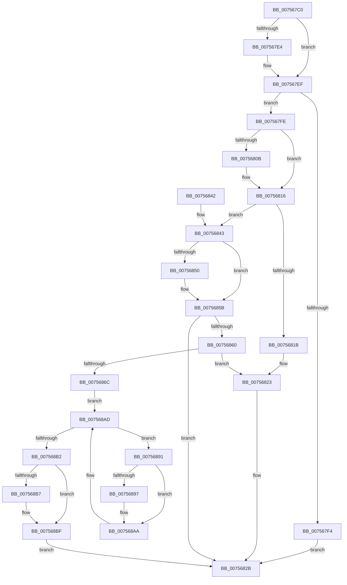

# PopPowerLimitPnpNotification

- RVA: `0x007567C0`–`0x007568CD` (길이 `269` bytes)
- VA: `0x00000001407567C0`
- 실행 섹션: `PAGE`
- PDB 이름 있음: `예`; PDB Function 태그: `아니요`
- unwind 정보 RVA: `0x000CBFE0`
- 디코드: `71`개 명령, `269/269` bytes 표시
- 미해석 바이트: `0` (있으면 어셈블리에 `.byte`로 보존)

> 이 문서는 커널 이미지의 기계어와 PDB 기호를 분석해 생성했습니다. 4번과 5번은 함수 원형과 자료형을 바이너리 사용 방식에서 추정한 C 해석이며 원본 소스 복구 결과는 아닙니다.

## 1. Dependencies

- 직접 호출 지점: **9**; 고유 호출 대상: **8**
- 직접 호출자로 확인된 함수: **0**
- RIP 상대 이미지 참조: **8**

### Outgoing calls
- `0x007567F7` → [PopDisablePowerLimitExtension](PopDisablePowerLimitExtension_function_00756148.md) (function, `0x00756148`)
- `0x0075681E` → [PopDisablePowerLimitExtension](PopDisablePowerLimitExtension_function_00756148.md) (function, `0x00756148`)
- `0x00756826` → [PopOrphanPowerLimitExtension](PopOrphanPowerLimitExtension_function_007566D8.md) (function, `0x007566D8`)
- `0x00756863` → [PopAcquirePowerLimitInterface](PopAcquirePowerLimitInterface_function_00755E10.md) (function, `0x00755E10`)
- `0x00756870` → [PopAcquireRwLockExclusive](../../text/43/PopAcquireRwLockExclusive_function_00430B44.md) (function, `0x00430B44`)
- `0x00756883` → [PopDiagTracePowerLimitExtension](../76/PopDiagTracePowerLimitExtension_function_0076233C.md) (function, `0x0076233C`)
- `0x007568A5` → [PopDiagTracePowerLimitRequest](../76/PopDiagTracePowerLimitRequest_function_007626D0.md) (function, `0x007626D0`)
- `0x007568BA` → [PopEvaluatePowerLimitChange](PopEvaluatePowerLimitChange_function_00756224.md) (function, `0x00756224`)
- `0x007568C3` → [PopReleaseRwLock](../../text/2D/PopReleaseRwLock_function_002DFBBC.md) (function, `0x002DFBBC`)

### Direct callers
- 이 함수 시작 RVA로 연결되는 직접 call은 확인되지 않았습니다. 간접 호출은 완전히 역산할 수 없습니다.

### Static image references
- `0x007567DB` → RVA `0x0001A210` (`.rdata`; read)
- `0x007567E8` → RVA `0x0001A218` (`.rdata`; read)
- `0x00756802` → RVA `0x0001A220` (`.rdata`; read)
- `0x0075680F` → RVA `0x0001A228` (`.rdata`; read)
- `0x00756847` → RVA `0x00012320` (`.rdata`; read)
- `0x00756854` → RVA `0x00012328` (`.rdata`; read)
- `0x00756875` → RVA `0x00022208` (`.rdata`; read)
- `0x00756897` → RVA `0x000232B0` (`.rdata`; read)

## 2. Other-region calls and transfers

- 다른 실행 섹션으로 향하는 call: **2**
  - `0x00756870` → [PopAcquireRwLockExclusive](../../text/43/PopAcquireRwLockExclusive_function_00430B44.md) (`PAGE` → `.text`)
  - `0x007568C3` → [PopReleaseRwLock](../../text/2D/PopReleaseRwLock_function_002DFBBC.md) (`PAGE` → `.text`)
- 별도 외부 분기/꼬리 이동을 확인하지 못했습니다.

## 3. Assembly (complete function range)

```asm
007567C0  48 89 5C 24 08                  mov qword ptr [rsp + 8], rbx
007567C5  48 89 6C 24 10                  mov qword ptr [rsp + 0x10], rbp
007567CA  48 89 74 24 18                  mov qword ptr [rsp + 0x18], rsi
007567CF  57                              push rdi
007567D0  48 83 EC 20                     sub rsp, 0x20
007567D4  48 8B 41 04                     mov rax, qword ptr [rcx + 4]
007567D8  48 8B DA                        mov rbx, rdx
007567DB  48 2B 05 2E 3A 8C FF            sub rax, qword ptr [rip - 0x73c5d2]
007567E2  75 0B                           jne 0x1407567ef
007567E4  48 8B 41 0C                     mov rax, qword ptr [rcx + 0xc]
007567E8  48 2B 05 29 3A 8C FF            sub rax, qword ptr [rip - 0x73c5d7]
007567EF  48 85 C0                        test rax, rax
007567F2  75 0A                           jne 0x1407567fe
007567F4  48 8B CB                        mov rcx, rbx
007567F7  E8 4C F9 FF FF                  call 0x140756148
007567FC  EB 2D                           jmp 0x14075682b
007567FE  48 8B 41 04                     mov rax, qword ptr [rcx + 4]
00756802  48 2B 05 17 3A 8C FF            sub rax, qword ptr [rip - 0x73c5e9]
00756809  75 0B                           jne 0x140756816
0075680B  48 8B 41 0C                     mov rax, qword ptr [rcx + 0xc]
0075680F  48 2B 05 12 3A 8C FF            sub rax, qword ptr [rip - 0x73c5ee]
00756816  48 85 C0                        test rax, rax
00756819  75 28                           jne 0x140756843
0075681B  48 8B CB                        mov rcx, rbx
0075681E  E8 25 F9 FF FF                  call 0x140756148
00756823  48 8B CB                        mov rcx, rbx
00756826  E8 AD FE FF FF                  call 0x1407566d8
0075682B  48 8B 5C 24 30                  mov rbx, qword ptr [rsp + 0x30]
00756830  33 C0                           xor eax, eax
00756832  48 8B 6C 24 38                  mov rbp, qword ptr [rsp + 0x38]
00756837  48 8B 74 24 40                  mov rsi, qword ptr [rsp + 0x40]
0075683C  48 83 C4 20                     add rsp, 0x20
00756840  5F                              pop rdi
00756841  C3                              ret
00756842  CC                              int3
00756843  48 8B 41 04                     mov rax, qword ptr [rcx + 4]
00756847  48 2B 05 D2 BA 8B FF            sub rax, qword ptr [rip - 0x74452e]
0075684E  75 0B                           jne 0x14075685b
00756850  48 8B 41 0C                     mov rax, qword ptr [rcx + 0xc]
00756854  48 2B 05 CD BA 8B FF            sub rax, qword ptr [rip - 0x744533]
0075685B  48 85 C0                        test rax, rax
0075685E  75 CB                           jne 0x14075682b
00756860  48 8B CB                        mov rcx, rbx
00756863  E8 A8 F5 FF FF                  call 0x140755e10
00756868  85 C0                           test eax, eax
0075686A  78 B7                           js 0x140756823
0075686C  48 8D 4B 20                     lea rcx, [rbx + 0x20]
00756870  E8 CF A2 CD FF                  call 0x140430b44
00756875  48 8D 15 8C B9 8C FF            lea rdx, [rip - 0x734674]
0075687C  C6 43 30 01                     mov byte ptr [rbx + 0x30], 1
00756880  48 8B CB                        mov rcx, rbx
00756883  E8 B4 BA 00 00                  call 0x14076233c
00756888  48 8D 73 10                     lea rsi, [rbx + 0x10]
0075688C  48 8B 3E                        mov rdi, qword ptr [rsi]
0075688F  EB 1C                           jmp 0x1407568ad
00756891  80 7F 10 01                     cmp byte ptr [rdi + 0x10], 1
00756895  74 13                           je 0x1407568aa
00756897  48 8D 15 12 CA 8C FF            lea rdx, [rip - 0x7335ee]
0075689E  C6 47 10 01                     mov byte ptr [rdi + 0x10], 1
007568A2  48 8B CF                        mov rcx, rdi
007568A5  E8 26 BE 00 00                  call 0x1407626d0
007568AA  48 8B 3F                        mov rdi, qword ptr [rdi]
007568AD  48 3B FE                        cmp rdi, rsi
007568B0  75 DF                           jne 0x140756891
007568B2  48 39 36                        cmp qword ptr [rsi], rsi
007568B5  74 08                           je 0x1407568bf
007568B7  48 8B CB                        mov rcx, rbx
007568BA  E8 65 F9 FF FF                  call 0x140756224
007568BF  48 8D 4B 20                     lea rcx, [rbx + 0x20]
007568C3  E8 F4 92 B8 FF                  call 0x1402dfbbc
007568C8  E9 5E FF FF FF                  jmp 0x14075682b
```

## 4. C-style interpretation (structured pseudocode)

```c
__int64 __fastcall PopPowerLimitPnpNotification(__int64 a1, __int64 a2)
{
    __int64 result;
    __int64 v_rsp;
    unsigned __int64 v_stack_p10;
    unsigned __int64 v_stack_p18;
    unsigned __int64 v_stack_p8;

    v_stack_p8 = v_rbx;
    v_stack_p10 = v_rbp;
    v_stack_p18 = v_rsi;
    v_rsp = (v_rsp) - (32);
    result = (*(unsigned __int64 *)(a1 + 4)) - (*(unsigned __int64 *)(v_rip - 7587282));
    if (!(condition_is_not_equal)) {
        result = *(unsigned __int64 *)(a1 + 12);
        result = (result) - (*(unsigned __int64 *)(v_rip - 7587287));
    }
    if (result != 0) goto loc_007567FE;
    result = PopDisablePowerLimitExtension(a2, a2, a3, a4);
    goto loc_0075682B;
loc_007567FE:
    result = (*(unsigned __int64 *)(a2 + 4)) - (*(unsigned __int64 *)(v_rip - 7587305));
    if (!(condition_is_not_equal)) {
        result = *(unsigned __int64 *)(a2 + 12);
        result = (result) - (*(unsigned __int64 *)(v_rip - 7587310));
    }
    if (result != 0) goto loc_00756843;
    result = PopDisablePowerLimitExtension(a2, a2, a3, a4);
loc_00756823:
    result = PopOrphanPowerLimitExtension(a2, a2, a3, a4);
loc_0075682B:
    result = 0;
    v_rsp = (v_rsp) + (32);
    return result;
loc_00756843:
    result = (*(unsigned __int64 *)(a2 + 4)) - (*(unsigned __int64 *)(v_rip - 7619886));
    if (!(condition_is_not_equal)) {
        result = *(unsigned __int64 *)(a2 + 12);
        result = (result) - (*(unsigned __int64 *)(v_rip - 7619891));
    }
    if (result != 0) goto loc_0075682B;
    result = PopAcquirePowerLimitInterface(v_stack_p8, a2, a3, a4);
    if (sign_flag) goto loc_00756823;
    result = PopAcquireRwLockExclusive(v_stack_p8 + 32, a2, a3, a4);
    *(unsigned __int8 *)(v_stack_p8 + 48) = 1;
    result = PopDiagTracePowerLimitExtension(v_stack_p8, v_rip - 7554676, a3, a4);
    goto loc_007568AD;
loc_00756891:
    if ((*(unsigned __int8 *)(*(unsigned __int64 *)(v_stack_p8 + 16) + 16)) != 1) {
        a2 = v_rip - 7550446;
        *(unsigned __int8 *)(*(unsigned __int64 *)(v_stack_p8 + 16) + 16) = 1;
        a1 = *(unsigned __int64 *)(v_stack_p8 + 16);
        result = PopDiagTracePowerLimitRequest(a1, a2, a3, a4);
    }
loc_007568AD:
    if ((*(unsigned __int64 *)(*(unsigned __int64 *)(v_stack_p8 + 16))) != (v_stack_p8 + 16)) goto loc_00756891;
    if ((*(unsigned __int64 *)(v_stack_p8 + 16)) != (v_stack_p8 + 16)) {
        a1 = v_stack_p8;
        result = PopEvaluatePowerLimitChange(a1, a2, a3, a4);
    }
    result = PopReleaseRwLock(v_stack_p8 + 32, a2, a3, a4);
    goto loc_0075682B;
}
```

## 5. (Beta) C Style

```c
int64_t PopPowerLimitPnpNotification(void *Arg1, void *Arg2)
{
    uint8_t *arg1 = (uint8_t *)Arg1;
    uint8_t *arg2 = (uint8_t *)Arg2;

    int64_t result;
    int64_t local_rsp;
    uint64_t v_stack_p10;
    uint64_t v_stack_p18;
    uint64_t v_stack_p8;

    v_stack_p8 = local_rbx;
    v_stack_p10 = local_rbp;
    v_stack_p18 = local_rsi;
    local_rsp = (local_rsp) - (32);
    result = (*(uint64_t *)(arg1 + 0x4)) - (*(uint64_t *)(v_rip - 0x73C5D2));
    if (!(condition_is_not_equal)) {
        result = *(uint64_t *)(arg1 + 0xC);
        result = (result) - (*(uint64_t *)(v_rip - 0x73C5D7));
    }
    if (result != 0) goto loc_007567FE;
    result = PopDisablePowerLimitExtension(Arg2, Arg2, a3, a4);
    goto loc_0075682B;
loc_007567FE:
    result = (*(uint64_t *)(arg2 + 0x4)) - (*(uint64_t *)(v_rip - 0x73C5E9));
    if (!(condition_is_not_equal)) {
        result = *(uint64_t *)(arg2 + 0xC);
        result = (result) - (*(uint64_t *)(v_rip - 0x73C5EE));
    }
    if (result != 0) goto loc_00756843;
    result = PopDisablePowerLimitExtension(Arg2, Arg2, a3, a4);
loc_00756823:
    result = PopOrphanPowerLimitExtension(Arg2, Arg2, a3, a4);
loc_0075682B:
    result = 0;
    local_rsp = (local_rsp) + (32);
    return result;
loc_00756843:
    result = (*(uint64_t *)(arg2 + 0x4)) - (*(uint64_t *)(v_rip - 0x74452E));
    if (!(condition_is_not_equal)) {
        result = *(uint64_t *)(arg2 + 0xC);
        result = (result) - (*(uint64_t *)(v_rip - 0x744533));
    }
    if (result != 0) goto loc_0075682B;
    result = PopAcquirePowerLimitInterface(v_stack_p8, Arg2, a3, a4);
    if (sign_flag) goto loc_00756823;
    result = PopAcquireRwLockExclusive(v_stack_p8 + 32, Arg2, a3, a4);
    *(uint8_t *)(v_stack_p8 + 0x30) = 1;
    result = PopDiagTracePowerLimitExtension(v_stack_p8, v_rip - 7554676, a3, a4);
    goto loc_007568AD;
loc_00756891:
    if ((*(uint8_t *)(*(uint64_t *)(v_stack_p8 + 0x10) + 0x10)) != 1) {
        Arg2 = v_rip - 7550446;
        *(uint8_t *)(*(uint64_t *)(v_stack_p8 + 0x10) + 0x10) = 1;
        Arg1 = *(uint64_t *)(v_stack_p8 + 0x10);
        result = PopDiagTracePowerLimitRequest(Arg1, Arg2, a3, a4);
    }
loc_007568AD:
    if ((*(uint64_t *)(*(uint64_t *)(v_stack_p8 + 0x10))) != (v_stack_p8 + 16)) goto loc_00756891;
    if ((*(uint64_t *)(v_stack_p8 + 0x10)) != (v_stack_p8 + 16)) {
        Arg1 = v_stack_p8;
        result = PopEvaluatePowerLimitChange(Arg1, Arg2, a3, a4);
    }
    result = PopReleaseRwLock(v_stack_p8 + 32, Arg2, a3, a4);
    goto loc_0075682B;
}
```

### 관측된 메모리 오프셋

구조체 형식이 확인되지 않은 접근은 인자 기준의 오프셋으로만 기록했습니다.

| 기준 인자 | 오프셋 표현 | 폭 (bit) | 접근 |
|---|---:|---:|---|
| `Arg1` | `+ 0x4` | `64` | `R` |
| `Arg1` | `+ 0xC` | `64` | `R` |
| `Arg2` | `+ 0x0` | `64` | `R` |
| `Arg2` | `+ 0x10` | `64` | `R` |
| `Arg2` | `+ 0x20` | `64` | `R` |
| `Arg2` | `+ 0x30` | `8` | `W` |

## 6. Execution-region graph

[열기: 2D/3D 그래프와 함수 탐색 컨트롤 패널](../../../control-panel.html?section=page&rva=0x007567C0&view=graph)

- 2D 그래프는 위에서 아래로 흐르고, 3D 그래프는 빈 공간을 드래그해 회전합니다. Shift+드래그는 이동, 휠은 확대·축소, 함수 노드 선택은 대상 보고서 이동입니다.

### Static fallback


