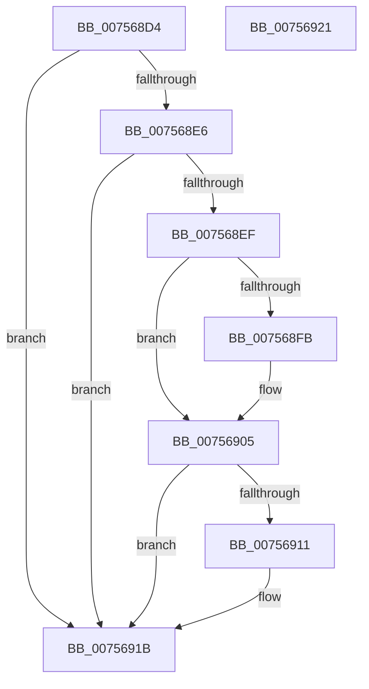

# PopPowerLimitUpdatePendingEvents

- RVA: `0x007568D4`–`0x00756922` (길이 `78` bytes)
- VA: `0x00000001407568D4`
- 실행 섹션: `PAGE`
- PDB 이름 있음: `예`; PDB Function 태그: `아니요`
- unwind 정보 RVA: `0x0005CF00`
- 디코드: `23`개 명령, `78/78` bytes 표시
- 미해석 바이트: `0` (있으면 어셈블리에 `.byte`로 보존)

> 이 문서는 커널 이미지의 기계어와 PDB 기호를 분석해 생성했습니다. 4번과 5번은 함수 원형과 자료형을 바이너리 사용 방식에서 추정한 C 해석이며 원본 소스 복구 결과는 아닙니다.

## 1. Dependencies

- 직접 호출 지점: **2**; 고유 호출 대상: **1**
- 직접 호출자로 확인된 함수: **2**
- RIP 상대 이미지 참조: **0**

### Outgoing calls
- `0x00756900` → [KeSetEvent](../../text/33/KeSetEvent_function_0033F310.md) (function, `0x0033F310`)
- `0x00756916` → [KeSetEvent](../../text/33/KeSetEvent_function_0033F310.md) (function, `0x0033F310`)

### Direct callers
- [PoQueryPowerLimitValue](PoQueryPowerLimitValue_function_00755B10.md) at `0x00755BED`
- [PopEvaluatePowerLimitChange](PopEvaluatePowerLimitChange_function_00756224.md) at `0x0075645D`

### Static image references
- 디코드된 RIP-relative 메모리 참조가 없습니다.

## 2. Other-region calls and transfers

- 다른 실행 섹션으로 향하는 call: **2**
  - `0x00756900` → [KeSetEvent](../../text/33/KeSetEvent_function_0033F310.md) (`PAGE` → `.text`)
  - `0x00756916` → [KeSetEvent](../../text/33/KeSetEvent_function_0033F310.md) (`PAGE` → `.text`)
- 별도 외부 분기/꼬리 이동을 확인하지 못했습니다.

## 3. Assembly (complete function range)

```asm
007568D4  40 53                           push rbx
007568D6  48 83 EC 20                     sub rsp, 0x20
007568DA  83 B9 B0 00 00 00 00            cmp dword ptr [rcx + 0xb0], 0
007568E1  48 8B D9                        mov rbx, rcx
007568E4  75 35                           jne 0x14075691b
007568E6  83 B9 B4 00 00 00 00            cmp dword ptr [rcx + 0xb4], 0
007568ED  75 2C                           jne 0x14075691b
007568EF  48 8B 89 C0 00 00 00            mov rcx, qword ptr [rcx + 0xc0]
007568F6  48 85 C9                        test rcx, rcx
007568F9  74 0A                           je 0x140756905
007568FB  45 33 C0                        xor r8d, r8d
007568FE  33 D2                           xor edx, edx
00756900  E8 0B 8A BE FF                  call 0x14033f310
00756905  48 8B 8B B8 00 00 00            mov rcx, qword ptr [rbx + 0xb8]
0075690C  48 85 C9                        test rcx, rcx
0075690F  74 0A                           je 0x14075691b
00756911  45 33 C0                        xor r8d, r8d
00756914  33 D2                           xor edx, edx
00756916  E8 F5 89 BE FF                  call 0x14033f310
0075691B  48 83 C4 20                     add rsp, 0x20
0075691F  5B                              pop rbx
00756920  C3                              ret
00756921  CC                              int3
```

## 4. C-style interpretation (structured pseudocode)

```c
__int64 __fastcall PopPowerLimitUpdatePendingEvents(__int64 a1, int a2, int a3)
{
    __int64 result;
    __int64 v_rsp;

    v_rsp = (v_rsp) - (32);
    if ((*(unsigned int *)(a1 + 176)) != 0) goto loc_0075691B;
    if ((*(unsigned int *)(a1 + 180)) != 0) goto loc_0075691B;
    if (*(unsigned __int64 *)(a1 + 192) != 0) {
        a3 = 0;
        a2 = 0;
        result = KeSetEvent(*(unsigned __int64 *)(a1 + 192), a2, a3, a4);
    }
    if (*(unsigned __int64 *)(a1 + 184) != 0) {
        a3 = 0;
        a2 = 0;
        result = KeSetEvent(*(unsigned __int64 *)(a1 + 184), a2, a3, a4);
    }
    v_rsp = (v_rsp) + (32);
    return result;
}
```

## 5. (Beta) C Style

```c
int64_t PopPowerLimitUpdatePendingEvents(void *Arg1, int32_t Arg2, int32_t Arg3)
{
    uint8_t *arg1 = (uint8_t *)Arg1;

    int64_t result;
    int64_t local_rsp;

    local_rsp = (local_rsp) - (32);
    if ((*(uint32_t *)(arg1 + 0xB0)) != 0) goto loc_0075691B;
    if ((*(uint32_t *)(arg1 + 0xB4)) != 0) goto loc_0075691B;
    if (*(uint64_t *)(arg1 + 0xC0) != 0) {
        Arg3 = 0;
        Arg2 = 0;
        result = KeSetEvent(*(uint64_t *)(arg1 + 0xC0), Arg2, Arg3, a4);
    }
    if (*(uint64_t *)(arg1 + 0xB8) != 0) {
        Arg3 = 0;
        Arg2 = 0;
        result = KeSetEvent(*(uint64_t *)(arg1 + 0xB8), Arg2, Arg3, a4);
    }
    local_rsp = (local_rsp) + (32);
    return result;
}
```

### 관측된 메모리 오프셋

구조체 형식이 확인되지 않은 접근은 인자 기준의 오프셋으로만 기록했습니다.

| 기준 인자 | 오프셋 표현 | 폭 (bit) | 접근 |
|---|---:|---:|---|
| `Arg1` | `+ 0xB0` | `32` | `R` |
| `Arg1` | `+ 0xB4` | `32` | `R` |
| `Arg1` | `+ 0xB8` | `64` | `R` |
| `Arg1` | `+ 0xC0` | `64` | `R` |

## 6. Execution-region graph

[열기: 2D/3D 그래프와 함수 탐색 컨트롤 패널](../../../control-panel.html?section=page&rva=0x007568D4&view=graph)

- 2D 그래프는 위에서 아래로 흐르고, 3D 그래프는 빈 공간을 드래그해 회전합니다. Shift+드래그는 이동, 휠은 확대·축소, 함수 노드 선택은 대상 보고서 이동입니다.

### Static fallback


