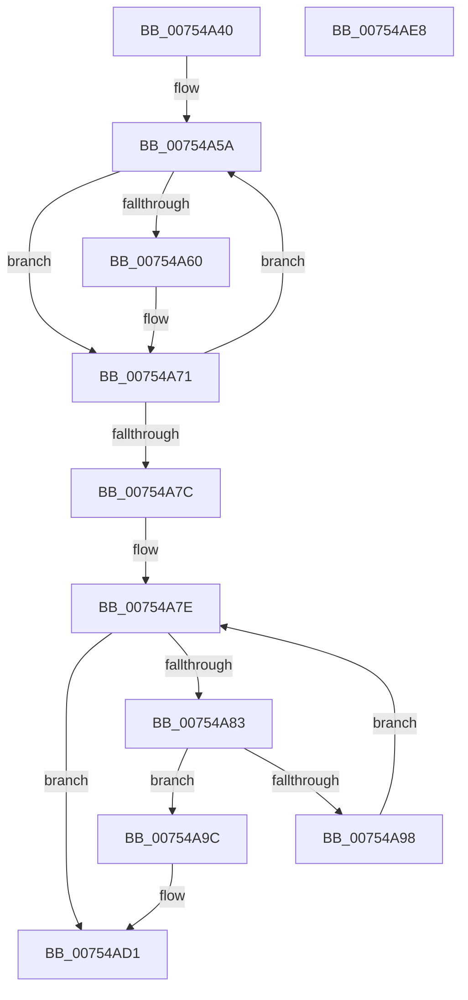

# PopPowerRequestDebounceTimerWorker

- RVA: `0x00754A40`–`0x00754AE9` (길이 `169` bytes)
- VA: `0x0000000140754A40`
- 실행 섹션: `PAGE`
- PDB 이름 있음: `예`; PDB Function 태그: `아니요`
- unwind 정보 RVA: `0x0006E5F8`
- 디코드: `48`개 명령, `169/169` bytes 표시
- 미해석 바이트: `0` (있으면 어셈블리에 `.byte`로 보존)

> 이 문서는 커널 이미지의 기계어와 PDB 기호를 분석해 생성했습니다. 4번과 5번은 함수 원형과 자료형을 바이너리 사용 방식에서 추정한 C 해석이며 원본 소스 복구 결과는 아닙니다.

## 1. Dependencies

- 직접 호출 지점: **5**; 고유 호출 대상: **5**
- 직접 호출자로 확인된 함수: **0**
- RIP 상대 이미지 참조: **3**

### Outgoing calls
- `0x00754A4C` → [PopAcquirePowerRequestPushLock](../A6/PopAcquirePowerRequestPushLock_function_00A66D94.md) (function, `0x00A66D94`)
- `0x00754A6C` → [PopPowerRequestHandleRequestUpdate](../A6/PopPowerRequestHandleRequestUpdate_function_00A652D8.md) (function, `0x00A652D8`)
- `0x00754AA5` → [KeCancelTimer2](../../text/3A/KeCancelTimer2_function_003A01E0.md) (function, `0x003A01E0`)
- `0x00754ACC` → [KeSetTimer2](../../text/3A/KeSetTimer2_function_003A08E0.md) (function, `0x003A08E0`)
- `0x00754AD8` → [PopReleaseRwLock](../../text/2D/PopReleaseRwLock_function_002DFBBC.md) (function, `0x002DFBBC`)

### Direct callers
- 이 함수 시작 RVA로 연결되는 직접 call은 확인되지 않았습니다. 간접 호출은 완전히 역산할 수 없습니다.

### Static image references
- `0x00754A53` → RVA `0x00E019CC` (`.data`; read)
- `0x00754A9E` → RVA `0x00F0EE40` (`.data`; read)
- `0x00754AD1` → RVA `0x00F0ED20` (`.data`; read)

## 2. Other-region calls and transfers

- 다른 실행 섹션으로 향하는 call: **3**
  - `0x00754AA5` → [KeCancelTimer2](../../text/3A/KeCancelTimer2_function_003A01E0.md) (`PAGE` → `.text`)
  - `0x00754ACC` → [KeSetTimer2](../../text/3A/KeSetTimer2_function_003A08E0.md) (`PAGE` → `.text`)
  - `0x00754AD8` → [PopReleaseRwLock](../../text/2D/PopReleaseRwLock_function_002DFBBC.md) (`PAGE` → `.text`)
- 별도 외부 분기/꼬리 이동을 확인하지 못했습니다.

## 3. Assembly (complete function range)

```asm
00754A40  48 89 5C 24 08                  mov qword ptr [rsp + 8], rbx
00754A45  57                              push rdi
00754A46  48 83 EC 30                     sub rsp, 0x30
00754A4A  B1 01                           mov cl, 1
00754A4C  E8 43 23 31 00                  call 0x140a66d94
00754A51  33 DB                           xor ebx, ebx
00754A53  48 8D 3D 72 CF 6A 00            lea rdi, [rip + 0x6acf72]
00754A5A  8B 07                           mov eax, dword ptr [rdi]
00754A5C  A8 08                           test al, 8
00754A5E  74 11                           je 0x140754a71
00754A60  83 E0 F7                        and eax, 0xfffffff7
00754A63  45 33 C0                        xor r8d, r8d
00754A66  8B D3                           mov edx, ebx
00754A68  89 07                           mov dword ptr [rdi], eax
00754A6A  33 C9                           xor ecx, ecx
00754A6C  E8 67 08 31 00                  call 0x140a652d8
00754A71  FF C3                           inc ebx
00754A73  48 83 C7 30                     add rdi, 0x30
00754A77  83 FB 06                        cmp ebx, 6
00754A7A  72 DE                           jb 0x140754a5a
00754A7C  33 C9                           xor ecx, ecx
00754A7E  83 F9 06                        cmp ecx, 6
00754A81  73 4E                           jae 0x140754ad1
00754A83  48 8D 04 49                     lea rax, [rcx + rcx*2]
00754A87  48 03 C0                        add rax, rax
00754A8A  48 8D 15 3B CF 6A 00            lea rdx, [rip + 0x6acf3b]
00754A91  8B 04 C2                        mov eax, dword ptr [rdx + rax*8]
00754A94  A8 08                           test al, 8
00754A96  75 04                           jne 0x140754a9c
00754A98  FF C1                           inc ecx
00754A9A  EB E2                           jmp 0x140754a7e
00754A9C  33 D2                           xor edx, edx
00754A9E  48 8D 0D 9B A3 7B 00            lea rcx, [rip + 0x7ba39b]
00754AA5  E8 36 B7 C4 FF                  call 0x1403a01e0
00754AAA  48 83 64 24 20 00               and qword ptr [rsp + 0x20], 0
00754AB0  4C 8D 4C 24 20                  lea r9, [rsp + 0x20]
00754AB5  48 83 4C 24 28 FF               or qword ptr [rsp + 0x28], 0xffffffffffffffff
00754ABB  48 8D 0D 7E A3 7B 00            lea rcx, [rip + 0x7ba37e]
00754AC2  45 33 C0                        xor r8d, r8d
00754AC5  48 C7 C2 80 0F 05 FD            mov rdx, 0xfffffffffd050f80
00754ACC  E8 0F BE C4 FF                  call 0x1403a08e0
00754AD1  48 8D 0D 48 A2 7B 00            lea rcx, [rip + 0x7ba248]
00754AD8  E8 DF B0 B8 FF                  call 0x1402dfbbc
00754ADD  48 8B 5C 24 40                  mov rbx, qword ptr [rsp + 0x40]
00754AE2  48 83 C4 30                     add rsp, 0x30
00754AE6  5F                              pop rdi
00754AE7  C3                              ret
00754AE8  CC                              int3
```

## 4. C-style interpretation (structured pseudocode)

```c
__int64 __fastcall PopPowerRequestDebounceTimerWorker(__int64 a1, __int64 a2, int a3)
{
    __int64 result;
    __int64 v_rbx;
    __int64 v_rdi;
    __int64 v_rsp;
    unsigned __int64 v_stack_m10;
    unsigned __int64 v_stack_m18;
    unsigned __int64 v_stack_p8;

    v_stack_p8 = v_rbx;
    v_rsp = (v_rsp) - (48);
    result = PopAcquirePowerRequestPushLock(1, a2, a3, a4);
    v_rbx = 0;
loc_00754A5A:
    result = (unsigned int)(*(unsigned int *)(v_rip + 6999922));
    if ((((unsigned __int8)((unsigned int)(*(unsigned int *)(v_rip + 6999922)))) & (8)) != 0) {
        result = (unsigned int)(((unsigned int)(*(unsigned int *)(v_rip + 6999922))) & (0xFFFFFFF7ULL));
        a3 = 0;
        a2 = 0;
        *(unsigned int *)(v_rip + 6999922) = (unsigned int)(result);
        a1 = 0;
        result = PopPowerRequestHandleRequestUpdate(a1, a2, a3, a4);
    }
    v_rbx = (unsigned int)((v_rbx) + 1);
    v_rdi = (v_rip + 6999922) + (48);
    if (((unsigned int)(v_rbx)) < 6) goto loc_00754A5A;
    a1 = 0;
loc_00754A7E:
    if (0 >= 6) goto loc_00754AD1;
    result = (a1 + a1 * 2) + (a1 + a1 * 2);
    if ((((unsigned __int8)((unsigned int)(*(unsigned int *)(v_rip + 6999867 + result * 8)))) & (8)) != 0) goto loc_00754A9C;
    a1 = (unsigned int)((a1) + 1);
    goto loc_00754A7E;
loc_00754A9C:
    a2 = 0;
    result = KeCancelTimer2(v_rip + 8102811, a2, a3, a4);
    a3 = 0;
    result = KeSetTimer2(v_rip + 8102782, 0xFFFFFFFFFD050F80ULL, a3, v_stack_m18);
loc_00754AD1:
    result = PopReleaseRwLock(v_rip + 8102472, 0xFFFFFFFFFD050F80ULL, a3, v_stack_m18);
    v_rsp = (v_rsp) + (48);
    return result;
}
```

## 5. (Beta) C Style

```c
int64_t PopPowerRequestDebounceTimerWorker(int64_t Arg1, int64_t Arg2, int32_t Arg3)
{
    int64_t result;
    int64_t local_rbx;
    int64_t local_rdi;
    int64_t local_rsp;
    uint64_t v_stack_m10;
    uint64_t v_stack_m18;
    uint64_t v_stack_p8;

    v_stack_p8 = local_rbx;
    local_rsp = (local_rsp) - (48);
    result = PopAcquirePowerRequestPushLock(1, Arg2, Arg3, a4);
    local_rbx = 0;
loc_00754A5A:
    result = (uint32_t)(*(uint32_t *)(v_rip + 0x6ACF72));
    if ((((uint8_t)((uint32_t)(*(uint32_t *)(v_rip + 0x6ACF72)))) & (8)) != 0) {
        result = (uint32_t)(((uint32_t)(*(uint32_t *)(v_rip + 0x6ACF72))) & (0xFFFFFFF7ULL));
        Arg3 = 0;
        Arg2 = 0;
        *(uint32_t *)(v_rip + 0x6ACF72) = (uint32_t)(result);
        Arg1 = 0;
        result = PopPowerRequestHandleRequestUpdate(Arg1, Arg2, Arg3, a4);
    }
    local_rbx = (uint32_t)((local_rbx) + 1);
    local_rdi = (v_rip + 6999922) + (48);
    if (((uint32_t)(local_rbx)) < 6) goto loc_00754A5A;
    Arg1 = 0;
loc_00754A7E:
    if (0 >= 6) goto loc_00754AD1;
    result = (Arg1 + Arg1 * 2) + (Arg1 + Arg1 * 2);
    if ((((uint8_t)((uint32_t)(*(uint32_t *)(v_rip + 0x6ACF3B + result * 8)))) & (8)) != 0) goto loc_00754A9C;
    Arg1 = (uint32_t)((Arg1) + 1);
    goto loc_00754A7E;
loc_00754A9C:
    Arg2 = 0;
    result = KeCancelTimer2(v_rip + 8102811, Arg2, Arg3, a4);
    Arg3 = 0;
    result = KeSetTimer2(v_rip + 8102782, 0xFFFFFFFFFD050F80ULL, Arg3, v_stack_m18);
loc_00754AD1:
    result = PopReleaseRwLock(v_rip + 8102472, 0xFFFFFFFFFD050F80ULL, Arg3, v_stack_m18);
    local_rsp = (local_rsp) + (48);
    return result;
}
```

## 6. Execution-region graph

[열기: 2D/3D 그래프와 함수 탐색 컨트롤 패널](../../../control-panel.html?section=page&rva=0x00754A40&view=graph)

- 2D 그래프는 위에서 아래로 흐르고, 3D 그래프는 빈 공간을 드래그해 회전합니다. Shift+드래그는 이동, 휠은 확대·축소, 함수 노드 선택은 대상 보고서 이동입니다.

### Static fallback


