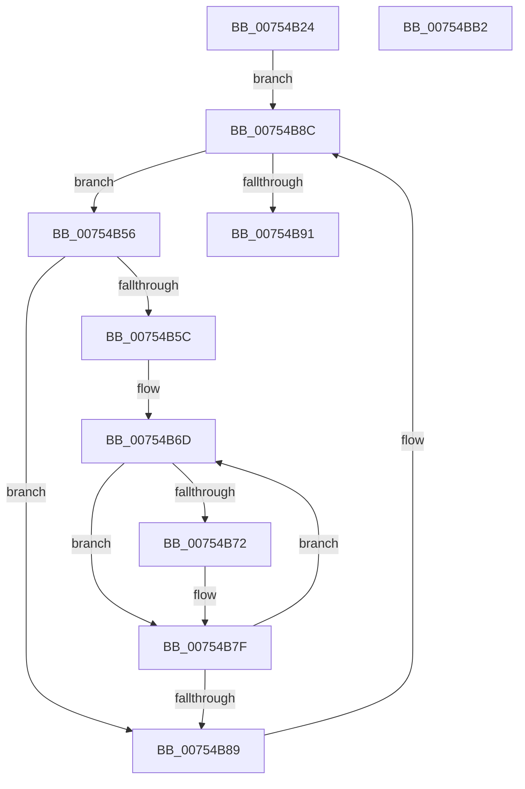

# PopPowerRequestNotificationsBegin

- RVA: `0x00754B24`–`0x00754BB3` (길이 `143` bytes)
- VA: `0x0000000140754B24`
- 실행 섹션: `PAGE`
- PDB 이름 있음: `예`; PDB Function 태그: `아니요`
- unwind 정보 RVA: `0x0005C954`
- 디코드: `39`개 명령, `143/143` bytes 표시
- 미해석 바이트: `0` (있으면 어셈블리에 `.byte`로 보존)

> 이 문서는 커널 이미지의 기계어와 PDB 기호를 분석해 생성했습니다. 4번과 5번은 함수 원형과 자료형을 바이너리 사용 방식에서 추정한 C 해석이며 원본 소스 복구 결과는 아닙니다.

## 1. Dependencies

- 직접 호출 지점: **4**; 고유 호출 대상: **4**
- 직접 호출자로 확인된 함수: **1**
- RIP 상대 이미지 참조: **3**

### Outgoing calls
- `0x00754B3A` → [PopAcquirePowerRequestPushLock](../A6/PopAcquirePowerRequestPushLock_function_00A66D94.md) (function, `0x00A66D94`)
- `0x00754B5F` → [PopUmpoSendPowerRequestCreate](../A7/PopUmpoSendPowerRequestCreate_function_00A7CE40.md) (function, `0x00A7CE40`)
- `0x00754B7A` → [PopUmpoSendPowerRequestAction](../76/PopUmpoSendPowerRequestAction_function_007692D4.md) (function, `0x007692D4`)
- `0x00754B98` → [PopReleaseRwLock](../../text/2D/PopReleaseRwLock_function_002DFBBC.md) (function, `0x002DFBBC`)

### Direct callers
- [PopUmpoProcessPowerMessage](../A2/PopUmpoProcessPowerMessage_function_00A2E9B4.md) at `0x00A2EA48`

### Static image references
- `0x00754B3F` → RVA `0x00F0ED40` (`.data`; read)
- `0x00754B4D` → RVA `0x00F0EFB0` (`.data`; write)
- `0x00754B91` → RVA `0x00F0ED20` (`.data`; read)

## 2. Other-region calls and transfers

- 다른 실행 섹션으로 향하는 call: **1**
  - `0x00754B98` → [PopReleaseRwLock](../../text/2D/PopReleaseRwLock_function_002DFBBC.md) (`PAGE` → `.text`)
- 별도 외부 분기/꼬리 이동을 확인하지 못했습니다.

## 3. Assembly (complete function range)

```asm
00754B24  48 89 5C 24 08                  mov qword ptr [rsp + 8], rbx
00754B29  48 89 6C 24 10                  mov qword ptr [rsp + 0x10], rbp
00754B2E  48 89 74 24 18                  mov qword ptr [rsp + 0x18], rsi
00754B33  57                              push rdi
00754B34  48 83 EC 20                     sub rsp, 0x20
00754B38  B1 01                           mov cl, 1
00754B3A  E8 55 22 31 00                  call 0x140a66d94
00754B3F  48 8B 1D FA A1 7B 00            mov rbx, qword ptr [rip + 0x7ba1fa]
00754B46  48 8D 2D F3 A1 7B 00            lea rbp, [rip + 0x7ba1f3]
00754B4D  C6 05 5C A4 7B 00 01            mov byte ptr [rip + 0x7ba45c], 1
00754B54  EB 36                           jmp 0x140754b8c
00754B56  83 7B 68 00                     cmp dword ptr [rbx + 0x68], 0
00754B5A  74 2D                           je 0x140754b89
00754B5C  8B 4B 24                        mov ecx, dword ptr [rbx + 0x24]
00754B5F  E8 DC 82 32 00                  call 0x140a7ce40
00754B64  33 FF                           xor edi, edi
00754B66  48 8D B3 99 00 00 00            lea rsi, [rbx + 0x99]
00754B6D  80 3E 00                        cmp byte ptr [rsi], 0
00754B70  74 0D                           je 0x140754b7f
00754B72  8B 4B 24                        mov ecx, dword ptr [rbx + 0x24]
00754B75  41 B0 01                        mov r8b, 1
00754B78  8B D7                           mov edx, edi
00754B7A  E8 55 47 01 00                  call 0x1407692d4
00754B7F  FF C7                           inc edi
00754B81  48 FF C6                        inc rsi
00754B84  83 FF 06                        cmp edi, 6
00754B87  7C E4                           jl 0x140754b6d
00754B89  48 8B 1B                        mov rbx, qword ptr [rbx]
00754B8C  48 3B DD                        cmp rbx, rbp
00754B8F  75 C5                           jne 0x140754b56
00754B91  48 8D 0D 88 A1 7B 00            lea rcx, [rip + 0x7ba188]
00754B98  E8 1F B0 B8 FF                  call 0x1402dfbbc
00754B9D  48 8B 5C 24 30                  mov rbx, qword ptr [rsp + 0x30]
00754BA2  48 8B 6C 24 38                  mov rbp, qword ptr [rsp + 0x38]
00754BA7  48 8B 74 24 40                  mov rsi, qword ptr [rsp + 0x40]
00754BAC  48 83 C4 20                     add rsp, 0x20
00754BB0  5F                              pop rdi
00754BB1  C3                              ret
00754BB2  CC                              int3
```

## 4. C-style interpretation (structured pseudocode)

```c
__int64 __fastcall PopPowerRequestNotificationsBegin(void)
{
    __int64 result;
    __int64 v_rdi;
    __int64 v_rsi;
    __int64 v_rsp;
    unsigned __int64 v_stack_p10;
    unsigned __int64 v_stack_p18;
    unsigned __int64 v_stack_p8;

    v_stack_p8 = v_rbx;
    v_stack_p10 = v_rbp;
    v_stack_p18 = v_rsi;
    v_rsp = (v_rsp) - (32);
    result = PopAcquirePowerRequestPushLock(1, a2, a3, a4);
    *(unsigned __int8 *)(v_rip + 8103004) = 1;
    goto loc_00754B8C;
loc_00754B56:
    if ((*(unsigned int *)(*(unsigned __int64 *)(v_rip + 8102394) + 104)) == 0) goto loc_00754B89;
    result = PopUmpoSendPowerRequestCreate((unsigned int)(*(unsigned int *)(*(unsigned __int64 *)(v_rip + 8102394) + 36)), a2, a3, a4);
    v_rdi = 0;
loc_00754B6D:
    if ((*(unsigned __int8 *)(*(unsigned __int64 *)(v_rip + 8102394) + 153)) != 0) {
        a1 = *(unsigned int *)(*(unsigned __int64 *)(v_rip + 8102394) + 36);
        a3 = 1;
        a2 = 0;
        result = PopUmpoSendPowerRequestAction(a1, a2, a3, a4);
    }
    v_rdi = (unsigned int)((v_rdi) + 1);
    v_rsi = (*(unsigned __int64 *)(v_rip + 8102394) + 153) + 1;
    if (((unsigned int)(v_rdi)) < 6) goto loc_00754B6D;
loc_00754B89:
loc_00754B8C:
    if ((*(unsigned __int64 *)(*(unsigned __int64 *)(v_rip + 8102394))) != (v_rip + 8102387)) goto loc_00754B56;
    result = PopReleaseRwLock(v_rip + 8102280, a2, a3, a4);
    v_rsp = (v_rsp) + (32);
    return result;
}
```

## 5. (Beta) C Style

```c
void PopPowerRequestNotificationsBegin(void)
{
    int64_t result;
    int64_t local_rdi;
    int64_t local_rsi;
    int64_t local_rsp;
    uint64_t v_stack_p10;
    uint64_t v_stack_p18;
    uint64_t v_stack_p8;

    v_stack_p8 = local_rbx;
    v_stack_p10 = local_rbp;
    v_stack_p18 = local_rsi;
    local_rsp = (local_rsp) - (32);
    result = PopAcquirePowerRequestPushLock(1, a2, a3, a4);
    *(uint8_t *)(v_rip + 0x7BA45C) = 1;
    goto loc_00754B8C;
loc_00754B56:
    if ((*(uint32_t *)(*(uint64_t *)(v_rip + 0x7BA1FA) + 0x68)) == 0) goto loc_00754B89;
    result = PopUmpoSendPowerRequestCreate((uint32_t)(*(uint32_t *)(*(uint64_t *)(v_rip + 0x7BA1FA) + 0x24)), a2, a3, a4);
    local_rdi = 0;
loc_00754B6D:
    if ((*(uint8_t *)(*(uint64_t *)(v_rip + 0x7BA1FA) + 0x99)) != 0) {
        a1 = *(uint32_t *)(*(uint64_t *)(v_rip + 0x7BA1FA) + 0x24);
        a3 = 1;
        a2 = 0;
        result = PopUmpoSendPowerRequestAction(a1, a2, a3, a4);
    }
    local_rdi = (uint32_t)((local_rdi) + 1);
    local_rsi = (*(uint64_t *)(v_rip + 0x7BA1FA) + 153) + 1;
    if (((uint32_t)(local_rdi)) < 6) goto loc_00754B6D;
loc_00754B89:
loc_00754B8C:
    if ((*(uint64_t *)(*(uint64_t *)(v_rip + 0x7BA1FA))) != (v_rip + 8102387)) goto loc_00754B56;
    result = PopReleaseRwLock(v_rip + 8102280, a2, a3, a4);
    local_rsp = (local_rsp) + (32);
    return result;
}
```

## 6. Execution-region graph

[열기: 2D/3D 그래프와 함수 탐색 컨트롤 패널](../../../control-panel.html?section=page&rva=0x00754B24&view=graph)

- 2D 그래프는 위에서 아래로 흐르고, 3D 그래프는 빈 공간을 드래그해 회전합니다. Shift+드래그는 이동, 휠은 확대·축소, 함수 노드 선택은 대상 보고서 이동입니다.

### Static fallback


