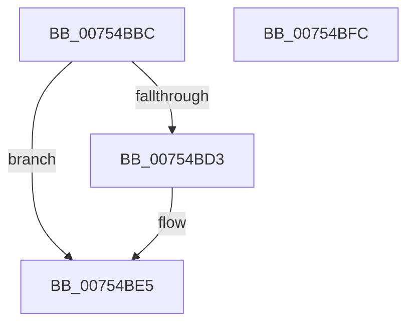

# PopPowerRequestNotifyMobileHotspotChanged

- RVA: `0x00754BBC`–`0x00754BFD` (길이 `65` bytes)
- VA: `0x0000000140754BBC`
- 실행 섹션: `PAGE`
- PDB 이름 있음: `예`; PDB Function 태그: `아니요`
- unwind 정보 RVA: `0x0005CF00`
- 디코드: `18`개 명령, `65/65` bytes 표시
- 미해석 바이트: `0` (있으면 어셈블리에 `.byte`로 보존)

> 이 문서는 커널 이미지의 기계어와 PDB 기호를 분석해 생성했습니다. 4번과 5번은 함수 원형과 자료형을 바이너리 사용 방식에서 추정한 C 해석이며 원본 소스 복구 결과는 아닙니다.

## 1. Dependencies

- 직접 호출 지점: **4**; 고유 호출 대상: **4**
- 직접 호출자로 확인된 함수: **1**
- RIP 상대 이미지 참조: **3**

### Outgoing calls
- `0x00754BC6` → [PopAcquirePowerRequestPushLock](../A6/PopAcquirePowerRequestPushLock_function_00A66D94.md) (function, `0x00A66D94`)
- `0x00754BE0` → [PopPowerRequestStatsNotifyScenarioStateChange](../../text/45/PopPowerRequestStatsNotifyScenarioStateChange_function_00453794.md) (function, `0x00453794`)
- `0x00754BE5` → [PopPowerRequestHandleExecutionEnablementUpdate](../A4/PopPowerRequestHandleExecutionEnablementUpdate_function_00A4A624.md) (function, `0x00A4A624`)
- `0x00754BF1` → [PopReleaseRwLock](../../text/2D/PopReleaseRwLock_function_002DFBBC.md) (function, `0x002DFBBC`)

### Direct callers
- [PopWnfMobileHotspotCallback](../../text/5D/PopWnfMobileHotspotCallback_function_005D14F0.md) at `0x005D153B`

### Static image references
- `0x00754BCB` → RVA `0x00F0EFC1` (`.data`; read)
- `0x00754BD5` → RVA `0x00F0EFC1` (`.data`; write)
- `0x00754BEA` → RVA `0x00F0ED20` (`.data`; read)

## 2. Other-region calls and transfers

- 다른 실행 섹션으로 향하는 call: **2**
  - `0x00754BE0` → [PopPowerRequestStatsNotifyScenarioStateChange](../../text/45/PopPowerRequestStatsNotifyScenarioStateChange_function_00453794.md) (`PAGE` → `.text`)
  - `0x00754BF1` → [PopReleaseRwLock](../../text/2D/PopReleaseRwLock_function_002DFBBC.md) (`PAGE` → `.text`)
- 별도 외부 분기/꼬리 이동을 확인하지 못했습니다.

## 3. Assembly (complete function range)

```asm
00754BBC  40 53                           push rbx
00754BBE  48 83 EC 20                     sub rsp, 0x20
00754BC2  8A D9                           mov bl, cl
00754BC4  B1 01                           mov cl, 1
00754BC6  E8 C9 21 31 00                  call 0x140a66d94
00754BCB  38 1D F0 A3 7B 00               cmp byte ptr [rip + 0x7ba3f0], bl
00754BD1  74 12                           je 0x140754be5
00754BD3  8A D3                           mov dl, bl
00754BD5  88 1D E6 A3 7B 00               mov byte ptr [rip + 0x7ba3e6], bl
00754BDB  B9 01 00 00 00                  mov ecx, 1
00754BE0  E8 AF EB CF FF                  call 0x140453794
00754BE5  E8 3A 5A 2F 00                  call 0x140a4a624
00754BEA  48 8D 0D 2F A1 7B 00            lea rcx, [rip + 0x7ba12f]
00754BF1  E8 C6 AF B8 FF                  call 0x1402dfbbc
00754BF6  48 83 C4 20                     add rsp, 0x20
00754BFA  5B                              pop rbx
00754BFB  C3                              ret
00754BFC  CC                              int3
```

## 4. C-style interpretation (structured pseudocode)

```c
__int64 __fastcall PopPowerRequestNotifyMobileHotspotChanged(unsigned __int8 a1)
{
    __int64 result;
    __int64 v_rsp;

    v_rsp = (v_rsp) - (32);
    result = PopAcquirePowerRequestPushLock(1, a2, a3, a4);
    if ((*(unsigned __int8 *)(v_rip + 8102896)) != a1) {
        a2 = a1;
        *(unsigned __int8 *)(v_rip + 8102886) = a1;
        a1 = 1;
        result = PopPowerRequestStatsNotifyScenarioStateChange(a1, a2, a3, a4);
    }
    result = PopPowerRequestHandleExecutionEnablementUpdate(a1, a2, a3, a4);
    result = PopReleaseRwLock(v_rip + 8102191, a2, a3, a4);
    v_rsp = (v_rsp) + (32);
    return result;
}
```

## 5. (Beta) C Style

```c
int64_t PopPowerRequestNotifyMobileHotspotChanged(uint8_t Arg1)
{
    int64_t result;
    int64_t local_rsp;

    local_rsp = (local_rsp) - (32);
    result = PopAcquirePowerRequestPushLock(1, a2, a3, a4);
    if ((*(uint8_t *)(v_rip + 0x7BA3F0)) != Arg1) {
        a2 = Arg1;
        *(uint8_t *)(v_rip + 0x7BA3E6) = Arg1;
        Arg1 = 1;
        result = PopPowerRequestStatsNotifyScenarioStateChange(Arg1, a2, a3, a4);
    }
    result = PopPowerRequestHandleExecutionEnablementUpdate(Arg1, a2, a3, a4);
    result = PopReleaseRwLock(v_rip + 8102191, a2, a3, a4);
    local_rsp = (local_rsp) + (32);
    return result;
}
```

## 6. Execution-region graph

[열기: 2D/3D 그래프와 함수 탐색 컨트롤 패널](../../../control-panel.html?section=page&rva=0x00754BBC&view=graph)

- 2D 그래프는 위에서 아래로 흐르고, 3D 그래프는 빈 공간을 드래그해 회전합니다. Shift+드래그는 이동, 휠은 확대·축소, 함수 노드 선택은 대상 보고서 이동입니다.

### Static fallback


