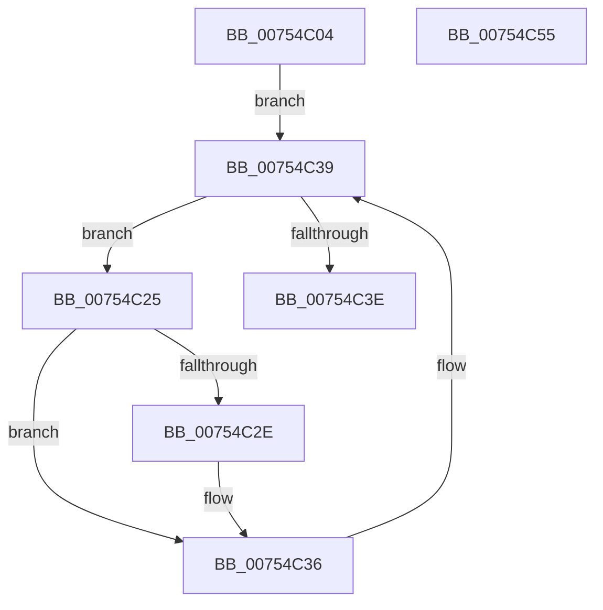

# PopPowerRequestOverrideInitialize

- RVA: `0x00754C04`–`0x00754C56` (길이 `82` bytes)
- VA: `0x0000000140754C04`
- 실행 섹션: `PAGE`
- PDB 이름 있음: `예`; PDB Function 태그: `아니요`
- unwind 정보 RVA: `0x0005CAAC`
- 디코드: `22`개 명령, `82/82` bytes 표시
- 미해석 바이트: `0` (있으면 어셈블리에 `.byte`로 보존)

> 이 문서는 커널 이미지의 기계어와 PDB 기호를 분석해 생성했습니다. 4번과 5번은 함수 원형과 자료형을 바이너리 사용 방식에서 추정한 C 해석이며 원본 소스 복구 결과는 아닙니다.

## 1. Dependencies

- 직접 호출 지점: **3**; 고유 호출 대상: **3**
- 직접 호출자로 확인된 함수: **1**
- RIP 상대 이미지 참조: **2**

### Outgoing calls
- `0x00754C10` → [PopAcquirePowerRequestPushLock](../A6/PopAcquirePowerRequestPushLock_function_00A66D94.md) (function, `0x00A66D94`)
- `0x00754C31` → [PopUmpoSendPowerRequestOverrideQuery](../../text/23/PopUmpoSendPowerRequestOverrideQuery_function_00230418.md) (function, `0x00230418`)
- `0x00754C45` → [PopReleaseRwLock](../../text/2D/PopReleaseRwLock_function_002DFBBC.md) (function, `0x002DFBBC`)

### Direct callers
- [sub_00B39700](../B3/Unknown_function_00B39700.md) at `0x00B3971E`

### Static image references
- `0x00754C15` → RVA `0x00F0ED40` (`.data`; read)
- `0x00754C3E` → RVA `0x00F0ED20` (`.data`; read)

## 2. Other-region calls and transfers

- 다른 실행 섹션으로 향하는 call: **2**
  - `0x00754C31` → [PopUmpoSendPowerRequestOverrideQuery](../../text/23/PopUmpoSendPowerRequestOverrideQuery_function_00230418.md) (`PAGE` → `.text`)
  - `0x00754C45` → [PopReleaseRwLock](../../text/2D/PopReleaseRwLock_function_002DFBBC.md) (`PAGE` → `.text`)
- 별도 외부 분기/꼬리 이동을 확인하지 못했습니다.

## 3. Assembly (complete function range)

```asm
00754C04  48 89 5C 24 08                  mov qword ptr [rsp + 8], rbx
00754C09  57                              push rdi
00754C0A  48 83 EC 20                     sub rsp, 0x20
00754C0E  33 C9                           xor ecx, ecx
00754C10  E8 7F 21 31 00                  call 0x140a66d94
00754C15  48 8B 1D 24 A1 7B 00            mov rbx, qword ptr [rip + 0x7ba124]
00754C1C  48 8D 3D 1D A1 7B 00            lea rdi, [rip + 0x7ba11d]
00754C23  EB 14                           jmp 0x140754c39
00754C25  80 BB 98 00 00 00 00            cmp byte ptr [rbx + 0x98], 0
00754C2C  75 08                           jne 0x140754c36
00754C2E  48 8B CB                        mov rcx, rbx
00754C31  E8 E2 B7 AD FF                  call 0x140230418
00754C36  48 8B 1B                        mov rbx, qword ptr [rbx]
00754C39  48 3B DF                        cmp rbx, rdi
00754C3C  75 E7                           jne 0x140754c25
00754C3E  48 8D 0D DB A0 7B 00            lea rcx, [rip + 0x7ba0db]
00754C45  E8 72 AF B8 FF                  call 0x1402dfbbc
00754C4A  48 8B 5C 24 30                  mov rbx, qword ptr [rsp + 0x30]
00754C4F  48 83 C4 20                     add rsp, 0x20
00754C53  5F                              pop rdi
00754C54  C3                              ret
00754C55  CC                              int3
```

## 4. C-style interpretation (structured pseudocode)

```c
__int64 __fastcall PopPowerRequestOverrideInitialize(int a1)
{
    __int64 result;
    __int64 v_rsp;
    unsigned __int64 v_stack_p8;

    v_stack_p8 = v_rbx;
    v_rsp = (v_rsp) - (32);
    a1 = 0;
    result = PopAcquirePowerRequestPushLock(a1, a2, a3, a4);
    goto loc_00754C39;
loc_00754C25:
    if ((*(unsigned __int8 *)(*(unsigned __int64 *)(v_rip + 8102180) + 152)) == 0) {
        a1 = *(unsigned __int64 *)(v_rip + 8102180);
        result = PopUmpoSendPowerRequestOverrideQuery(a1, a2, a3, a4);
    }
loc_00754C39:
    if ((*(unsigned __int64 *)(*(unsigned __int64 *)(v_rip + 8102180))) != (v_rip + 8102173)) goto loc_00754C25;
    result = PopReleaseRwLock(v_rip + 8102107, a2, a3, a4);
    v_rsp = (v_rsp) + (32);
    return result;
}
```

## 5. (Beta) C Style

```c
int64_t PopPowerRequestOverrideInitialize(int32_t Arg1)
{
    int64_t result;
    int64_t local_rsp;
    uint64_t v_stack_p8;

    v_stack_p8 = local_rbx;
    local_rsp = (local_rsp) - (32);
    Arg1 = 0;
    result = PopAcquirePowerRequestPushLock(Arg1, a2, a3, a4);
    goto loc_00754C39;
loc_00754C25:
    if ((*(uint8_t *)(*(uint64_t *)(v_rip + 0x7BA124) + 0x98)) == 0) {
        Arg1 = *(uint64_t *)(v_rip + 0x7BA124);
        result = PopUmpoSendPowerRequestOverrideQuery(Arg1, a2, a3, a4);
    }
loc_00754C39:
    if ((*(uint64_t *)(*(uint64_t *)(v_rip + 0x7BA124))) != (v_rip + 8102173)) goto loc_00754C25;
    result = PopReleaseRwLock(v_rip + 8102107, a2, a3, a4);
    local_rsp = (local_rsp) + (32);
    return result;
}
```

## 6. Execution-region graph

[열기: 2D/3D 그래프와 함수 탐색 컨트롤 패널](../../../control-panel.html?section=page&rva=0x00754C04&view=graph)

- 2D 그래프는 위에서 아래로 흐르고, 3D 그래프는 빈 공간을 드래그해 회전합니다. Shift+드래그는 이동, 휠은 확대·축소, 함수 노드 선택은 대상 보고서 이동입니다.

### Static fallback


