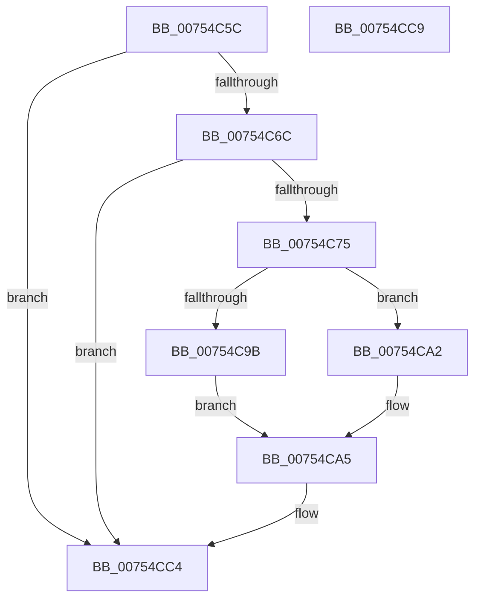

# PopPowerRequestSetExecutionRequiredTimeoutTimer

- RVA: `0x00754C5C`–`0x00754CCA` (길이 `110` bytes)
- VA: `0x0000000140754C5C`
- 실행 섹션: `PAGE`
- PDB 이름 있음: `예`; PDB Function 태그: `아니요`
- unwind 정보 RVA: `0x0005D2F4`
- 디코드: `25`개 명령, `110/110` bytes 표시
- 미해석 바이트: `0` (있으면 어셈블리에 `.byte`로 보존)

> 이 문서는 커널 이미지의 기계어와 PDB 기호를 분석해 생성했습니다. 4번과 5번은 함수 원형과 자료형을 바이너리 사용 방식에서 추정한 C 해석이며 원본 소스 복구 결과는 아닙니다.

## 1. Dependencies

- 직접 호출 지점: **1**; 고유 호출 대상: **1**
- 직접 호출자로 확인된 함수: **2**
- RIP 상대 이미지 참조: **4**

### Outgoing calls
- `0x00754CBF` → [KeSetTimer2](../../text/3A/KeSetTimer2_function_003A08E0.md) (function, `0x003A08E0`)

### Direct callers
- [PopUpdatePdcSystemIdleState](../A3/PopUpdatePdcSystemIdleState_function_00A320B4.md) at `0x00A32134`
- [PopPowerRequestExecutionRequiredSettingCallback](../AC/PopPowerRequestExecutionRequiredSettingCallback_function_00AC4EB0.md) at `0x00AC4F1A`

### Static image references
- `0x00754C63` → RVA `0x00F0EFC3` (`.data`; read)
- `0x00754C6C` → RVA `0x00FD80B0` (`PAGEDATA`; read)
- `0x00754C88` → RVA `0x00F0EFC8` (`.data`; read)
- `0x00754CB8` → RVA `0x00F0EF00` (`.data`; read)

## 2. Other-region calls and transfers

- 다른 실행 섹션으로 향하는 call: **1**
  - `0x00754CBF` → [KeSetTimer2](../../text/3A/KeSetTimer2_function_003A08E0.md) (`PAGE` → `.text`)
- 별도 외부 분기/꼬리 이동을 확인하지 못했습니다.

## 3. Assembly (complete function range)

```asm
00754C5C  48 83 EC 38                     sub rsp, 0x38
00754C60  45 33 C0                        xor r8d, r8d
00754C63  44 38 05 59 A3 7B 00            cmp byte ptr [rip + 0x7ba359], r8b
00754C6A  74 58                           je 0x140754cc4
00754C6C  44 39 05 3D 34 88 00            cmp dword ptr [rip + 0x88343d], r8d
00754C73  74 4F                           je 0x140754cc4
00754C75  48 B9 08 00 00 00 80 F7 FF FF   movabs rcx, 0xfffff78000000008
00754C7F  48 8B 09                        mov rcx, qword ptr [rcx]
00754C82  8B 05 28 34 88 00               mov eax, dword ptr [rip + 0x883428]
00754C88  48 2B 0D 39 A3 7B 00            sub rcx, qword ptr [rip + 0x7ba339]
00754C8F  48 69 D0 80 96 98 00            imul rdx, rax, 0x989680
00754C96  48 3B CA                        cmp rcx, rdx
00754C99  72 07                           jb 0x140754ca2
00754C9B  BA 80 96 98 00                  mov edx, 0x989680
00754CA0  EB 03                           jmp 0x140754ca5
00754CA2  48 2B D1                        sub rdx, rcx
00754CA5  48 83 4C 24 28 FF               or qword ptr [rsp + 0x28], 0xffffffffffffffff
00754CAB  4C 8D 4C 24 20                  lea r9, [rsp + 0x20]
00754CB0  48 F7 DA                        neg rdx
00754CB3  4C 89 44 24 20                  mov qword ptr [rsp + 0x20], r8
00754CB8  48 8D 0D 41 A2 7B 00            lea rcx, [rip + 0x7ba241]
00754CBF  E8 1C BC C4 FF                  call 0x1403a08e0
00754CC4  48 83 C4 38                     add rsp, 0x38
00754CC8  C3                              ret
00754CC9  CC                              int3
```

## 4. C-style interpretation (structured pseudocode)

```c
__int64 __fastcall PopPowerRequestSetExecutionRequiredTimeoutTimer(__int64 a1, __int64 a2, int a3)
{
    __int64 result;
    __int64 v_rsp;
    unsigned __int64 v_stack_m10;
    unsigned __int64 v_stack_m18;

    v_rsp = (v_rsp) - (56);
    a3 = 0;
    if ((*(unsigned __int8 *)(v_rip + 8102745)) == 0) goto loc_00754CC4;
    if ((*(unsigned int *)(v_rip + 8926269)) == 0) goto loc_00754CC4;
    a1 = (*(unsigned __int64 *)(a1)) - (*(unsigned __int64 *)(v_rip + 8102713));
    a2 = (a2) * ((unsigned int)(*(unsigned int *)(v_rip + 8926248)));
    if (a1 < a2) goto loc_00754CA2;
    goto loc_00754CA5;
loc_00754CA2:
    a2 = ((unsigned int)(0x989680ULL)) - (a1);
loc_00754CA5:
    a2 = -(a2);
    v_stack_m18 = 0;
    result = KeSetTimer2(v_rip + 8102465, a2, a3, v_stack_m18);
loc_00754CC4:
    v_rsp = (v_rsp) + (56);
    return result;
}
```

## 5. (Beta) C Style

```c
int64_t PopPowerRequestSetExecutionRequiredTimeoutTimer(int64_t Arg1, int64_t Arg2, int32_t Arg3)
{
    int64_t result;
    int64_t local_rsp;
    uint64_t v_stack_m10;
    uint64_t v_stack_m18;

    local_rsp = (local_rsp) - (56);
    Arg3 = 0;
    if ((*(uint8_t *)(v_rip + 0x7BA359)) == 0) goto loc_00754CC4;
    if ((*(uint32_t *)(v_rip + 0x88343D)) == 0) goto loc_00754CC4;
    Arg1 = (*(uint64_t *)(Arg1)) - (*(uint64_t *)(v_rip + 0x7BA339));
    Arg2 = (Arg2) * ((uint32_t)(*(uint32_t *)(v_rip + 0x883428)));
    if (Arg1 < Arg2) goto loc_00754CA2;
    goto loc_00754CA5;
loc_00754CA2:
    Arg2 = ((uint32_t)(0x989680ULL)) - (Arg1);
loc_00754CA5:
    Arg2 = -(Arg2);
    v_stack_m18 = 0;
    result = KeSetTimer2(v_rip + 8102465, Arg2, Arg3, v_stack_m18);
loc_00754CC4:
    local_rsp = (local_rsp) + (56);
    return result;
}
```

## 6. Execution-region graph

[열기: 2D/3D 그래프와 함수 탐색 컨트롤 패널](../../../control-panel.html?section=page&rva=0x00754C5C&view=graph)

- 2D 그래프는 위에서 아래로 흐르고, 3D 그래프는 빈 공간을 드래그해 회전합니다. Shift+드래그는 이동, 휠은 확대·축소, 함수 노드 선택은 대상 보고서 이동입니다.

### Static fallback


