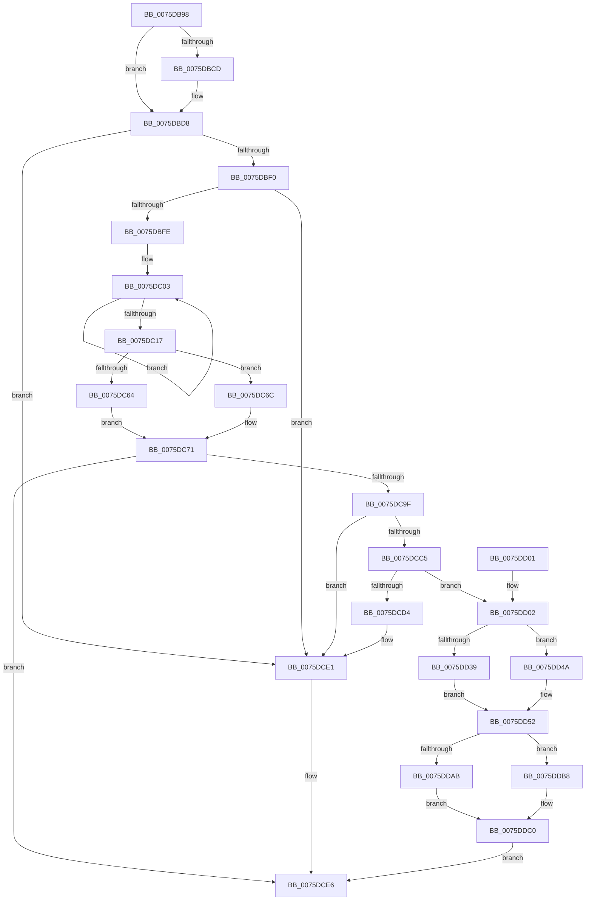

# PopPreallocateHibernateMemory

- RVA: `0x0075DB98`–`0x0075DDF3` (길이 `603` bytes)
- VA: `0x000000014075DB98`
- 실행 섹션: `PAGE`
- PDB 이름 있음: `예`; PDB Function 태그: `아니요`
- unwind 정보 RVA: `0x000CC50C`
- 디코드: `147`개 명령, `603/603` bytes 표시
- 미해석 바이트: `0` (있으면 어셈블리에 `.byte`로 보존)

> 이 문서는 커널 이미지의 기계어와 PDB 기호를 분석해 생성했습니다. 4번과 5번은 함수 원형과 자료형을 바이너리 사용 방식에서 추정한 C 해석이며 원본 소스 복구 결과는 아닙니다.

## 1. Dependencies

- 직접 호출 지점: **6**; 고유 호출 대상: **6**
- 직접 호출자로 확인된 함수: **1**
- RIP 상대 이미지 참조: **20**

### Outgoing calls
- `0x0075DBDA` → [MmGetHighestPhysicalPage](../../text/47/MmGetHighestPhysicalPage_function_00479040.md) (function, `0x00479040`)
- `0x0075DC44` → [Feature_CrashDumpOneMBTransferSize__private_IsEnabledDeviceUsageNoInline](../../text/5D/Feature_CrashDumpOneMBTransferSize__private_IsEnabledDeviceUsageNoInline_function_005D4A08.md) (function, `0x005D4A08`)
- `0x0075DC96` → [HvlAllocateHibernateResources](../71/HvlAllocateHibernateResources_function_007186D4.md) (function, `0x007186D4`)
- `0x0075DCB8` → [ExAllocatePool2](../../poolcode/B8/ExAllocatePool2_function_00B820F0.md) (function, `0x00B820F0`)
- `0x0075DCCB` → [MmObtainChargesToLockPagedPool](../7F/MmObtainChargesToLockPagedPool_function_007FE390.md) (function, `0x007FE390`)
- `0x0075DCDC` → [ExFreePoolWithTag](../../poolcode/B8/ExFreePoolWithTag_function_00B82870.md) (function, `0x00B82870`)

### Direct callers
- [PopEnableHiberFile](../90/PopEnableHiberFile_function_0090F850.md) at `0x0090FC67`

### Static image references
- `0x0075DBBB` → RVA `0x00EFF050` (`.data`; read)
- `0x0075DD10` → RVA `0x00F0BF80` (`.data`; write)
- `0x0075DD1F` → RVA `0x00F0BF78` (`.data`; write)
- `0x0075DD26` → RVA `0x00F0BF70` (`.data`; write)
- `0x0075DD2D` → RVA `0x00F0BF88` (`.data`; write)
- `0x0075DD41` → RVA `0x00F0BFE8` (`.data`; write)
- `0x0075DD4A` → RVA `0x00F0BFE8` (`.data`; read/write)
- `0x0075DD65` → RVA `0x00F0BF98` (`.data`; write)
- `0x0075DD71` → RVA `0x00F0BFA8` (`.data`; write)
- `0x0075DD86` → RVA `0x00F0BF90` (`.data`; write)
- `0x0075DD8C` → RVA `0x00F0BFB0` (`.data`; write)
- `0x0075DD92` → RVA `0x00F0BFB8` (`.data`; write)
- `0x0075DD99` → RVA `0x00F0BFA0` (`.data`; write)
- `0x0075DD9F` → RVA `0x00F0BFC0` (`.data`; write)
- `0x0075DDAF` → RVA `0x00F0BFF0` (`.data`; write)
- `0x0075DDB8` → RVA `0x00F0BFF0` (`.data`; read/write)
- `0x0075DDC4` → RVA `0x00F0BFC8` (`.data`; write)
- `0x0075DDCF` → RVA `0x00F0BFD0` (`.data`; write)
- `0x0075DDDA` → RVA `0x00F0BFD8` (`.data`; write)
- `0x0075DDE5` → RVA `0x00F0BFE0` (`.data`; write)

## 2. Other-region calls and transfers

- 다른 실행 섹션으로 향하는 call: **4**
  - `0x0075DBDA` → [MmGetHighestPhysicalPage](../../text/47/MmGetHighestPhysicalPage_function_00479040.md) (`PAGE` → `.text`)
  - `0x0075DC44` → [Feature_CrashDumpOneMBTransferSize__private_IsEnabledDeviceUsageNoInline](../../text/5D/Feature_CrashDumpOneMBTransferSize__private_IsEnabledDeviceUsageNoInline_function_005D4A08.md) (`PAGE` → `.text`)
  - `0x0075DCB8` → [ExAllocatePool2](../../poolcode/B8/ExAllocatePool2_function_00B820F0.md) (`PAGE` → `POOLCODE`)
  - `0x0075DCDC` → [ExFreePoolWithTag](../../poolcode/B8/ExFreePoolWithTag_function_00B82870.md) (`PAGE` → `POOLCODE`)
- 별도 외부 분기/꼬리 이동을 확인하지 못했습니다.

## 3. Assembly (complete function range)

```asm
0075DB98  48 89 5C 24 18                  mov qword ptr [rsp + 0x18], rbx
0075DB9D  55                              push rbp
0075DB9E  56                              push rsi
0075DB9F  57                              push rdi
0075DBA0  41 54                           push r12
0075DBA2  41 55                           push r13
0075DBA4  41 56                           push r14
0075DBA6  41 57                           push r15
0075DBA8  48 81 EC 80 00 00 00            sub rsp, 0x80
0075DBAF  48 83 64 24 20 00               and qword ptr [rsp + 0x20], 0
0075DBB5  41 B8 00 90 01 00               mov r8d, 0x19000
0075DBBB  83 3D 8E 14 7A 00 02            cmp dword ptr [rip + 0x7a148e], 2
0075DBC2  48 C7 44 24 28 00 10 00 00      mov qword ptr [rsp + 0x28], 0x1000
0075DBCB  75 0B                           jne 0x14075dbd8
0075DBCD  4C 89 44 24 30                  mov qword ptr [rsp + 0x30], r8
0075DBD2  41 B8 00 A0 01 00               mov r8d, 0x1a000
0075DBD8  33 C9                           xor ecx, ecx
0075DBDA  E8 61 B4 D1 FF                  call 0x140479040
0075DBDF  48 8D 78 20                     lea rdi, [rax + 0x20]
0075DBE3  48 83 E7 E0                     and rdi, 0xffffffffffffffe0
0075DBE7  48 3B F8                        cmp rdi, rax
0075DBEA  0F 82 F1 00 00 00               jb 0x14075dce1
0075DBF0  B8 FF FF FF FF                  mov eax, 0xffffffff
0075DBF5  48 3B F8                        cmp rdi, rax
0075DBF8  0F 87 E3 00 00 00               ja 0x14075dce1
0075DBFE  8B D7                           mov edx, edi
0075DC00  C1 EA 03                        shr edx, 3
0075DC03  41 8B C0                        mov eax, r8d
0075DC06  44 03 C2                        add r8d, edx
0075DC09  48 89 44 CC 38                  mov qword ptr [rsp + rcx*8 + 0x38], rax
0075DC0E  48 FF C1                        inc rcx
0075DC11  48 83 F9 02                     cmp rcx, 2
0075DC15  7C EC                           jl 0x14075dc03
0075DC17  41 8B C0                        mov eax, r8d
0075DC1A  BE F8 FF FF FF                  mov esi, 0xfffffff8
0075DC1F  48 89 84 24 C0 00 00 00         mov qword ptr [rsp + 0xc0], rax
0075DC27  8D 42 07                        lea eax, [rdx + 7]
0075DC2A  41 03 C0                        add eax, r8d
0075DC2D  23 C6                           and eax, esi
0075DC2F  8B C8                           mov ecx, eax
0075DC31  48 89 8C 24 C8 00 00 00         mov qword ptr [rsp + 0xc8], rcx
0075DC39  8D 98 F7 00 00 00               lea ebx, [rax + 0xf7]
0075DC3F  23 DE                           and ebx, esi
0075DC41  44 8B EB                        mov r13d, ebx
0075DC44  E8 BF 6D E7 FF                  call 0x1405d4a08
0075DC49  F7 D8                           neg eax
0075DC4B  1B C9                           sbb ecx, ecx
0075DC4D  81 E1 80 07 00 00               and ecx, 0x780
0075DC53  8D 81 B0 00 00 00               lea eax, [rcx + 0xb0]
0075DC59  03 C3                           add eax, ebx
0075DC5B  83 3D EE 13 7A 00 02            cmp dword ptr [rip + 0x7a13ee], 2
0075DC62  75 08                           jne 0x14075dc6c
0075DC64  44 8B F0                        mov r14d, eax
0075DC67  83 C0 38                        add eax, 0x38
0075DC6A  EB 05                           jmp 0x14075dc71
0075DC6C  4C 8B 74 24 60                  mov r14, qword ptr [rsp + 0x60]
0075DC71  44 8B F8                        mov r15d, eax
0075DC74  BB 00 01 00 00                  mov ebx, 0x100
0075DC79  05 AF 00 00 00                  add eax, 0xaf
0075DC7E  8B D3                           mov edx, ebx
0075DC80  23 C6                           and eax, esi
0075DC82  B1 01                           mov cl, 1
0075DC84  44 8B E0                        mov r12d, eax
0075DC87  8D B0 3F 10 00 00               lea esi, [rax + 0x103f]
0075DC8D  B8 00 F0 FF FF                  mov eax, 0xfffff000
0075DC92  23 F0                           and esi, eax
0075DC94  8B EE                           mov ebp, esi
0075DC96  E8 39 AA FB FF                  call 0x1407186d4
0075DC9B  85 C0                           test eax, eax
0075DC9D  78 47                           js 0x14075dce6
0075DC9F  B8 00 F0 FF FF                  mov eax, 0xfffff000
0075DCA4  81 C6 FF 3F 00 00               add esi, 0x3fff
0075DCAA  48 23 F0                        and rsi, rax
0075DCAD  41 B8 68 69 62 72               mov r8d, 0x72626968
0075DCB3  48 8B D6                        mov rdx, rsi
0075DCB6  8B CB                           mov ecx, ebx
0075DCB8  E8 33 44 42 00                  call 0x140b820f0
0075DCBD  48 8B D8                        mov rbx, rax
0075DCC0  48 85 C0                        test rax, rax
0075DCC3  74 1C                           je 0x14075dce1
0075DCC5  48 8B D6                        mov rdx, rsi
0075DCC8  48 8B C8                        mov rcx, rax
0075DCCB  E8 C0 06 0A 00                  call 0x1407fe390
0075DCD0  85 C0                           test eax, eax
0075DCD2  75 2E                           jne 0x14075dd02
0075DCD4  BA 68 69 62 72                  mov edx, 0x72626968
0075DCD9  48 8B CB                        mov rcx, rbx
0075DCDC  E8 8F 4B 42 00                  call 0x140b82870
0075DCE1  B8 9A 00 00 C0                  mov eax, 0xc000009a
0075DCE6  48 8B 9C 24 D0 00 00 00         mov rbx, qword ptr [rsp + 0xd0]
0075DCEE  48 81 C4 80 00 00 00            add rsp, 0x80
0075DCF5  41 5F                           pop r15
0075DCF7  41 5E                           pop r14
0075DCF9  41 5D                           pop r13
0075DCFB  41 5C                           pop r12
0075DCFD  5F                              pop rdi
0075DCFE  5E                              pop rsi
0075DCFF  5D                              pop rbp
0075DD00  C3                              ret
0075DD01  CC                              int3
0075DD02  48 8B 4C 24 20                  mov rcx, qword ptr [rsp + 0x20]
0075DD07  8B 15 43 13 7A 00               mov edx, dword ptr [rip + 0x7a1343]
0075DD0D  48 03 CB                        add rcx, rbx
0075DD10  48 89 0D 69 E2 7A 00            mov qword ptr [rip + 0x7ae269], rcx
0075DD17  48 8B 4C 24 28                  mov rcx, qword ptr [rsp + 0x28]
0075DD1C  48 03 CB                        add rcx, rbx
0075DD1F  48 89 35 52 E2 7A 00            mov qword ptr [rip + 0x7ae252], rsi
0075DD26  48 89 1D 43 E2 7A 00            mov qword ptr [rip + 0x7ae243], rbx
0075DD2D  48 89 0D 54 E2 7A 00            mov qword ptr [rip + 0x7ae254], rcx
0075DD34  83 FA 02                        cmp edx, 2
0075DD37  75 11                           jne 0x14075dd4a
0075DD39  48 8B 4C 24 30                  mov rcx, qword ptr [rsp + 0x30]
0075DD3E  48 03 CB                        add rcx, rbx
0075DD41  48 89 0D A0 E2 7A 00            mov qword ptr [rip + 0x7ae2a0], rcx
0075DD48  EB 08                           jmp 0x14075dd52
0075DD4A  48 83 25 96 E2 7A 00 00         and qword ptr [rip + 0x7ae296], 0
0075DD52  48 8B 4C 24 38                  mov rcx, qword ptr [rsp + 0x38]
0075DD57  48 8B 84 24 C0 00 00 00         mov rax, qword ptr [rsp + 0xc0]
0075DD5F  48 03 CB                        add rcx, rbx
0075DD62  48 03 C3                        add rax, rbx
0075DD65  48 89 0D 2C E2 7A 00            mov qword ptr [rip + 0x7ae22c], rcx
0075DD6C  48 8B 4C 24 40                  mov rcx, qword ptr [rsp + 0x40]
0075DD71  48 89 05 30 E2 7A 00            mov qword ptr [rip + 0x7ae230], rax
0075DD78  48 03 CB                        add rcx, rbx
0075DD7B  48 8B 84 24 C8 00 00 00         mov rax, qword ptr [rsp + 0xc8]
0075DD83  48 03 C3                        add rax, rbx
0075DD86  89 3D 04 E2 7A 00               mov dword ptr [rip + 0x7ae204], edi
0075DD8C  89 3D 1E E2 7A 00               mov dword ptr [rip + 0x7ae21e], edi
0075DD92  48 89 0D 1F E2 7A 00            mov qword ptr [rip + 0x7ae21f], rcx
0075DD99  89 3D 01 E2 7A 00               mov dword ptr [rip + 0x7ae201], edi
0075DD9F  48 89 05 1A E2 7A 00            mov qword ptr [rip + 0x7ae21a], rax
0075DDA6  83 FA 02                        cmp edx, 2
0075DDA9  75 0D                           jne 0x14075ddb8
0075DDAB  49 8D 04 1E                     lea rax, [r14 + rbx]
0075DDAF  48 89 05 3A E2 7A 00            mov qword ptr [rip + 0x7ae23a], rax
0075DDB6  EB 08                           jmp 0x14075ddc0
0075DDB8  48 83 25 30 E2 7A 00 00         and qword ptr [rip + 0x7ae230], 0
0075DDC0  49 8D 04 1C                     lea rax, [r12 + rbx]
0075DDC4  48 89 05 FD E1 7A 00            mov qword ptr [rip + 0x7ae1fd], rax
0075DDCB  48 8D 04 2B                     lea rax, [rbx + rbp]
0075DDCF  48 89 05 FA E1 7A 00            mov qword ptr [rip + 0x7ae1fa], rax
0075DDD6  49 8D 04 1F                     lea rax, [r15 + rbx]
0075DDDA  48 89 05 F7 E1 7A 00            mov qword ptr [rip + 0x7ae1f7], rax
0075DDE1  4A 8D 04 2B                     lea rax, [rbx + r13]
0075DDE5  48 89 05 F4 E1 7A 00            mov qword ptr [rip + 0x7ae1f4], rax
0075DDEC  33 C0                           xor eax, eax
0075DDEE  E9 F3 FE FF FF                  jmp 0x14075dce6
```

## 4. C-style interpretation (structured pseudocode)

```c
__int64 __fastcall PopPreallocateHibernateMemory(int a1)
{
    __int64 result;
    __int64 v_rbx;
    __int64 v_rdi;
    __int64 v_rsi;
    __int64 v_rsp;
    unsigned __int64 v_stack_m58;
    unsigned __int64 v_stack_m88;
    unsigned __int64 v_stack_m90;
    unsigned __int64 v_stack_m98;
    unsigned __int64 v_stack_p10;
    unsigned __int64 v_stack_p18;
    unsigned __int64 v_stack_p20;
    unsigned __int64 v_stack_p28;
    unsigned __int64 v_stack_p30;
    unsigned __int64 v_stack_p38;
    unsigned __int64 v_stack_p40;
    unsigned __int64 v_stack_p8;
    unsigned __int64 v_stack_pC0;
    unsigned __int64 v_stack_pC8;

    v_stack_p18 = v_rbx;
    v_rsp = (v_rsp) - (128);
    v_stack_m90 = 0x1000ULL;
    if ((*(unsigned int *)(v_rip + 8000654)) == 2) {
        v_stack_m88 = (unsigned int)(0x19000ULL);
        a3 = 0x1A000ULL;
    }
    a1 = 0;
    result = MmGetHighestPhysicalPage(a1, a2, a3, a4);
    v_rdi = (result + 32) & (-32);
    if (v_rdi < result) goto loc_0075DCE1;
    if (v_rdi > ((unsigned int)(0xFFFFFFFFULL))) goto loc_0075DCE1;
    a2 = (unsigned int)(((unsigned int)((unsigned int)(v_rdi))) >> (3));
loc_0075DC03:
    a3 = (unsigned int)((a3) + ((unsigned int)(a2)));
    *(unsigned __int64 *)(v_rsp + a1 * 8 + 56) = (unsigned int)((unsigned int)(a3));
    a1 = (a1) + 1;
    if (a1 < 2) goto loc_0075DC03;
    v_stack_p8 = (unsigned int)((unsigned int)(a3));
    result = (unsigned int)((a2 + 7) + ((unsigned int)(a3)));
    result = (unsigned int)((result) & ((unsigned int)((unsigned int)(0xFFFFFFF8ULL))));
    v_stack_p10 = (unsigned int)((unsigned int)(result));
    v_rbx = (unsigned int)((result + 247) & ((unsigned int)((unsigned int)(0xFFFFFFF8ULL))));
    result = Feature_CrashDumpOneMBTransferSize__private_IsEnabledDeviceUsageNoInline((unsigned int)((unsigned int)(result)), a2, a3, a4);
    result = (unsigned int)(-(result));
    a1 = (unsigned int)(((unsigned int)((unsigned int)(result))) & (0x780ULL));
    result = (unsigned int)((a1 + 176) + ((unsigned int)(v_rbx)));
    if ((*(unsigned int *)(v_rip + 8000494)) != 2) goto loc_0075DC6C;
    result = (unsigned int)((result) + (56));
    goto loc_0075DC71;
loc_0075DC6C:
loc_0075DC71:
    result = (unsigned int)((result) + (175));
    result = (unsigned int)((result) & ((unsigned int)((unsigned int)(0xFFFFFFF8ULL))));
    v_rsi = (unsigned int)((result + 4159) & ((unsigned int)((unsigned int)(0xFFFFF000ULL))));
    result = HvlAllocateHibernateResources(1, 256, a3, a4);
    if (sign_flag) goto loc_0075DCE6;
    v_rsi = (unsigned int)((v_rsi) + (0x3FFFULL));
    v_rsi = (v_rsi) & ((unsigned int)(0xFFFFF000ULL));
    result = ExAllocatePool2(256, v_rsi, (unsigned int)(0x72626968ULL), a4);
    if (result == 0) goto loc_0075DCE1;
    result = MmObtainChargesToLockPagedPool(result, v_rsi, (unsigned int)(0x72626968ULL), a4);
    if ((unsigned int)(result) != 0) goto loc_0075DD02;
    result = ExFreePoolWithTag(result, (unsigned int)(0x72626968ULL), (unsigned int)(0x72626968ULL), a4);
loc_0075DCE1:
loc_0075DCE6:
    v_rsp = (v_rsp) + (128);
    return (unsigned int)(0xC000009AULL);
loc_0075DD02:
    a1 = (v_stack_p20) + (v_stack_p18);
    *(unsigned __int64 *)(v_rip + 8053353) = a1;
    a1 = (v_stack_p28) + (v_stack_p18);
    *(unsigned __int64 *)(v_rip + 8053330) = v_rsi;
    *(unsigned __int64 *)(v_rip + 8053315) = v_stack_p18;
    *(unsigned __int64 *)(v_rip + 8053332) = a1;
    if (((unsigned int)((unsigned int)(*(unsigned int *)(v_rip + 8000323)))) != 2) goto loc_0075DD4A;
    a1 = (v_stack_p30) + (v_stack_p18);
    *(unsigned __int64 *)(v_rip + 8053408) = a1;
    goto loc_0075DD52;
loc_0075DD4A:
loc_0075DD52:
    a1 = (v_stack_p38) + (v_stack_p18);
    result = (v_stack_pC0) + (v_stack_p18);
    *(unsigned __int64 *)(v_rip + 8053292) = a1;
    *(unsigned __int64 *)(v_rip + 8053296) = result;
    a1 = (v_stack_p40) + (v_stack_p18);
    result = (v_stack_pC8) + (v_stack_p18);
    *(unsigned int *)(v_rip + 8053252) = (unsigned int)(v_rdi);
    *(unsigned int *)(v_rip + 8053278) = (unsigned int)(v_rdi);
    *(unsigned __int64 *)(v_rip + 8053279) = a1;
    *(unsigned int *)(v_rip + 8053249) = (unsigned int)(v_rdi);
    *(unsigned __int64 *)(v_rip + 8053274) = result;
    if (((unsigned int)((unsigned int)(*(unsigned int *)(v_rip + 8000323)))) != 2) goto loc_0075DDB8;
    *(unsigned __int64 *)(v_rip + 8053306) = v_stack_m58 + v_stack_p18 * 1;
    goto loc_0075DDC0;
loc_0075DDB8:
loc_0075DDC0:
    *(unsigned __int64 *)(v_rip + 8053245) = (unsigned int)((unsigned int)(result)) + v_stack_p18 * 1;
    *(unsigned __int64 *)(v_rip + 8053242) = v_stack_p18 + (unsigned int)((unsigned int)(v_rsi)) * 1;
    *(unsigned __int64 *)(v_rip + 8053239) = (unsigned int)((unsigned int)(result)) + v_stack_p18 * 1;
    *(unsigned __int64 *)(v_rip + 8053236) = v_stack_p18 + (unsigned int)((unsigned int)(v_rbx)) * 1;
    result = 0;
    goto loc_0075DCE6;
}
```

## 5. (Beta) C Style

```c
int64_t PopPreallocateHibernateMemory(int32_t Arg1)
{
    int64_t result;
    int64_t local_rbx;
    int64_t local_rdi;
    int64_t local_rsi;
    int64_t local_rsp;
    uint64_t v_stack_m58;
    uint64_t v_stack_m88;
    uint64_t v_stack_m90;
    uint64_t v_stack_m98;
    uint64_t v_stack_p10;
    uint64_t v_stack_p18;
    uint64_t v_stack_p20;
    uint64_t v_stack_p28;
    uint64_t v_stack_p30;
    uint64_t v_stack_p38;
    uint64_t v_stack_p40;
    uint64_t v_stack_p8;
    uint64_t v_stack_pC0;
    uint64_t v_stack_pC8;

    v_stack_p18 = local_rbx;
    local_rsp = (local_rsp) - (128);
    v_stack_m90 = 0x1000ULL;
    if ((*(uint32_t *)(v_rip + 0x7A148E)) == 2) {
        v_stack_m88 = (uint32_t)(0x19000ULL);
        a3 = 0x1A000ULL;
    }
    Arg1 = 0;
    result = MmGetHighestPhysicalPage(Arg1, a2, a3, a4);
    local_rdi = (result + 32) & (-32);
    if (local_rdi < result) goto loc_0075DCE1;
    if (local_rdi > ((uint32_t)(0xFFFFFFFFULL))) goto loc_0075DCE1;
    a2 = (uint32_t)(((uint32_t)((uint32_t)(local_rdi))) >> (3));
loc_0075DC03:
    a3 = (uint32_t)((a3) + ((uint32_t)(a2)));
    *(uint64_t *)(local_rsp + Arg1 * 8 + 0x38) = (uint32_t)((uint32_t)(a3));
    Arg1 = (Arg1) + 1;
    if (Arg1 < 2) goto loc_0075DC03;
    v_stack_p8 = (uint32_t)((uint32_t)(a3));
    result = (uint32_t)((a2 + 7) + ((uint32_t)(a3)));
    result = (uint32_t)((result) & ((uint32_t)((uint32_t)(0xFFFFFFF8ULL))));
    v_stack_p10 = (uint32_t)((uint32_t)(result));
    local_rbx = (uint32_t)((result + 247) & ((uint32_t)((uint32_t)(0xFFFFFFF8ULL))));
    result = Feature_CrashDumpOneMBTransferSize__private_IsEnabledDeviceUsageNoInline((uint32_t)((uint32_t)(result)), a2, a3, a4);
    result = (uint32_t)(-(result));
    Arg1 = (uint32_t)(((uint32_t)((uint32_t)(result))) & (0x780ULL));
    result = (uint32_t)((Arg1 + 176) + ((uint32_t)(local_rbx)));
    if ((*(uint32_t *)(v_rip + 0x7A13EE)) != 2) goto loc_0075DC6C;
    result = (uint32_t)((result) + (56));
    goto loc_0075DC71;
loc_0075DC6C:
loc_0075DC71:
    result = (uint32_t)((result) + (175));
    result = (uint32_t)((result) & ((uint32_t)((uint32_t)(0xFFFFFFF8ULL))));
    local_rsi = (uint32_t)((result + 4159) & ((uint32_t)((uint32_t)(0xFFFFF000ULL))));
    result = HvlAllocateHibernateResources(1, 256, a3, a4);
    if (sign_flag) goto loc_0075DCE6;
    local_rsi = (uint32_t)((local_rsi) + (0x3FFFULL));
    local_rsi = (local_rsi) & ((uint32_t)(0xFFFFF000ULL));
    result = ExAllocatePool2(256, local_rsi, (uint32_t)(0x72626968ULL), a4);
    if (result == 0) goto loc_0075DCE1;
    result = MmObtainChargesToLockPagedPool(result, local_rsi, (uint32_t)(0x72626968ULL), a4);
    if ((uint32_t)(result) != 0) goto loc_0075DD02;
    result = ExFreePoolWithTag(result, (uint32_t)(0x72626968ULL), (uint32_t)(0x72626968ULL), a4);
loc_0075DCE1:
loc_0075DCE6:
    local_rsp = (local_rsp) + (128);
    return (uint32_t)(0xC000009AULL);
loc_0075DD02:
    Arg1 = (v_stack_p20) + (v_stack_p18);
    *(uint64_t *)(v_rip + 0x7AE269) = Arg1;
    Arg1 = (v_stack_p28) + (v_stack_p18);
    *(uint64_t *)(v_rip + 0x7AE252) = local_rsi;
    *(uint64_t *)(v_rip + 0x7AE243) = v_stack_p18;
    *(uint64_t *)(v_rip + 0x7AE254) = Arg1;
    if (((uint32_t)((uint32_t)(*(uint32_t *)(v_rip + 0x7A1343)))) != 2) goto loc_0075DD4A;
    Arg1 = (v_stack_p30) + (v_stack_p18);
    *(uint64_t *)(v_rip + 0x7AE2A0) = Arg1;
    goto loc_0075DD52;
loc_0075DD4A:
loc_0075DD52:
    Arg1 = (v_stack_p38) + (v_stack_p18);
    result = (v_stack_pC0) + (v_stack_p18);
    *(uint64_t *)(v_rip + 0x7AE22C) = Arg1;
    *(uint64_t *)(v_rip + 0x7AE230) = result;
    Arg1 = (v_stack_p40) + (v_stack_p18);
    result = (v_stack_pC8) + (v_stack_p18);
    *(uint32_t *)(v_rip + 0x7AE204) = (uint32_t)(local_rdi);
    *(uint32_t *)(v_rip + 0x7AE21E) = (uint32_t)(local_rdi);
    *(uint64_t *)(v_rip + 0x7AE21F) = Arg1;
    *(uint32_t *)(v_rip + 0x7AE201) = (uint32_t)(local_rdi);
    *(uint64_t *)(v_rip + 0x7AE21A) = result;
    if (((uint32_t)((uint32_t)(*(uint32_t *)(v_rip + 0x7A1343)))) != 2) goto loc_0075DDB8;
    *(uint64_t *)(v_rip + 0x7AE23A) = v_stack_m58 + v_stack_p18 * 1;
    goto loc_0075DDC0;
loc_0075DDB8:
loc_0075DDC0:
    *(uint64_t *)(v_rip + 0x7AE1FD) = (uint32_t)((uint32_t)(result)) + v_stack_p18 * 1;
    *(uint64_t *)(v_rip + 0x7AE1FA) = v_stack_p18 + (uint32_t)((uint32_t)(local_rsi)) * 1;
    *(uint64_t *)(v_rip + 0x7AE1F7) = (uint32_t)((uint32_t)(result)) + v_stack_p18 * 1;
    *(uint64_t *)(v_rip + 0x7AE1F4) = v_stack_p18 + (uint32_t)((uint32_t)(local_rbx)) * 1;
    result = 0;
    goto loc_0075DCE6;
}
```

## 6. Execution-region graph

[열기: 2D/3D 그래프와 함수 탐색 컨트롤 패널](../../../control-panel.html?section=page&rva=0x0075DB98&view=graph)

- 2D 그래프는 위에서 아래로 흐르고, 3D 그래프는 빈 공간을 드래그해 회전합니다. Shift+드래그는 이동, 휠은 확대·축소, 함수 노드 선택은 대상 보고서 이동입니다.

### Static fallback


