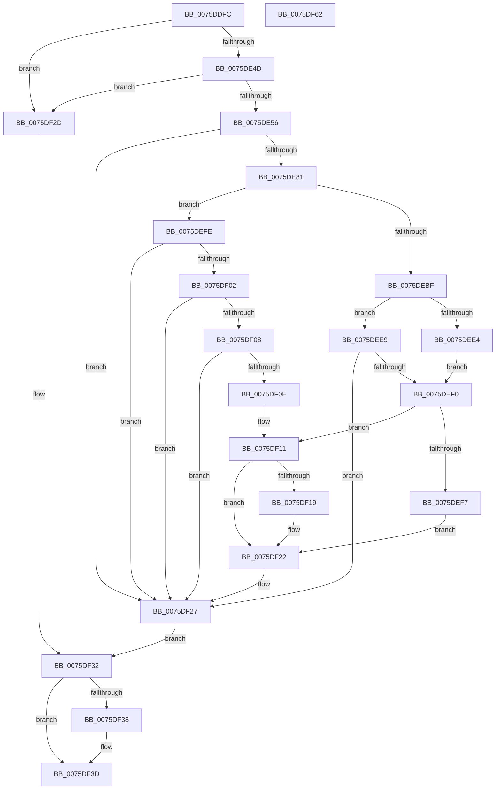

# PopQueryHiberPersistedRegValue

- RVA: `0x0075DDFC`–`0x0075DF63` (길이 `359` bytes)
- VA: `0x000000014075DDFC`
- 실행 섹션: `PAGE`
- PDB 이름 있음: `예`; PDB Function 태그: `아니요`
- unwind 정보 RVA: `0x000CC528`
- 디코드: `102`개 명령, `359/359` bytes 표시
- 미해석 바이트: `0` (있으면 어셈블리에 `.byte`로 보존)

> 이 문서는 커널 이미지의 기계어와 PDB 기호를 분석해 생성했습니다. 4번과 5번은 함수 원형과 자료형을 바이너리 사용 방식에서 추정한 C 해석이며 원본 소스 복구 결과는 아닙니다.

## 1. Dependencies

- 직접 호출 지점: **6**; 고유 호출 대상: **6**
- 직접 호출자로 확인된 함수: **2**
- RIP 상대 이미지 참조: **2**

### Outgoing calls
- `0x0075DE72` → [PopOpenHiberPersistedKey](../70/PopOpenHiberPersistedKey_function_007024E0.md) (function, `0x007024E0`)
- `0x0075DE89` → [RtlInitUnicodeString](../../text/42/RtlInitUnicodeString_function_0042A780.md) (function, `0x0042A780`)
- `0x0075DEB1` → [ZwQueryValueKey](../../text/6A/ZwQueryValueKey_function_006AD3B0.md) (function, `0x006AD3B0`)
- `0x0075DED9` → [PopReadUlongPowerKey](../../text/5C/PopReadUlongPowerKey_function_005CEB5C.md) (function, `0x005CEB5C`)
- `0x0075DF38` → [ZwClose](../../text/6A/ZwClose_function_006AD2B0.md) (function, `0x006AD2B0`)
- `0x0075DF46` → [_security_check_cookie](../../text/6A/_security_check_cookie_function_006AC640.md) (function, `0x006AC640`)

### Direct callers
- [PopInitHiberPersistedRegValues](PopInitHiberPersistedRegValues_function_0075D974.md) at `0x0075DA2C`
- [PopWnfHibernatePolicyCallback](PopWnfHibernatePolicyCallback_function_0075E3C0.md) at `0x0075E3DD`

### Static image references
- `0x0075DE12` → RVA `0x00E0A740` (`.data`; read)
- `0x0075DE5D` → RVA `0x00E07520` (`.data`; read)

## 2. Other-region calls and transfers

- 다른 실행 섹션으로 향하는 call: **5**
  - `0x0075DE89` → [RtlInitUnicodeString](../../text/42/RtlInitUnicodeString_function_0042A780.md) (`PAGE` → `.text`)
  - `0x0075DEB1` → [ZwQueryValueKey](../../text/6A/ZwQueryValueKey_function_006AD3B0.md) (`PAGE` → `.text`)
  - `0x0075DED9` → [PopReadUlongPowerKey](../../text/5C/PopReadUlongPowerKey_function_005CEB5C.md) (`PAGE` → `.text`)
  - `0x0075DF38` → [ZwClose](../../text/6A/ZwClose_function_006AD2B0.md) (`PAGE` → `.text`)
  - `0x0075DF46` → [_security_check_cookie](../../text/6A/_security_check_cookie_function_006AC640.md) (`PAGE` → `.text`)
- 별도 외부 분기/꼬리 이동을 확인하지 못했습니다.

## 3. Assembly (complete function range)

```asm
0075DDFC  48 89 5C 24 18                  mov qword ptr [rsp + 0x18], rbx
0075DE01  55                              push rbp
0075DE02  56                              push rsi
0075DE03  57                              push rdi
0075DE04  41 54                           push r12
0075DE06  41 56                           push r14
0075DE08  48 8B EC                        mov rbp, rsp
0075DE0B  48 81 EC 80 00 00 00            sub rsp, 0x80
0075DE12  48 8B 05 27 C9 6A 00            mov rax, qword ptr [rip + 0x6ac927]
0075DE19  48 33 C4                        xor rax, rsp
0075DE1C  48 89 45 F0                     mov qword ptr [rbp - 0x10], rax
0075DE20  48 63 C1                        movsxd rax, ecx
0075DE23  0F 57 C0                        xorps xmm0, xmm0
0075DE26  33 C9                           xor ecx, ecx
0075DE28  4C 8B F2                        mov r14, rdx
0075DE2B  21 4D C0                        and dword ptr [rbp - 0x40], ecx
0075DE2E  21 4D B0                        and dword ptr [rbp - 0x50], ecx
0075DE31  89 4D E8                        mov dword ptr [rbp - 0x18], ecx
0075DE34  48 83 C9 FF                     or rcx, 0xffffffffffffffff
0075DE38  48 89 4D B8                     mov qword ptr [rbp - 0x48], rcx
0075DE3C  0F 11 45 D8                     movups xmmword ptr [rbp - 0x28], xmm0
0075DE40  0F 11 45 C8                     movups xmmword ptr [rbp - 0x38], xmm0
0075DE44  83 F8 03                        cmp eax, 3
0075DE47  0F 87 E0 00 00 00               ja 0x14075df2d
0075DE4D  48 85 D2                        test rdx, rdx
0075DE50  0F 84 D7 00 00 00               je 0x14075df2d
0075DE56  48 8D 34 40                     lea rsi, [rax + rax*2]
0075DE5A  45 33 C0                        xor r8d, r8d
0075DE5D  4C 8D 25 BC 96 6A 00            lea r12, [rip + 0x6a96bc]
0075DE64  BA 19 00 02 00                  mov edx, 0x20019
0075DE69  41 8B 7C F4 14                  mov edi, dword ptr [r12 + rsi*8 + 0x14]
0075DE6E  48 8D 4D B8                     lea rcx, [rbp - 0x48]
0075DE72  E8 69 46 FA FF                  call 0x1407024e0
0075DE77  8B D8                           mov ebx, eax
0075DE79  85 C0                           test eax, eax
0075DE7B  0F 88 A6 00 00 00               js 0x14075df27
0075DE81  49 8B 14 F4                     mov rdx, qword ptr [r12 + rsi*8]
0075DE85  48 8D 4D C8                     lea rcx, [rbp - 0x38]
0075DE89  E8 F2 C8 CC FF                  call 0x14042a780
0075DE8E  48 8B 4D B8                     mov rcx, qword ptr [rbp - 0x48]
0075DE92  48 8D 45 C0                     lea rax, [rbp - 0x40]
0075DE96  48 89 44 24 28                  mov qword ptr [rsp + 0x28], rax
0075DE9B  4C 8D 4D D8                     lea r9, [rbp - 0x28]
0075DE9F  41 B8 02 00 00 00               mov r8d, 2
0075DEA5  C7 44 24 20 14 00 00 00         mov dword ptr [rsp + 0x20], 0x14
0075DEAD  48 8D 55 C8                     lea rdx, [rbp - 0x38]
0075DEB1  E8 FA F4 F4 FF                  call 0x1406ad3b0
0075DEB6  8B D8                           mov ebx, eax
0075DEB8  3D 34 00 00 C0                  cmp eax, 0xc0000034
0075DEBD  75 3F                           jne 0x14075defe
0075DEBF  45 8B 44 F4 14                  mov r8d, dword ptr [r12 + rsi*8 + 0x14]
0075DEC4  48 8D 55 B0                     lea rdx, [rbp - 0x50]
0075DEC8  49 8B 0C F4                     mov rcx, qword ptr [r12 + rsi*8]
0075DECC  45 33 C9                        xor r9d, r9d
0075DECF  44 89 44 24 28                  mov dword ptr [rsp + 0x28], r8d
0075DED4  83 4C 24 20 FF                  or dword ptr [rsp + 0x20], 0xffffffff
0075DED9  E8 7E 0C E7 FF                  call 0x1405ceb5c
0075DEDE  8B D8                           mov ebx, eax
0075DEE0  85 C0                           test eax, eax
0075DEE2  78 05                           js 0x14075dee9
0075DEE4  8B 7D B0                        mov edi, dword ptr [rbp - 0x50]
0075DEE7  EB 07                           jmp 0x14075def0
0075DEE9  3D 34 00 00 C0                  cmp eax, 0xc0000034
0075DEEE  75 37                           jne 0x14075df27
0075DEF0  3D 34 00 00 C0                  cmp eax, 0xc0000034
0075DEF5  75 1A                           jne 0x14075df11
0075DEF7  41 8B 7C F4 14                  mov edi, dword ptr [r12 + rsi*8 + 0x14]
0075DEFC  EB 24                           jmp 0x14075df22
0075DEFE  85 C0                           test eax, eax
0075DF00  78 25                           js 0x14075df27
0075DF02  83 7D DC 04                     cmp dword ptr [rbp - 0x24], 4
0075DF06  75 1F                           jne 0x14075df27
0075DF08  83 7D E0 04                     cmp dword ptr [rbp - 0x20], 4
0075DF0C  75 19                           jne 0x14075df27
0075DF0E  8B 7D E4                        mov edi, dword ptr [rbp - 0x1c]
0075DF11  41 80 7C F4 10 00               cmp byte ptr [r12 + rsi*8 + 0x10], 0
0075DF17  74 09                           je 0x14075df22
0075DF19  33 C0                           xor eax, eax
0075DF1B  85 FF                           test edi, edi
0075DF1D  0F 95 C0                        setne al
0075DF20  8B F8                           mov edi, eax
0075DF22  41 89 3E                        mov dword ptr [r14], edi
0075DF25  33 DB                           xor ebx, ebx
0075DF27  48 8B 4D B8                     mov rcx, qword ptr [rbp - 0x48]
0075DF2B  EB 05                           jmp 0x14075df32
0075DF2D  BB 0D 00 00 C0                  mov ebx, 0xc000000d
0075DF32  48 83 F9 FF                     cmp rcx, -1
0075DF36  74 05                           je 0x14075df3d
0075DF38  E8 73 F3 F4 FF                  call 0x1406ad2b0
0075DF3D  8B C3                           mov eax, ebx
0075DF3F  48 8B 4D F0                     mov rcx, qword ptr [rbp - 0x10]
0075DF43  48 33 CC                        xor rcx, rsp
0075DF46  E8 F5 E6 F4 FF                  call 0x1406ac640
0075DF4B  48 8B 9C 24 C0 00 00 00         mov rbx, qword ptr [rsp + 0xc0]
0075DF53  48 81 C4 80 00 00 00            add rsp, 0x80
0075DF5A  41 5E                           pop r14
0075DF5C  41 5C                           pop r12
0075DF5E  5F                              pop rdi
0075DF5F  5E                              pop rsi
0075DF60  5D                              pop rbp
0075DF61  C3                              ret
0075DF62  CC                              int3
```

## 4. C-style interpretation (structured pseudocode)

```c
__int64 __fastcall PopQueryHiberPersistedRegValue(int a1, __int64 a2, int a3)
{
    __int64 result;
    __int64 v_rbx;
    __int64 v_rdi;
    __int64 v_rsp;
    unsigned __int64 v_stack_m38;
    unsigned int v_stack_m40;
    unsigned int v_stack_m44;
    unsigned int v_stack_m48;
    unsigned int v_stack_m4C;
    unsigned __int64 v_stack_m50;
    unsigned __int64 v_stack_m60;
    unsigned int v_stack_m68;
    unsigned __int64 v_stack_m70;
    unsigned int v_stack_m78;
    unsigned __int64 v_stack_m80;
    unsigned int v_stack_m88;
    unsigned __int64 v_stack_p18;

    v_stack_p18 = v_rbx;
    v_rsp = (v_rsp) - (128);
    result = (*(unsigned __int64 *)(v_rip + 6998311)) ^ (v_rsp);
    v_stack_m38 = result;
    a1 = 0;
    v_stack_m40 = 0;
    a1 = (a1) | (-1);
    v_stack_m70 = a1;
    v_stack_m50 = v_xmm0;
    v_stack_m60 = v_xmm0;
    if (((unsigned int)((int)(a1))) > 3) goto loc_0075DF2D;
    if (a2 == 0) goto loc_0075DF2D;
    a3 = 0;
    result = PopOpenHiberPersistedKey(v_stack_m70, (unsigned int)(0x20019ULL), a3, a4);
    if (sign_flag) goto loc_0075DF27;
    result = RtlInitUnicodeString(v_stack_m60, *(unsigned __int64 *)(v_rip + 6985404 + (int)(a1) + (int)(a1) * 2 * 8), a3, a4);
    v_stack_m80 = v_stack_m68;
    v_stack_m88 = 20;
    result = ZwQueryValueKey(v_stack_m70, v_stack_m60, 2, v_stack_m50);
    if (((unsigned int)(result)) != 0xC0000034ULL) goto loc_0075DEFE;
    a4 = 0;
    v_stack_m80 = (unsigned int)((unsigned int)(*(unsigned int *)(v_rip + 6985404 + (int)(a1) + (int)(a1) * 2 * 8 + 20)));
    result = PopReadUlongPowerKey(*(unsigned __int64 *)(v_rip + 6985404 + (int)(a1) + (int)(a1) * 2 * 8), v_stack_m78, (unsigned int)(*(unsigned int *)(v_rip + 6985404 + (int)(a1) + (int)(a1) * 2 * 8 + 20)), a4);
    if (sign_flag) goto loc_0075DEE9;
    goto loc_0075DEF0;
loc_0075DEE9:
    if (((unsigned int)(result)) != 0xC0000034ULL) goto loc_0075DF27;
loc_0075DEF0:
    if (((unsigned int)(result)) != 0xC0000034ULL) goto loc_0075DF11;
    goto loc_0075DF22;
loc_0075DEFE:
    if (sign_flag) goto loc_0075DF27;
    if (v_stack_m4C != 4) goto loc_0075DF27;
    if (v_stack_m48 != 4) goto loc_0075DF27;
loc_0075DF11:
    v_rdi = (unsigned int)(v_stack_m44);
    if ((*(unsigned __int8 *)(v_rip + 6985404 + (int)(a1) + (int)(a1) * 2 * 8 + 16)) != 0) {
        result = 0;
        result = ((unsigned int)((unsigned int)(v_stack_m44)) != 0) ? 1 : 0;
        v_rdi = (unsigned int)(result);
    }
    *(unsigned int *)(a2) = (unsigned int)(v_rdi);
    v_rbx = 0;
loc_0075DF27:
    goto loc_0075DF32;
loc_0075DF2D:
loc_0075DF32:
    if (v_stack_m70 != -1) {
        result = ZwClose(v_stack_m70, v_stack_m78, (unsigned int)(*(unsigned int *)(v_rip + 6985404 + (int)(a1) + (int)(a1) * 2 * 8 + 20)), a4);
    }
    a1 = (v_stack_m38) ^ (v_rsp);
    result = _security_check_cookie(a1, v_stack_m78, (unsigned int)(*(unsigned int *)(v_rip + 6985404 + (int)(a1) + (int)(a1) * 2 * 8 + 20)), a4);
    v_rsp = (v_rsp) + (128);
    return result;
}
```

## 5. (Beta) C Style

```c
int64_t PopQueryHiberPersistedRegValue(int32_t Arg1, void *Arg2, int32_t Arg3)
{
    uint8_t *arg2 = (uint8_t *)Arg2;

    int64_t result;
    int64_t local_rbx;
    int64_t local_rdi;
    int64_t local_rsp;
    uint64_t v_stack_m38;
    uint32_t v_stack_m40;
    uint32_t v_stack_m44;
    uint32_t v_stack_m48;
    uint32_t v_stack_m4C;
    uint64_t v_stack_m50;
    uint64_t v_stack_m60;
    uint32_t v_stack_m68;
    uint64_t v_stack_m70;
    uint32_t v_stack_m78;
    uint64_t v_stack_m80;
    uint32_t v_stack_m88;
    uint64_t v_stack_p18;

    v_stack_p18 = local_rbx;
    local_rsp = (local_rsp) - (128);
    result = (*(uint64_t *)(v_rip + 0x6AC927)) ^ (local_rsp);
    v_stack_m38 = result;
    Arg1 = 0;
    v_stack_m40 = 0;
    Arg1 = (Arg1) | (-1);
    v_stack_m70 = Arg1;
    v_stack_m50 = v_xmm0;
    v_stack_m60 = v_xmm0;
    if (((uint32_t)((int32_t)(Arg1))) > 3) goto loc_0075DF2D;
    if (Arg2 == NULL) goto loc_0075DF2D;
    Arg3 = 0;
    result = PopOpenHiberPersistedKey(v_stack_m70, (uint32_t)(0x20019ULL), Arg3, a4);
    if (sign_flag) goto loc_0075DF27;
    result = RtlInitUnicodeString(v_stack_m60, *(uint64_t *)(v_rip + 0x6A96BC + (int32_t)(Arg1) + (int32_t)(Arg1) * 2 * 8), Arg3, a4);
    v_stack_m80 = v_stack_m68;
    v_stack_m88 = 20;
    result = ZwQueryValueKey(v_stack_m70, v_stack_m60, 2, v_stack_m50);
    if (((uint32_t)(result)) != 0xC0000034ULL) goto loc_0075DEFE;
    a4 = 0;
    v_stack_m80 = (uint32_t)((uint32_t)(*(uint32_t *)(v_rip + 0x6A96BC + (int32_t)(Arg1) + (int32_t)(Arg1) * 2 * 8 + 0x14)));
    result = PopReadUlongPowerKey(*(uint64_t *)(v_rip + 0x6A96BC + (int32_t)(Arg1) + (int32_t)(Arg1) * 2 * 8), v_stack_m78, (uint32_t)(*(uint32_t *)(v_rip + 0x6A96BC + (int32_t)(Arg1) + (int32_t)(Arg1) * 2 * 8 + 0x14)), a4);
    if (sign_flag) goto loc_0075DEE9;
    goto loc_0075DEF0;
loc_0075DEE9:
    if (((uint32_t)(result)) != 0xC0000034ULL) goto loc_0075DF27;
loc_0075DEF0:
    if (((uint32_t)(result)) != 0xC0000034ULL) goto loc_0075DF11;
    goto loc_0075DF22;
loc_0075DEFE:
    if (sign_flag) goto loc_0075DF27;
    if (v_stack_m4C != 4) goto loc_0075DF27;
    if (v_stack_m48 != 4) goto loc_0075DF27;
loc_0075DF11:
    local_rdi = (uint32_t)(v_stack_m44);
    if ((*(uint8_t *)(v_rip + 0x6A96BC + (int32_t)(Arg1) + (int32_t)(Arg1) * 2 * 8 + 0x10)) != 0) {
        result = 0;
        result = ((uint32_t)((uint32_t)(v_stack_m44)) != 0) ? 1 : 0;
        local_rdi = (uint32_t)(result);
    }
    *(uint32_t *)(arg2) = (uint32_t)(local_rdi);
    local_rbx = 0;
loc_0075DF27:
    goto loc_0075DF32;
loc_0075DF2D:
loc_0075DF32:
    if (v_stack_m70 != -1) {
        result = ZwClose(v_stack_m70, v_stack_m78, (uint32_t)(*(uint32_t *)(v_rip + 0x6A96BC + (int32_t)(Arg1) + (int32_t)(Arg1) * 2 * 8 + 0x14)), a4);
    }
    Arg1 = (v_stack_m38) ^ (local_rsp);
    result = _security_check_cookie(Arg1, v_stack_m78, (uint32_t)(*(uint32_t *)(v_rip + 0x6A96BC + (int32_t)(Arg1) + (int32_t)(Arg1) * 2 * 8 + 0x14)), a4);
    local_rsp = (local_rsp) + (128);
    return result;
}
```

### 관측된 메모리 오프셋

구조체 형식이 확인되지 않은 접근은 인자 기준의 오프셋으로만 기록했습니다.

| 기준 인자 | 오프셋 표현 | 폭 (bit) | 접근 |
|---|---:|---:|---|
| `Arg2` | `+ 0x0` | `32` | `W` |

## 6. Execution-region graph

[열기: 2D/3D 그래프와 함수 탐색 컨트롤 패널](../../../control-panel.html?section=page&rva=0x0075DDFC&view=graph)

- 2D 그래프는 위에서 아래로 흐르고, 3D 그래프는 빈 공간을 드래그해 회전합니다. Shift+드래그는 이동, 휠은 확대·축소, 함수 노드 선택은 대상 보고서 이동입니다.

### Static fallback


