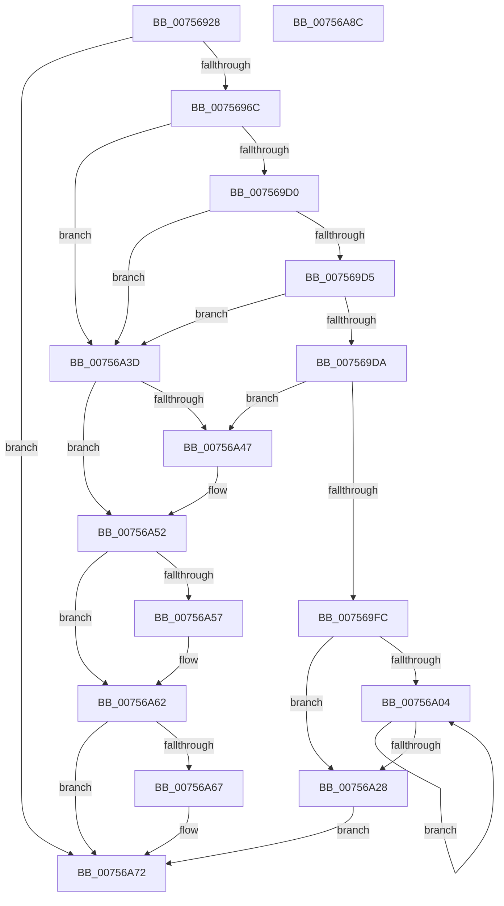

# PopQueryPowerLimitAttributes

- RVA: `0x00756928`–`0x00756A8D` (길이 `357` bytes)
- VA: `0x0000000140756928`
- 실행 섹션: `PAGE`
- PDB 이름 있음: `예`; PDB Function 태그: `아니요`
- unwind 정보 RVA: `0x00060284`
- 디코드: `111`개 명령, `357/357` bytes 표시
- 미해석 바이트: `0` (있으면 어셈블리에 `.byte`로 보존)

> 이 문서는 커널 이미지의 기계어와 PDB 기호를 분석해 생성했습니다. 4번과 5번은 함수 원형과 자료형을 바이너리 사용 방식에서 추정한 C 해석이며 원본 소스 복구 결과는 아닙니다.

## 1. Dependencies

- 직접 호출 지점: **8**; 고유 호출 대상: **3**
- 직접 호출자로 확인된 함수: **1**
- RIP 상대 이미지 참조: **0**

### Outgoing calls
- `0x0075695A` → [guard_dispatch_icall](../../text/6B/guard_dispatch_icall_function_006BAAD0.md) (function, `0x006BAAD0`)
- `0x0075699A` → [ExAllocatePool2](../../poolcode/B8/ExAllocatePool2_function_00B820F0.md) (function, `0x00B820F0`)
- `0x007569AF` → [ExAllocatePool2](../../poolcode/B8/ExAllocatePool2_function_00B820F0.md) (function, `0x00B820F0`)
- `0x007569C3` → [ExAllocatePool2](../../poolcode/B8/ExAllocatePool2_function_00B820F0.md) (function, `0x00B820F0`)
- `0x007569F1` → [guard_dispatch_icall](../../text/6B/guard_dispatch_icall_function_006BAAD0.md) (function, `0x006BAAD0`)
- `0x00756A4D` → [ExFreePoolWithTag](../../poolcode/B8/ExFreePoolWithTag_function_00B82870.md) (function, `0x00B82870`)
- `0x00756A5D` → [ExFreePoolWithTag](../../poolcode/B8/ExFreePoolWithTag_function_00B82870.md) (function, `0x00B82870`)
- `0x00756A6D` → [ExFreePoolWithTag](../../poolcode/B8/ExFreePoolWithTag_function_00B82870.md) (function, `0x00B82870`)

### Direct callers
- [PopAssociatePowerLimitRequest](PopAssociatePowerLimitRequest_function_00755EC8.md) at `0x00755F71`

### Static image references
- 디코드된 RIP-relative 메모리 참조가 없습니다.

## 2. Other-region calls and transfers

- 다른 실행 섹션으로 향하는 call: **8**
  - `0x0075695A` → [guard_dispatch_icall](../../text/6B/guard_dispatch_icall_function_006BAAD0.md) (`PAGE` → `.text`)
  - `0x0075699A` → [ExAllocatePool2](../../poolcode/B8/ExAllocatePool2_function_00B820F0.md) (`PAGE` → `POOLCODE`)
  - `0x007569AF` → [ExAllocatePool2](../../poolcode/B8/ExAllocatePool2_function_00B820F0.md) (`PAGE` → `POOLCODE`)
  - `0x007569C3` → [ExAllocatePool2](../../poolcode/B8/ExAllocatePool2_function_00B820F0.md) (`PAGE` → `POOLCODE`)
  - `0x007569F1` → [guard_dispatch_icall](../../text/6B/guard_dispatch_icall_function_006BAAD0.md) (`PAGE` → `.text`)
  - `0x00756A4D` → [ExFreePoolWithTag](../../poolcode/B8/ExFreePoolWithTag_function_00B82870.md) (`PAGE` → `POOLCODE`)
  - `0x00756A5D` → [ExFreePoolWithTag](../../poolcode/B8/ExFreePoolWithTag_function_00B82870.md) (`PAGE` → `POOLCODE`)
  - `0x00756A6D` → [ExFreePoolWithTag](../../poolcode/B8/ExFreePoolWithTag_function_00B82870.md) (`PAGE` → `POOLCODE`)
- 별도 외부 분기/꼬리 이동을 확인하지 못했습니다.

## 3. Assembly (complete function range)

```asm
00756928  48 89 5C 24 18                  mov qword ptr [rsp + 0x18], rbx
0075692D  55                              push rbp
0075692E  56                              push rsi
0075692F  57                              push rdi
00756930  41 54                           push r12
00756932  41 55                           push r13
00756934  41 56                           push r14
00756936  41 57                           push r15
00756938  48 83 EC 30                     sub rsp, 0x30
0075693C  48 8B 81 98 00 00 00            mov rax, qword ptr [rcx + 0x98]
00756943  4C 8D 4C 24 70                  lea r9, [rsp + 0x70]
00756948  48 8B F9                        mov rdi, rcx
0075694B  33 DB                           xor ebx, ebx
0075694D  48 8B 49 78                     mov rcx, qword ptr [rcx + 0x78]
00756951  45 33 C0                        xor r8d, r8d
00756954  33 D2                           xor edx, edx
00756956  89 5C 24 70                     mov dword ptr [rsp + 0x70], ebx
0075695A  E8 71 41 F6 FF                  call 0x1406baad0
0075695F  8B F0                           mov esi, eax
00756961  3D 23 00 00 C0                  cmp eax, 0xc0000023
00756966  0F 85 06 01 00 00               jne 0x140756a72
0075696C  8B 4C 24 70                     mov ecx, dword ptr [rsp + 0x70]
00756970  44 8B E3                        mov r12d, ebx
00756973  F6 C1 3F                        test cl, 0x3f
00756976  8B C1                           mov eax, ecx
00756978  41 BD 50 50 6C 6D               mov r13d, 0x6d6c5050
0075697E  BE 00 01 00 00                  mov esi, 0x100
00756983  41 0F 95 C4                     setne r12b
00756987  45 8B C5                        mov r8d, r13d
0075698A  48 8D 14 C9                     lea rdx, [rcx + rcx*8]
0075698E  C1 E8 06                        shr eax, 6
00756991  48 C1 E2 02                     shl rdx, 2
00756995  8B CE                           mov ecx, esi
00756997  44 03 E0                        add r12d, eax
0075699A  E8 51 B7 42 00                  call 0x140b820f0
0075699F  8B 54 24 70                     mov edx, dword ptr [rsp + 0x70]
007569A3  45 8B C5                        mov r8d, r13d
007569A6  48 C1 E2 04                     shl rdx, 4
007569AA  8B CE                           mov ecx, esi
007569AC  4C 8B F0                        mov r14, rax
007569AF  E8 3C B7 42 00                  call 0x140b820f0
007569B4  41 8B D4                        mov edx, r12d
007569B7  45 8B C5                        mov r8d, r13d
007569BA  48 C1 E2 03                     shl rdx, 3
007569BE  8B CE                           mov ecx, esi
007569C0  48 8B E8                        mov rbp, rax
007569C3  E8 28 B7 42 00                  call 0x140b820f0
007569C8  4C 8B F8                        mov r15, rax
007569CB  4D 85 F6                        test r14, r14
007569CE  74 6D                           je 0x140756a3d
007569D0  48 85 ED                        test rbp, rbp
007569D3  74 68                           je 0x140756a3d
007569D5  48 85 C0                        test rax, rax
007569D8  74 63                           je 0x140756a3d
007569DA  48 8B 87 98 00 00 00            mov rax, qword ptr [rdi + 0x98]
007569E1  4C 8D 4C 24 70                  lea r9, [rsp + 0x70]
007569E6  8B 54 24 70                     mov edx, dword ptr [rsp + 0x70]
007569EA  4D 8B C6                        mov r8, r14
007569ED  48 8B 4F 78                     mov rcx, qword ptr [rdi + 0x78]
007569F1  E8 DA 40 F6 FF                  call 0x1406baad0
007569F6  8B F0                           mov esi, eax
007569F8  85 C0                           test eax, eax
007569FA  78 4B                           js 0x140756a47
007569FC  8B 44 24 70                     mov eax, dword ptr [rsp + 0x70]
00756A00  85 C0                           test eax, eax
00756A02  74 24                           je 0x140756a28
00756A04  8B D3                           mov edx, ebx
00756A06  FF C3                           inc ebx
00756A08  48 8D 0C D2                     lea rcx, [rdx + rdx*8]
00756A0C  48 03 D2                        add rdx, rdx
00756A0F  41 8B 04 8E                     mov eax, dword ptr [r14 + rcx*4]
00756A13  89 44 D5 00                     mov dword ptr [rbp + rdx*8], eax
00756A17  41 8B 44 8E 04                  mov eax, dword ptr [r14 + rcx*4 + 4]
00756A1C  89 44 D5 04                     mov dword ptr [rbp + rdx*8 + 4], eax
00756A20  8B 44 24 70                     mov eax, dword ptr [rsp + 0x70]
00756A24  3B D8                           cmp ebx, eax
00756A26  72 DC                           jb 0x140756a04
00756A28  89 47 48                        mov dword ptr [rdi + 0x48], eax
00756A2B  4C 89 77 50                     mov qword ptr [rdi + 0x50], r14
00756A2F  48 89 6F 58                     mov qword ptr [rdi + 0x58], rbp
00756A33  44 89 67 60                     mov dword ptr [rdi + 0x60], r12d
00756A37  4C 89 7F 68                     mov qword ptr [rdi + 0x68], r15
00756A3B  EB 35                           jmp 0x140756a72
00756A3D  BE 9A 00 00 C0                  mov esi, 0xc000009a
00756A42  4D 85 F6                        test r14, r14
00756A45  74 0B                           je 0x140756a52
00756A47  41 8B D5                        mov edx, r13d
00756A4A  49 8B CE                        mov rcx, r14
00756A4D  E8 1E BE 42 00                  call 0x140b82870
00756A52  48 85 ED                        test rbp, rbp
00756A55  74 0B                           je 0x140756a62
00756A57  41 8B D5                        mov edx, r13d
00756A5A  48 8B CD                        mov rcx, rbp
00756A5D  E8 0E BE 42 00                  call 0x140b82870
00756A62  4D 85 FF                        test r15, r15
00756A65  74 0B                           je 0x140756a72
00756A67  41 8B D5                        mov edx, r13d
00756A6A  49 8B CF                        mov rcx, r15
00756A6D  E8 FE BD 42 00                  call 0x140b82870
00756A72  48 8B 9C 24 80 00 00 00         mov rbx, qword ptr [rsp + 0x80]
00756A7A  8B C6                           mov eax, esi
00756A7C  48 83 C4 30                     add rsp, 0x30
00756A80  41 5F                           pop r15
00756A82  41 5E                           pop r14
00756A84  41 5D                           pop r13
00756A86  41 5C                           pop r12
00756A88  5F                              pop rdi
00756A89  5E                              pop rsi
00756A8A  5D                              pop rbp
00756A8B  C3                              ret
00756A8C  CC                              int3
```

## 4. C-style interpretation (structured pseudocode)

```c
__int64 __fastcall PopQueryPowerLimitAttributes(__int64 a1, int a2, int a3)
{
    __int64 result;
    __int64 v_r12;
    __int64 v_rbx;
    __int64 v_rsp;
    unsigned __int64 v_stack_p18;
    unsigned __int64 v_stack_p8;

    v_stack_p18 = v_rbx;
    v_rsp = (v_rsp) - (48);
    v_rbx = 0;
    a3 = 0;
    a2 = 0;
    v_stack_p8 = 0;
    result = guard_dispatch_icall(*(unsigned __int64 *)(a1 + 120), a2, a3, v_stack_p8);
    if (((unsigned int)(result)) != 0xC0000023ULL) goto loc_00756A72;
    v_r12 = ((((unsigned __int8)((unsigned int)(v_stack_p8))) & (63)) != 0) ? 1 : 0;
    result = (unsigned int)(((unsigned int)((unsigned int)((unsigned int)(v_stack_p8)))) >> (6));
    a2 = ((unsigned int)(v_stack_p8) + (unsigned int)(v_stack_p8) * 8) << (2);
    v_r12 = (unsigned int)((v_r12) + ((unsigned int)(result)));
    result = ExAllocatePool2(256, a2, (unsigned int)((unsigned int)((unsigned int)(0x6D6C5050ULL))), v_stack_p8);
    a2 = ((unsigned int)(v_stack_p8)) << (4);
    result = ExAllocatePool2(256, a2, (unsigned int)((unsigned int)((unsigned int)(0x6D6C5050ULL))), v_stack_p8);
    a2 = ((unsigned int)((unsigned int)(v_r12))) << (3);
    result = ExAllocatePool2(256, a2, (unsigned int)((unsigned int)((unsigned int)(0x6D6C5050ULL))), v_stack_p8);
    if (result == 0) goto loc_00756A3D;
    if (result == 0) goto loc_00756A3D;
    if (result == 0) goto loc_00756A3D;
    result = guard_dispatch_icall(*(unsigned __int64 *)(a1 + 120), (unsigned int)(v_stack_p8), result, v_stack_p8);
    if (sign_flag) goto loc_00756A47;
    if ((unsigned int)((unsigned int)(v_stack_p8)) == 0) goto loc_00756A28;
loc_00756A04:
    v_rbx = (unsigned int)((v_rbx) + 1);
    a2 = (0) + (0);
    *(unsigned int *)(result + a2 * 8) = (unsigned int)((unsigned int)(*(unsigned int *)(result + 0 + 0 * 8 * 4)));
    *(unsigned int *)(result + a2 * 8 + 4) = (unsigned int)((unsigned int)(*(unsigned int *)(result + 0 + 0 * 8 * 4 + 4)));
    if (((unsigned int)(v_rbx)) < ((unsigned int)((unsigned int)(v_stack_p8)))) goto loc_00756A04;
loc_00756A28:
    *(unsigned int *)(a1 + 72) = (unsigned int)((unsigned int)(v_stack_p8));
    *(unsigned __int64 *)(a1 + 80) = result;
    *(unsigned __int64 *)(a1 + 88) = result;
    *(unsigned int *)(a1 + 96) = (unsigned int)(v_r12);
    *(unsigned __int64 *)(a1 + 104) = result;
    goto loc_00756A72;
loc_00756A3D:
    result = (unsigned int)(v_stack_p8);
    if (result != 0) {
        a2 = (unsigned int)((unsigned int)(0x6D6C5050ULL));
        a1 = result;
        result = ExFreePoolWithTag(a1, a2, result, v_stack_p8);
    }
    if (result != 0) {
        a2 = (unsigned int)((unsigned int)(0x6D6C5050ULL));
        a1 = result;
        result = ExFreePoolWithTag(a1, a2, result, v_stack_p8);
    }
    if (result != 0) {
        a2 = (unsigned int)((unsigned int)(0x6D6C5050ULL));
        a1 = result;
        result = ExFreePoolWithTag(a1, a2, result, v_stack_p8);
    }
    v_rsp = (v_rsp) + (48);
    return (unsigned int)((unsigned int)((unsigned int)(0xC000009AULL)));
}
```

## 5. (Beta) C Style

```c
int64_t PopQueryPowerLimitAttributes(void *Arg1, int32_t Arg2, int32_t Arg3)
{
    uint8_t *arg1 = (uint8_t *)Arg1;

    int64_t result;
    int64_t local_r12;
    int64_t local_rbx;
    int64_t local_rsp;
    uint64_t v_stack_p18;
    uint64_t v_stack_p8;

    v_stack_p18 = local_rbx;
    local_rsp = (local_rsp) - (48);
    local_rbx = 0;
    Arg3 = 0;
    Arg2 = 0;
    v_stack_p8 = 0;
    result = guard_dispatch_icall(*(uint64_t *)(arg1 + 0x78), Arg2, Arg3, v_stack_p8);
    if (((uint32_t)(result)) != 0xC0000023ULL) goto loc_00756A72;
    local_r12 = ((((uint8_t)((uint32_t)(v_stack_p8))) & (63)) != 0) ? 1 : 0;
    result = (uint32_t)(((uint32_t)((uint32_t)((uint32_t)(v_stack_p8)))) >> (6));
    Arg2 = ((uint32_t)(v_stack_p8) + (uint32_t)(v_stack_p8) * 8) << (2);
    local_r12 = (uint32_t)((local_r12) + ((uint32_t)(result)));
    result = ExAllocatePool2(256, Arg2, (uint32_t)((uint32_t)((uint32_t)(0x6D6C5050ULL))), v_stack_p8);
    Arg2 = ((uint32_t)(v_stack_p8)) << (4);
    result = ExAllocatePool2(256, Arg2, (uint32_t)((uint32_t)((uint32_t)(0x6D6C5050ULL))), v_stack_p8);
    Arg2 = ((uint32_t)((uint32_t)(local_r12))) << (3);
    result = ExAllocatePool2(256, Arg2, (uint32_t)((uint32_t)((uint32_t)(0x6D6C5050ULL))), v_stack_p8);
    if (result == 0) goto loc_00756A3D;
    if (result == 0) goto loc_00756A3D;
    if (result == 0) goto loc_00756A3D;
    result = guard_dispatch_icall(*(uint64_t *)(arg1 + 0x78), (uint32_t)(v_stack_p8), result, v_stack_p8);
    if (sign_flag) goto loc_00756A47;
    if ((uint32_t)((uint32_t)(v_stack_p8)) == 0) goto loc_00756A28;
loc_00756A04:
    local_rbx = (uint32_t)((local_rbx) + 1);
    Arg2 = (0) + (0);
    *(uint32_t *)(result + Arg2 * 8) = (uint32_t)((uint32_t)(*(uint32_t *)(result + 0x0 + 0x0 * 8 * 4)));
    *(uint32_t *)(result + Arg2 * 8 + 0x4) = (uint32_t)((uint32_t)(*(uint32_t *)(result + 0x0 + 0x0 * 8 * 4 + 0x4)));
    if (((uint32_t)(local_rbx)) < ((uint32_t)((uint32_t)(v_stack_p8)))) goto loc_00756A04;
loc_00756A28:
    *(uint32_t *)(arg1 + 0x48) = (uint32_t)((uint32_t)(v_stack_p8));
    *(uint64_t *)(arg1 + 0x50) = result;
    *(uint64_t *)(arg1 + 0x58) = result;
    *(uint32_t *)(arg1 + 0x60) = (uint32_t)(local_r12);
    *(uint64_t *)(arg1 + 0x68) = result;
    goto loc_00756A72;
loc_00756A3D:
    result = (uint32_t)(v_stack_p8);
    if (result != 0) {
        Arg2 = (uint32_t)((uint32_t)(0x6D6C5050ULL));
        Arg1 = result;
        result = ExFreePoolWithTag(Arg1, Arg2, result, v_stack_p8);
    }
    if (result != 0) {
        Arg2 = (uint32_t)((uint32_t)(0x6D6C5050ULL));
        Arg1 = result;
        result = ExFreePoolWithTag(Arg1, Arg2, result, v_stack_p8);
    }
    if (result != 0) {
        Arg2 = (uint32_t)((uint32_t)(0x6D6C5050ULL));
        Arg1 = result;
        result = ExFreePoolWithTag(Arg1, Arg2, result, v_stack_p8);
    }
    local_rsp = (local_rsp) + (48);
    return (uint32_t)((uint32_t)((uint32_t)(0xC000009AULL)));
}
```

### 관측된 메모리 오프셋

구조체 형식이 확인되지 않은 접근은 인자 기준의 오프셋으로만 기록했습니다.

| 기준 인자 | 오프셋 표현 | 폭 (bit) | 접근 |
|---|---:|---:|---|
| `Arg1` | `+ 0x48` | `32` | `W` |
| `Arg1` | `+ 0x50` | `64` | `W` |
| `Arg1` | `+ 0x58` | `64` | `W` |
| `Arg1` | `+ 0x60` | `32` | `W` |
| `Arg1` | `+ 0x68` | `64` | `W` |
| `Arg1` | `+ 0x78` | `64` | `R` |
| `Arg1` | `+ 0x98` | `64` | `R` |

## 6. Execution-region graph

[열기: 2D/3D 그래프와 함수 탐색 컨트롤 패널](../../../control-panel.html?section=page&rva=0x00756928&view=graph)

- 2D 그래프는 위에서 아래로 흐르고, 3D 그래프는 빈 공간을 드래그해 회전합니다. Shift+드래그는 이동, 휠은 확대·축소, 함수 노드 선택은 대상 보고서 이동입니다.

### Static fallback


