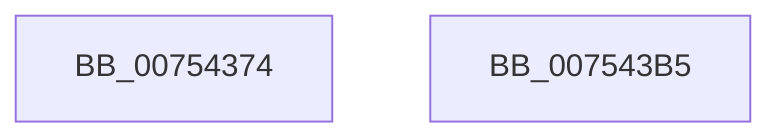

# PopQueryRestrictedStandbyTimeoutSeconds

- RVA: `0x00754374`–`0x007543B6` (길이 `66` bytes)
- VA: `0x0000000140754374`
- 실행 섹션: `PAGE`
- PDB 이름 있음: `예`; PDB Function 태그: `아니요`
- unwind 정보 RVA: `0x00064C80`
- 디코드: `19`개 명령, `66/66` bytes 표시
- 미해석 바이트: `0` (있으면 어셈블리에 `.byte`로 보존)

> 이 문서는 커널 이미지의 기계어와 PDB 기호를 분석해 생성했습니다. 4번과 5번은 함수 원형과 자료형을 바이너리 사용 방식에서 추정한 C 해석이며 원본 소스 복구 결과는 아닙니다.

## 1. Dependencies

- 직접 호출 지점: **1**; 고유 호출 대상: **1**
- 직접 호출자로 확인된 함수: **1**
- RIP 상대 이미지 참조: **2**

### Outgoing calls
- `0x0075439F` → [PopReadRegKeyValue](../../text/4B/PopReadRegKeyValue_function_004B5F64.md) (function, `0x004B5F64`)

### Direct callers
- [PopPowerAggregatorEvaluateDozeTimers](../6F/PopPowerAggregatorEvaluateDozeTimers_function_006FE460.md) at `0x006FE49C`

### Static image references
- `0x00754381` → RVA `0x00B01980` (` ?? ::NNGAKEGL::`string'`; read)
- `0x0075438C` → RVA `0x00029610` (`.rdata`; read)

## 2. Other-region calls and transfers

- 다른 실행 섹션으로 향하는 call: **1**
  - `0x0075439F` → [PopReadRegKeyValue](../../text/4B/PopReadRegKeyValue_function_004B5F64.md) (`PAGE` → `.text`)
- 별도 외부 분기/꼬리 이동을 확인하지 못했습니다.

## 3. Assembly (complete function range)

```asm
00754374  40 53                           push rbx
00754376  48 83 EC 30                     sub rsp, 0x30
0075437A  33 DB                           xor ebx, ebx
0075437C  48 8D 44 24 40                  lea rax, [rsp + 0x40]
00754381  48 8D 15 F8 D5 3A 00            lea rdx, [rip + 0x3ad5f8]
00754388  89 5C 24 40                     mov dword ptr [rsp + 0x40], ebx
0075438C  48 8D 0D 7D 52 8D FF            lea rcx, [rip - 0x72ad83]
00754393  48 89 44 24 20                  mov qword ptr [rsp + 0x20], rax
00754398  44 8D 43 04                     lea r8d, [rbx + 4]
0075439C  45 8B C8                        mov r9d, r8d
0075439F  E8 C0 1B D6 FF                  call 0x1404b5f64
007543A4  8B 4C 24 40                     mov ecx, dword ptr [rsp + 0x40]
007543A8  85 C0                           test eax, eax
007543AA  0F 48 CB                        cmovs ecx, ebx
007543AD  8B C1                           mov eax, ecx
007543AF  48 83 C4 30                     add rsp, 0x30
007543B3  5B                              pop rbx
007543B4  C3                              ret
007543B5  CC                              int3
```

## 4. C-style interpretation (structured pseudocode)

```c
__int64 __fastcall PopQueryRestrictedStandbyTimeoutSeconds(void)
{
    __int64 result;
    __int64 v_rbx;
    __int64 v_rsp;
    unsigned __int64 v_stack_m18;
    unsigned __int64 v_stack_p8;

    v_rsp = (v_rsp) - (48);
    v_rbx = 0;
    v_stack_p8 = 0;
    v_stack_m18 = v_stack_p8;
    result = PopReadRegKeyValue(v_rip - 7515523, v_rip + 3855864, v_rbx + 4, (unsigned int)((unsigned int)(v_rbx + 4)));
    a1 = (unsigned int)(v_stack_p8);
    if (sign_flag) { a1 = 0; }
    v_rsp = (v_rsp) + (48);
    return (unsigned int)((unsigned int)(a1));
}
```

## 5. (Beta) C Style

```c
void PopQueryRestrictedStandbyTimeoutSeconds(void)
{
    int64_t result;
    int64_t local_rbx;
    int64_t local_rsp;
    uint64_t v_stack_m18;
    uint64_t v_stack_p8;

    local_rsp = (local_rsp) - (48);
    local_rbx = 0;
    v_stack_p8 = 0;
    v_stack_m18 = v_stack_p8;
    result = PopReadRegKeyValue(v_rip - 7515523, v_rip + 3855864, local_rbx + 4, (uint32_t)((uint32_t)(local_rbx + 4)));
    a1 = (uint32_t)(v_stack_p8);
    if (sign_flag) { a1 = 0; }
    local_rsp = (local_rsp) + (48);
    return (uint32_t)((uint32_t)(a1));
}
```

## 6. Execution-region graph

[열기: 2D/3D 그래프와 함수 탐색 컨트롤 패널](../../../control-panel.html?section=page&rva=0x00754374&view=graph)

- 2D 그래프는 위에서 아래로 흐르고, 3D 그래프는 빈 공간을 드래그해 회전합니다. Shift+드래그는 이동, 휠은 확대·축소, 함수 노드 선택은 대상 보고서 이동입니다.

### Static fallback


