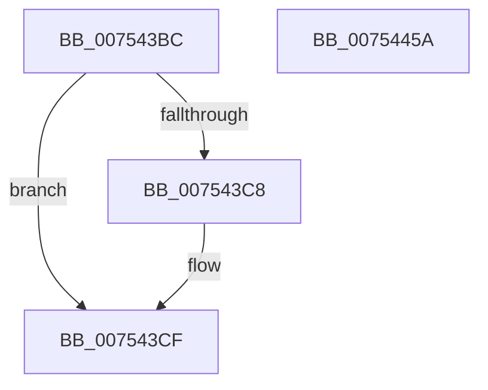

# PopRecordLongPowerButtonPressDetected

- RVA: `0x007543BC`–`0x0075445B` (길이 `159` bytes)
- VA: `0x00000001407543BC`
- 실행 섹션: `PAGE`
- PDB 이름 있음: `예`; PDB Function 태그: `아니요`
- unwind 정보 RVA: `0x0005CF00`
- 디코드: `42`개 명령, `159/159` bytes 표시
- 미해석 바이트: `0` (있으면 어셈블리에 `.byte`로 보존)

> 이 문서는 커널 이미지의 기계어와 PDB 기호를 분석해 생성했습니다. 4번과 5번은 함수 원형과 자료형을 바이너리 사용 방식에서 추정한 C 해석이며 원본 소스 복구 결과는 아닙니다.

## 1. Dependencies

- 직접 호출 지점: **5**; 고유 호출 대상: **4**
- 직접 호출자로 확인된 함수: **2**
- RIP 상대 이미지 참조: **9**

### Outgoing calls
- `0x007543CA` → [RtlBootStatusDisableFlushing](../../text/4F/RtlBootStatusDisableFlushing_function_004FC6C0.md) (function, `0x004FC6C0`)
- `0x007543D6` → [PopAcquireRwLockExclusive](../../text/43/PopAcquireRwLockExclusive_function_00430B44.md) (function, `0x00430B44`)
- `0x0075442C` → [RtlSetSystemBootStatus](../A8/RtlSetSystemBootStatus_function_00A83230.md) (function, `0x00A83230`)
- `0x00754443` → [RtlSetSystemBootStatus](../A8/RtlSetSystemBootStatus_function_00A83230.md) (function, `0x00A83230`)
- `0x0075444F` → [PopReleaseRwLock](../../text/2D/PopReleaseRwLock_function_002DFBBC.md) (function, `0x002DFBBC`)

### Direct callers
- [PoClearTransitionMarker](PoClearTransitionMarker_function_00753C88.md) at `0x00753E01`
- [PopDiagTracePowerButtonBugcheck](../76/PopDiagTracePowerButtonBugcheck_function_00761F14.md) at `0x00761F46`

### Static image references
- `0x007543CF` → RVA `0x00F0F1E0` (`.data`; read)
- `0x007543DB` → RVA `0x00E673BF` (`.data`; read)
- `0x007543E4` → RVA `0x00E66279` (`.data`; read)
- `0x007543FC` → RVA `0x00E673F1` (`.data`; read)
- `0x00754404` → RVA `0x00E673BF` (`.data`; write)
- `0x0075440C` → RVA `0x00E66245` (`.data`; read)
- `0x0075441F` → RVA `0x00E673F1` (`.data`; write)
- `0x00754425` → RVA `0x00E673B0` (`.data`; read)
- `0x00754434` → RVA `0x00E673F0` (`.data`; read)

## 2. Other-region calls and transfers

- 다른 실행 섹션으로 향하는 call: **3**
  - `0x007543CA` → [RtlBootStatusDisableFlushing](../../text/4F/RtlBootStatusDisableFlushing_function_004FC6C0.md) (`PAGE` → `.text`)
  - `0x007543D6` → [PopAcquireRwLockExclusive](../../text/43/PopAcquireRwLockExclusive_function_00430B44.md) (`PAGE` → `.text`)
  - `0x0075444F` → [PopReleaseRwLock](../../text/2D/PopReleaseRwLock_function_002DFBBC.md) (`PAGE` → `.text`)
- 별도 외부 분기/꼬리 이동을 확인하지 못했습니다.

## 3. Assembly (complete function range)

```asm
007543BC  40 53                           push rbx
007543BE  48 83 EC 20                     sub rsp, 0x20
007543C2  8A D9                           mov bl, cl
007543C4  84 D2                           test dl, dl
007543C6  74 07                           je 0x1407543cf
007543C8  33 C9                           xor ecx, ecx
007543CA  E8 F1 82 DA FF                  call 0x1404fc6c0
007543CF  48 8D 0D 0A AE 7B 00            lea rcx, [rip + 0x7bae0a]
007543D6  E8 69 C7 CD FF                  call 0x140430b44
007543DB  8A 05 DE 2F 71 00               mov al, byte ptr [rip + 0x712fde]
007543E1  41 B0 01                        mov r8b, 1
007543E4  8A 15 8F 1E 71 00               mov dl, byte ptr [rip + 0x711e8f]
007543EA  24 FB                           and al, 0xfb
007543EC  41 22 D0                        and dl, r8b
007543EF  41 22 D8                        and bl, r8b
007543F2  02 D2                           add dl, dl
007543F4  C0 E3 02                        shl bl, 2
007543F7  0A D8                           or bl, al
007543F9  45 33 C9                        xor r9d, r9d
007543FC  8A 05 EF 2F 71 00               mov al, byte ptr [rip + 0x712fef]
00754402  24 FC                           and al, 0xfc
00754404  88 1D B5 2F 71 00               mov byte ptr [rip + 0x712fb5], bl
0075440A  0A D0                           or dl, al
0075440C  8A 05 33 1E 71 00               mov al, byte ptr [rip + 0x711e33]
00754412  41 22 C0                        and al, r8b
00754415  41 8D 49 0E                     lea ecx, [r9 + 0xe]
00754419  0A D0                           or dl, al
0075441B  45 8D 41 40                     lea r8d, [r9 + 0x40]
0075441F  88 15 CC 2F 71 00               mov byte ptr [rip + 0x712fcc], dl
00754425  48 8D 15 84 2F 71 00            lea rdx, [rip + 0x712f84]
0075442C  E8 FF ED 32 00                  call 0x140a83230
00754431  45 33 C9                        xor r9d, r9d
00754434  48 8D 15 B5 2F 71 00            lea rdx, [rip + 0x712fb5]
0075443B  45 8D 41 20                     lea r8d, [r9 + 0x20]
0075443F  41 8D 49 10                     lea ecx, [r9 + 0x10]
00754443  E8 E8 ED 32 00                  call 0x140a83230
00754448  48 8D 0D 91 AD 7B 00            lea rcx, [rip + 0x7bad91]
0075444F  E8 68 B7 B8 FF                  call 0x1402dfbbc
00754454  48 83 C4 20                     add rsp, 0x20
00754458  5B                              pop rbx
00754459  C3                              ret
0075445A  CC                              int3
```

## 4. C-style interpretation (structured pseudocode)

```c
__int64 __fastcall PopRecordLongPowerButtonPressDetected(int a1, unsigned __int8 a2, __int64 a3, int a4)
{
    __int64 result;
    __int64 v_rbx;
    __int64 v_rsp;

    v_rsp = (v_rsp) - (32);
    if (a2 != 0) {
        a1 = 0;
        result = RtlBootStatusDisableFlushing(a1, a2, a3, a4);
    }
    result = PopAcquireRwLockExclusive(v_rip + 8105482, a2, a3, a4);
    result = (unsigned __int8)((*(unsigned __int8 *)(v_rip + 7417822)) & (251));
    a2 = (unsigned __int8)((*(unsigned __int8 *)(v_rip + 7413391)) & (1));
    v_rbx = (unsigned __int8)(((unsigned __int8)(a1)) & (1));
    a2 = (unsigned __int8)((a2) + (a2));
    v_rbx = (unsigned __int8)((v_rbx) << (2));
    v_rbx = (unsigned __int8)((v_rbx) | ((unsigned __int8)(result)));
    a4 = 0;
    result = (unsigned __int8)((*(unsigned __int8 *)(v_rip + 7417839)) & (252));
    *(unsigned __int8 *)(v_rip + 7417781) = (unsigned __int8)(v_rbx);
    a2 = (unsigned __int8)((a2) | ((unsigned __int8)(result)));
    result = (unsigned __int8)((*(unsigned __int8 *)(v_rip + 7413299)) & (1));
    a2 = (unsigned __int8)((a2) | ((unsigned __int8)(result)));
    *(unsigned __int8 *)(v_rip + 7417804) = a2;
    result = RtlSetSystemBootStatus(a4 + 14, v_rip + 7417732, a4 + 64, a4);
    a4 = 0;
    result = RtlSetSystemBootStatus(a4 + 16, v_rip + 7417781, a4 + 32, a4);
    result = PopReleaseRwLock(v_rip + 8105361, v_rip + 7417781, a4 + 32, a4);
    v_rsp = (v_rsp) + (32);
    return result;
}
```

## 5. (Beta) C Style

```c
int64_t PopRecordLongPowerButtonPressDetected(int32_t Arg1, uint8_t Arg2, int64_t Arg3, int32_t Arg4)
{
    int64_t result;
    int64_t local_rbx;
    int64_t local_rsp;

    local_rsp = (local_rsp) - (32);
    if (Arg2 != 0) {
        Arg1 = 0;
        result = RtlBootStatusDisableFlushing(Arg1, Arg2, Arg3, Arg4);
    }
    result = PopAcquireRwLockExclusive(v_rip + 8105482, Arg2, Arg3, Arg4);
    result = (uint8_t)((*(uint8_t *)(v_rip + 0x712FDE)) & (251));
    Arg2 = (uint8_t)((*(uint8_t *)(v_rip + 0x711E8F)) & (1));
    local_rbx = (uint8_t)(((uint8_t)(Arg1)) & (1));
    Arg2 = (uint8_t)((Arg2) + (Arg2));
    local_rbx = (uint8_t)((local_rbx) << (2));
    local_rbx = (uint8_t)((local_rbx) | ((uint8_t)(result)));
    Arg4 = 0;
    result = (uint8_t)((*(uint8_t *)(v_rip + 0x712FEF)) & (252));
    *(uint8_t *)(v_rip + 0x712FB5) = (uint8_t)(local_rbx);
    Arg2 = (uint8_t)((Arg2) | ((uint8_t)(result)));
    result = (uint8_t)((*(uint8_t *)(v_rip + 0x711E33)) & (1));
    Arg2 = (uint8_t)((Arg2) | ((uint8_t)(result)));
    *(uint8_t *)(v_rip + 0x712FCC) = Arg2;
    result = RtlSetSystemBootStatus(Arg4 + 14, v_rip + 7417732, Arg4 + 64, Arg4);
    Arg4 = 0;
    result = RtlSetSystemBootStatus(Arg4 + 16, v_rip + 7417781, Arg4 + 32, Arg4);
    result = PopReleaseRwLock(v_rip + 8105361, v_rip + 7417781, Arg4 + 32, Arg4);
    local_rsp = (local_rsp) + (32);
    return result;
}
```

## 6. Execution-region graph

[열기: 2D/3D 그래프와 함수 탐색 컨트롤 패널](../../../control-panel.html?section=page&rva=0x007543BC&view=graph)

- 2D 그래프는 위에서 아래로 흐르고, 3D 그래프는 빈 공간을 드래그해 회전합니다. Shift+드래그는 이동, 휠은 확대·축소, 함수 노드 선택은 대상 보고서 이동입니다.

### Static fallback


