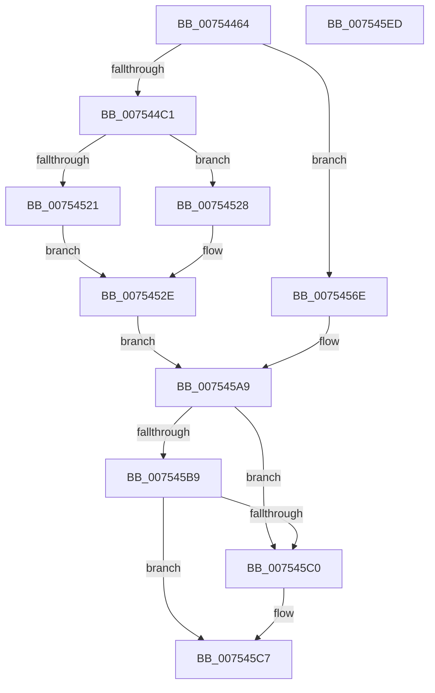

# PopRecordPhysicalPowerButton

- RVA: `0x00754464`–`0x007545EE` (길이 `394` bytes)
- VA: `0x0000000140754464`
- 실행 섹션: `PAGE`
- PDB 이름 있음: `예`; PDB Function 태그: `아니요`
- unwind 정보 RVA: `0x000794E0`
- 디코드: `82`개 명령, `394/394` bytes 표시
- 미해석 바이트: `0` (있으면 어셈블리에 `.byte`로 보존)

> 이 문서는 커널 이미지의 기계어와 PDB 기호를 분석해 생성했습니다. 4번과 5번은 함수 원형과 자료형을 바이너리 사용 방식에서 추정한 C 해석이며 원본 소스 복구 결과는 아닙니다.

## 1. Dependencies

- 직접 호출 지점: **5**; 고유 호출 대상: **5**
- 직접 호출자로 확인된 함수: **1**
- RIP 상대 이미지 참조: **31**

### Outgoing calls
- `0x00754485` → [PopAcquireRwLockExclusive](../../text/43/PopAcquireRwLockExclusive_function_00430B44.md) (function, `0x00430B44`)
- `0x00754518` → [Feature_ExpandSTEIgnoreReasons__private_IsEnabledDeviceUsageNoInline](../../text/4F/Feature_ExpandSTEIgnoreReasons__private_IsEnabledDeviceUsageNoInline_function_004F7AE8.md) (function, `0x004F7AE8`)
- `0x00754521` → [PopGetCurrentPdcPhase](../../text/5D/PopGetCurrentPdcPhase_function_005D9FB4.md) (function, `0x005D9FB4`)
- `0x007545CC` → [PopBsdHandleRequest](../../text/4B/PopBsdHandleRequest_function_004B27A0.md) (function, `0x004B27A0`)
- `0x007545D8` → [PopReleaseRwLock](../../text/2D/PopReleaseRwLock_function_002DFBBC.md) (function, `0x002DFBBC`)

### Direct callers
- [PopPowerButtonWorkCallback](../../text/5D/PopPowerButtonWorkCallback_function_005D9A70.md) at `0x005D9B34`
- [PopPowerButtonWorkCallback](../../text/5D/PopPowerButtonWorkCallback_function_005D9A70.md) at `0x005D9B97`

### Static image references
- `0x00754479` → RVA `0x00F0F1E0` (`.data`; read)
- `0x0075448A` → RVA `0x00F0853C` (`.data`; read)
- `0x00754495` → RVA `0x00F08538` (`.data`; read)
- `0x007544C1` → RVA `0x00E6755C` (`.data`; read)
- `0x007544C7` → RVA `0x00F08560` (`.data`; read)
- `0x007544D1` → RVA `0x00E673B0` (`.data`; write)
- `0x007544DD` → RVA `0x00E673B8` (`.data`; read/write)
- `0x007544E3` → RVA `0x00E673BC` (`.data`; write)
- `0x007544EA` → RVA `0x00E67554` (`.data`; read)
- `0x007544F0` → RVA `0x00E673BE` (`.data`; write)
- `0x007544F6` → RVA `0x00E673BF` (`.data`; read)
- `0x00754500` → RVA `0x00E67558` (`.data`; read)
- `0x0075450A` → RVA `0x00E673BF` (`.data`; write)
- `0x00754510` → RVA `0x00E673C0` (`.data`; write)
- `0x00754528` → RVA `0x00E67550` (`.data`; read)
- `0x0075452E` → RVA `0x00F08540` (`.data`; read/write)
- `0x00754535` → RVA `0x00F08538` (`.data`; read/write)
- `0x0075453B` → RVA `0x00E673E0` (`.data`; write)
- `0x00754541` → RVA `0x00F0EFF0` (`.data`; read)
- `0x00754547` → RVA `0x00E673E4` (`.data`; write)
- `0x0075454D` → RVA `0x00F0EFF4` (`.data`; read)
- `0x00754553` → RVA `0x00E673E8` (`.data`; write)
- `0x00754559` → RVA `0x00F0EFF8` (`.data`; read)
- `0x0075455F` → RVA `0x00E673EC` (`.data`; write)
- `0x00754565` → RVA `0x00F08548` (`.data`; write)
- `0x00754573` → RVA `0x00E673D0` (`.data`; write)
- `0x00754580` → RVA `0x00E673D8` (`.data`; read/write)
- `0x0075458D` → RVA `0x00F0853C` (`.data`; read/write)
- `0x0075459B` → RVA `0x00E673DC` (`.data`; write)
- `0x007545A2` → RVA `0x00F08550` (`.data`; write)
- `0x007545C0` → RVA `0x00F08588` (`.data`; write)

## 2. Other-region calls and transfers

- 다른 실행 섹션으로 향하는 call: **5**
  - `0x00754485` → [PopAcquireRwLockExclusive](../../text/43/PopAcquireRwLockExclusive_function_00430B44.md) (`PAGE` → `.text`)
  - `0x00754518` → [Feature_ExpandSTEIgnoreReasons__private_IsEnabledDeviceUsageNoInline](../../text/4F/Feature_ExpandSTEIgnoreReasons__private_IsEnabledDeviceUsageNoInline_function_004F7AE8.md) (`PAGE` → `.text`)
  - `0x00754521` → [PopGetCurrentPdcPhase](../../text/5D/PopGetCurrentPdcPhase_function_005D9FB4.md) (`PAGE` → `.text`)
  - `0x007545CC` → [PopBsdHandleRequest](../../text/4B/PopBsdHandleRequest_function_004B27A0.md) (`PAGE` → `.text`)
  - `0x007545D8` → [PopReleaseRwLock](../../text/2D/PopReleaseRwLock_function_002DFBBC.md) (`PAGE` → `.text`)
- 별도 외부 분기/꼬리 이동을 확인하지 못했습니다.

## 3. Assembly (complete function range)

```asm
00754464  48 89 5C 24 08                  mov qword ptr [rsp + 8], rbx
00754469  48 89 74 24 10                  mov qword ptr [rsp + 0x10], rsi
0075446E  57                              push rdi
0075446F  48 83 EC 30                     sub rsp, 0x30
00754473  40 8A F9                        mov dil, cl
00754476  0F 57 C0                        xorps xmm0, xmm0
00754479  48 8D 0D 60 AD 7B 00            lea rcx, [rip + 0x7bad60]
00754480  0F 11 44 24 20                  movups xmmword ptr [rsp + 0x20], xmm0
00754485  E8 BA C6 CD FF                  call 0x140430b44
0075448A  8B 0D AC 40 7B 00               mov ecx, dword ptr [rip + 0x7b40ac]
00754490  BE 01 00 00 00                  mov esi, 1
00754495  03 0D 9D 40 7B 00               add ecx, dword ptr [rip + 0x7b409d]
0075449B  48 BB 14 00 00 00 80 F7 FF FF   movabs rbx, 0xfffff78000000014
007544A5  83 E1 3F                        and ecx, 0x3f
007544A8  48 B8 C4 02 00 00 80 F7 FF FF   movabs rax, 0xfffff780000002c4
007544B2  48 D3 E6                        shl rsi, cl
007544B5  48 8B 1B                        mov rbx, qword ptr [rbx]
007544B8  40 84 FF                        test dil, dil
007544BB  0F 84 AD 00 00 00               je 0x14075456e
007544C1  8A 0D 95 30 71 00               mov cl, byte ptr [rip + 0x713095]
007544C7  0F 10 05 92 40 7B 00            movups xmm0, xmmword ptr [rip + 0x7b4092]
007544CE  80 E1 01                        and cl, 1
007544D1  48 89 1D D8 2E 71 00            mov qword ptr [rip + 0x712ed8], rbx
007544D8  0F B7 00                        movzx eax, word ptr [rax]
007544DB  02 C9                           add cl, cl
007544DD  FF 05 D5 2E 71 00               inc dword ptr [rip + 0x712ed5]
007544E3  66 89 05 D2 2E 71 00            mov word ptr [rip + 0x712ed2], ax
007544EA  8A 05 64 30 71 00               mov al, byte ptr [rip + 0x713064]
007544F0  88 05 C8 2E 71 00               mov byte ptr [rip + 0x712ec8], al
007544F6  8A 05 C3 2E 71 00               mov al, byte ptr [rip + 0x712ec3]
007544FC  24 FC                           and al, 0xfc
007544FE  0A C8                           or cl, al
00754500  8A 05 52 30 71 00               mov al, byte ptr [rip + 0x713052]
00754506  24 01                           and al, 1
00754508  0A C8                           or cl, al
0075450A  88 0D AF 2E 71 00               mov byte ptr [rip + 0x712eaf], cl
00754510  F3 0F 7F 05 A8 2E 71 00         movdqu xmmword ptr [rip + 0x712ea8], xmm0
00754518  E8 CB 35 DA FF                  call 0x1404f7ae8
0075451D  85 C0                           test eax, eax
0075451F  74 07                           je 0x140754528
00754521  E8 8E 5A E8 FF                  call 0x1405d9fb4
00754526  EB 06                           jmp 0x14075452e
00754528  8A 05 22 30 71 00               mov al, byte ptr [rip + 0x713022]
0075452E  48 09 35 0B 40 7B 00            or qword ptr [rip + 0x7b400b], rsi
00754535  FF 05 FD 3F 7B 00               inc dword ptr [rip + 0x7b3ffd]
0075453B  88 05 9F 2E 71 00               mov byte ptr [rip + 0x712e9f], al
00754541  8B 05 A9 AA 7B 00               mov eax, dword ptr [rip + 0x7baaa9]
00754547  89 05 97 2E 71 00               mov dword ptr [rip + 0x712e97], eax
0075454D  8B 05 A1 AA 7B 00               mov eax, dword ptr [rip + 0x7baaa1]
00754553  89 05 8F 2E 71 00               mov dword ptr [rip + 0x712e8f], eax
00754559  8B 05 99 AA 7B 00               mov eax, dword ptr [rip + 0x7baa99]
0075455F  89 05 87 2E 71 00               mov dword ptr [rip + 0x712e87], eax
00754565  48 89 1D DC 3F 7B 00            mov qword ptr [rip + 0x7b3fdc], rbx
0075456C  EB 3B                           jmp 0x1407545a9
0075456E  0F 10 44 24 20                  movups xmm0, xmmword ptr [rsp + 0x20]
00754573  48 89 1D 56 2E 71 00            mov qword ptr [rip + 0x712e56], rbx
0075457A  48 F7 D6                        not rsi
0075457D  0F B7 00                        movzx eax, word ptr [rax]
00754580  FF 05 52 2E 71 00               inc dword ptr [rip + 0x712e52]
00754586  48 21 35 B3 3F 7B 00            and qword ptr [rip + 0x7b3fb3], rsi
0075458D  FF 05 A9 3F 7B 00               inc dword ptr [rip + 0x7b3fa9]
00754593  F3 0F 7F 05 25 2E 71 00         movdqu xmmword ptr [rip + 0x712e25], xmm0
0075459B  66 89 05 3A 2E 71 00            mov word ptr [rip + 0x712e3a], ax
007545A2  48 89 1D A7 3F 7B 00            mov qword ptr [rip + 0x7b3fa7], rbx
007545A9  8B 05 89 3F 7B 00               mov eax, dword ptr [rip + 0x7b3f89]
007545AF  8B 0D 87 3F 7B 00               mov ecx, dword ptr [rip + 0x7b3f87]
007545B5  3B C1                           cmp eax, ecx
007545B7  72 07                           jb 0x1407545c0
007545B9  2B C1                           sub eax, ecx
007545BB  83 F8 01                        cmp eax, 1
007545BE  76 07                           jbe 0x1407545c7
007545C0  C6 05 C1 3F 7B 00 01            mov byte ptr [rip + 0x7b3fc1], 1
007545C7  B9 04 00 00 00                  mov ecx, 4
007545CC  E8 CF E1 D5 FF                  call 0x1404b27a0
007545D1  48 8D 0D 08 AC 7B 00            lea rcx, [rip + 0x7bac08]
007545D8  E8 DF B5 B8 FF                  call 0x1402dfbbc
007545DD  48 8B 5C 24 40                  mov rbx, qword ptr [rsp + 0x40]
007545E2  48 8B 74 24 48                  mov rsi, qword ptr [rsp + 0x48]
007545E7  48 83 C4 30                     add rsp, 0x30
007545EB  5F                              pop rdi
007545EC  C3                              ret
007545ED  CC                              int3
```

## 4. C-style interpretation (structured pseudocode)

```c
__int64 __fastcall PopRecordPhysicalPowerButton(unsigned __int8 a1)
{
    __int64 result;
    __int64 v_rsi;
    __int64 v_rsp;
    unsigned __int64 v_stack_m18;
    unsigned __int64 v_stack_p10;
    unsigned __int64 v_stack_p8;

    v_stack_p8 = v_rbx;
    v_stack_p10 = v_rsi;
    v_rsp = (v_rsp) - (48);
    v_stack_m18 = v_xmm0;
    result = PopAcquireRwLockExclusive(v_rip + 8105312, a2, a3, a4);
    a1 = (unsigned int)(((unsigned int)(*(unsigned int *)(v_rip + 8077484))) + (*(unsigned int *)(v_rip + 8077469)));
    a1 = (unsigned int)((a1) & (63));
    v_rsi = (1) << (a1);
    if (a1 == 0) goto loc_0075456E;
    a1 = (unsigned __int8)((*(unsigned __int8 *)(v_rip + 7418005)) & (1));
    *(unsigned __int64 *)(v_rip + 7417560) = *(unsigned __int64 *)(v_rbx);
    a1 = (unsigned __int8)((a1) + (a1));
    *(unsigned __int16 *)(v_rip + 7417554) = (unsigned __int16)(*(unsigned __int16 *)(result));
    *(unsigned __int8 *)(v_rip + 7417544) = (unsigned __int8)(*(unsigned __int8 *)(v_rip + 7417956));
    result = (unsigned __int8)((*(unsigned __int8 *)(v_rip + 7417539)) & (252));
    a1 = (unsigned __int8)((a1) | ((unsigned __int8)(result)));
    result = (unsigned __int8)((*(unsigned __int8 *)(v_rip + 7417938)) & (1));
    a1 = (unsigned __int8)((a1) | ((unsigned __int8)(result)));
    *(unsigned __int8 *)(v_rip + 7417519) = a1;
    *(unsigned __int64 *)(v_rip + 7417512) = v_xmm0;
    result = Feature_ExpandSTEIgnoreReasons__private_IsEnabledDeviceUsageNoInline(a1, a2, a3, a4);
    if ((unsigned int)(result) == 0) goto loc_00754528;
    result = PopGetCurrentPdcPhase(a1, a2, a3, a4);
    goto loc_0075452E;
loc_00754528:
loc_0075452E:
    *(unsigned __int8 *)(v_rip + 7417503) = (unsigned __int8)(*(unsigned __int8 *)(v_rip + 7417890));
    *(unsigned int *)(v_rip + 7417495) = (unsigned int)((unsigned int)(*(unsigned int *)(v_rip + 8104617)));
    *(unsigned int *)(v_rip + 7417487) = (unsigned int)((unsigned int)(*(unsigned int *)(v_rip + 8104609)));
    *(unsigned int *)(v_rip + 7417479) = (unsigned int)((unsigned int)(*(unsigned int *)(v_rip + 8104601)));
    *(unsigned __int64 *)(v_rip + 8077276) = *(unsigned __int64 *)(v_rbx);
    goto loc_007545A9;
loc_0075456E:
    *(unsigned __int64 *)(v_rip + 7417430) = *(unsigned __int64 *)(v_rbx);
    v_rsi = ~(v_rsi);
    *(unsigned __int64 *)(v_rip + 7417381) = v_xmm0;
    *(unsigned __int16 *)(v_rip + 7417402) = (unsigned __int16)(*(unsigned __int16 *)((unsigned int)(*(unsigned int *)(v_rip + 8104601))));
    *(unsigned __int64 *)(v_rip + 8077223) = *(unsigned __int64 *)(v_rbx);
loc_007545A9:
    if (((unsigned int)((unsigned int)(*(unsigned int *)(v_rip + 8077193)))) < ((unsigned int)((unsigned int)(*(unsigned int *)(v_rip + 8077191))))) goto loc_007545C0;
    result = (unsigned int)(((unsigned int)(*(unsigned int *)(v_rip + 8077193))) - ((unsigned int)((unsigned int)(*(unsigned int *)(v_rip + 8077191)))));
    if (((unsigned int)(result)) >= = 1) {
        *(unsigned __int8 *)(v_rip + 8077249) = 1;
    }
    result = PopBsdHandleRequest(4, a2, a3, a4);
    result = PopReleaseRwLock(v_rip + 8104968, a2, a3, a4);
    v_rsp = (v_rsp) + (48);
    return result;
}
```

## 5. (Beta) C Style

```c
int64_t PopRecordPhysicalPowerButton(uint8_t Arg1)
{
    int64_t result;
    int64_t local_rsi;
    int64_t local_rsp;
    uint64_t v_stack_m18;
    uint64_t v_stack_p10;
    uint64_t v_stack_p8;

    v_stack_p8 = local_rbx;
    v_stack_p10 = local_rsi;
    local_rsp = (local_rsp) - (48);
    v_stack_m18 = v_xmm0;
    result = PopAcquireRwLockExclusive(v_rip + 8105312, a2, a3, a4);
    Arg1 = (uint32_t)(((uint32_t)(*(uint32_t *)(v_rip + 0x7B40AC))) + (*(uint32_t *)(v_rip + 0x7B409D)));
    Arg1 = (uint32_t)((Arg1) & (63));
    local_rsi = (1) << (Arg1);
    if (Arg1 == 0) goto loc_0075456E;
    Arg1 = (uint8_t)((*(uint8_t *)(v_rip + 0x713095)) & (1));
    *(uint64_t *)(v_rip + 0x712ED8) = *(uint64_t *)(local_rbx);
    Arg1 = (uint8_t)((Arg1) + (Arg1));
    *(uint16_t *)(v_rip + 0x712ED2) = (uint16_t)(*(uint16_t *)(result));
    *(uint8_t *)(v_rip + 0x712EC8) = (uint8_t)(*(uint8_t *)(v_rip + 0x713064));
    result = (uint8_t)((*(uint8_t *)(v_rip + 0x712EC3)) & (252));
    Arg1 = (uint8_t)((Arg1) | ((uint8_t)(result)));
    result = (uint8_t)((*(uint8_t *)(v_rip + 0x713052)) & (1));
    Arg1 = (uint8_t)((Arg1) | ((uint8_t)(result)));
    *(uint8_t *)(v_rip + 0x712EAF) = Arg1;
    *(uint64_t *)(v_rip + 0x712EA8) = v_xmm0;
    result = Feature_ExpandSTEIgnoreReasons__private_IsEnabledDeviceUsageNoInline(Arg1, a2, a3, a4);
    if ((uint32_t)(result) == 0) goto loc_00754528;
    result = PopGetCurrentPdcPhase(Arg1, a2, a3, a4);
    goto loc_0075452E;
loc_00754528:
loc_0075452E:
    *(uint8_t *)(v_rip + 0x712E9F) = (uint8_t)(*(uint8_t *)(v_rip + 0x713022));
    *(uint32_t *)(v_rip + 0x712E97) = (uint32_t)((uint32_t)(*(uint32_t *)(v_rip + 0x7BAAA9)));
    *(uint32_t *)(v_rip + 0x712E8F) = (uint32_t)((uint32_t)(*(uint32_t *)(v_rip + 0x7BAAA1)));
    *(uint32_t *)(v_rip + 0x712E87) = (uint32_t)((uint32_t)(*(uint32_t *)(v_rip + 0x7BAA99)));
    *(uint64_t *)(v_rip + 0x7B3FDC) = *(uint64_t *)(local_rbx);
    goto loc_007545A9;
loc_0075456E:
    *(uint64_t *)(v_rip + 0x712E56) = *(uint64_t *)(local_rbx);
    local_rsi = ~(local_rsi);
    *(uint64_t *)(v_rip + 0x712E25) = v_xmm0;
    *(uint16_t *)(v_rip + 0x712E3A) = (uint16_t)(*(uint16_t *)((uint32_t)(*(uint32_t *)(v_rip + 0x7BAA99))));
    *(uint64_t *)(v_rip + 0x7B3FA7) = *(uint64_t *)(local_rbx);
loc_007545A9:
    if (((uint32_t)((uint32_t)(*(uint32_t *)(v_rip + 0x7B3F89)))) < ((uint32_t)((uint32_t)(*(uint32_t *)(v_rip + 0x7B3F87))))) goto loc_007545C0;
    result = (uint32_t)(((uint32_t)(*(uint32_t *)(v_rip + 0x7B3F89))) - ((uint32_t)((uint32_t)(*(uint32_t *)(v_rip + 0x7B3F87)))));
    if (((uint32_t)(result)) >= = 1) {
        *(uint8_t *)(v_rip + 0x7B3FC1) = 1;
    }
    result = PopBsdHandleRequest(4, a2, a3, a4);
    result = PopReleaseRwLock(v_rip + 8104968, a2, a3, a4);
    local_rsp = (local_rsp) + (48);
    return result;
}
```

## 6. Execution-region graph

[열기: 2D/3D 그래프와 함수 탐색 컨트롤 패널](../../../control-panel.html?section=page&rva=0x00754464&view=graph)

- 2D 그래프는 위에서 아래로 흐르고, 3D 그래프는 빈 공간을 드래그해 회전합니다. Shift+드래그는 이동, 휠은 확대·축소, 함수 노드 선택은 대상 보고서 이동입니다.

### Static fallback


