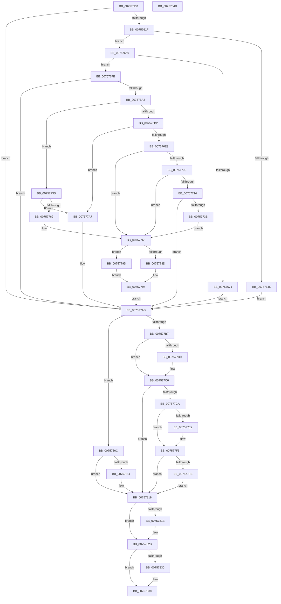

# PopRegisterCoolingExtensionProtection

- RVA: `0x007575D0`–`0x0075784C` (길이 `636` bytes)
- VA: `0x00000001407575D0`
- 실행 섹션: `PAGE`
- PDB 이름 있음: `예`; PDB Function 태그: `아니요`
- unwind 정보 RVA: `0x000B3BD8`
- 디코드: `180`개 명령, `636/636` bytes 표시
- 미해석 바이트: `0` (있으면 어셈블리에 `.byte`로 보존)

> 이 문서는 커널 이미지의 기계어와 PDB 기호를 분석해 생성했습니다. 4번과 5번은 함수 원형과 자료형을 바이너리 사용 방식에서 추정한 C 해석이며 원본 소스 복구 결과는 아닙니다.

## 1. Dependencies

- 직접 호출 지점: **22**; 고유 호출 대상: **12**
- 직접 호출자로 확인된 함수: **1**
- RIP 상대 이미지 참조: **3**

### Outgoing calls
- `0x00757623` → [IoGetDeviceAttachmentBaseRef](../../text/27/IoGetDeviceAttachmentBaseRef_function_00272710.md) (function, `0x00272710`)
- `0x00757640` → [IoGetDeviceProperty](../8F/IoGetDeviceProperty_function_008FA720.md) (function, `0x008FA720`)
- `0x00757664` → [ExAllocatePool2](../../poolcode/B8/ExAllocatePool2_function_00B820F0.md) (function, `0x00B820F0`)
- `0x00757693` → [IoGetDeviceProperty](../8F/IoGetDeviceProperty_function_008FA720.md) (function, `0x008FA720`)
- `0x007576A2` → [Feature_Servicing_CoolingFrameworkDeviceCleanupFix__private_IsEnabledDeviceUsageNoInline](../../text/5D/Feature_Servicing_CoolingFrameworkDeviceCleanupFix__private_IsEnabledDeviceUsageNoInline_function_005D1004.md) (function, `0x005D1004`)
- `0x007576BC` → [RtlInitUnicodeString](../../text/42/RtlInitUnicodeString_function_0042A780.md) (function, `0x0042A780`)
- `0x007576D4` → [IoGetDeviceObjectPointer](../95/IoGetDeviceObjectPointer_function_00953220.md) (function, `0x00953220`)
- `0x007576FF` → [IoGetDeviceInterfaces](../95/IoGetDeviceInterfaces_function_00953340.md) (function, `0x00953340`)
- `0x0075771B` → [RtlInitUnicodeString](../../text/42/RtlInitUnicodeString_function_0042A780.md) (function, `0x0042A780`)
- `0x00757730` → [RtlDuplicateUnicodeString](../93/RtlDuplicateUnicodeString_function_009321F0.md) (function, `0x009321F0`)
- `0x00757741` → [RtlInitUnicodeString](../../text/42/RtlInitUnicodeString_function_0042A780.md) (function, `0x0042A780`)
- `0x00757757` → [IoGetDeviceObjectPointer](../95/IoGetDeviceObjectPointer_function_00953220.md) (function, `0x00953220`)
- `0x00757766` → [Feature_Servicing_CoolingFrameworkDeviceCleanupFix__private_IsEnabledDeviceUsageNoInline](../../text/5D/Feature_Servicing_CoolingFrameworkDeviceCleanupFix__private_IsEnabledDeviceUsageNoInline_function_005D1004.md) (function, `0x005D1004`)
- `0x00757794` → [IoRegisterPlugPlayNotification](../95/IoRegisterPlugPlayNotification_function_009535A0.md) (function, `0x009535A0`)
- `0x007577AB` → [Feature_Servicing_CoolingFrameworkDeviceCleanupFix__private_IsEnabledDeviceUsageNoInline](../../text/5D/Feature_Servicing_CoolingFrameworkDeviceCleanupFix__private_IsEnabledDeviceUsageNoInline_function_005D1004.md) (function, `0x005D1004`)
- `0x007577C1` → [ExFreePoolWithTag](../../poolcode/B8/ExFreePoolWithTag_function_00B82870.md) (function, `0x00B82870`)
- `0x007577D1` → [RtlFreeAnsiString](../9C/RtlFreeAnsiString_function_009C0800.md) (function, `0x009C0800`)
- `0x007577E7` → [ExFreePoolWithTag](../../poolcode/B8/ExFreePoolWithTag_function_00B82870.md) (function, `0x00B82870`)
- `0x007577FE` → [ObfDereferenceObject](../../text/2F/ObfDereferenceObject_function_002F9350.md) (function, `0x002F9350`)
- `0x00757814` → [ObfDereferenceObject](../../text/2F/ObfDereferenceObject_function_002F9350.md) (function, `0x002F9350`)
- `0x00757826` → [ExFreePoolWithTag](../../poolcode/B8/ExFreePoolWithTag_function_00B82870.md) (function, `0x00B82870`)
- `0x00757833` → [ObfDereferenceObject](../../text/2F/ObfDereferenceObject_function_002F9350.md) (function, `0x002F9350`)

### Direct callers
- [PopAssociateThermalRequest](PopAssociateThermalRequest_function_00756E78.md) at `0x00756FAF`
- [PopAssociateThermalRequest](PopAssociateThermalRequest_function_00756E78.md) at `0x0075703F`

### Static image references
- `0x007576F8` → RVA `0x00023690` (`.rdata`; read)
- `0x00757779` → RVA `0x00757110` (`PopCoolingExtensionPnpNotification`; read)
- `0x0075778D` → RVA `0x00F8C440` (`.data`; read)

## 2. Other-region calls and transfers

- 다른 실행 섹션으로 향하는 call: **14**
  - `0x00757623` → [IoGetDeviceAttachmentBaseRef](../../text/27/IoGetDeviceAttachmentBaseRef_function_00272710.md) (`PAGE` → `.text`)
  - `0x00757664` → [ExAllocatePool2](../../poolcode/B8/ExAllocatePool2_function_00B820F0.md) (`PAGE` → `POOLCODE`)
  - `0x007576A2` → [Feature_Servicing_CoolingFrameworkDeviceCleanupFix__private_IsEnabledDeviceUsageNoInline](../../text/5D/Feature_Servicing_CoolingFrameworkDeviceCleanupFix__private_IsEnabledDeviceUsageNoInline_function_005D1004.md) (`PAGE` → `.text`)
  - `0x007576BC` → [RtlInitUnicodeString](../../text/42/RtlInitUnicodeString_function_0042A780.md) (`PAGE` → `.text`)
  - `0x0075771B` → [RtlInitUnicodeString](../../text/42/RtlInitUnicodeString_function_0042A780.md) (`PAGE` → `.text`)
  - `0x00757741` → [RtlInitUnicodeString](../../text/42/RtlInitUnicodeString_function_0042A780.md) (`PAGE` → `.text`)
  - `0x00757766` → [Feature_Servicing_CoolingFrameworkDeviceCleanupFix__private_IsEnabledDeviceUsageNoInline](../../text/5D/Feature_Servicing_CoolingFrameworkDeviceCleanupFix__private_IsEnabledDeviceUsageNoInline_function_005D1004.md) (`PAGE` → `.text`)
  - `0x007577AB` → [Feature_Servicing_CoolingFrameworkDeviceCleanupFix__private_IsEnabledDeviceUsageNoInline](../../text/5D/Feature_Servicing_CoolingFrameworkDeviceCleanupFix__private_IsEnabledDeviceUsageNoInline_function_005D1004.md) (`PAGE` → `.text`)
  - `0x007577C1` → [ExFreePoolWithTag](../../poolcode/B8/ExFreePoolWithTag_function_00B82870.md) (`PAGE` → `POOLCODE`)
  - `0x007577E7` → [ExFreePoolWithTag](../../poolcode/B8/ExFreePoolWithTag_function_00B82870.md) (`PAGE` → `POOLCODE`)
  - `0x007577FE` → [ObfDereferenceObject](../../text/2F/ObfDereferenceObject_function_002F9350.md) (`PAGE` → `.text`)
  - `0x00757814` → [ObfDereferenceObject](../../text/2F/ObfDereferenceObject_function_002F9350.md) (`PAGE` → `.text`)
  - `0x00757826` → [ExFreePoolWithTag](../../poolcode/B8/ExFreePoolWithTag_function_00B82870.md) (`PAGE` → `POOLCODE`)
  - `0x00757833` → [ObfDereferenceObject](../../text/2F/ObfDereferenceObject_function_002F9350.md) (`PAGE` → `.text`)
- 별도 외부 분기/꼬리 이동을 확인하지 못했습니다.

## 3. Assembly (complete function range)

```asm
007575D0  40 55                           push rbp
007575D2  53                              push rbx
007575D3  56                              push rsi
007575D4  57                              push rdi
007575D5  41 54                           push r12
007575D7  41 55                           push r13
007575D9  41 56                           push r14
007575DB  41 57                           push r15
007575DD  48 8B EC                        mov rbp, rsp
007575E0  48 83 EC 68                     sub rsp, 0x68
007575E4  33 DB                           xor ebx, ebx
007575E6  4C 8D 69 48                     lea r13, [rcx + 0x48]
007575EA  0F 57 C0                        xorps xmm0, xmm0
007575ED  0F 57 C9                        xorps xmm1, xmm1
007575F0  48 8B F1                        mov rsi, rcx
007575F3  89 5D 48                        mov dword ptr [rbp + 0x48], ebx
007575F6  44 8B F3                        mov r14d, ebx
007575F9  48 89 5D 60                     mov qword ptr [rbp + 0x60], rbx
007575FD  8B FB                           mov edi, ebx
007575FF  48 89 5D 58                     mov qword ptr [rbp + 0x58], rbx
00757603  44 8B E3                        mov r12d, ebx
00757606  48 89 5D 50                     mov qword ptr [rbp + 0x50], rbx
0075760A  44 8B FB                        mov r15d, ebx
0075760D  0F 11 45 E8                     movups xmmword ptr [rbp - 0x18], xmm0
00757611  0F 11 4D D8                     movups xmmword ptr [rbp - 0x28], xmm1
00757615  49 39 5D 00                     cmp qword ptr [r13], rbx
00757619  0F 85 8C 01 00 00               jne 0x1407577ab
0075761F  48 8B 49 40                     mov rcx, qword ptr [rcx + 0x40]
00757623  E8 E8 B0 B1 FF                  call 0x140272710
00757628  4C 8B E0                        mov r12, rax
0075762B  8D 53 0B                        lea edx, [rbx + 0xb]
0075762E  48 8D 45 48                     lea rax, [rbp + 0x48]
00757632  49 8B CC                        mov rcx, r12
00757635  45 33 C9                        xor r9d, r9d
00757638  48 89 44 24 20                  mov qword ptr [rsp + 0x20], rax
0075763D  45 33 C0                        xor r8d, r8d
00757640  E8 DB 30 1A 00                  call 0x1408fa720
00757645  3D 23 00 00 C0                  cmp eax, 0xc0000023
0075764A  74 0A                           je 0x140757656
0075764C  BB 01 00 00 C0                  mov ebx, 0xc0000001
00757651  E9 55 01 00 00                  jmp 0x1407577ab
00757656  8B 55 48                        mov edx, dword ptr [rbp + 0x48]
00757659  B9 00 01 00 00                  mov ecx, 0x100
0075765E  41 B8 50 43 6F 6C               mov r8d, 0x6c6f4350
00757664  E8 87 AA 42 00                  call 0x140b820f0
00757669  4C 8B F8                        mov r15, rax
0075766C  48 85 C0                        test rax, rax
0075766F  75 0A                           jne 0x14075767b
00757671  BB 9A 00 00 C0                  mov ebx, 0xc000009a
00757676  E9 30 01 00 00                  jmp 0x1407577ab
0075767B  44 8B 45 48                     mov r8d, dword ptr [rbp + 0x48]
0075767F  48 8D 45 48                     lea rax, [rbp + 0x48]
00757683  4D 8B CF                        mov r9, r15
00757686  48 89 44 24 20                  mov qword ptr [rsp + 0x20], rax
0075768B  BA 0B 00 00 00                  mov edx, 0xb
00757690  49 8B CC                        mov rcx, r12
00757693  E8 88 30 1A 00                  call 0x1408fa720
00757698  8B D8                           mov ebx, eax
0075769A  85 C0                           test eax, eax
0075769C  0F 88 09 01 00 00               js 0x1407577ab
007576A2  E8 5D 99 E7 FF                  call 0x1405d1004
007576A7  49 8B D7                        mov rdx, r15
007576AA  85 C0                           test eax, eax
007576AC  0F 84 8B 00 00 00               je 0x14075773d
007576B2  48 8D 9E C0 00 00 00            lea rbx, [rsi + 0xc0]
007576B9  48 8B CB                        mov rcx, rbx
007576BC  E8 BF 30 CD FF                  call 0x14042a780
007576C1  4C 8D 4D 60                     lea r9, [rbp + 0x60]
007576C5  BA FF 01 1F 00                  mov edx, 0x1f01ff
007576CA  4C 8D 45 50                     lea r8, [rbp + 0x50]
007576CE  48 8B CB                        mov rcx, rbx
007576D1  4C 8B FF                        mov r15, rdi
007576D4  E8 47 BB 1F 00                  call 0x140953220
007576D9  8B D8                           mov ebx, eax
007576DB  85 C0                           test eax, eax
007576DD  0F 88 C4 00 00 00               js 0x1407577a7
007576E3  48 8B 7D 50                     mov rdi, qword ptr [rbp + 0x50]
007576E7  4C 8D 4D 58                     lea r9, [rbp + 0x58]
007576EB  45 33 C0                        xor r8d, r8d
007576EE  48 89 BE D0 00 00 00            mov qword ptr [rsi + 0xd0], rdi
007576F5  49 8B D4                        mov rdx, r12
007576F8  48 8D 0D 91 BF 8C FF            lea rcx, [rip - 0x73406f]
007576FF  E8 3C BC 1F 00                  call 0x140953340
00757704  4C 8B 75 58                     mov r14, qword ptr [rbp + 0x58]
00757708  33 C9                           xor ecx, ecx
0075770A  85 C0                           test eax, eax
0075770C  78 58                           js 0x140757766
0075770E  66 41 39 0E                     cmp word ptr [r14], cx
00757712  74 52                           je 0x140757766
00757714  49 8B D6                        mov rdx, r14
00757717  48 8D 4D D8                     lea rcx, [rbp - 0x28]
0075771B  E8 60 30 CD FF                  call 0x14042a780
00757720  4C 8D 86 B0 00 00 00            lea r8, [rsi + 0xb0]
00757727  B9 01 00 00 00                  mov ecx, 1
0075772C  48 8D 55 D8                     lea rdx, [rbp - 0x28]
00757730  E8 BB AA 1D 00                  call 0x1409321f0
00757735  8B D8                           mov ebx, eax
00757737  85 C0                           test eax, eax
00757739  78 70                           js 0x1407577ab
0075773B  EB 29                           jmp 0x140757766
0075773D  48 8D 4D E8                     lea rcx, [rbp - 0x18]
00757741  E8 3A 30 CD FF                  call 0x14042a780
00757746  4C 8D 4D 60                     lea r9, [rbp + 0x60]
0075774A  BA FF 01 1F 00                  mov edx, 0x1f01ff
0075774F  4C 8D 45 50                     lea r8, [rbp + 0x50]
00757753  48 8D 4D E8                     lea rcx, [rbp - 0x18]
00757757  E8 C4 BA 1F 00                  call 0x140953220
0075775C  8B D8                           mov ebx, eax
0075775E  85 C0                           test eax, eax
00757760  78 45                           js 0x1407577a7
00757762  48 8B 7D 50                     mov rdi, qword ptr [rbp + 0x50]
00757766  E8 99 98 E7 FF                  call 0x1405d1004
0075776B  33 D2                           xor edx, edx
0075776D  4C 89 6C 24 30                  mov qword ptr [rsp + 0x30], r13
00757772  85 C0                           test eax, eax
00757774  48 89 74 24 28                  mov qword ptr [rsp + 0x28], rsi
00757779  48 8D 05 90 F9 FF FF            lea rax, [rip - 0x670]
00757780  4C 8B C7                        mov r8, rdi
00757783  48 89 44 24 20                  mov qword ptr [rsp + 0x20], rax
00757788  8D 4A 03                        lea ecx, [rdx + 3]
0075778B  74 10                           je 0x14075779d
0075778D  4C 8B 0D AC 4C 83 00            mov r9, qword ptr [rip + 0x834cac]
00757794  E8 07 BE 1F 00                  call 0x1409535a0
00757799  8B D8                           mov ebx, eax
0075779B  EB 0E                           jmp 0x1407577ab
0075779D  4C 8B 4D 60                     mov r9, qword ptr [rbp + 0x60]
007577A1  4D 8B 49 08                     mov r9, qword ptr [r9 + 8]
007577A5  EB ED                           jmp 0x140757794
007577A7  48 8B 7D 50                     mov rdi, qword ptr [rbp + 0x50]
007577AB  E8 54 98 E7 FF                  call 0x1405d1004
007577B0  45 33 ED                        xor r13d, r13d
007577B3  85 C0                           test eax, eax
007577B5  74 55                           je 0x14075780c
007577B7  4D 85 F6                        test r14, r14
007577BA  74 0A                           je 0x1407577c6
007577BC  33 D2                           xor edx, edx
007577BE  49 8B CE                        mov rcx, r14
007577C1  E8 AA B0 42 00                  call 0x140b82870
007577C6  85 DB                           test ebx, ebx
007577C8  79 4F                           jns 0x140757819
007577CA  48 8D 8E B0 00 00 00            lea rcx, [rsi + 0xb0]
007577D1  E8 2A 90 26 00                  call 0x1409c0800
007577D6  48 8B 8E C8 00 00 00            mov rcx, qword ptr [rsi + 0xc8]
007577DD  48 85 C9                        test rcx, rcx
007577E0  74 14                           je 0x1407577f6
007577E2  BA 50 43 6F 6C                  mov edx, 0x6c6f4350
007577E7  E8 84 B0 42 00                  call 0x140b82870
007577EC  0F 57 C0                        xorps xmm0, xmm0
007577EF  0F 11 86 C0 00 00 00            movups xmmword ptr [rsi + 0xc0], xmm0
007577F6  48 85 FF                        test rdi, rdi
007577F9  74 1E                           je 0x140757819
007577FB  48 8B CF                        mov rcx, rdi
007577FE  E8 4D 1B BA FF                  call 0x1402f9350
00757803  4C 89 AE D0 00 00 00            mov qword ptr [rsi + 0xd0], r13
0075780A  EB 0D                           jmp 0x140757819
0075780C  48 85 FF                        test rdi, rdi
0075780F  74 08                           je 0x140757819
00757811  48 8B CF                        mov rcx, rdi
00757814  E8 37 1B BA FF                  call 0x1402f9350
00757819  4D 85 FF                        test r15, r15
0075781C  74 0D                           je 0x14075782b
0075781E  BA 50 43 6F 6C                  mov edx, 0x6c6f4350
00757823  49 8B CF                        mov rcx, r15
00757826  E8 45 B0 42 00                  call 0x140b82870
0075782B  4D 85 E4                        test r12, r12
0075782E  74 08                           je 0x140757838
00757830  49 8B CC                        mov rcx, r12
00757833  E8 18 1B BA FF                  call 0x1402f9350
00757838  8B C3                           mov eax, ebx
0075783A  48 83 C4 68                     add rsp, 0x68
0075783E  41 5F                           pop r15
00757840  41 5E                           pop r14
00757842  41 5D                           pop r13
00757844  41 5C                           pop r12
00757846  5F                              pop rdi
00757847  5E                              pop rsi
00757848  5B                              pop rbx
00757849  5D                              pop rbp
0075784A  C3                              ret
0075784B  CC                              int3
```

## 4. C-style interpretation (structured pseudocode)

```c
__int64 __fastcall PopRegisterCoolingExtensionProtection(__int64 a1, __int64 a2, int a3, int a4)
{
    __int64 result;
    __int64 v_r13;
    __int64 v_rbx;
    __int64 v_rsp;
    unsigned __int64 v_stack_m58;
    unsigned __int64 v_stack_m68;
    unsigned __int64 v_stack_m78;
    unsigned __int64 v_stack_m80;
    unsigned __int64 v_stack_m88;
    unsigned __int64 v_stack_p10;
    unsigned __int64 v_stack_p18;
    unsigned __int64 v_stack_p20;
    unsigned int v_stack_p8;

    v_rsp = (v_rsp) - (104);
    v_rbx = 0;
    v_stack_p8 = 0;
    v_stack_p20 = 0;
    v_stack_p18 = 0;
    v_stack_p10 = 0;
    v_stack_m58 = v_xmm0;
    v_stack_m68 = v_xmm1;
    if ((*(unsigned __int64 *)(a1 + 72)) != 0) goto loc_007577AB;
    result = IoGetDeviceAttachmentBaseRef(*(unsigned __int64 *)(a1 + 64), a2, a3, a4);
    a4 = 0;
    v_stack_m88 = v_stack_p8;
    a3 = 0;
    result = IoGetDeviceProperty(result, v_rbx + 11, a3, a4);
    if (((unsigned int)(result)) == 0xC0000023ULL) goto loc_00757656;
    goto loc_007577AB;
loc_00757656:
    result = ExAllocatePool2(256, (unsigned int)(v_stack_p8), (unsigned int)(0x6C6F4350ULL), a4);
    if (result != 0) goto loc_0075767B;
    goto loc_007577AB;
loc_0075767B:
    v_stack_m88 = v_stack_p8;
    result = IoGetDeviceProperty(result, 11, (unsigned int)(v_stack_p8), result);
    if (sign_flag) goto loc_007577AB;
    result = Feature_Servicing_CoolingFrameworkDeviceCleanupFix__private_IsEnabledDeviceUsageNoInline(result, 11, (unsigned int)(v_stack_p8), result);
    if ((unsigned int)(result) == 0) goto loc_0075773D;
    result = RtlInitUnicodeString(a1 + 192, result, (unsigned int)(v_stack_p8), result);
    result = IoGetDeviceObjectPointer(a1 + 192, (unsigned int)(0x1F01FFULL), v_stack_p10, v_stack_p20);
    if (sign_flag) goto loc_007577A7;
    a3 = 0;
    *(unsigned __int64 *)(a1 + 208) = v_stack_p10;
    result = IoGetDeviceInterfaces(v_rip - 7553135, result, a3, v_stack_p18);
    a1 = 0;
    if (sign_flag) goto loc_00757766;
    if ((*(unsigned __int16 *)(v_stack_p18)) == 0) goto loc_00757766;
    result = RtlInitUnicodeString(v_stack_m68, v_stack_p18, a3, v_stack_p18);
    result = RtlDuplicateUnicodeString(1, v_stack_m68, a1 + 176, v_stack_p18);
    if (sign_flag) goto loc_007577AB;
    goto loc_00757766;
loc_0075773D:
    result = RtlInitUnicodeString(v_stack_m58, v_stack_m68, a1 + 176, v_stack_p18);
    result = IoGetDeviceObjectPointer(v_stack_m58, (unsigned int)(0x1F01FFULL), v_stack_p10, v_stack_p20);
    if (sign_flag) goto loc_007577A7;
loc_00757766:
    result = Feature_Servicing_CoolingFrameworkDeviceCleanupFix__private_IsEnabledDeviceUsageNoInline(v_stack_m58, (unsigned int)(0x1F01FFULL), v_stack_p10, v_stack_p20);
    a2 = 0;
    v_stack_m78 = a1 + 72;
    v_stack_m80 = 0;
    v_stack_m88 = v_rip - 1648;
    if ((unsigned int)(result) == 0) goto loc_0075779D;
loc_00757794:
    result = IoRegisterPlugPlayNotification(a2 + 3, a2, v_stack_p10, *(unsigned __int64 *)(v_rip + 8604844));
    goto loc_007577AB;
loc_0075779D:
    goto loc_00757794;
loc_007577A7:
loc_007577AB:
    result = Feature_Servicing_CoolingFrameworkDeviceCleanupFix__private_IsEnabledDeviceUsageNoInline(a2 + 3, a2, v_stack_p10, *(unsigned __int64 *)(v_stack_p20 + 8));
    v_r13 = 0;
    if ((unsigned int)(result) == 0) goto loc_0075780C;
    if (v_stack_p18 != 0) {
        a2 = 0;
        a1 = v_stack_p18;
        result = ExFreePoolWithTag(a1, a2, v_stack_p10, *(unsigned __int64 *)(v_stack_p20 + 8));
    }
    if (!sign_flag) goto loc_00757819;
    result = RtlFreeAnsiString(a1 + 176, a2, v_stack_p10, *(unsigned __int64 *)(v_stack_p20 + 8));
    if (*(unsigned __int64 *)(a1 + 200) != 0) {
        a2 = 0x6C6F4350ULL;
        result = ExFreePoolWithTag(*(unsigned __int64 *)(a1 + 200), a2, v_stack_p10, *(unsigned __int64 *)(v_stack_p20 + 8));
        *(unsigned __int64 *)(a1 + 192) = v_xmm0;
    }
    if (v_stack_p10 == 0) goto loc_00757819;
    result = ObfDereferenceObject(v_stack_p10, a2, v_stack_p10, *(unsigned __int64 *)(v_stack_p20 + 8));
    *(unsigned __int64 *)(a1 + 208) = 0;
    goto loc_00757819;
loc_0075780C:
    if (v_stack_p10 != 0) {
        a1 = v_stack_p10;
        result = ObfDereferenceObject(a1, a2, v_stack_p10, *(unsigned __int64 *)(v_stack_p20 + 8));
    }
    if (0 != 0) {
        a2 = 0x6C6F4350ULL;
        a1 = 0;
        result = ExFreePoolWithTag(a1, a2, v_stack_p10, *(unsigned __int64 *)(v_stack_p20 + 8));
    }
    if (result != 0) {
        a1 = result;
        result = ObfDereferenceObject(a1, a2, v_stack_p10, *(unsigned __int64 *)(v_stack_p20 + 8));
    }
    v_rsp = (v_rsp) + (104);
    return (unsigned int)((unsigned int)((unsigned int)((unsigned int)(result))));
}
```

## 5. (Beta) C Style

```c
int64_t PopRegisterCoolingExtensionProtection(void *Arg1, int64_t Arg2, int32_t Arg3, int32_t Arg4)
{
    uint8_t *arg1 = (uint8_t *)Arg1;

    int64_t result;
    int64_t local_r13;
    int64_t local_rbx;
    int64_t local_rsp;
    uint64_t v_stack_m58;
    uint64_t v_stack_m68;
    uint64_t v_stack_m78;
    uint64_t v_stack_m80;
    uint64_t v_stack_m88;
    uint64_t v_stack_p10;
    uint64_t v_stack_p18;
    uint64_t v_stack_p20;
    uint32_t v_stack_p8;

    local_rsp = (local_rsp) - (104);
    local_rbx = 0;
    v_stack_p8 = 0;
    v_stack_p20 = 0;
    v_stack_p18 = 0;
    v_stack_p10 = 0;
    v_stack_m58 = v_xmm0;
    v_stack_m68 = v_xmm1;
    if ((*(uint64_t *)(arg1 + 0x48)) != 0) goto loc_007577AB;
    result = IoGetDeviceAttachmentBaseRef(*(uint64_t *)(arg1 + 0x40), Arg2, Arg3, Arg4);
    Arg4 = 0;
    v_stack_m88 = v_stack_p8;
    Arg3 = 0;
    result = IoGetDeviceProperty(result, local_rbx + 11, Arg3, Arg4);
    if (((uint32_t)(result)) == 0xC0000023ULL) goto loc_00757656;
    goto loc_007577AB;
loc_00757656:
    result = ExAllocatePool2(256, (uint32_t)(v_stack_p8), (uint32_t)(0x6C6F4350ULL), Arg4);
    if (result != 0) goto loc_0075767B;
    goto loc_007577AB;
loc_0075767B:
    v_stack_m88 = v_stack_p8;
    result = IoGetDeviceProperty(result, 11, (uint32_t)(v_stack_p8), result);
    if (sign_flag) goto loc_007577AB;
    result = Feature_Servicing_CoolingFrameworkDeviceCleanupFix__private_IsEnabledDeviceUsageNoInline(result, 11, (uint32_t)(v_stack_p8), result);
    if ((uint32_t)(result) == 0) goto loc_0075773D;
    result = RtlInitUnicodeString(Arg1 + 192, result, (uint32_t)(v_stack_p8), result);
    result = IoGetDeviceObjectPointer(Arg1 + 192, (uint32_t)(0x1F01FFULL), v_stack_p10, v_stack_p20);
    if (sign_flag) goto loc_007577A7;
    Arg3 = 0;
    *(uint64_t *)(arg1 + 0xD0) = v_stack_p10;
    result = IoGetDeviceInterfaces(v_rip - 7553135, result, Arg3, v_stack_p18);
    Arg1 = 0;
    if (sign_flag) goto loc_00757766;
    if ((*(uint16_t *)(v_stack_p18)) == 0) goto loc_00757766;
    result = RtlInitUnicodeString(v_stack_m68, v_stack_p18, Arg3, v_stack_p18);
    result = RtlDuplicateUnicodeString(1, v_stack_m68, Arg1 + 176, v_stack_p18);
    if (sign_flag) goto loc_007577AB;
    goto loc_00757766;
loc_0075773D:
    result = RtlInitUnicodeString(v_stack_m58, v_stack_m68, Arg1 + 176, v_stack_p18);
    result = IoGetDeviceObjectPointer(v_stack_m58, (uint32_t)(0x1F01FFULL), v_stack_p10, v_stack_p20);
    if (sign_flag) goto loc_007577A7;
loc_00757766:
    result = Feature_Servicing_CoolingFrameworkDeviceCleanupFix__private_IsEnabledDeviceUsageNoInline(v_stack_m58, (uint32_t)(0x1F01FFULL), v_stack_p10, v_stack_p20);
    Arg2 = 0;
    v_stack_m78 = Arg1 + 72;
    v_stack_m80 = 0;
    v_stack_m88 = v_rip - 1648;
    if ((uint32_t)(result) == 0) goto loc_0075779D;
loc_00757794:
    result = IoRegisterPlugPlayNotification(Arg2 + 3, Arg2, v_stack_p10, *(uint64_t *)(v_rip + 0x834CAC));
    goto loc_007577AB;
loc_0075779D:
    goto loc_00757794;
loc_007577A7:
loc_007577AB:
    result = Feature_Servicing_CoolingFrameworkDeviceCleanupFix__private_IsEnabledDeviceUsageNoInline(Arg2 + 3, Arg2, v_stack_p10, *(uint64_t *)(v_stack_p20 + 0x8));
    local_r13 = 0;
    if ((uint32_t)(result) == 0) goto loc_0075780C;
    if (v_stack_p18 != 0) {
        Arg2 = 0;
        Arg1 = v_stack_p18;
        result = ExFreePoolWithTag(Arg1, Arg2, v_stack_p10, *(uint64_t *)(v_stack_p20 + 0x8));
    }
    if (!sign_flag) goto loc_00757819;
    result = RtlFreeAnsiString(Arg1 + 176, Arg2, v_stack_p10, *(uint64_t *)(v_stack_p20 + 0x8));
    if (*(uint64_t *)(arg1 + 0xC8) != 0) {
        Arg2 = 0x6C6F4350ULL;
        result = ExFreePoolWithTag(*(uint64_t *)(arg1 + 0xC8), Arg2, v_stack_p10, *(uint64_t *)(v_stack_p20 + 0x8));
        *(uint64_t *)(arg1 + 0xC0) = v_xmm0;
    }
    if (v_stack_p10 == 0) goto loc_00757819;
    result = ObfDereferenceObject(v_stack_p10, Arg2, v_stack_p10, *(uint64_t *)(v_stack_p20 + 0x8));
    *(uint64_t *)(arg1 + 0xD0) = 0;
    goto loc_00757819;
loc_0075780C:
    if (v_stack_p10 != 0) {
        Arg1 = v_stack_p10;
        result = ObfDereferenceObject(Arg1, Arg2, v_stack_p10, *(uint64_t *)(v_stack_p20 + 0x8));
    }
    if (0 != 0) {
        Arg2 = 0x6C6F4350ULL;
        Arg1 = 0;
        result = ExFreePoolWithTag(Arg1, Arg2, v_stack_p10, *(uint64_t *)(v_stack_p20 + 0x8));
    }
    if (result != 0) {
        Arg1 = result;
        result = ObfDereferenceObject(Arg1, Arg2, v_stack_p10, *(uint64_t *)(v_stack_p20 + 0x8));
    }
    local_rsp = (local_rsp) + (104);
    return (uint32_t)((uint32_t)((uint32_t)((uint32_t)(result))));
}
```

### 관측된 메모리 오프셋

구조체 형식이 확인되지 않은 접근은 인자 기준의 오프셋으로만 기록했습니다.

| 기준 인자 | 오프셋 표현 | 폭 (bit) | 접근 |
|---|---:|---:|---|
| `Arg1` | `+ 0x0` | `64` | `R` |
| `Arg1` | `+ 0x40` | `64` | `R` |
| `Arg1` | `+ 0x48` | `64` | `R` |
| `Arg1` | `+ 0xB0` | `64` | `R` |
| `Arg1` | `+ 0xC0` | `64` | `R` |
| `Arg1` | `+ 0xC0` | `128` | `R` |
| `Arg1` | `+ 0xC8` | `64` | `R` |
| `Arg1` | `+ 0xD0` | `64` | `W` |

## 6. Execution-region graph

[열기: 2D/3D 그래프와 함수 탐색 컨트롤 패널](../../../control-panel.html?section=page&rva=0x007575D0&view=graph)

- 2D 그래프는 위에서 아래로 흐르고, 3D 그래프는 빈 공간을 드래그해 회전합니다. Shift+드래그는 이동, 휠은 확대·축소, 함수 노드 선택은 대상 보고서 이동입니다.

### Static fallback


