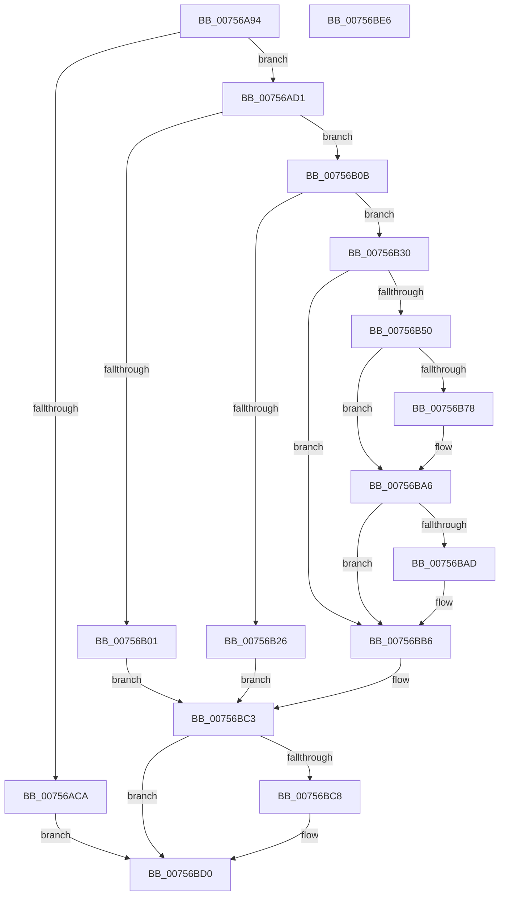

# PopRegisterTargetDeviceProtection

- RVA: `0x00756A94`–`0x00756BE7` (길이 `339` bytes)
- VA: `0x0000000140756A94`
- 실행 섹션: `PAGE`
- PDB 이름 있음: `예`; PDB Function 태그: `아니요`
- unwind 정보 RVA: `0x000CC010`
- 디코드: `96`개 명령, `339/339` bytes 표시
- 미해석 바이트: `0` (있으면 어셈블리에 `.byte`로 보존)

> 이 문서는 커널 이미지의 기계어와 PDB 기호를 분석해 생성했습니다. 4번과 5번은 함수 원형과 자료형을 바이너리 사용 방식에서 추정한 C 해석이며 원본 소스 복구 결과는 아닙니다.

## 1. Dependencies

- 직접 호출 지점: **10**; 고유 호출 대상: **8**
- 직접 호출자로 확인된 함수: **1**
- RIP 상대 이미지 참조: **1**

### Outgoing calls
- `0x00756AD5` → [IoGetDeviceAttachmentBaseRef](../../text/27/IoGetDeviceAttachmentBaseRef_function_00272710.md) (function, `0x00272710`)
- `0x00756AF5` → [IoGetDeviceProperty](../8F/IoGetDeviceProperty_function_008FA720.md) (function, `0x008FA720`)
- `0x00756B19` → [ExAllocatePool2](../../poolcode/B8/ExAllocatePool2_function_00B820F0.md) (function, `0x00B820F0`)
- `0x00756B45` → [IoGetDeviceProperty](../8F/IoGetDeviceProperty_function_008FA720.md) (function, `0x008FA720`)
- `0x00756B57` → [RtlInitUnicodeString](../../text/42/RtlInitUnicodeString_function_0042A780.md) (function, `0x0042A780`)
- `0x00756B6D` → [IoGetDeviceObjectPointer](../95/IoGetDeviceObjectPointer_function_00953220.md) (function, `0x00953220`)
- `0x00756B9F` → [IoRegisterPlugPlayNotification](../95/IoRegisterPlugPlayNotification_function_009535A0.md) (function, `0x009535A0`)
- `0x00756BB1` → [ObfDereferenceObject](../../text/2F/ObfDereferenceObject_function_002F9350.md) (function, `0x002F9350`)
- `0x00756BBE` → [ExFreePoolWithTag](../../poolcode/B8/ExFreePoolWithTag_function_00B82870.md) (function, `0x00B82870`)
- `0x00756BCB` → [ObfDereferenceObject](../../text/2F/ObfDereferenceObject_function_002F9350.md) (function, `0x002F9350`)

### Direct callers
- [PopAssociatePowerLimitRequest](PopAssociatePowerLimitRequest_function_00755EC8.md) at `0x00755F83`

### Static image references
- `0x00756B7C` → RVA `0x007567C0` (`PopPowerLimitPnpNotification`; read)

## 2. Other-region calls and transfers

- 다른 실행 섹션으로 향하는 call: **6**
  - `0x00756AD5` → [IoGetDeviceAttachmentBaseRef](../../text/27/IoGetDeviceAttachmentBaseRef_function_00272710.md) (`PAGE` → `.text`)
  - `0x00756B19` → [ExAllocatePool2](../../poolcode/B8/ExAllocatePool2_function_00B820F0.md) (`PAGE` → `POOLCODE`)
  - `0x00756B57` → [RtlInitUnicodeString](../../text/42/RtlInitUnicodeString_function_0042A780.md) (`PAGE` → `.text`)
  - `0x00756BB1` → [ObfDereferenceObject](../../text/2F/ObfDereferenceObject_function_002F9350.md) (`PAGE` → `.text`)
  - `0x00756BBE` → [ExFreePoolWithTag](../../poolcode/B8/ExFreePoolWithTag_function_00B82870.md) (`PAGE` → `POOLCODE`)
  - `0x00756BCB` → [ObfDereferenceObject](../../text/2F/ObfDereferenceObject_function_002F9350.md) (`PAGE` → `.text`)
- 별도 외부 분기/꼬리 이동을 확인하지 못했습니다.

## 3. Assembly (complete function range)

```asm
00756A94  48 89 5C 24 20                  mov qword ptr [rsp + 0x20], rbx
00756A99  55                              push rbp
00756A9A  56                              push rsi
00756A9B  57                              push rdi
00756A9C  41 54                           push r12
00756A9E  41 57                           push r15
00756AA0  48 8B EC                        mov rbp, rsp
00756AA3  48 83 EC 50                     sub rsp, 0x50
00756AA7  83 65 30 00                     and dword ptr [rbp + 0x30], 0
00756AAB  4C 8D 61 40                     lea r12, [rcx + 0x40]
00756AAF  48 83 65 40 00                  and qword ptr [rbp + 0x40], 0
00756AB4  0F 57 C0                        xorps xmm0, xmm0
00756AB7  48 83 65 38 00                  and qword ptr [rbp + 0x38], 0
00756ABC  4C 8B F9                        mov r15, rcx
00756ABF  49 83 3C 24 00                  cmp qword ptr [r12], 0
00756AC4  0F 11 45 F0                     movups xmmword ptr [rbp - 0x10], xmm0
00756AC8  74 07                           je 0x140756ad1
00756ACA  33 DB                           xor ebx, ebx
00756ACC  E9 FF 00 00 00                  jmp 0x140756bd0
00756AD1  48 8B 49 38                     mov rcx, qword ptr [rcx + 0x38]
00756AD5  E8 36 BC B1 FF                  call 0x140272710
00756ADA  48 8B F8                        mov rdi, rax
00756ADD  45 33 C9                        xor r9d, r9d
00756AE0  48 8D 45 30                     lea rax, [rbp + 0x30]
00756AE4  45 33 C0                        xor r8d, r8d
00756AE7  48 8B CF                        mov rcx, rdi
00756AEA  48 89 44 24 20                  mov qword ptr [rsp + 0x20], rax
00756AEF  41 8D 59 0B                     lea ebx, [r9 + 0xb]
00756AF3  8B D3                           mov edx, ebx
00756AF5  E8 26 3C 1A 00                  call 0x1408fa720
00756AFA  3D 23 00 00 C0                  cmp eax, 0xc0000023
00756AFF  74 0A                           je 0x140756b0b
00756B01  BB 01 00 00 C0                  mov ebx, 0xc0000001
00756B06  E9 B8 00 00 00                  jmp 0x140756bc3
00756B0B  8B 55 30                        mov edx, dword ptr [rbp + 0x30]
00756B0E  B9 00 01 00 00                  mov ecx, 0x100
00756B13  41 B8 50 50 6C 6D               mov r8d, 0x6d6c5050
00756B19  E8 D2 B5 42 00                  call 0x140b820f0
00756B1E  48 8B F0                        mov rsi, rax
00756B21  48 85 C0                        test rax, rax
00756B24  75 0A                           jne 0x140756b30
00756B26  BB 9A 00 00 C0                  mov ebx, 0xc000009a
00756B2B  E9 93 00 00 00                  jmp 0x140756bc3
00756B30  44 8B 45 30                     mov r8d, dword ptr [rbp + 0x30]
00756B34  48 8D 45 30                     lea rax, [rbp + 0x30]
00756B38  4C 8B CE                        mov r9, rsi
00756B3B  48 89 44 24 20                  mov qword ptr [rsp + 0x20], rax
00756B40  8B D3                           mov edx, ebx
00756B42  48 8B CF                        mov rcx, rdi
00756B45  E8 D6 3B 1A 00                  call 0x1408fa720
00756B4A  8B D8                           mov ebx, eax
00756B4C  85 C0                           test eax, eax
00756B4E  78 66                           js 0x140756bb6
00756B50  48 8B D6                        mov rdx, rsi
00756B53  48 8D 4D F0                     lea rcx, [rbp - 0x10]
00756B57  E8 24 3C CD FF                  call 0x14042a780
00756B5C  4C 8D 4D 40                     lea r9, [rbp + 0x40]
00756B60  BA FF 01 1F 00                  mov edx, 0x1f01ff
00756B65  4C 8D 45 38                     lea r8, [rbp + 0x38]
00756B69  48 8D 4D F0                     lea rcx, [rbp - 0x10]
00756B6D  E8 AE C6 1F 00                  call 0x140953220
00756B72  8B D8                           mov ebx, eax
00756B74  85 C0                           test eax, eax
00756B76  78 2E                           js 0x140756ba6
00756B78  4C 8B 4D 40                     mov r9, qword ptr [rbp + 0x40]
00756B7C  48 8D 05 3D FC FF FF            lea rax, [rip - 0x3c3]
00756B83  4C 8B 45 38                     mov r8, qword ptr [rbp + 0x38]
00756B87  33 D2                           xor edx, edx
00756B89  4C 89 64 24 30                  mov qword ptr [rsp + 0x30], r12
00756B8E  4C 89 7C 24 28                  mov qword ptr [rsp + 0x28], r15
00756B93  4D 8B 49 08                     mov r9, qword ptr [r9 + 8]
00756B97  8D 4A 03                        lea ecx, [rdx + 3]
00756B9A  48 89 44 24 20                  mov qword ptr [rsp + 0x20], rax
00756B9F  E8 FC C9 1F 00                  call 0x1409535a0
00756BA4  8B D8                           mov ebx, eax
00756BA6  48 83 7D 38 00                  cmp qword ptr [rbp + 0x38], 0
00756BAB  74 09                           je 0x140756bb6
00756BAD  48 8B 4D 38                     mov rcx, qword ptr [rbp + 0x38]
00756BB1  E8 9A 27 BA FF                  call 0x1402f9350
00756BB6  BA 50 50 6C 6D                  mov edx, 0x6d6c5050
00756BBB  48 8B CE                        mov rcx, rsi
00756BBE  E8 AD BC 42 00                  call 0x140b82870
00756BC3  48 85 FF                        test rdi, rdi
00756BC6  74 08                           je 0x140756bd0
00756BC8  48 8B CF                        mov rcx, rdi
00756BCB  E8 80 27 BA FF                  call 0x1402f9350
00756BD0  8B C3                           mov eax, ebx
00756BD2  48 8B 9C 24 98 00 00 00         mov rbx, qword ptr [rsp + 0x98]
00756BDA  48 83 C4 50                     add rsp, 0x50
00756BDE  41 5F                           pop r15
00756BE0  41 5C                           pop r12
00756BE2  5F                              pop rdi
00756BE3  5E                              pop rsi
00756BE4  5D                              pop rbp
00756BE5  C3                              ret
00756BE6  CC                              int3
```

## 4. C-style interpretation (structured pseudocode)

```c
__int64 __fastcall PopRegisterTargetDeviceProtection(__int64 a1, __int64 a2, int a3, int a4)
{
    __int64 result;
    __int64 v_rbx;
    __int64 v_rsp;
    unsigned __int64 v_stack_m38;
    unsigned __int64 v_stack_m48;
    unsigned __int64 v_stack_m50;
    unsigned __int64 v_stack_m58;
    unsigned __int64 v_stack_p10;
    unsigned __int64 v_stack_p18;
    unsigned __int64 v_stack_p20;
    unsigned int v_stack_p8;

    v_stack_p20 = v_rbx;
    v_rsp = (v_rsp) - (80);
    v_stack_m38 = v_xmm0;
    if ((*(unsigned __int64 *)(a1 + 64)) == 0) goto loc_00756AD1;
    v_rbx = 0;
    goto loc_00756BD0;
loc_00756AD1:
    result = IoGetDeviceAttachmentBaseRef(*(unsigned __int64 *)(a1 + 56), a2, a3, a4);
    a4 = 0;
    a3 = 0;
    v_stack_m58 = v_stack_p8;
    result = IoGetDeviceProperty(result, (unsigned int)((unsigned int)(a4 + 11)), a3, a4);
    if (((unsigned int)(result)) == 0xC0000023ULL) goto loc_00756B0B;
    goto loc_00756BC3;
loc_00756B0B:
    result = ExAllocatePool2(256, (unsigned int)(v_stack_p8), (unsigned int)(0x6D6C5050ULL), a4);
    if (result != 0) goto loc_00756B30;
    goto loc_00756BC3;
loc_00756B30:
    v_stack_m58 = v_stack_p8;
    result = IoGetDeviceProperty(result, (unsigned int)((unsigned int)((unsigned int)(0xC000009AULL))), (unsigned int)(v_stack_p8), result);
    if (sign_flag) goto loc_00756BB6;
    result = RtlInitUnicodeString(v_stack_m38, result, (unsigned int)(v_stack_p8), result);
    result = IoGetDeviceObjectPointer(v_stack_m38, (unsigned int)(0x1F01FFULL), v_stack_p10, v_stack_p18);
    v_rbx = (unsigned int)((unsigned int)(result));
    if (!(sign_flag)) {
        a4 = v_stack_p18;
        result = v_rip - 963;
        a3 = v_stack_p10;
        a2 = 0;
        v_stack_m48 = a1 + 64;
        v_stack_m50 = a1;
        a4 = *(unsigned __int64 *)(a4 + 8);
        a1 = a2 + 3;
        v_stack_m58 = result;
        result = IoRegisterPlugPlayNotification(a1, a2, a3, a4);
        v_rbx = (unsigned int)(result);
    }
    if (v_stack_p10 != 0) {
        a1 = v_stack_p10;
        result = ObfDereferenceObject(a1, a2, a3, a4);
    }
    result = ExFreePoolWithTag(result, (unsigned int)(0x6D6C5050ULL), a3, a4);
loc_00756BC3:
    if (result != 0) {
        a1 = result;
        result = ObfDereferenceObject(a1, (unsigned int)(0x6D6C5050ULL), a3, a4);
    }
    v_rsp = (v_rsp) + (80);
    return (unsigned int)((unsigned int)(v_rbx));
}
```

## 5. (Beta) C Style

```c
int64_t PopRegisterTargetDeviceProtection(void *Arg1, int64_t Arg2, int32_t Arg3, int32_t Arg4)
{
    uint8_t *arg1 = (uint8_t *)Arg1;

    int64_t result;
    int64_t local_rbx;
    int64_t local_rsp;
    uint64_t v_stack_m38;
    uint64_t v_stack_m48;
    uint64_t v_stack_m50;
    uint64_t v_stack_m58;
    uint64_t v_stack_p10;
    uint64_t v_stack_p18;
    uint64_t v_stack_p20;
    uint32_t v_stack_p8;

    v_stack_p20 = local_rbx;
    local_rsp = (local_rsp) - (80);
    v_stack_m38 = v_xmm0;
    if ((*(uint64_t *)(arg1 + 0x40)) == 0) goto loc_00756AD1;
    local_rbx = 0;
    goto loc_00756BD0;
loc_00756AD1:
    result = IoGetDeviceAttachmentBaseRef(*(uint64_t *)(arg1 + 0x38), Arg2, Arg3, Arg4);
    Arg4 = 0;
    Arg3 = 0;
    v_stack_m58 = v_stack_p8;
    result = IoGetDeviceProperty(result, (uint32_t)((uint32_t)(Arg4 + 11)), Arg3, Arg4);
    if (((uint32_t)(result)) == 0xC0000023ULL) goto loc_00756B0B;
    goto loc_00756BC3;
loc_00756B0B:
    result = ExAllocatePool2(256, (uint32_t)(v_stack_p8), (uint32_t)(0x6D6C5050ULL), Arg4);
    if (result != 0) goto loc_00756B30;
    goto loc_00756BC3;
loc_00756B30:
    v_stack_m58 = v_stack_p8;
    result = IoGetDeviceProperty(result, (uint32_t)((uint32_t)((uint32_t)(0xC000009AULL))), (uint32_t)(v_stack_p8), result);
    if (sign_flag) goto loc_00756BB6;
    result = RtlInitUnicodeString(v_stack_m38, result, (uint32_t)(v_stack_p8), result);
    result = IoGetDeviceObjectPointer(v_stack_m38, (uint32_t)(0x1F01FFULL), v_stack_p10, v_stack_p18);
    local_rbx = (uint32_t)((uint32_t)(result));
    if (!(sign_flag)) {
        Arg4 = v_stack_p18;
        result = v_rip - 963;
        Arg3 = v_stack_p10;
        Arg2 = 0;
        v_stack_m48 = Arg1 + 64;
        v_stack_m50 = Arg1;
        Arg4 = *(uint64_t *)(Arg4 + 0x8);
        Arg1 = Arg2 + 3;
        v_stack_m58 = result;
        result = IoRegisterPlugPlayNotification(Arg1, Arg2, Arg3, Arg4);
        local_rbx = (uint32_t)(result);
    }
    if (v_stack_p10 != 0) {
        Arg1 = v_stack_p10;
        result = ObfDereferenceObject(Arg1, Arg2, Arg3, Arg4);
    }
    result = ExFreePoolWithTag(result, (uint32_t)(0x6D6C5050ULL), Arg3, Arg4);
loc_00756BC3:
    if (result != 0) {
        Arg1 = result;
        result = ObfDereferenceObject(Arg1, (uint32_t)(0x6D6C5050ULL), Arg3, Arg4);
    }
    local_rsp = (local_rsp) + (80);
    return (uint32_t)((uint32_t)(local_rbx));
}
```

### 관측된 메모리 오프셋

구조체 형식이 확인되지 않은 접근은 인자 기준의 오프셋으로만 기록했습니다.

| 기준 인자 | 오프셋 표현 | 폭 (bit) | 접근 |
|---|---:|---:|---|
| `Arg1` | `+ 0x0` | `64` | `R` |
| `Arg1` | `+ 0x38` | `64` | `R` |
| `Arg1` | `+ 0x40` | `64` | `R` |

## 6. Execution-region graph

[열기: 2D/3D 그래프와 함수 탐색 컨트롤 패널](../../../control-panel.html?section=page&rva=0x00756A94&view=graph)

- 2D 그래프는 위에서 아래로 흐르고, 3D 그래프는 빈 공간을 드래그해 회전합니다. Shift+드래그는 이동, 휠은 확대·축소, 함수 노드 선택은 대상 보고서 이동입니다.

### Static fallback


