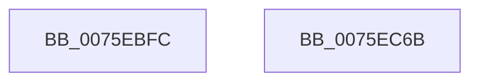

# PopResumeApps

- RVA: `0x0075EBFC`–`0x0075EC6C` (길이 `112` bytes)
- VA: `0x000000014075EBFC`
- 실행 섹션: `PAGE`
- PDB 이름 있음: `예`; PDB Function 태그: `아니요`
- unwind 정보 RVA: `0x0005CF00`
- 디코드: `26`개 명령, `112/112` bytes 표시
- 미해석 바이트: `0` (있으면 어셈블리에 `.byte`로 보존)

> 이 문서는 커널 이미지의 기계어와 PDB 기호를 분석해 생성했습니다. 4번과 5번은 함수 원형과 자료형을 바이너리 사용 방식에서 추정한 C 해석이며 원본 소스 복구 결과는 아닙니다.

## 1. Dependencies

- 직접 호출 지점: **7**; 고유 호출 대상: **4**
- 직접 호출자로 확인된 함수: **1**
- RIP 상대 이미지 참조: **5**

### Outgoing calls
- `0x0075EC15` → [KeQueryPerformanceCounter](../../text/37/KeQueryPerformanceCounter_function_0037E7E0.md) (function, `0x0037E7E0`)
- `0x0075EC28` → [PopDiagTraceEventNoPayload](../../text/49/PopDiagTraceEventNoPayload_function_004982F8.md) (function, `0x004982F8`)
- `0x0075EC32` → [PopCheckpointSystemSleep](../../pagelk/B7/PopCheckpointSystemSleep_function_00B77C90.md) (function, `0x00B77C90`)
- `0x0075EC3C` → [PopDispatchStateCallout](../91/PopDispatchStateCallout_function_0091248C.md) (function, `0x0091248C`)
- `0x0075EC43` → [KeQueryPerformanceCounter](../../text/37/KeQueryPerformanceCounter_function_0037E7E0.md) (function, `0x0037E7E0`)
- `0x0075EC56` → [PopDiagTraceEventNoPayload](../../text/49/PopDiagTraceEventNoPayload_function_004982F8.md) (function, `0x004982F8`)
- `0x0075EC60` → [PopCheckpointSystemSleep](../../pagelk/B7/PopCheckpointSystemSleep_function_00B77C90.md) (function, `0x00B77C90`)

### Direct callers
- [PopIssueActionRequest](../A9/PopIssueActionRequest_function_00A9CE54.md) at `0x00A9D1CB`

### Static image references
- `0x0075EC02` → RVA `0x00E67A55` (`.data`; write)
- `0x0075EC1A` → RVA `0x000220C0` (`.rdata`; read)
- `0x0075EC21` → RVA `0x00F0C350` (`.data`; write)
- `0x0075EC48` → RVA `0x00022008` (`.rdata`; read)
- `0x0075EC4F` → RVA `0x00F0C358` (`.data`; write)

## 2. Other-region calls and transfers

- 다른 실행 섹션으로 향하는 call: **6**
  - `0x0075EC15` → [KeQueryPerformanceCounter](../../text/37/KeQueryPerformanceCounter_function_0037E7E0.md) (`PAGE` → `.text`)
  - `0x0075EC28` → [PopDiagTraceEventNoPayload](../../text/49/PopDiagTraceEventNoPayload_function_004982F8.md) (`PAGE` → `.text`)
  - `0x0075EC32` → [PopCheckpointSystemSleep](../../pagelk/B7/PopCheckpointSystemSleep_function_00B77C90.md) (`PAGE` → `PAGELK`)
  - `0x0075EC43` → [KeQueryPerformanceCounter](../../text/37/KeQueryPerformanceCounter_function_0037E7E0.md) (`PAGE` → `.text`)
  - `0x0075EC56` → [PopDiagTraceEventNoPayload](../../text/49/PopDiagTraceEventNoPayload_function_004982F8.md) (`PAGE` → `.text`)
  - `0x0075EC60` → [PopCheckpointSystemSleep](../../pagelk/B7/PopCheckpointSystemSleep_function_00B77C90.md) (`PAGE` → `PAGELK`)
- 별도 외부 분기/꼬리 이동을 확인하지 못했습니다.

## 3. Assembly (complete function range)

```asm
0075EBFC  40 53                           push rbx
0075EBFE  48 83 EC 20                     sub rsp, 0x20
0075EC02  C6 05 4C 8E 70 00 00            mov byte ptr [rip + 0x708e4c], 0
0075EC09  48 8B D9                        mov rbx, rcx
0075EC0C  C7 41 20 05 00 00 00            mov dword ptr [rcx + 0x20], 5
0075EC13  33 C9                           xor ecx, ecx
0075EC15  E8 C6 FB C1 FF                  call 0x14037e7e0
0075EC1A  48 8D 0D 9F 34 8C FF            lea rcx, [rip - 0x73cb61]
0075EC21  48 89 05 28 D7 7A 00            mov qword ptr [rip + 0x7ad728], rax
0075EC28  E8 CB 96 D3 FF                  call 0x1404982f8
0075EC2D  B9 25 00 00 00                  mov ecx, 0x25
0075EC32  E8 59 90 41 00                  call 0x140b77c90
0075EC37  33 D2                           xor edx, edx
0075EC39  48 8B CB                        mov rcx, rbx
0075EC3C  E8 4B 38 1B 00                  call 0x14091248c
0075EC41  33 C9                           xor ecx, ecx
0075EC43  E8 98 FB C1 FF                  call 0x14037e7e0
0075EC48  48 8D 0D B9 33 8C FF            lea rcx, [rip - 0x73cc47]
0075EC4F  48 89 05 02 D7 7A 00            mov qword ptr [rip + 0x7ad702], rax
0075EC56  E8 9D 96 D3 FF                  call 0x1404982f8
0075EC5B  B9 26 00 00 00                  mov ecx, 0x26
0075EC60  E8 2B 90 41 00                  call 0x140b77c90
0075EC65  48 83 C4 20                     add rsp, 0x20
0075EC69  5B                              pop rbx
0075EC6A  C3                              ret
0075EC6B  CC                              int3
```

## 4. C-style interpretation (structured pseudocode)

```c
__int64 __fastcall PopResumeApps(__int64 a1, int a2)
{
    __int64 result;
    __int64 v_rsp;

    v_rsp = (v_rsp) - (32);
    *(unsigned __int8 *)(v_rip + 7376460) = 0;
    *(unsigned int *)(a1 + 32) = 5;
    a1 = 0;
    result = KeQueryPerformanceCounter(a1, a2, a3, a4);
    *(unsigned __int64 *)(v_rip + 8050472) = result;
    result = PopDiagTraceEventNoPayload(v_rip - 7588705, a2, a3, a4);
    result = PopCheckpointSystemSleep(37, a2, a3, a4);
    a2 = 0;
    result = PopDispatchStateCallout(0, a2, a3, a4);
    a1 = 0;
    result = KeQueryPerformanceCounter(a1, a2, a3, a4);
    *(unsigned __int64 *)(v_rip + 8050434) = result;
    result = PopDiagTraceEventNoPayload(v_rip - 7588935, a2, a3, a4);
    result = PopCheckpointSystemSleep(38, a2, a3, a4);
    v_rsp = (v_rsp) + (32);
    return result;
}
```

## 5. (Beta) C Style

```c
int64_t PopResumeApps(void *Arg1, int32_t Arg2)
{
    uint8_t *arg1 = (uint8_t *)Arg1;

    int64_t result;
    int64_t local_rsp;

    local_rsp = (local_rsp) - (32);
    *(uint8_t *)(v_rip + 0x708E4C) = 0;
    *(uint32_t *)(arg1 + 0x20) = 5;
    Arg1 = 0;
    result = KeQueryPerformanceCounter(Arg1, Arg2, a3, a4);
    *(uint64_t *)(v_rip + 0x7AD728) = result;
    result = PopDiagTraceEventNoPayload(v_rip - 7588705, Arg2, a3, a4);
    result = PopCheckpointSystemSleep(37, Arg2, a3, a4);
    Arg2 = 0;
    result = PopDispatchStateCallout(0, Arg2, a3, a4);
    Arg1 = 0;
    result = KeQueryPerformanceCounter(Arg1, Arg2, a3, a4);
    *(uint64_t *)(v_rip + 0x7AD702) = result;
    result = PopDiagTraceEventNoPayload(v_rip - 7588935, Arg2, a3, a4);
    result = PopCheckpointSystemSleep(38, Arg2, a3, a4);
    local_rsp = (local_rsp) + (32);
    return result;
}
```

### 관측된 메모리 오프셋

구조체 형식이 확인되지 않은 접근은 인자 기준의 오프셋으로만 기록했습니다.

| 기준 인자 | 오프셋 표현 | 폭 (bit) | 접근 |
|---|---:|---:|---|
| `Arg1` | `+ 0x20` | `32` | `W` |

## 6. Execution-region graph

[열기: 2D/3D 그래프와 함수 탐색 컨트롤 패널](../../../control-panel.html?section=page&rva=0x0075EBFC&view=graph)

- 2D 그래프는 위에서 아래로 흐르고, 3D 그래프는 빈 공간을 드래그해 회전합니다. Shift+드래그는 이동, 휠은 확대·축소, 함수 노드 선택은 대상 보고서 이동입니다.

### Static fallback


