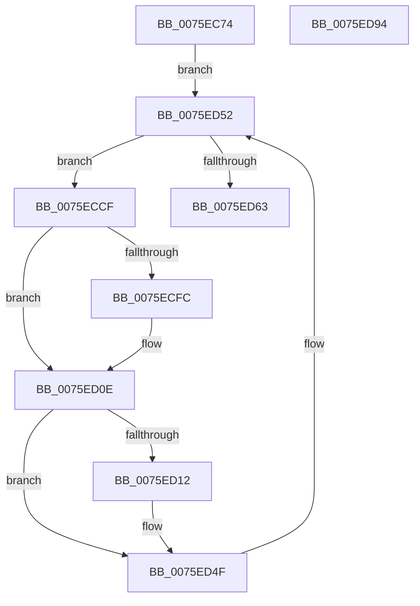

# PopSendSuspendResumeApplicationNotification

- RVA: `0x0075EC74`–`0x0075ED95` (길이 `289` bytes)
- VA: `0x000000014075EC74`
- 실행 섹션: `PAGE`
- PDB 이름 있음: `예`; PDB Function 태그: `아니요`
- unwind 정보 RVA: `0x000CC55C`
- 디코드: `81`개 명령, `289/289` bytes 표시
- 미해석 바이트: `0` (있으면 어셈블리에 `.byte`로 보존)

> 이 문서는 커널 이미지의 기계어와 PDB 기호를 분석해 생성했습니다. 4번과 5번은 함수 원형과 자료형을 바이너리 사용 방식에서 추정한 C 해석이며 원본 소스 복구 결과는 아닙니다.

## 1. Dependencies

- 직접 호출 지점: **8**; 고유 호출 대상: **6**
- 직접 호출자로 확인된 함수: **1**
- RIP 상대 이미지 참조: **1**

### Outgoing calls
- `0x0075ECC3` → [PopDiagTraceSuspendResumeNotification](../76/PopDiagTraceSuspendResumeNotification_function_0076361C.md) (function, `0x0076361C`)
- `0x0075ECD2` → [PsGetProcessSessionId](../../text/22/PsGetProcessSessionId_function_002233A0.md) (function, `0x002233A0`)
- `0x0075ECF0` → [PopSuspendResumeInvocation](../AA/PopSuspendResumeInvocation_function_00AAE544.md) (function, `0x00AAE544`)
- `0x0075ED07` → [PopSuspendResumeInvocation](../AA/PopSuspendResumeInvocation_function_00AAE544.md) (function, `0x00AAE544`)
- `0x0075ED48` → [PopDispatchStateCallout](../91/PopDispatchStateCallout_function_0091248C.md) (function, `0x0091248C`)
- `0x0075ED52` → [PsGetNextSession](../91/PsGetNextSession_function_009128C0.md) (function, `0x009128C0`)
- `0x0075ED6B` → [PopDiagTraceSuspendResumeNotification](../76/PopDiagTraceSuspendResumeNotification_function_0076361C.md) (function, `0x0076361C`)
- `0x0075ED79` → [_security_check_cookie](../../text/6A/_security_check_cookie_function_006AC640.md) (function, `0x006AC640`)

### Direct callers
- [PopSendSuspendResumeNotifications](../AD/PopSendSuspendResumeNotifications_function_00AD425C.md) at `0x00AD42DF`
- [PopSendSuspendResumeNotifications](../AD/PopSendSuspendResumeNotifications_function_00AD425C.md) at `0x00AD42F7`

### Static image references
- `0x0075EC8B` → RVA `0x00E0A740` (`.data`; read)

## 2. Other-region calls and transfers

- 다른 실행 섹션으로 향하는 call: **2**
  - `0x0075ECD2` → [PsGetProcessSessionId](../../text/22/PsGetProcessSessionId_function_002233A0.md) (`PAGE` → `.text`)
  - `0x0075ED79` → [_security_check_cookie](../../text/6A/_security_check_cookie_function_006AC640.md) (`PAGE` → `.text`)
- 별도 외부 분기/꼬리 이동을 확인하지 못했습니다.

## 3. Assembly (complete function range)

```asm
0075EC74  48 89 5C 24 08                  mov qword ptr [rsp + 8], rbx
0075EC79  48 89 74 24 10                  mov qword ptr [rsp + 0x10], rsi
0075EC7E  48 89 7C 24 18                  mov qword ptr [rsp + 0x18], rdi
0075EC83  55                              push rbp
0075EC84  48 8B EC                        mov rbp, rsp
0075EC87  48 83 EC 70                     sub rsp, 0x70
0075EC8B  48 8B 05 AE BA 6A 00            mov rax, qword ptr [rip + 0x6abaae]
0075EC92  48 33 C4                        xor rax, rsp
0075EC95  48 89 45 F8                     mov qword ptr [rbp - 8], rax
0075EC99  83 65 B0 00                     and dword ptr [rbp - 0x50], 0
0075EC9D  33 C0                           xor eax, eax
0075EC9F  0F 57 C9                        xorps xmm1, xmm1
0075ECA2  89 45 F0                        mov dword ptr [rbp - 0x10], eax
0075ECA5  41 B0 01                        mov r8b, 1
0075ECA8  48 89 45 D8                     mov qword ptr [rbp - 0x28], rax
0075ECAC  0F 57 C0                        xorps xmm0, xmm0
0075ECAF  41 8A D0                        mov dl, r8b
0075ECB2  40 8A F1                        mov sil, cl
0075ECB5  33 DB                           xor ebx, ebx
0075ECB7  0F 11 45 E0                     movups xmmword ptr [rbp - 0x20], xmm0
0075ECBB  0F 11 4D B8                     movups xmmword ptr [rbp - 0x48], xmm1
0075ECBF  0F 11 4D C8                     movups xmmword ptr [rbp - 0x38], xmm1
0075ECC3  E8 54 49 00 00                  call 0x14076361c
0075ECC8  33 C9                           xor ecx, ecx
0075ECCA  E9 83 00 00 00                  jmp 0x14075ed52
0075ECCF  48 8B CF                        mov rcx, rdi
0075ECD2  E8 C9 46 AC FF                  call 0x1402233a0
0075ECD7  83 65 E8 00                     and dword ptr [rbp - 0x18], 0
0075ECDB  48 8D 4D E0                     lea rcx, [rbp - 0x20]
0075ECDF  89 45 B0                        mov dword ptr [rbp - 0x50], eax
0075ECE2  89 45 F0                        mov dword ptr [rbp - 0x10], eax
0075ECE5  33 C0                           xor eax, eax
0075ECE7  40 84 F6                        test sil, sil
0075ECEA  0F 94 C0                        sete al
0075ECED  89 45 EC                        mov dword ptr [rbp - 0x14], eax
0075ECF0  E8 4F F8 34 00                  call 0x140aae544
0075ECF5  8B D8                           mov ebx, eax
0075ECF7  40 84 F6                        test sil, sil
0075ECFA  75 12                           jne 0x14075ed0e
0075ECFC  48 8D 4D E0                     lea rcx, [rbp - 0x20]
0075ED00  C7 45 EC 02 00 00 00            mov dword ptr [rbp - 0x14], 2
0075ED07  E8 38 F8 34 00                  call 0x140aae544
0075ED0C  8B D8                           mov ebx, eax
0075ED0E  85 DB                           test ebx, ebx
0075ED10  75 3D                           jne 0x14075ed4f
0075ED12  40 8A C6                        mov al, sil
0075ED15  88 5D C8                        mov byte ptr [rbp - 0x38], bl
0075ED18  F6 D8                           neg al
0075ED1A  C7 45 CC 02 00 00 00            mov dword ptr [rbp - 0x34], 2
0075ED21  48 8D 55 B0                     lea rdx, [rbp - 0x50]
0075ED25  C7 45 D4 00 00 00 80            mov dword ptr [rbp - 0x2c], 0x80000000
0075ED2C  1B C9                           sbb ecx, ecx
0075ED2E  C7 45 DC 14 00 00 00            mov dword ptr [rbp - 0x24], 0x14
0075ED35  83 E1 04                        and ecx, 4
0075ED38  C7 45 D8 0E 00 00 00            mov dword ptr [rbp - 0x28], 0xe
0075ED3F  FF C1                           inc ecx
0075ED41  89 4D D0                        mov dword ptr [rbp - 0x30], ecx
0075ED44  48 8D 4D B8                     lea rcx, [rbp - 0x48]
0075ED48  E8 3F 37 1B 00                  call 0x14091248c
0075ED4D  8B D8                           mov ebx, eax
0075ED4F  48 8B CF                        mov rcx, rdi
0075ED52  E8 69 3B 1B 00                  call 0x1409128c0
0075ED57  48 8B F8                        mov rdi, rax
0075ED5A  48 85 C0                        test rax, rax
0075ED5D  0F 85 6C FF FF FF               jne 0x14075eccf
0075ED63  45 33 C0                        xor r8d, r8d
0075ED66  B2 01                           mov dl, 1
0075ED68  40 8A CE                        mov cl, sil
0075ED6B  E8 AC 48 00 00                  call 0x14076361c
0075ED70  8B C3                           mov eax, ebx
0075ED72  48 8B 4D F8                     mov rcx, qword ptr [rbp - 8]
0075ED76  48 33 CC                        xor rcx, rsp
0075ED79  E8 C2 D8 F4 FF                  call 0x1406ac640
0075ED7E  4C 8D 5C 24 70                  lea r11, [rsp + 0x70]
0075ED83  49 8B 5B 10                     mov rbx, qword ptr [r11 + 0x10]
0075ED87  49 8B 73 18                     mov rsi, qword ptr [r11 + 0x18]
0075ED8B  49 8B 7B 20                     mov rdi, qword ptr [r11 + 0x20]
0075ED8F  49 8B E3                        mov rsp, r11
0075ED92  5D                              pop rbp
0075ED93  C3                              ret
0075ED94  CC                              int3
```

## 4. C-style interpretation (structured pseudocode)

```c
__int64 __fastcall PopSendSuspendResumeApplicationNotification(int a1)
{
    __int64 result;
    __int64 v_rbx;
    __int64 v_rsp;
    unsigned __int64 v_stack_m10;
    unsigned int v_stack_m18;
    unsigned int v_stack_m1C;
    unsigned int v_stack_m20;
    unsigned __int64 v_stack_m28;
    unsigned int v_stack_m2C;
    unsigned __int64 v_stack_m30;
    unsigned int v_stack_m34;
    unsigned int v_stack_m38;
    unsigned int v_stack_m3C;
    unsigned __int64 v_stack_m40;
    unsigned __int64 v_stack_m50;
    unsigned int v_stack_m58;
    unsigned __int64 v_stack_m8;
    unsigned __int64 v_stack_p10;
    unsigned __int64 v_stack_p18;
    unsigned __int64 v_stack_p8;

    v_stack_p8 = v_rbx;
    v_stack_p10 = v_rsi;
    v_stack_p18 = v_rdi;
    v_rsp = (v_rsp) - (112);
    result = (*(unsigned __int64 *)(v_rip + 6994606)) ^ (v_rsp);
    v_stack_m10 = result;
    result = 0;
    v_stack_m18 = 0;
    v_stack_m30 = 0;
    v_rbx = 0;
    v_stack_m28 = v_xmm0;
    v_stack_m50 = v_xmm1;
    v_stack_m40 = v_xmm1;
    result = PopDiagTraceSuspendResumeNotification(a1, 1, 1, a4);
    a1 = 0;
    goto loc_0075ED52;
loc_0075ECCF:
    result = PsGetProcessSessionId(v_rdi, 1, 1, a4);
    v_stack_m58 = (unsigned int)(result);
    v_stack_m18 = (unsigned int)(result);
    result = 0;
    result = ((unsigned __int8)((unsigned __int8)(a1)) == 0) ? 1 : 0;
    v_stack_m1C = (unsigned int)(result);
    result = PopSuspendResumeInvocation(v_stack_m28, 1, 1, a4);
    v_rbx = (unsigned int)((unsigned int)(result));
    if ((unsigned __int8)((unsigned __int8)(a1)) == 0) {
        a1 = v_stack_m28;
        v_stack_m1C = 2;
        result = PopSuspendResumeInvocation(a1, 1, 1, a4);
        v_rbx = (unsigned int)(result);
    }
    if ((unsigned int)(v_rbx) == 0) {
        result = (unsigned __int8)((unsigned __int8)(a1));
        v_stack_m40 = (unsigned __int8)(v_rbx);
        result = (unsigned __int8)(-(result));
        v_stack_m3C = 2;
        a2 = v_stack_m58;
        v_stack_m34 = 0x80000000ULL;
        v_stack_m2C = 20;
        a1 = (unsigned int)((a1) & (4));
        v_stack_m30 = 14;
        a1 = (unsigned int)((a1) + 1);
        v_stack_m38 = a1;
        a1 = v_stack_m50;
        result = PopDispatchStateCallout(a1, a2, 1, a4);
        v_rbx = (unsigned int)(result);
    }
loc_0075ED52:
    result = PsGetNextSession(v_rdi, a2, 1, a4);
    if (result != 0) goto loc_0075ECCF;
    a3 = 0;
    result = PopDiagTraceSuspendResumeNotification((unsigned __int8)((unsigned __int8)(a1)), 1, a3, a4);
    a1 = (v_stack_m10) ^ (v_rsp);
    result = _security_check_cookie(a1, 1, a3, a4);
    return result;
}
```

## 5. (Beta) C Style

```c
int64_t PopSendSuspendResumeApplicationNotification(int32_t Arg1)
{
    int64_t result;
    int64_t local_rbx;
    int64_t local_rsp;
    uint64_t v_stack_m10;
    uint32_t v_stack_m18;
    uint32_t v_stack_m1C;
    uint32_t v_stack_m20;
    uint64_t v_stack_m28;
    uint32_t v_stack_m2C;
    uint64_t v_stack_m30;
    uint32_t v_stack_m34;
    uint32_t v_stack_m38;
    uint32_t v_stack_m3C;
    uint64_t v_stack_m40;
    uint64_t v_stack_m50;
    uint32_t v_stack_m58;
    uint64_t v_stack_m8;
    uint64_t v_stack_p10;
    uint64_t v_stack_p18;
    uint64_t v_stack_p8;

    v_stack_p8 = local_rbx;
    v_stack_p10 = local_rsi;
    v_stack_p18 = local_rdi;
    local_rsp = (local_rsp) - (112);
    result = (*(uint64_t *)(v_rip + 0x6ABAAE)) ^ (local_rsp);
    v_stack_m10 = result;
    result = 0;
    v_stack_m18 = 0;
    v_stack_m30 = 0;
    local_rbx = 0;
    v_stack_m28 = v_xmm0;
    v_stack_m50 = v_xmm1;
    v_stack_m40 = v_xmm1;
    result = PopDiagTraceSuspendResumeNotification(Arg1, 1, 1, a4);
    Arg1 = 0;
    goto loc_0075ED52;
loc_0075ECCF:
    result = PsGetProcessSessionId(local_rdi, 1, 1, a4);
    v_stack_m58 = (uint32_t)(result);
    v_stack_m18 = (uint32_t)(result);
    result = 0;
    result = ((uint8_t)((uint8_t)(Arg1)) == 0) ? 1 : 0;
    v_stack_m1C = (uint32_t)(result);
    result = PopSuspendResumeInvocation(v_stack_m28, 1, 1, a4);
    local_rbx = (uint32_t)((uint32_t)(result));
    if ((uint8_t)((uint8_t)(Arg1)) == 0) {
        Arg1 = v_stack_m28;
        v_stack_m1C = 2;
        result = PopSuspendResumeInvocation(Arg1, 1, 1, a4);
        local_rbx = (uint32_t)(result);
    }
    if ((uint32_t)(local_rbx) == 0) {
        result = (uint8_t)((uint8_t)(Arg1));
        v_stack_m40 = (uint8_t)(local_rbx);
        result = (uint8_t)(-(result));
        v_stack_m3C = 2;
        a2 = v_stack_m58;
        v_stack_m34 = 0x80000000ULL;
        v_stack_m2C = 20;
        Arg1 = (uint32_t)((Arg1) & (4));
        v_stack_m30 = 14;
        Arg1 = (uint32_t)((Arg1) + 1);
        v_stack_m38 = Arg1;
        Arg1 = v_stack_m50;
        result = PopDispatchStateCallout(Arg1, a2, 1, a4);
        local_rbx = (uint32_t)(result);
    }
loc_0075ED52:
    result = PsGetNextSession(local_rdi, a2, 1, a4);
    if (result != 0) goto loc_0075ECCF;
    a3 = 0;
    result = PopDiagTraceSuspendResumeNotification((uint8_t)((uint8_t)(Arg1)), 1, a3, a4);
    Arg1 = (v_stack_m10) ^ (local_rsp);
    result = _security_check_cookie(Arg1, 1, a3, a4);
    return result;
}
```

## 6. Execution-region graph

[열기: 2D/3D 그래프와 함수 탐색 컨트롤 패널](../../../control-panel.html?section=page&rva=0x0075EC74&view=graph)

- 2D 그래프는 위에서 아래로 흐르고, 3D 그래프는 빈 공간을 드래그해 회전합니다. Shift+드래그는 이동, 휠은 확대·축소, 함수 노드 선택은 대상 보고서 이동입니다.

### Static fallback


