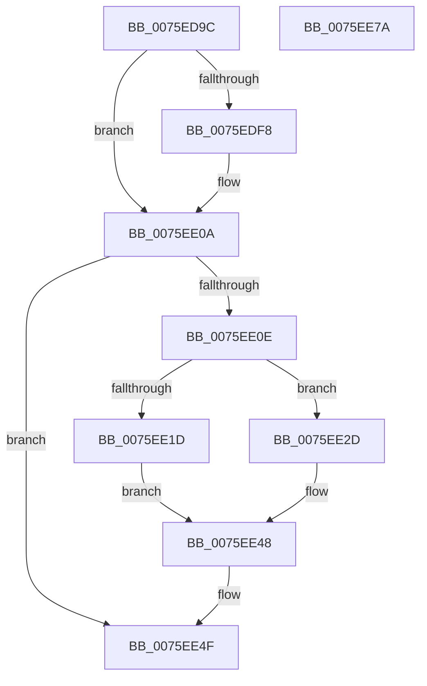

# PopSendSuspendResumeServiceNotification

- RVA: `0x0075ED9C`–`0x0075EE7B` (길이 `223` bytes)
- VA: `0x000000014075ED9C`
- 실행 섹션: `PAGE`
- PDB 이름 있음: `예`; PDB Function 태그: `아니요`
- unwind 정보 RVA: `0x000C48CC`
- 디코드: `60`개 명령, `223/223` bytes 표시
- 미해석 바이트: `0` (있으면 어셈블리에 `.byte`로 보존)

> 이 문서는 커널 이미지의 기계어와 PDB 기호를 분석해 생성했습니다. 4번과 5번은 함수 원형과 자료형을 바이너리 사용 방식에서 추정한 C 해석이며 원본 소스 복구 결과는 아닙니다.

## 1. Dependencies

- 직접 호출 지점: **7**; 고유 호출 대상: **4**
- 직접 호출자로 확인된 함수: **1**
- RIP 상대 이미지 참조: **1**

### Outgoing calls
- `0x0075EDD0` → [PopDiagTraceSuspendResumeNotification](../76/PopDiagTraceSuspendResumeNotification_function_0076361C.md) (function, `0x0076361C`)
- `0x0075EDEC` → [PopSuspendResumeInvocation](../AA/PopSuspendResumeInvocation_function_00AAE544.md) (function, `0x00AAE544`)
- `0x0075EE03` → [PopSuspendResumeInvocation](../AA/PopSuspendResumeInvocation_function_00AAE544.md) (function, `0x00AAE544`)
- `0x0075EE38` → [PopUmpoSendLegacyEvent](../AA/PopUmpoSendLegacyEvent_function_00AA48E8.md) (function, `0x00AA48E8`)
- `0x0075EE48` → [PopUmpoSendLegacyEvent](../AA/PopUmpoSendLegacyEvent_function_00AA48E8.md) (function, `0x00AA48E8`)
- `0x0075EE57` → [PopDiagTraceSuspendResumeNotification](../76/PopDiagTraceSuspendResumeNotification_function_0076361C.md) (function, `0x0076361C`)
- `0x0075EE65` → [_security_check_cookie](../../text/6A/_security_check_cookie_function_006AC640.md) (function, `0x006AC640`)

### Direct callers
- [PopSendSuspendResumeNotifications](../AD/PopSendSuspendResumeNotifications_function_00AD425C.md) at `0x00AD42E7`
- [PopSendSuspendResumeNotifications](../AD/PopSendSuspendResumeNotifications_function_00AD425C.md) at `0x00AD42F0`

### Static image references
- `0x0075EDAE` → RVA `0x00E0A740` (`.data`; read)

## 2. Other-region calls and transfers

- 다른 실행 섹션으로 향하는 call: **1**
  - `0x0075EE65` → [_security_check_cookie](../../text/6A/_security_check_cookie_function_006AC640.md) (`PAGE` → `.text`)
- 별도 외부 분기/꼬리 이동을 확인하지 못했습니다.

## 3. Assembly (complete function range)

```asm
0075ED9C  48 89 5C 24 08                  mov qword ptr [rsp + 8], rbx
0075EDA1  48 89 7C 24 10                  mov qword ptr [rsp + 0x10], rdi
0075EDA6  55                              push rbp
0075EDA7  48 8B EC                        mov rbp, rsp
0075EDAA  48 83 EC 50                     sub rsp, 0x50
0075EDAE  48 8B 05 8B B9 6A 00            mov rax, qword ptr [rip + 0x6ab98b]
0075EDB5  48 33 C4                        xor rax, rsp
0075EDB8  48 89 45 F8                     mov qword ptr [rbp - 8], rax
0075EDBC  48 83 65 E0 00                  and qword ptr [rbp - 0x20], 0
0075EDC1  0F 57 C0                        xorps xmm0, xmm0
0075EDC4  41 B0 01                        mov r8b, 1
0075EDC7  33 D2                           xor edx, edx
0075EDC9  0F 11 45 D0                     movups xmmword ptr [rbp - 0x30], xmm0
0075EDCD  40 8A F9                        mov dil, cl
0075EDD0  E8 47 48 00 00                  call 0x14076361c
0075EDD5  83 65 E8 00                     and dword ptr [rbp - 0x18], 0
0075EDD9  48 8D 4D E0                     lea rcx, [rbp - 0x20]
0075EDDD  83 65 F0 00                     and dword ptr [rbp - 0x10], 0
0075EDE1  33 C0                           xor eax, eax
0075EDE3  40 84 FF                        test dil, dil
0075EDE6  0F 94 C0                        sete al
0075EDE9  89 45 EC                        mov dword ptr [rbp - 0x14], eax
0075EDEC  E8 53 F7 34 00                  call 0x140aae544
0075EDF1  8B D8                           mov ebx, eax
0075EDF3  40 84 FF                        test dil, dil
0075EDF6  75 12                           jne 0x14075ee0a
0075EDF8  48 8D 4D E0                     lea rcx, [rbp - 0x20]
0075EDFC  C7 45 EC 02 00 00 00            mov dword ptr [rbp - 0x14], 2
0075EE03  E8 3C F7 34 00                  call 0x140aae544
0075EE08  8B D8                           mov ebx, eax
0075EE0A  85 DB                           test ebx, ebx
0075EE0C  75 41                           jne 0x14075ee4f
0075EE0E  66 C7 45 DC 00 01               mov word ptr [rbp - 0x24], 0x100
0075EE14  48 8D 4D D0                     lea rcx, [rbp - 0x30]
0075EE18  40 84 FF                        test dil, dil
0075EE1B  74 10                           je 0x14075ee2d
0075EE1D  C7 45 D0 03 00 00 00            mov dword ptr [rbp - 0x30], 3
0075EE24  C7 45 D4 04 00 00 00            mov dword ptr [rbp - 0x2c], 4
0075EE2B  EB 1B                           jmp 0x14075ee48
0075EE2D  83 65 D0 00                     and dword ptr [rbp - 0x30], 0
0075EE31  C7 45 D4 12 00 00 00            mov dword ptr [rbp - 0x2c], 0x12
0075EE38  E8 AB 5A 34 00                  call 0x140aa48e8
0075EE3D  48 8D 4D D0                     lea rcx, [rbp - 0x30]
0075EE41  C7 45 D4 07 00 00 00            mov dword ptr [rbp - 0x2c], 7
0075EE48  E8 9B 5A 34 00                  call 0x140aa48e8
0075EE4D  8B D8                           mov ebx, eax
0075EE4F  45 33 C0                        xor r8d, r8d
0075EE52  33 D2                           xor edx, edx
0075EE54  40 8A CF                        mov cl, dil
0075EE57  E8 C0 47 00 00                  call 0x14076361c
0075EE5C  8B C3                           mov eax, ebx
0075EE5E  48 8B 4D F8                     mov rcx, qword ptr [rbp - 8]
0075EE62  48 33 CC                        xor rcx, rsp
0075EE65  E8 D6 D7 F4 FF                  call 0x1406ac640
0075EE6A  48 8B 5C 24 60                  mov rbx, qword ptr [rsp + 0x60]
0075EE6F  48 8B 7C 24 68                  mov rdi, qword ptr [rsp + 0x68]
0075EE74  48 83 C4 50                     add rsp, 0x50
0075EE78  5D                              pop rbp
0075EE79  C3                              ret
0075EE7A  CC                              int3
```

## 4. C-style interpretation (structured pseudocode)

```c
__int64 __fastcall PopSendSuspendResumeServiceNotification(unsigned __int8 a1, int a2)
{
    __int64 result;
    __int64 v_rbx;
    __int64 v_rsp;
    unsigned __int64 v_stack_m10;
    unsigned int v_stack_m18;
    unsigned int v_stack_m1C;
    unsigned int v_stack_m20;
    unsigned __int64 v_stack_m28;
    unsigned __int16 v_stack_m2C;
    unsigned int v_stack_m34;
    unsigned __int64 v_stack_m38;
    unsigned __int64 v_stack_p10;
    unsigned __int64 v_stack_p8;

    v_stack_p8 = v_rbx;
    v_stack_p10 = v_rdi;
    v_rsp = (v_rsp) - (80);
    result = (*(unsigned __int64 *)(v_rip + 6994315)) ^ (v_rsp);
    v_stack_m10 = result;
    a2 = 0;
    v_stack_m38 = v_xmm0;
    result = PopDiagTraceSuspendResumeNotification(a1, a2, 1, a4);
    result = 0;
    result = (a1 == 0) ? 1 : 0;
    v_stack_m1C = (unsigned int)(result);
    result = PopSuspendResumeInvocation(v_stack_m28, a2, 1, a4);
    v_rbx = (unsigned int)((unsigned int)(result));
    if (a1 == 0) {
        a1 = v_stack_m28;
        v_stack_m1C = 2;
        result = PopSuspendResumeInvocation(a1, a2, 1, a4);
        v_rbx = (unsigned int)(result);
    }
    if ((unsigned int)(v_rbx) != 0) goto loc_0075EE4F;
    v_stack_m2C = 256;
    if (a1 == 0) goto loc_0075EE2D;
    v_stack_m38 = 3;
    v_stack_m34 = 4;
    goto loc_0075EE48;
loc_0075EE2D:
    v_stack_m34 = 18;
    result = PopUmpoSendLegacyEvent(v_stack_m38, a2, 1, a4);
    v_stack_m34 = 7;
loc_0075EE48:
    result = PopUmpoSendLegacyEvent(v_stack_m38, a2, 1, a4);
loc_0075EE4F:
    a3 = 0;
    a2 = 0;
    result = PopDiagTraceSuspendResumeNotification(a1, a2, a3, a4);
    a1 = (v_stack_m10) ^ (v_rsp);
    result = _security_check_cookie(a1, a2, a3, a4);
    v_rsp = (v_rsp) + (80);
    return result;
}
```

## 5. (Beta) C Style

```c
int64_t PopSendSuspendResumeServiceNotification(uint8_t Arg1, int32_t Arg2)
{
    int64_t result;
    int64_t local_rbx;
    int64_t local_rsp;
    uint64_t v_stack_m10;
    uint32_t v_stack_m18;
    uint32_t v_stack_m1C;
    uint32_t v_stack_m20;
    uint64_t v_stack_m28;
    uint16_t v_stack_m2C;
    uint32_t v_stack_m34;
    uint64_t v_stack_m38;
    uint64_t v_stack_p10;
    uint64_t v_stack_p8;

    v_stack_p8 = local_rbx;
    v_stack_p10 = local_rdi;
    local_rsp = (local_rsp) - (80);
    result = (*(uint64_t *)(v_rip + 0x6AB98B)) ^ (local_rsp);
    v_stack_m10 = result;
    Arg2 = 0;
    v_stack_m38 = v_xmm0;
    result = PopDiagTraceSuspendResumeNotification(Arg1, Arg2, 1, a4);
    result = 0;
    result = (Arg1 == 0) ? 1 : 0;
    v_stack_m1C = (uint32_t)(result);
    result = PopSuspendResumeInvocation(v_stack_m28, Arg2, 1, a4);
    local_rbx = (uint32_t)((uint32_t)(result));
    if (Arg1 == 0) {
        Arg1 = v_stack_m28;
        v_stack_m1C = 2;
        result = PopSuspendResumeInvocation(Arg1, Arg2, 1, a4);
        local_rbx = (uint32_t)(result);
    }
    if ((uint32_t)(local_rbx) != 0) goto loc_0075EE4F;
    v_stack_m2C = 256;
    if (Arg1 == 0) goto loc_0075EE2D;
    v_stack_m38 = 3;
    v_stack_m34 = 4;
    goto loc_0075EE48;
loc_0075EE2D:
    v_stack_m34 = 18;
    result = PopUmpoSendLegacyEvent(v_stack_m38, Arg2, 1, a4);
    v_stack_m34 = 7;
loc_0075EE48:
    result = PopUmpoSendLegacyEvent(v_stack_m38, Arg2, 1, a4);
loc_0075EE4F:
    a3 = 0;
    Arg2 = 0;
    result = PopDiagTraceSuspendResumeNotification(Arg1, Arg2, a3, a4);
    Arg1 = (v_stack_m10) ^ (local_rsp);
    result = _security_check_cookie(Arg1, Arg2, a3, a4);
    local_rsp = (local_rsp) + (80);
    return result;
}
```

## 6. Execution-region graph

[열기: 2D/3D 그래프와 함수 탐색 컨트롤 패널](../../../control-panel.html?section=page&rva=0x0075ED9C&view=graph)

- 2D 그래프는 위에서 아래로 흐르고, 3D 그래프는 빈 공간을 드래그해 회전합니다. Shift+드래그는 이동, 휠은 확대·축소, 함수 노드 선택은 대상 보고서 이동입니다.

### Static fallback


